> **Current research-first review (2026-11-02):** Start with [the research worklog](docs/research/WORKLOG.md), [published evidence](docs/research/EVIDENCE_REVIEW.md), [dataset suitability](docs/research/DATA_SUITABILITY.md), and [technical decisions](docs/research/TECHNICAL_DECISIONS.md). Model selection and financial claims remain open. The content below includes legacy project history.

# AGQO — Hướng dẫn đọc dự án từ bài toán đến kết quả

> **Nghiên cứu và tiến độ mới nhất:** [paper LLM sinh mạch + portfolio](docs/LLM_QUANTUM_FINANCE_LITERATURE.md), [tiến độ thực tế](docs/PROJECT_STATUS.md), [đặc tả kết quả](docs/RESULTS_SPEC.md). QGAS đã nghiên cứu giao điểm này từ 2023; QUASAR là đối chứng quantum specialist cần bổ sung. Các worker 480B/397B mới được deploy, chưa có kết quả inference để chọn winner.

> **GateIR synthesis:** LLM thiết kế lịch cổng và chia sẻ tham số từ `FinancialIR`/`DataProfile`, kiểm chứng NumPy–Qiskit trước tối ưu. Đã có pilot Modal 80B/30B: [kết quả GateIR tự do](results/synthesis/pilot/REPORT.md), [kết quả typed exchange](results/synthesis/typed_pilot/REPORT.md), [quyết định dựa trên paper và lỗi thực nghiệm](docs/SYNTHESIS_RESEARCH_DECISION.md). Xem thêm [ngưỡng đăng ký](docs/SYNTHESIS_THRESHOLDS.md) và [hướng dẫn chạy](docs/GATE_SYNTHESIS_GUIDE.md). Chưa model nào được chứng nhận trên tập độc lập; không mặc định model lớn hơn tốt hơn.

> **Nhánh mới: Portfolio Repair.** Đã thêm mô hình tái cân bằng bám chỉ số theo mandate, chuẩn hóa yêu cầu có bằng chứng, exact/MILP/annealing/QAOA, Qwen trên Modal, benchmark và giao diện cục bộ. Bắt đầu tại [hướng dẫn chạy](docs/REPAIR_GUIDE.md) và [hồ sơ nghiên cứu](docs/REPAIR_RESEARCH.md). Chạy `.venv/bin/python -m agqo.repair serve --llm modal` để mở ứng dụng. Báo cáo mới nằm trong `results/repair/`; phần README phía dưới tiếp tục mô tả nghiên cứu legacy và các giới hạn của kết quả cũ.

**AGQO** là viết tắt của **AI Guide for Quantum Optimization** — trí tuệ nhân tạo hướng dẫn tối ưu hóa lượng tử. Dự án nghiên cứu một câu hỏi cụ thể: liệu một mô hình AI có thể đọc trạng thái thị trường, chọn cách cấu hình bộ giải QAOA, rồi giúp bộ giải tìm một danh mục cổ phiếu tốt hơn hay không?

Tài liệu này được viết để thành viên chưa có nền tảng tài chính định lượng, học máy hay máy tính lượng tử vẫn có thể lần theo từng bước. Mỗi biểu đồ đều có phần hướng dẫn đọc, ý nghĩa của kết quả và giới hạn của kết luận.

> **Trạng thái kết quả cần biết trước khi đọc:** các chỉ số tài chính và biểu đồ kết quả trong README đến từ lượt chạy cũ trên dữ liệu OHLCV thô và ảnh chụp thành phần VN30 hiện tại. Mã nguồn sau đó đã được bổ sung lịch thành phần theo ngày hiệu lực và yêu cầu dữ liệu giá điều chỉnh, nhưng **chưa chạy lại kiểm định trên dữ liệu mới**. Vì thế, những số liệu bên dưới là kết quả nghiên cứu ban đầu, không phải kết quả đã loại bỏ thiên lệch thành phần hay đã đối soát cổ tức, chia tách và quyền mua.
>
> Mạch QAOA hiện chạy bằng mô phỏng véc-tơ trạng thái trên CPU; dự án chưa chạy QPU. Tin tức bên ngoài chưa tham gia mô hình: lần lấy dữ liệu GDELT bị giới hạn yêu cầu HTTP 429. Chưa có bằng chứng AGQO tạo lợi nhuận vượt chuẩn, LLM làm tăng lợi nhuận, hay QAOA vượt bộ giải cổ điển.

## Bắt đầu nhanh: dự án đang làm gì?

Hãy hình dung bạn cần lập một danh mục gồm sáu cổ phiếu. Mỗi cổ phiếu có lợi nhuận và rủi ro khác nhau; một số mã biến động cùng chiều nên nắm nhiều mã đó chưa chắc giúp đa dạng hóa. Nếu thay danh mục thường xuyên, phí giao dịch cũng làm giảm lợi nhuận.

AGQO đặt các phần vào một quy trình:

1. **Đọc dữ liệu đến ngày quyết định:** giá, biến động, xu hướng, tương quan, độ rộng thị trường và thanh khoản.
2. **Tạo insight có số liệu:** ví dụ thị trường biến động mạnh hay các mã đang phân hóa.
3. **Nhờ Qwen chọn một chính sách QAOA được phép:** LLM không tự bịa tham số tùy ý và không trực tiếp chọn mã cổ phiếu.
4. **Kiểm tra đề xuất:** bộ giám sát xác nhận đầu ra, mã chính sách và bằng chứng; có thể từ chối đề xuất nếu không đạt các ngưỡng đã đặt.
5. **Chạy QAOA:** bộ giải tạo các tổ hợp cổ phiếu, với mục tiêu chọn đúng sáu mã và cân bằng lợi suất, rủi ro, chi phí.
6. **Đối chiếu với bộ giải cổ điển và chỉ số thị trường:** kiểm tra nghiệm QAOA gần nghiệm toán học tốt nhất đến đâu và danh mục có sinh lợi sau chi phí hay không.

Điểm mấu chốt: **QAOA là bộ giải tổ hợp; LLM là bộ hướng dẫn lựa chọn cấu hình; phép kiểm định tài chính mới cho biết danh mục có ích về đầu tư hay không.** Ba việc này đo bằng các chỉ số khác nhau và không thể thay thế cho nhau.

## Bản đồ đọc README

- Muốn hiểu chỉ số tài chính: xem [mục 1 — những khái niệm nền tảng](#1-những-khái-niệm-nền-tảng).
- Muốn biết dữ liệu từ đâu và được xử lý thế nào: xem [mục 2 — dữ liệu](#2-dữ-liệu-đầu-vào-và-các-giới-hạn).
- Muốn hiểu AI, Qwen và RAG: xem [mục 3 — AI hướng dẫn QAOA](#3-ai-hướng-dẫn-qaoa-hoạt-động-ra-sao).
- Muốn hiểu qubit, mixer, độ sâu và regret: xem [mục 4 — bài toán tối ưu và QAOA](#4-bài-toán-tối-ưu-và-qaoa).
- Muốn biết kết quả tài chính: xem [mục 5 — kết quả và cách diễn giải](#5-kết-quả-tài-chính-đang-nói-gì).
- Muốn đọc tất cả biểu đồ: xem [mục 6 — sổ tay đọc biểu đồ](#6-sổ-tay-đọc-từng-biểu-đồ).
- Muốn chạy lại hoặc tìm tệp: xem [mục 8 — cấu trúc và cách tái lập](#8-cấu-trúc-dự-án-và-cách-tái-lập).

## 1. Những khái niệm nền tảng

### Cổ phiếu, danh mục và chuẩn so sánh

- **Cổ phiếu** là phần sở hữu trong một doanh nghiệp. Trong dự án, một mã như FPT hoặc VCB là một ứng viên để đưa vào danh mục.
- **Danh mục** là tập hợp các cổ phiếu và tỷ trọng vốn dành cho từng cổ phiếu. Trong thí nghiệm, thuật toán chọn sáu mã; phần vốn được mô phỏng theo quy tắc của bộ giả lập.
- **Chuẩn so sánh** là một lựa chọn có sẵn để biết phương pháp mới có hơn điều gì không. VN30 và VN-Index là chuẩn thị trường; bộ chọn quy tắc, danh mục cổ điển và nghiệm chính xác là chuẩn kỹ thuật.
- **Lợi suất** cho biết giá trị tăng hay giảm trong một khoảng thời gian. Lợi suất 5% nghĩa là giá trị tăng 5% trước khi xét những chi phí chưa được tính.
- **Rủi ro** trong báo cáo chủ yếu được đo bằng độ biến động của lợi suất và mức sụt giảm từ đỉnh. Rủi ro không đồng nghĩa với khả năng chắc chắn thua lỗ; nó mô tả độ bất định và độ lớn của dao động.

### Các chỉ số tài chính trong README

| Thuật ngữ | Hiểu đơn giản | Cách dùng trong dự án |
|---|---|---|
| **CAGR** — tốc độ tăng trưởng kép năm hóa | Tốc độ tăng trưởng bình quân mỗi năm nếu tăng trưởng diễn ra đều, dù thực tế lên xuống. | So sánh tốc độ tăng vốn giữa các phương pháp. CAGR không thể hiện đường đi và mức sụt giữa kỳ. |
| **Sharpe** | Lợi nhuận vượt mức tham chiếu trên mỗi đơn vị biến động. Cao hơn thường tốt hơn nếu tính trên cùng kỳ và cùng giả định. | So sánh lợi nhuận với độ dao động; Sharpe cao không đảm bảo lợi nhuận dương. |
| **Độ biến động** | Mức độ lợi suất dao động lên xuống. | Báo cáo năm hóa để so sánh rủi ro giữa danh mục. |
| **Sụt giảm tối đa** | Mức giảm lớn nhất từ một đỉnh vốn xuống đáy kế tiếp. | Cho biết nhà đầu tư có thể phải chịu cú giảm sâu đến đâu trong mô phỏng. |
| **Lợi nhuận ròng** | Lợi nhuận sau các loại phí mà mô phỏng đã đưa vào. | Hiện đã có phí giao dịch giả định; chưa bao gồm đầy đủ thuế, trượt giá, bước giá và tác động thị trường. |
| **Turnover / mức luân chuyển** | Tỷ lệ danh mục bị mua bán lại trong kỳ. | Luân chuyển cao thường làm phí và độ nhạy với giả định khớp lệnh tăng. |
| **Điểm Brier** | Đo độ chính xác của xác suất dự báo; phạt mạnh khi dự báo quá tự tin nhưng sai. | So mô hình chế độ biến động với mức nền. Điểm thấp hơn là tốt hơn. |
| **Điểm phần trăm** | Chênh lệch trực tiếp giữa hai tỷ lệ. | CAGR 18,81% thấp hơn 24,58% là thấp hơn 5,77 điểm phần trăm, không phải “thấp hơn 5,77%”. |

Một năm hóa không biến một mẫu ngắn thành dữ liệu dài. Khi số kỳ ít, các chỉ số như CAGR và Sharpe có thể thay đổi đáng kể nếu chỉ một vài tháng khác đi. Vì vậy, mọi chỉ số trong kết quả 16 kỳ cần được đọc cùng thời gian mẫu và giới hạn dữ liệu.

### Những thuật ngữ dữ liệu và kiểm định

- **OHLCV** là năm trường dữ liệu của một phiên: giá mở cửa (Open), cao nhất (High), thấp nhất (Low), đóng cửa (Close) và khối lượng (Volume).
- **Giá điều chỉnh** cố gắng phản ánh một số sự kiện doanh nghiệp như cổ tức hoặc chia tách để chuỗi giá không tạo ra mức giảm giả do thay đổi kỹ thuật. Cần biết chính xác nhà cung cấp điều chỉnh những sự kiện nào.
- **Thiên lệch sống sót** xảy ra khi nhìn về quá khứ chỉ với các công ty còn tồn tại hoặc còn trong chỉ số hiện nay. Những mã đã bị loại khỏi VN30 có thể biến mất khỏi mẫu, làm lịch sử trông tốt hơn thực tế có thể biết ở thời điểm đó.
- **Thông tin tương lai / rò rỉ dữ liệu** là dữ liệu chưa thể biết vào ngày ra quyết định nhưng lại lọt vào đặc trưng hoặc quy trình chọn tham số. Nó làm kết quả kiểm định lạc quan giả tạo.
- **Kiểm định cuốn chiếu (walk-forward)** mô phỏng cách triển khai theo thời gian: tại mỗi ngày chỉ dùng dữ liệu đã có, chọn danh mục, rồi chấm điểm ở giai đoạn sau.
- **Ngoài mẫu** là một giai đoạn được giữ kín khi thiết kế hệ thống và chỉ dùng một lần để đánh giá cuối. Nếu đã xem kết quả rồi thay đổi cách làm, giai đoạn đó không còn là bài kiểm tra độc lập tuyệt đối.
- **Hàm mục tiêu** là thước đo toán học mà bộ tối ưu tìm cách giảm hoặc tăng. Tối ưu tốt hàm mục tiêu chỉ có ý nghĩa nếu hàm đó mô tả hợp lý mục tiêu đầu tư.

## 2. Dữ liệu đầu vào và các giới hạn

### Tập dữ liệu của kết quả cũ

Kết quả ban đầu dùng tệp `data/vn30_snapshot_20261002/ohlcv_daily.csv`:

- 37.308 dòng OHLCV.
- 30 mã cổ phiếu cùng hai chỉ số VN30 và VN-Index.
- Từ ngày 04/01/2022 đến 19/10/2026.
- Phần lớn mã có 1.192 phiên; VPL có 360 phiên vì dữ liệu của mã này bắt đầu muộn hơn.

Đây là dữ liệu để tái lập **lượt chạy cũ**, không phải dữ liệu đã được hiệu chỉnh ở vòng sửa mới. Tệp OHLCV đầy đủ không nằm trong Git; trong kho mã chỉ có manifest mô tả nguồn và dấu băm.

### Ba điểm hiệu chỉnh đã chuẩn bị trong mã

| Vấn đề | Vì sao quan trọng | Tình trạng hiện tại |
|---|---|---|
| Thành phần VN30 theo từng thời điểm | Không thể dùng danh sách thành viên hiện tại để giả làm danh sách lịch sử. | Đã thêm lịch thành phần theo ngày hiệu lực và quy tắc chỉ dùng thành viên phù hợp tại ngày tín hiệu. Lịch được tổng hợp từ thông báo tìm được, chưa kiểm tra độc lập đủ mọi kỳ rà soát. Chưa chạy lại backtest. |
| Cổ tức, chia tách và quyền mua | Nếu chỉ dùng giá thô, một sự kiện kỹ thuật có thể làm lợi suất sai lệch. | Đã thêm đường nạp giá VCI điều chỉnh song song với giá thô DNSE, nhưng chưa tải được lịch sử đầy đủ và chưa đối soát từng sự kiện doanh nghiệp. Chưa có kết quả backtest mới. |
| Tin tức theo thời gian | Muốn liên hệ tin với biến động phải chứng minh tin đã khả dụng trước quyết định và gắn đúng doanh nghiệp. | Đã viết bộ thu metadata GDELT, bộ lọc thời điểm và manifest. Lần thu bị HTTP 429, hiện không có bản ghi; tin tức chưa tham gia mô hình hoặc giải thích kết quả. |

Để lấy lịch sử giá điều chỉnh trước 365 ngày, cần xác thực miễn phí Vnstock Cộng đồng bằng `vnstock register`, kiểm tra bằng `vnstock status`, rồi chạy lại tải dữ liệu. Tới khi thành công, bộ nạp chủ động từ chối chạy phân tích đã hiệu chỉnh trên tệp cũ thiếu cột giá điều chỉnh.

### Cách đọc các insight dữ liệu hiện có

- **Phân tán lợi suất:** nếu một vài mã tăng mạnh trong khi một số khác giảm sâu, chỉ chọn theo lợi suất gần đây có thể tạo danh mục tập trung và nhạy với đảo chiều.
- **Tương quan:** hai mã tương quan cao thường biến động cùng chiều trong cửa sổ đã đo. Nếu cả hai cùng giảm, nắm cả hai không đa dạng hóa nhiều như tưởng tượng. Tương quan không chứng minh mã này gây ra biến động của mã kia.
- **Thanh khoản:** dự án dùng `giá đóng cửa × khối lượng` làm đại diện thô cho giá trị giao dịch. Đây chỉ là proxy; nó không cho biết spread mua bán, độ sâu sổ lệnh hay giá có thể khớp thật.
- **Chế độ biến động:** mô hình phụ ước lượng xác suất VN30 thuộc nhóm biến động cao. Nó không dự báo VN30 sẽ tăng hay giảm và không tự quyết định mua bán.
- **Tin tức:** hiện không có dữ liệu tin hợp lệ trong kết quả. Không nên diễn giải insight giá như thể đã tìm được nguyên nhân từ sự kiện tin tức.

## 3. AI hướng dẫn QAOA hoạt động ra sao?

### Vai trò của từng phần

| Thành phần | Nói dễ hiểu | Việc nó làm / không làm |
|---|---|---|
| Tính toán insight | Bộ thống kê đọc các chuỗi giá đến ngày tín hiệu. | Tính các số như biến động, tương quan, độ phân tán và độ rộng. Không tự suy luận nguyên nhân tin tức. |
| Mô hình phụ LogisticRegression | Một bộ phân loại thống kê nhỏ. | Ước lượng chế độ biến động cao trong 21 phiên kế tiếp. Không chọn cổ phiếu và không dự báo lợi nhuận. |
| RAG | Tìm đúng ghi chú nền tảng để cấp cho mô hình. | Cung cấp định nghĩa tài chính, thiết kế QAOA, cách đọc benchmark và giới hạn. Đây là tài liệu dự án phiên bản hóa, không phải bằng chứng thị trường mới. |
| Qwen3-8B | Mô hình ngôn ngữ lớn chạy trên Modal. | Chọn một `policy_id` trong danh mục cho phép, nêu mã insight và mã bằng chứng. Không được tự chọn mã cổ phiếu hay sửa công thức. |
| Bộ giám sát | Người gác cổng bằng quy tắc và kiểm tra kiểu dữ liệu. | Kiểm tra JSON, chính sách được phép, ngưỡng khả thi/regret/rủi ro và fallback. Có thể thay đề xuất của Qwen. |
| QAOA | Bộ tìm kiếm tổ hợp lấy cảm hứng từ thuật toán lượng tử. | Tạo các nghiệm chọn cổ phiếu theo hàm mục tiêu và ràng buộc. Trong dự án hiện tại nó được mô phỏng trên CPU. |
| Bộ giải cổ điển | Các phương pháp chuẩn như vét cạn, greedy và simulated annealing. | Cho mốc so sánh để đánh giá chất lượng nghiệm, thời gian và tính cần thiết của QAOA. |
| Mô phỏng danh mục | Mô hình hóa giao dịch rồi chấm điểm theo giá sau ngày tín hiệu. | Tính lợi nhuận, phí, rủi ro và benchmark. Các giả định khớp lệnh vẫn đơn giản hơn giao dịch thật. |

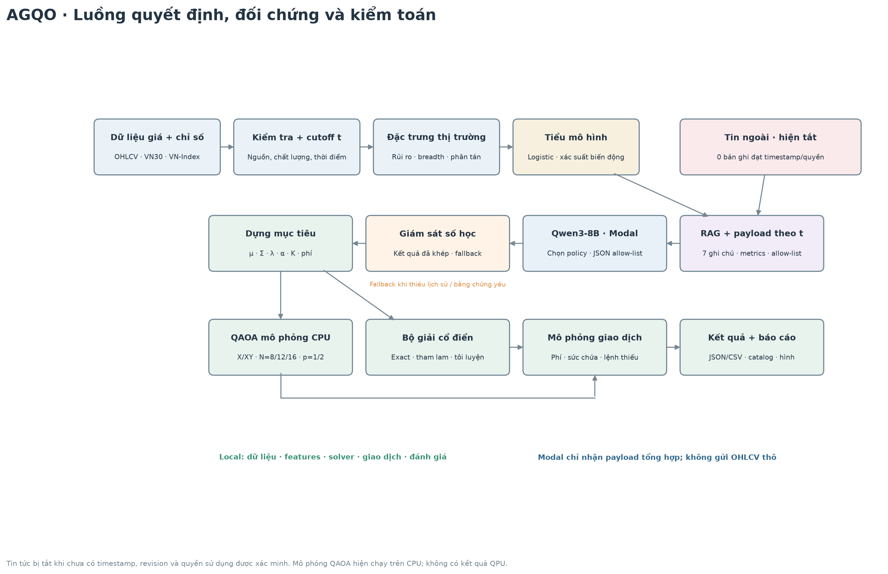

**Hình 1. Sơ đồ tổng thể của pipeline AGQO.** Cách đọc: đi từ dữ liệu bên trái qua tính insight, RAG, Qwen, bộ giám sát và QAOA; các nhánh cổ điển và mô phỏng danh mục kiểm tra chất lượng nghiệm và hiệu quả tài chính. Insight số học được tạo từ dữ liệu, Qwen chỉ chọn policy hợp lệ, bộ giám sát có thể từ chối, còn đối chứng cho biết kết quả có thật sự tốt hơn hay không. Giới hạn: nhánh tin GDELT đang tắt vì chưa thu đủ dữ liệu; QAOA mô phỏng CPU, chưa chạy QPU; các chỉ số tài chính đang hiển thị thuộc lượt chạy cũ.

### Tại sao cần mô hình ngôn ngữ nếu đã có mô hình học máy?

LogisticRegression trả lời câu hỏi hẹp: **xác suất chế độ biến động cao là bao nhiêu?** Qwen nhận một gói thông tin rộng hơn: chỉ số đã tính, mã insight được hỗ trợ, lịch sử các chính sách đã hoàn tất, ghi chú RAG và danh sách cấu hình hợp lệ. Nó chọn cấu hình QAOA nào sẽ thử.

Vì vậy, Qwen là **bộ điều khiển lựa chọn chính sách**, không phải mô hình dự báo giá và không phải bộ chọn cổ phiếu. Giá trị tăng thêm của nó chỉ được xác nhận nếu so sánh với một bộ chọn quy tắc không dùng LLM trên các kỳ tương đương, tốt nhất là giai đoạn độc lập.

### Prompt, bằng chứng và giám sát

Prompt hiện tại là tiếng Anh phiên bản `agqo-prompt-v9-en-rag-submodel-allowlisted-structured`. Mô hình được yêu cầu:

- chỉ dựa vào dữ kiện ở ngày cắt đã chỉ định;
- dùng insight và định nghĩa đã được tính/truy xuất;
- chọn đúng một chính sách trong danh sách cho phép;
- trả JSON gọn gồm mã chính sách, mã insight và mã bằng chứng;
- không tự tạo số liệu hoặc viết diễn giải tự do không thể kiểm tra.

Trong 16 quyết định của lượt chạy cũ, cả 16 phản hồi đều hợp lệ và không bị sửa định dạng hoặc thay thế bởi bộ giám sát. Qwen chọn XY vòng p=1 bảy lần và p=2 chín lần. Đây là bằng chứng định dạng và tích hợp hoạt động; nó **không** chứng minh Qwen hiểu thị trường tốt hơn quy tắc.

### Mô hình dự báo chế độ chưa cải thiện mức nền

Điểm Brier của LogisticRegression là **0,237**, cao hơn mức nền **0,217**. Vì điểm thấp hơn tốt hơn, mô hình phụ này hiện không cải thiện dự báo so với mức nền đơn giản. Do đó, xác suất chế độ chỉ được dùng như bối cảnh yếu và không nên quảng bá như một dự báo có kỹ năng.


**Hình 2. Dự báo chế độ biến động.** Cách đọc: so xác suất mà mô hình ước lượng với nhãn biến động cao/thấp được xác định sau khi kỳ tương lai hoàn tất. Điểm Brier 0,237 của mô hình kém mức nền 0,217. Insight: mô hình đã được kiểm định theo thời gian, nhưng chưa có kỹ năng dự báo tốt hơn mức nền. Giới hạn: nhãn 21 phiên chồng lấn nên các ngày không độc lập; đây không phải tín hiệu mua/bán.

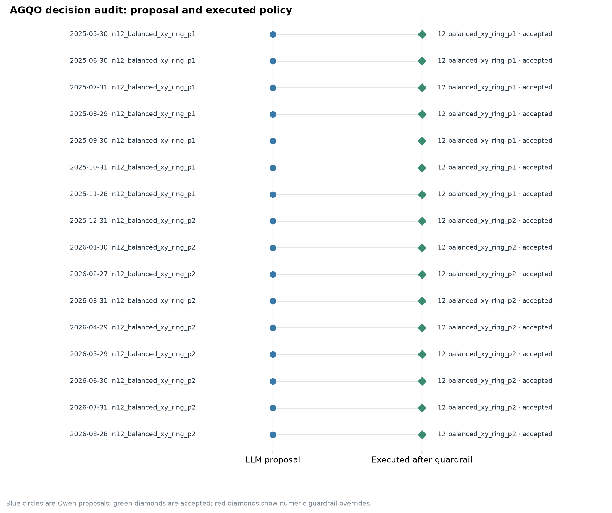

**Hình 3. Đề xuất Qwen và chính sách được thực thi.** Cách đọc: mỗi điểm/ký hiệu đối chiếu cấu hình Qwen đề xuất với cấu hình sau khi bộ giám sát kiểm tra. Insight: có thể truy vết đề xuất có được giữ hay không, thay vì chỉ thấy kết quả cuối. Giới hạn: phản hồi JSON hợp lệ không đồng nghĩa quyết định tốt; 16 quyết định không đủ chứng minh giá trị gia tăng của LLM.

## 4. Bài toán tối ưu và QAOA

### Bài toán danh mục dưới dạng lựa chọn có/không

Với từng cổ phiếu i, đặt một biến nhị phân:

- (x_i=1): đưa mã i vào danh mục.
- (x_i=0): không đưa mã i vào danh mục.
- Ràng buộc (sum_i x_i=6): chọn đúng sáu mã.

Bộ tối ưu cân bằng ba thành phần:

1. **Rủi ro:** các mã biến động mạnh hoặc cùng biến động sẽ làm danh mục rủi ro hơn.
2. **Lợi suất kỳ vọng:** các mã có lợi suất ước lượng cao sẽ được ưu tiên.
3. **Chi phí tái cân bằng:** thay đổi khỏi danh mục trước có thể chịu phí giao dịch cao hơn.

Có thể đọc hàm mục tiêu như sau:

$$
\text{Điểm danh mục}
= \text{mức phạt rủi ro}
- \text{phần thưởng lợi suất kỳ vọng}
+ \text{chi phí thay đổi danh mục}.
$$

Thuật toán **tối thiểu hóa** điểm này. Hệ số \(\lambda\) điều chỉnh mức ưu tiên giảm rủi ro; mức co rút hiệp phương sai \(\alpha\) làm các ước lượng rủi ro bớt nhạy với nhiễu. Những ước lượng này đều lấy từ dữ liệu quá khứ và có thể sai; vì thế cần đánh giá bằng dữ liệu tương lai chưa dùng.

Trong công thức chi tiết ở mã, \(\mu\) là lợi suất trung bình ước lượng, \(\Sigma\) là ma trận hiệp phương sai (mô tả mức các mã cùng dao động), và \(\Sigma_\alpha=(1-\alpha)\Sigma+\alpha\,\mathrm{diag}(\Sigma)\) là ma trận đã co rút. Rủi ro được chia theo quy mô danh mục; lợi suất được lấy trung bình trên số mã đã chọn. Chi phí tái cân bằng phạt việc mua bán nhiều.

### QAOA là gì trong dự án này?

QAOA là viết tắt của thuật toán tối ưu gần đúng lượng tử có tham số. Nó mã hóa bài toán thành một hàm năng lượng, rồi tạo một mạch có tham số để lấy mẫu các nghiệm có điểm tốt.

Một cách hình dung: bộ giải gieo ra nhiều tổ hợp sáu mã, dùng cấu trúc mạch để làm một số tổ hợp tốt xuất hiện thường xuyên hơn, rồi giữ nghiệm tốt nhất trong các lần lấy mẫu. Các tham số góc của mạch được tối ưu bằng COBYLA; đây là bộ tối ưu cổ điển bên ngoài mạch lượng tử.

Trong dự án hiện tại, trạng thái lượng tử được mô phỏng bằng mảng số trên CPU. Vì mô phỏng véc-tơ trạng thái cần lưu đến (2^N) biên độ khi có N qubit, chi phí tăng nhanh theo N. Chạy mô phỏng QAOA không có nghĩa đã chạy trên chip lượng tử.

### Qubit, K, độ sâu, mixer và bố trí cổng

- **Qubit:** đơn vị biến lượng tử trong mô hình. Ở đây một qubit ứng với một cổ phiếu ứng viên trong bài toán QAOA cụ thể.
- **N:** số qubit, cũng là số ứng viên mà bộ giải xét trong chính bài toán đó. Các thiết kế đã lưu dùng N=8, 12 hoặc 16.
- **K=6:** số cổ phiếu phải chọn. Trong một phần dữ liệu mô tả có 30 mã, nhưng bộ QAOA trong backtest thường rút trước một nhóm ứng viên 12 hoặc 16 mã; vì vậy 12/16 qubit không đồng nghĩa tối ưu trực tiếp toàn bộ 30 mã ở mọi lần.
- **Độ sâu p:** số lần lặp khối cost/mixer. Tăng p làm mạch biểu đạt được nhiều hơn, nhưng tăng số cổng, thời gian và khả năng chịu nhiễu trên phần cứng.
- **Cost layer:** cổng mã hóa hàm mục tiêu — lợi suất, rủi ro và tương tác cặp mã.
- **Mixer:** cổng làm thay đổi trạng thái để khám phá nghiệm khác. Bộ trộn X có thể tạo bitstring sai số lượng mã; ràng buộc phải được xử lý khi lấy mẫu. Bộ trộn XY được thiết kế để giữ số lượng bit 1, tức giữ cardinality K trong các cấu hình đã cài.
- **Layout:** cách nối các qubit, ví dụ vòng (ring), đường thẳng (linear), đầy đủ (complete) hoặc theo tương quan. Kết nối ảnh hưởng số cổng và cấu trúc tìm kiếm.
- **Shots:** số lần đo/lấy mẫu từ mạch. Nhiều shots tăng cơ hội thấy nghiệm tốt nhưng làm tăng công việc.
- **Cổng hai qubit:** tương tác giữa hai qubit; thường là tài nguyên quan trọng khi chuyển mạch sang phần cứng. Số trong báo cáo là bộ đếm logic mô phỏng, chưa phải số cổng sau biên dịch QPU.

### Cách đánh giá QAOA

| Chỉ số | Câu hỏi trả lời | Không nên nhầm với |
|---|---|---|
| **Tỷ lệ khả thi** | Trong các mẫu, bao nhiêu phần thỏa chọn đúng K mã? | Lợi nhuận hoặc chất lượng mục tiêu. |
| **Regret / hối tiếc chuẩn hóa** | Nghiệm QAOA tốt nhất cách nghiệm exact bao xa trên cùng hàm mục tiêu? Thấp hơn là tốt hơn. | Lợi nhuận danh mục. Regret bằng 0 chỉ nói giải đúng bài toán toán học đã đặt. |
| **Runtime** | Mất bao lâu trong môi trường đo? | Thời gian QPU công bằng nếu so phần cứng khác nhau hoặc bỏ qua tối ưu góc. |
| **Số cổng và độ sâu** | Mạch cần bao nhiêu thao tác logic? | Chất lượng nghiệm tự động tốt hơn khi số cổng cao. |
| **Lợi nhuận/Sharpe/drawdown** | Danh mục sinh kết quả tài chính ra sao? | Chất lượng giải toán thuần túy. Một nghiệm gần exact vẫn có thể thua lỗ nếu mô hình tài chính kém. |

### Thử nghiệm cấu hình QAOA trong kết quả cũ

Lượt chạy chính có 14 chính sách, số qubit 8/12/16, K=6, 1.024 shots, tối đa 100 lần đánh giá góc cho mỗi lần khởi tạo và ba seed cố định. Một số thiết kế đại diện:

| Cấu hình | Bài toán có regret ≤5% | Regret trung bình | Mẫu thỏa K | Cổng hai qubit logic |
|---|---:|---:|---:|---:|
| X, p=1 | 16/16 | 0,28% | 40,81% | 66 |
| XY vòng, p=1 | 0/16 | 20,04% | 100,00% | 90 |
| XY vòng, p=2 | 4/16 | 13,85% | 100,00% | 180 |
| XY theo tương quan, p=2 | 13/16 | 2,53% | 100,00% | 240 |

Bảng thể hiện một đánh đổi: X p=1 gần exact nhưng nhiều mẫu sai K; XY bảo toàn K nhưng chất lượng nghiệm phụ thuộc layout và p. XY theo tương quan p=2 giảm regret nhiều nhất trong các cấu hình này nhưng dùng nhiều cổng hơn. Không có cấu hình tốt nhất trên tất cả tiêu chí.

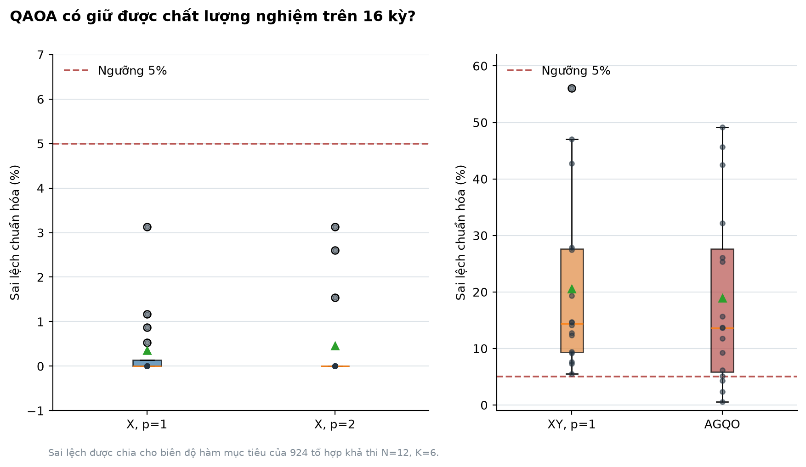

**Hình 4. Khoảng cách nghiệm QAOA so với exact.** Cách đọc: mỗi điểm/nhóm cho biết regret của một cấu hình qua các bài toán; giá trị thấp nghĩa là nghiệm gần nghiệm exact hơn trên đúng hàm mục tiêu đó. Insight: chất lượng thay đổi theo policy; các cấu hình cần được đánh giá qua nhiều tín hiệu chứ không chỉ một trường hợp. Giới hạn: regret là thước đo solver, không phải lợi nhuận; exact chỉ là chuẩn trong kích thước bài toán đang xét và kết quả vẫn dùng dữ liệu cũ.


**Hình 5. Sơ đồ cost layer và mixer.** Cách đọc: các đường nối biểu thị tương tác giữa qubit; các lớp cost đưa thông tin hàm mục tiêu vào mạch, mixer thay đổi ứng viên đang được xét. Insight: cấu trúc nối và loại mixer thay đổi khả năng giữ ràng buộc và chi phí cổng. Giới hạn: đây là sơ đồ nguyên lý, không phải ảnh chụp một lần chạy QPU.


**Hình 6. Chất lượng nghiệm so với chi phí mạch.** Cách đọc: trục regret thấp hơn là nghiệm gần exact hơn; trục cổng thấp hơn là mạch nhẹ hơn; kích thước/màu biểu diễn thuộc tính cấu hình như độ sâu và số qubit. Insight: tăng độ sâu hoặc cổng không tự động giảm regret; cần tìm cấu hình trên đường đánh đổi. Giới hạn: đo bằng simulator và bộ đếm cổng logic, chưa có nhiễu hay thời gian phần cứng lượng tử.

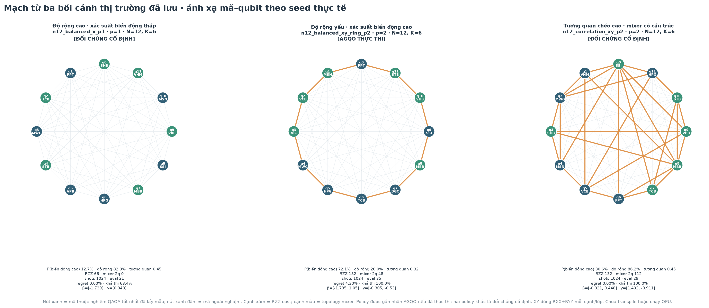

**Hình 7. Ba mạch theo ba bối cảnh thị trường.** Cách đọc: mỗi sơ đồ nối tên mã với qubit, cạnh cost và cạnh mixer; màu nút chỉ mã nằm trong nghiệm được lấy mẫu tốt nhất; nhãn cho biết cấu hình AGQO hay đối chứng. Insight: dữ liệu thị trường đi vào trọng số của cost, còn policy quyết định cấu trúc mixer/độ sâu. Giới hạn: mạch logic dựng từ metadata đã lưu, chưa biên dịch xuống topology QPU và chưa đo trên phần cứng.

## 5. Kết quả tài chính đang nói gì?

### Backtest cuốn chiếu chính — 16 kỳ

Lượt chạy cũ mô phỏng vốn ban đầu **100 triệu đồng**, tái cân bằng theo tháng trong 16 kỳ từ 02/06/2025 đến 01/10/2026. Mỗi chiều giao dịch giả định phí 25 điểm cơ bản (0,25%) và lệnh bị giới hạn ở 5% giá trị giao dịch bình quân ngày. Chỉ số VN30/VN-Index trong bảng là chuẩn giá, không bị trừ phí đầu tư.

| Phương pháp | CAGR ròng | Biến động năm hóa | Sharpe | Sụt giảm tối đa | Giá trị cuối mô phỏng |
|---|---:|---:|---:|---:|---:|
| VN30 | 24,58% | 20,64% | 1,17 | -9,22% | 134,04 triệu đồng |
| VN-Index | 23,63% | 19,05% | 1,21 | -8,64% | 132,68 triệu đồng |
| Ledoit–Wolf, exact trên toàn rổ | 49,68% | 29,31% | 1,53 | -15,92% | 171,21 triệu đồng |
| QAOA XY vòng p=1, 12 mã | 22,07% | 27,55% | 0,85 | -11,90% | 130,45 triệu đồng |
| Quy tắc → QAOA | 19,98% | 25,39% | 0,84 | -11,90% | 127,49 triệu đồng |
| **AGQO: Qwen → giám sát → QAOA** | **18,81%** | **25,44%** | **0,80** | **-11,90%** | **125,84 triệu đồng** |

**Diễn giải công bằng:** AGQO kém VN30 5,77 điểm phần trăm CAGR và kém bộ chọn quy tắc 1,17 điểm. Từ 100 triệu đồng, vốn mô phỏng AGQO cuối kỳ thấp hơn VN30 khoảng 8,20 triệu đồng và thấp hơn bộ quy tắc khoảng 1,65 triệu đồng. Sharpe của AGQO thấp hơn VN30; drawdown sâu hơn.

Ledoit–Wolf có CAGR cao nhất trong cửa sổ này nhưng cũng biến động và sụt giảm sâu hơn, đồng thời dùng toàn bộ rổ tài sản nên phạm vi so sánh khác. Đây là kết quả cần khảo sát, không phải bằng chứng nó sẽ tiếp tục vượt trội.


**Hình 8. Đường vốn của các phương pháp.** Cách đọc: mọi đường bắt đầu từ vốn mô phỏng ban đầu; trục thời gian là các kỳ đầu tư, trục dọc là giá trị vốn sau giả định chi phí. Insight: đường AGQO kết thúc dưới VN30, VN-Index và bộ chọn quy tắc. Giới hạn: chỉ 16 kỳ; giá thô và giả định khớp đơn giản; kết quả chưa chạy lại trên dữ liệu hiệu chỉnh.


**Hình 9. Lợi nhuận và rủi ro sau chi phí.** Cách đọc: đặt CAGR cạnh độ biến động hoặc sụt giảm để không chỉ xếp hạng theo lợi nhuận. Insight: lợi nhuận cao hơn của Ledoit–Wolf đi cùng rủi ro cao hơn; AGQO không đứng đầu trên lợi nhuận điều chỉnh rủi ro. Giới hạn: các phương pháp có thể dùng quy mô vũ trụ khác nhau và cửa sổ chỉ 16 kỳ.


**Hình 10. Độ nhạy với chi phí và thanh khoản.** Cách đọc: so kết quả khi thay đổi mức phí và tỷ lệ lệnh so với thanh khoản đại diện. Insight: phương pháp có thể nhạy đáng kể với giả định giao dịch; lợi nhuận mô phỏng không chỉ phụ thuộc vào lựa chọn mã. Giới hạn: thanh khoản dùng `close × volume`; chưa mô phỏng spread, độ sâu sổ lệnh, thuế, bước giá hay trượt giá thực.


**Hình 11. Mức tập trung và tần suất chọn mã.** Cách đọc: xem mã/ngành nào thường được giữ, tỷ trọng và số kỳ được chọn. Insight: nếu một vài mã hoặc một ngành chiếm phần lớn danh mục, hiệu quả có thể phụ thuộc vào một số nguồn rủi ro. Giới hạn: lịch thành phần cũ có thiên lệch sống sót; tần suất trong mẫu này không phải xác suất chọn trong tương lai.

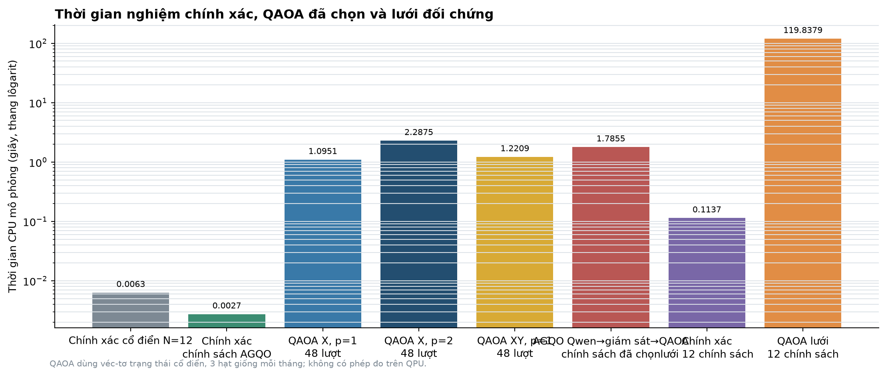

**Hình 12. Thời gian giải.** Cách đọc: so giây chạy của simulator QAOA với các bộ giải cổ điển trên những bài toán đã lưu. Insight: exact vẫn chạy được nhanh ở quy mô hiện tại; do đó QAOA chưa có lợi thế thời gian được chứng minh. Giới hạn: đây không phải so sánh phần cứng tương đương; mô phỏng CPU không đại diện thời gian QPU.


**Hình 13. Chính sách thích nghi so với cố định.** Cách đọc: đặt kết quả AGQO cạnh bộ chọn quy tắc và các policy QAOA cố định theo chỉ số tài chính. Insight: trong mẫu này AGQO chưa vượt bộ chọn quy tắc; vì vậy giá trị tăng thêm của LLM chưa được chứng minh. Giới hạn: các cấu hình được xét trên các kỳ đã dùng trong quá trình nghiên cứu; có rủi ro chọn cấu hình tốt hậu nghiệm.

### Kiểm định đuôi — một quyết định, 12 phiên

Ngày ra quyết định là **30/09/2026**, vào lệnh theo giá mở cửa 01/10 và định giá đến 19/10/2026. Qwen chọn XY vòng p=2; bộ giám sát chấp nhận. Đây là một phép thử chẩn đoán ngắn, dữ liệu đã được xem trong các phân tích trước, nên không phải tập mù độc lập.

| Phương pháp | Lợi nhuận ròng 12 phiên | Phí mô phỏng |
|---|---:|---:|
| AGQO: Qwen + giám sát + QAOA | -2,649% | 425.046 đồng |
| Quy tắc + QAOA | -1,073% | 525.545 đồng |
| Nghiệm exact cổ điển, cùng mục tiêu | -1,237% | 525.030 đồng |
| Bình quân sáu mã thanh khoản cao | -2,782% | 624.760 đồng |
| VN30 / VN-Index | -2,01% / -2,53% | Không áp phí đầu tư |

AGQO hơn bình quân sáu mã thanh khoản cao 0,13 điểm phần trăm và có phí mô phỏng thấp hơn khoảng 199.714 đồng. Nhưng AGQO kém VN30 khoảng 0,64 điểm, kém quy tắc khoảng 1,58 điểm và kém exact cổ điển khoảng 1,41 điểm. Kết quả không cho thấy lợi thế tài chính tổng thể. Sharpe tính trên 12 phiên không phải ước lượng ổn định dài hạn.

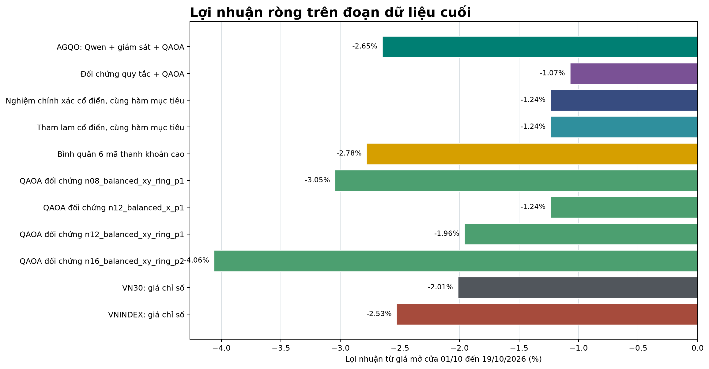

**Hình 14. Lợi nhuận trên phép thử cuối 12 phiên.** Cách đọc: mỗi cột là lợi nhuận tích lũy sau phí của một phương án; số âm nghĩa là vốn giảm trong giai đoạn. Insight: AGQO nhỉnh hơn một baseline đơn giản nhưng kém VN30, bộ quy tắc và nghiệm exact. Giới hạn: một quyết định, 12 phiên, không mù và giá chuẩn không bị trừ phí đầu tư.

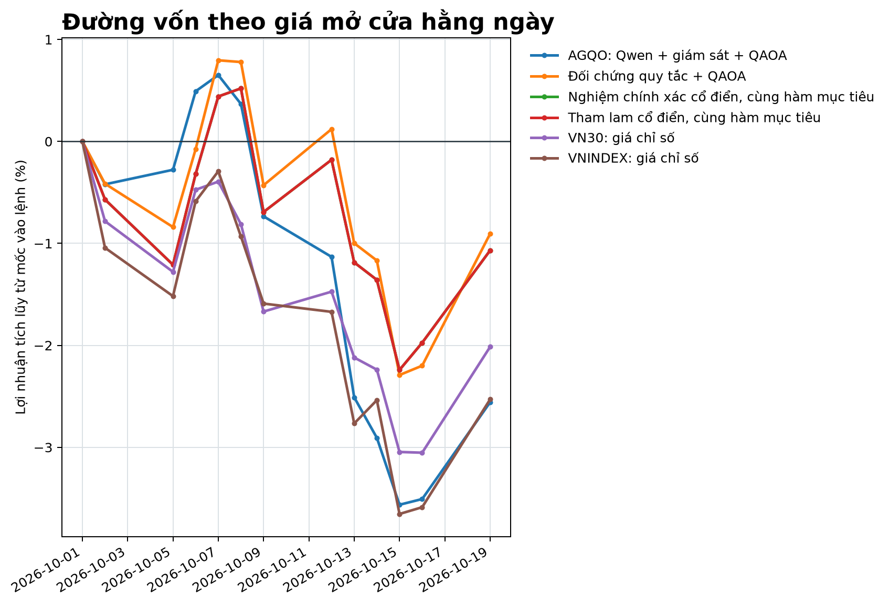

**Hình 15. Đường vốn hằng ngày của phép thử đuôi.** Cách đọc: quan sát đường đi của vốn từng phiên thay vì chỉ nhìn tổng lợi nhuận cuối. Insight: đường vốn cho thấy thứ tự và độ sâu các nhịp giảm/tăng trong 12 phiên. Giới hạn: giai đoạn ngắn, các chỉ số rủi ro quy đổi năm chỉ mang tính mô tả; chỉ số thị trường không chịu chi phí danh mục.

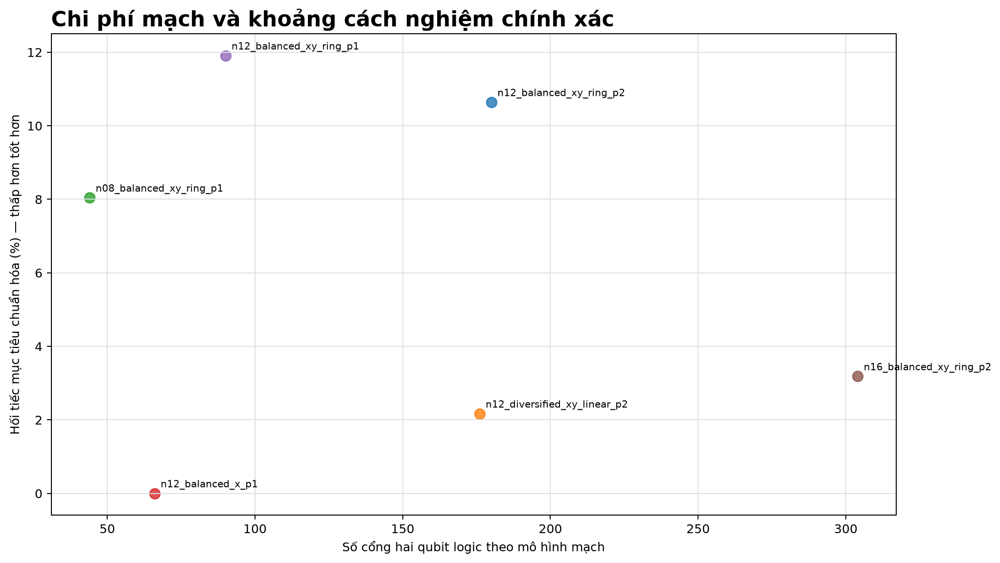

**Hình 16. Đánh đổi cổng và regret trong phép thử đuôi.** Cách đọc: so số cổng hai qubit logic, tỷ lệ mẫu khả thi và regret của các cấu hình tại cùng tín hiệu. Insight: X p=1 đạt regret 0% nhưng chỉ 25,10% mẫu khả thi; các cấu hình XY đều đạt tính khả thi cao hơn nhưng regret khác nhau. Chính sách Qwen chọn có regret 10,64% và lợi nhuận -2,649%, kém phương án exact ở phép thử này. Giới hạn: chỉ một ngày quyết định và kết quả tài chính ngắn không thể khái quát thành chiến lược dài hạn.

## 6. Sổ tay đọc từng biểu đồ

Các biểu đồ ở phần này mô tả thị trường và phân bố dữ liệu. Chúng giúp hiểu vì sao bài toán chọn danh mục có nhiều đánh đổi, nhưng **không phải tất cả đều là đầu vào trực tiếp của QAOA**. Các thống kê dưới đây cũng thuộc dữ liệu cũ.


**Hình 17. Bối cảnh chỉ số thị trường.** Cách đọc: đường giá được chuẩn hóa để hai chỉ số có chung điểm xuất phát; phần drawdown cho biết chỉ số giảm bao xa so với đỉnh gần nhất. Insight: so sánh danh mục với thị trường cần xét cả hướng đi lẫn các giai đoạn sụt giảm. Giới hạn: chỉ số giá không nhất thiết tính cổ tức; nó không phải chỉ số tổng lợi suất.


**Hình 18. Mức phân tán lợi suất giữa các mã.** Cách đọc: mỗi thanh là lợi suất tích lũy của một cổ phiếu trong 252 phiên gần nhất; mã được sắp từ thấp tới cao. Insight: khoảng cách lớn giữa mã tăng và giảm cho thấy chọn mã có ảnh hưởng lớn. Giới hạn: nhìn lại 252 phiên không cho biết trước mã nào sẽ thắng; vũ trụ là ảnh chụp thành phần hiện tại.


**Hình 19. Tương quan giữa các cổ phiếu.** Cách đọc: mỗi ô là hệ số từ -1 đến +1; +1 nghĩa là hai chuỗi thường cùng chiều, 0 là ít quan hệ tuyến tính, -1 là thường ngược chiều. Đường chéo của mã với chính nó bằng 1. Insight: nhiều cặp cùng chiều cao làm giảm lợi ích đa dạng hóa. Giới hạn: hệ số phụ thuộc cửa sổ và không chứng minh quan hệ nhân quả hay bảo đảm tương lai.

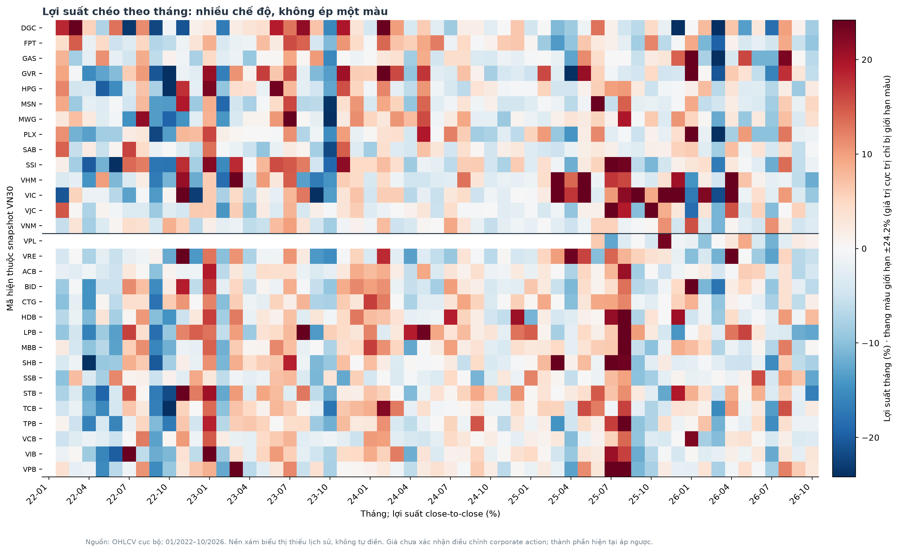

**Hình 20. Bản đồ nhiệt lợi suất theo mã và tháng.** Cách đọc: hàng là mã, cột là tháng; màu xanh/đỏ phân biệt lợi suất dương/âm quanh mốc 0, ô xám là thiếu dữ liệu. Insight: biến động giữa các mã thay đổi theo thời gian, không có một mã luôn tăng hoặc một tháng chỉ có một chiều. Giới hạn: màu được giới hạn để đọc dễ hơn; số liệu gốc không bị đổi; chuỗi giá và thành phần cũ vẫn có sai lệch.


**Hình 21. Độ phủ lịch sử của dữ liệu.** Cách đọc: mỗi hàng là một mã, mỗi ngày được tô nếu có quan sát; VPL có 360 phiên, phần lớn mã có 1.192. Insight: mã có lịch sử ngắn tạo vấn đề khi tính toán cùng một cửa sổ và cần quy tắc xử lý rõ. Giới hạn: khoảng trắng có thể là ngày nghỉ, ngừng giao dịch hoặc thiếu dữ liệu; biểu đồ không phân biệt nguyên nhân.


**Hình 22. Rủi ro, lợi suất và thanh khoản chéo.** Cách đọc: mỗi điểm là một mã; trục ngang/dọc biểu diễn lợi suất và rủi ro, kích thước điểm đại diện thanh khoản proxy. Insight: mã có lợi suất cao không nhất thiết có rủi ro thấp hoặc dễ giao dịch; cần nhìn nhiều chiều cùng lúc. Giới hạn: tương quan không phải quan hệ nhân quả; thanh khoản dùng giá đóng cửa nhân khối lượng.


**Hình 23. Thanh khoản đại diện.** Cách đọc: so giá trị giao dịch proxy giữa các mã với quy mô lệnh mô phỏng/giới hạn tham gia. Insight: cùng một số tiền có thể dễ giao dịch ở mã thanh khoản cao hơn và khó hơn ở mã thanh khoản thấp. Giới hạn: `close × volume` không phải giá trị giao dịch xác nhận, không cho biết độ sâu hay mức trượt giá.


**Hình 24. Biến động VN30 và các ngưỡng chế độ.** Cách đọc: đường biến động thực hiện thay đổi theo thời gian; các mốc ngưỡng chia trạng thái thành nhóm tương đối thấp/cao. Insight: rủi ro thị trường không cố định, nên hệ thống cần kiểm tra độ bền qua nhiều chế độ. Giới hạn: ngưỡng mô tả quá khứ, không phải tin tức hay tín hiệu dự báo chắc chắn.

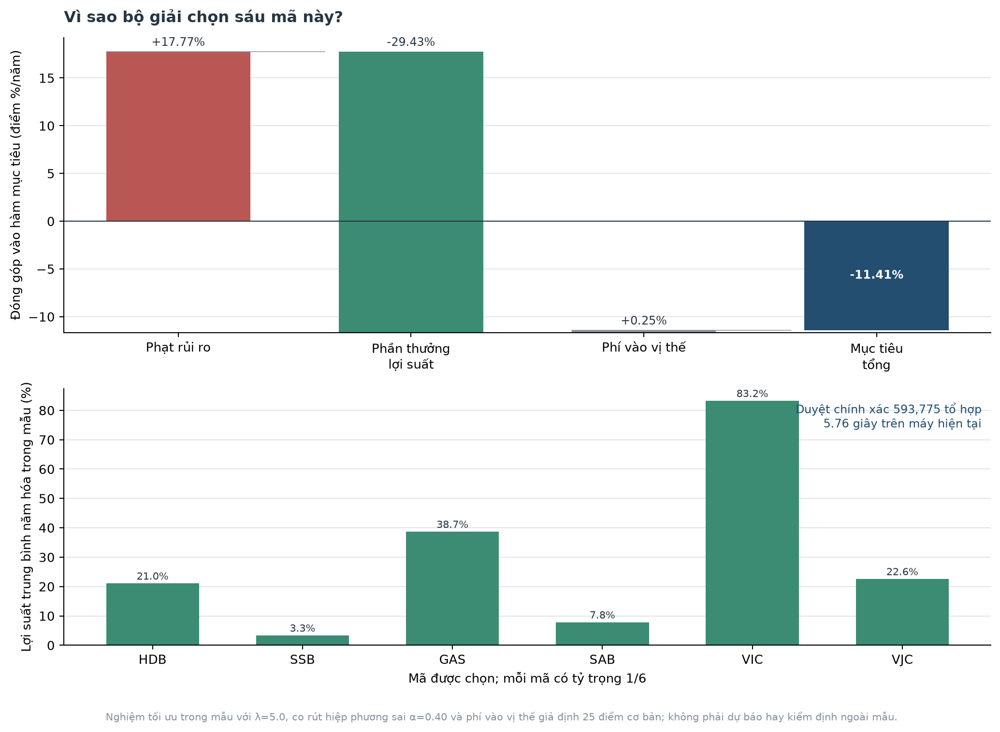

**Hình 25. Nghiệm exact trên ảnh chụp 30 mã.** Cách đọc: đây là danh mục được vét cạn/chọn chính xác theo hàm mục tiêu trên dữ liệu snapshot, chọn K=6 từ 30 mã. Có \(\binom{30}{6}=593.775\) tổ hợp. Insight: nghiệm cổ điển exact là mốc cần thiết để đo regret của solver; bài toán nhỏ này vẫn có thể giải được bằng phương pháp cổ điển. Giới hạn: nghiệm tối ưu của công thức không đồng nghĩa với danh mục sinh lời trong tương lai; đây không phải kết quả ngoài mẫu.

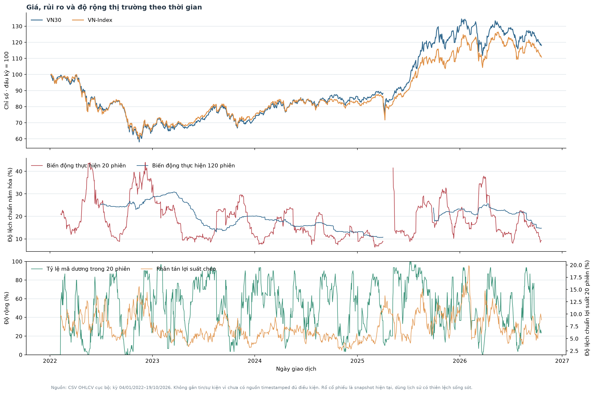

**Hình 26. Diễn biến bốn khía cạnh của thị trường.** Cách đọc: các dải/trục cùng thời gian cho thấy chỉ số, biến động, độ rộng (tỷ lệ mã tăng) và phân tán lợi suất chéo. Insight: cùng một mức tăng của chỉ số có thể đi kèm độ rộng khác nhau; nếu chỉ một vài mã kéo chỉ số, rủi ro tập trung có thể cao. Giới hạn: không gắn biến động với tin tức vì dữ liệu tin chưa có; dữ liệu giá là snapshot cũ.

## 7. Điều dự án chứng minh được và chưa chứng minh được

| Câu hỏi | Kết luận có thể nói hiện nay |
|---|---|
| Đã tích hợp LLM với QAOA chưa? | Có. Quy trình tạo insight, gọi Qwen, kiểm tra đề xuất, chọn cấu hình QAOA và ghi lại quyết định. |
| AI có tự chọn mã cổ phiếu không? | Không. Qwen chọn chính sách từ danh sách giới hạn; bộ tối ưu chọn mã. |
| QAOA có tạo danh mục không? | Có trên simulator CPU, với các cấu hình N=8/12/16 và K=6 đã lưu. |
| QAOA chạy trên phần cứng lượng tử chưa? | Chưa. Không có kết quả QPU. |
| LLM làm tăng hiệu quả tài chính chưa? | Chưa chứng minh. CAGR AGQO thấp hơn bộ chọn quy tắc trong kết quả cũ. |
| QAOA hơn exact hoặc heuristic chưa? | Chưa. Exact vẫn khả thi và nhanh ở kích thước hiện tại; trong phép thử đuôi exact tốt hơn QAOA được chọn. |
| Dữ liệu đã hết thiên lệch thành phần và sự kiện doanh nghiệp chưa? | Chưa có kết quả tái chạy. Mã đã chuẩn bị lịch thành phần và đường dữ liệu điều chỉnh, nhưng chưa tải/chạy lại lịch sử đầy đủ. |
| Tin tức đã giải thích biến động chưa? | Chưa. Bộ thu GDELT chưa có bản ghi; không có tin tức tham gia kết quả. |

### Hướng làm tiếp để nâng độ tin cậy

1. Đăng ký Vnstock Cộng đồng và tải lại giá điều chỉnh toàn kỳ 2022–2026.
2. Kiểm tra lịch VN30 lịch sử độc lập, bao gồm thành phần bị loại và ngày hiệu lực.
3. Chạy lại toàn bộ insight, biểu đồ và walk-forward trên dữ liệu mới; gắn phiên bản nguồn và dấu băm.
4. Khóa một giai đoạn ngoài mẫu chưa dùng khi thiết kế; đăng ký trước tiêu chí quyết định.
5. So sánh AGQO với VN30, VN-Index, equal-weight, bộ quy tắc, exact, greedy và simulated annealing trên cùng dữ liệu, chi phí và thời gian.
6. Tách đóng góp LLM khỏi đóng góp QAOA: so AGQO với chính sách quy tắc trên cùng solver; so QAOA với bộ giải cổ điển trên cùng hàm mục tiêu.
7. Nếu muốn tuyên bố giá trị lượng tử, mở rộng kích thước và đo chất lượng, thời gian, tài nguyên; sau đó chạy QPU nếu khả thi.
8. Chỉ thêm tin tức sau khi thu đủ nguồn có dấu thời gian, xác minh được thực thể mã–công ty và kiểm soát quyền sử dụng.

## 8. Cấu trúc dự án và cách tái lập

### Tệp nên đọc

| Tệp | Nội dung |
|---|---|
| `agqo/market_data.py` | Đọc, kiểm tra và chuẩn hóa dữ liệu thị trường; từ chối dữ liệu thiếu yêu cầu cho kiểm định hiệu chỉnh. |
| `agqo/insights.py` | Tính insight định lượng và mã bằng chứng được phép dùng. |
| `agqo/ai.py` | Mô hình chế độ biến động và cách kiểm định theo thời gian. |
| `agqo/knowledge.py` | Các ghi chú nội bộ dùng cho RAG. |
| `agqo/guide.py` | Danh sách chính sách, prompt version, kiểm tra và lưu quyết định LLM. |
| `agqo/problem.py` | Hàm mục tiêu danh mục, exact solver, greedy và simulated annealing. |
| `agqo/simulator.py` | Mô phỏng statevector QAOA, mixer và tối ưu góc. |
| `agqo/walkforward.py` | Luồng kiểm định cuốn chiếu và mô phỏng danh mục. |
| `agqo/evaluation.py` | Chỉ số tài chính, regret và đối chiếu kết quả. |
| `scripts/run_ai_qaoa_walkforward.py` | Điểm chạy pipeline chính và xuất JSON, báo cáo cùng biểu đồ. |
| `scripts/run_tail_probe.py` | Tái lập phép thử một quyết định 12 phiên. |
| `scripts/build_vn30_membership_history.py` | Dựng lịch thành phần VN30 theo ngày hiệu lực từ dữ liệu rà soát. |
| `scripts/download_vn30_dataset.py` | Tải giá thô/điều chỉnh sau khi xác thực nguồn dữ liệu. |
| `scripts/fetch_gdelt_news_metadata.py` | Thu metadata tin tức khi nguồn cho phép và thu đủ truy vấn. |

### Hồ sơ kết quả

- [Báo cáo cuốn chiếu chi tiết](results/final/BAO_CAO_AGQO_CUOI_CUNG.md)
- [Kết quả cuốn chiếu dạng JSON](results/final/agqo_final_walkforward.json)
- [Báo cáo phép thử đuôi 12 phiên](results/final/AGQO_KIEM_DINH_DUOI_20261019.md)
- [Dữ liệu phép thử đuôi dạng JSON](results/final/agqo_tail_probe_20261019.json)
- [Tóm tắt dữ liệu](results/final/dataset_summary.json)
- [Metadata mạch QAOA](results/final/circuit_metadata.json)
- [Các quyết định Qwen](results/final/qwen3_decisions.json)
- [Danh mục biểu đồ và chú thích](results/final/figure_catalog.json)
- [Tài liệu kỹ thuật AGQO](TAI_LIEU_KY_THUAT_AGQO.md)
- [Sổ tay Qwen3 trên Modal](notebooks/AGQO_Qwen3_Modal.ipynb)
- [Kế hoạch nghiên cứu vòng tiếp theo](AGQO_NEXT_ROUND_MASTER_PROMPT.md)
- [Đề bài frontend](FRONTEND_YEU_CAU.md)

### Chạy lại

Trước tiên cần tải đủ dữ liệu giá điều chỉnh và đảm bảo lịch thành phần có ngày hiệu lực. Bản tải đầy đủ chưa được tạo trong lượt chỉnh sửa này; tệp cũ không đáp ứng kiểm tra của pipeline mới.

Sau khi đã cấu hình môi trường Python theo các tệp phụ thuộc của dự án và đăng nhập Modal:

```bash
cp config/modal-qwen3.env.example config/modal-qwen3.env
source .venv/bin/activate
set -a
source config/modal-qwen3.env
set +a
modal deploy modal_qwen3_agqo.py
python scripts/check_modal_qwen3.py
python scripts/run_ai_qaoa_walkforward.py --llm-guide modal-qwen3
```

Không lưu thông tin bí mật vào Git. Có thể chạy solver mà không gọi LLM theo các tùy chọn trong `scripts/run_ai_qaoa_walkforward.py`; xem `--help` để biết tham số hiện hành. Kết quả được lưu thành JSON/Markdown và hình ảnh trong `results/final/`. Phép thử đuôi cũ được tạo bởi:

```bash
python scripts/run_tail_probe.py
```

### Công nghệ đang dùng

- **Python, pandas, NumPy, SciPy:** đọc, biến đổi dữ liệu và tính toán.
- **scikit-learn LogisticRegression:** mô hình phụ phân loại chế độ biến động.
- **Qwen/Qwen3-8B, Transformers, bitsandbytes NF4:** mô hình ngôn ngữ được gọi trên Modal; không cần khóa API OpenAI.
- **RAG nội bộ:** truy xuất ghi chú phương pháp dự án để cấp định nghĩa và giới hạn cho Qwen.
- **COBYLA:** tối ưu các góc tham số cổ điển bao quanh mạch QAOA.
- **Mô phỏng statevector NumPy trên CPU:** thực thi logic QAOA; chưa phải phần cứng lượng tử.
- **Matplotlib:** tạo biểu đồ báo cáo.

Chạy Qwen trên Modal có thể phát sinh chi phí GPU. Dự án là nghiên cứu, không phải tư vấn đầu tư.
