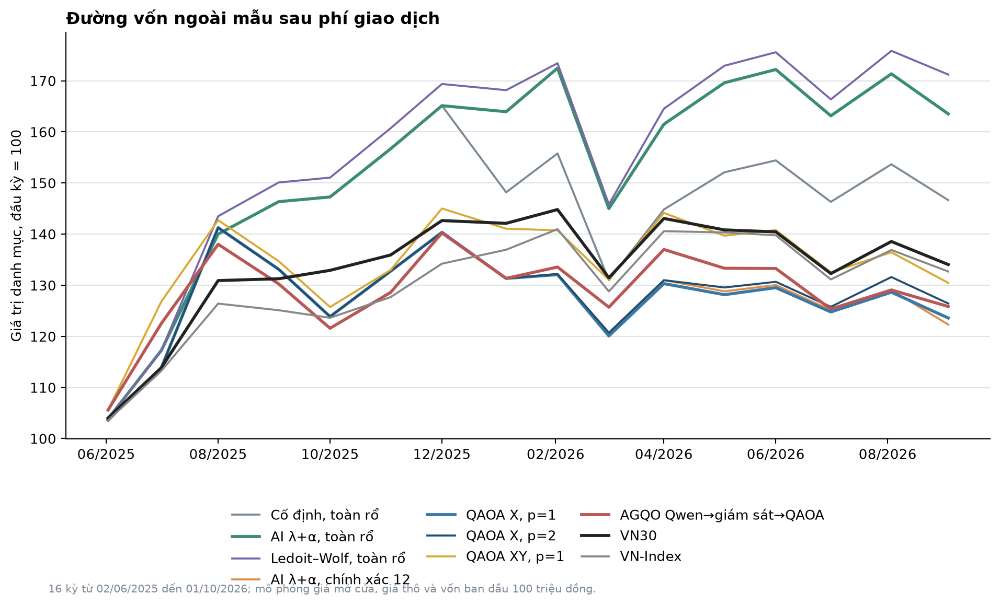
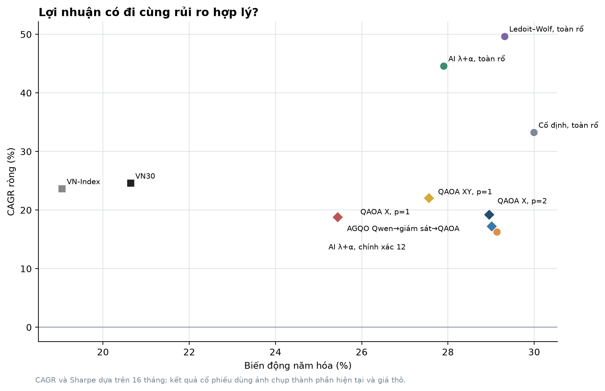
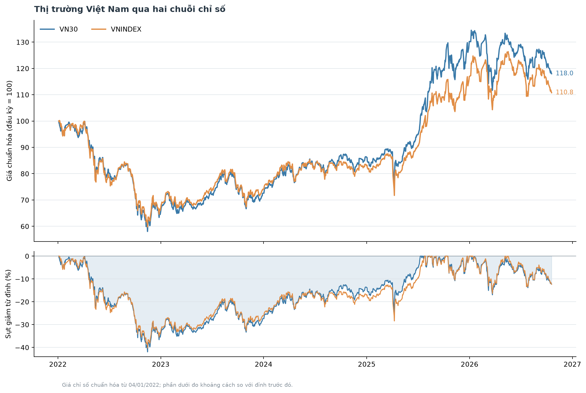
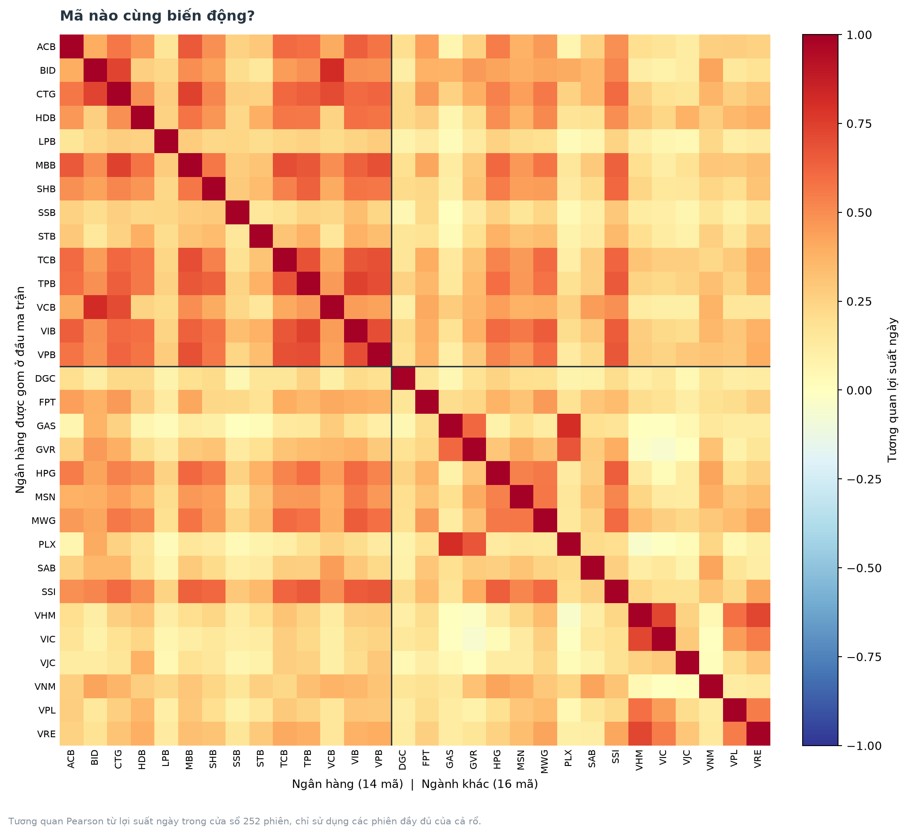
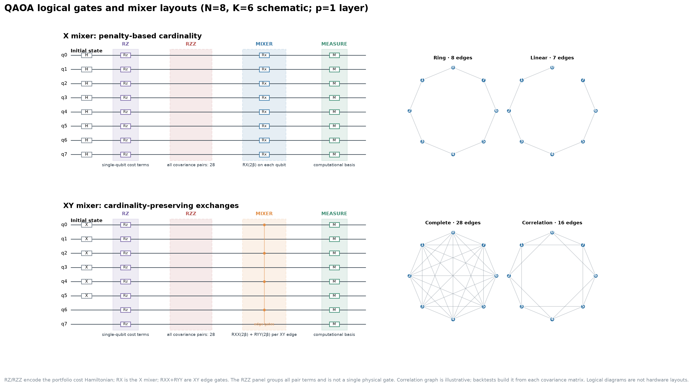
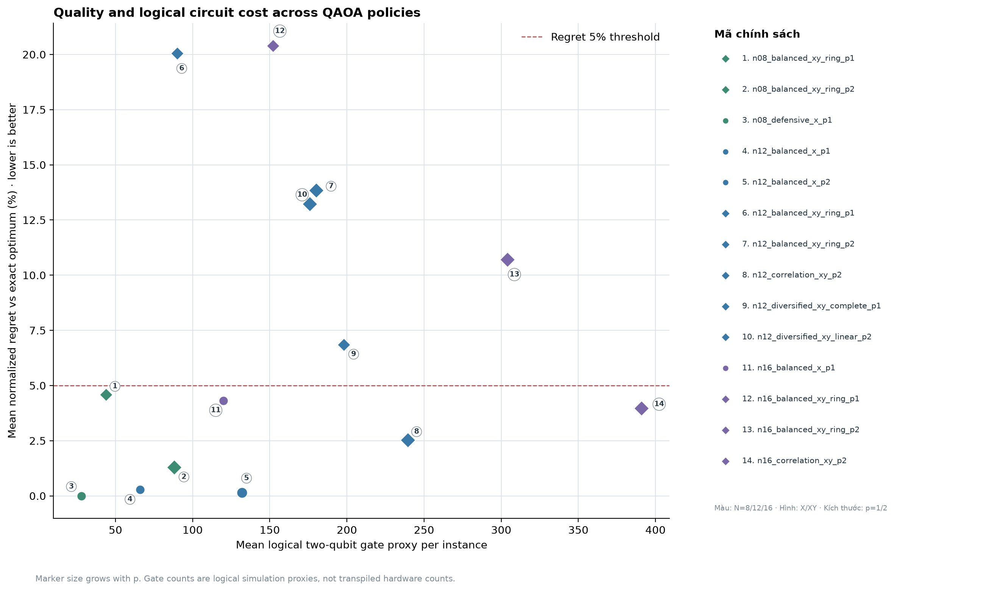

# AGQO
## Báo cáo tài chính và luận cứ kỹ thuật

**AI Guide for Quantum Optimization · Nghiên cứu danh mục cổ phiếu Việt Nam · Bản kết quả ngày 21/10/2026**

> **Luận điểm chính:** AGQO đã hoàn thiện một quy trình lai có thể kiểm toán, trong đó mô hình ngôn ngữ chọn cấu hình QAOA từ danh mục hữu hạn, còn QAOA giải bài toán chọn danh mục. Kết quả hiện tại chứng minh quy trình hoạt động và lượng hóa được các đánh đổi kỹ thuật. **Kết quả chưa chứng minh AGQO tạo lợi nhuận vượt thị trường, chưa chứng minh mô hình ngôn ngữ tăng giá trị và chưa chứng minh ưu thế lượng tử.**

Báo cáo này được viết để người đọc có thể lần theo câu chuyện từ dữ liệu, luận cứ tài chính, thiết kế AI–QAOA cho đến hạn chế và bằng chứng cần có ở vòng tiếp theo. Đây là nghiên cứu lịch sử, không phải khuyến nghị đầu tư.

---

## Tóm tắt điều hành

| Hạng mục | Kết quả đã đo |
|---|---|
| Dữ liệu | 37.308 dòng, 30 cổ phiếu cùng VN30 và VN-Index, từ 04/01/2022 đến 19/10/2026 |
| Kiểm định danh mục | 16 kỳ tháng, từ 02/06/2025 đến 01/10/2026; vốn mô phỏng 100 triệu đồng |
| Chi phí giao dịch | 25 điểm cơ bản mỗi chiều; giới hạn khớp lệnh mô phỏng bằng 5% giá trị giao dịch bình quân ngày |
| LLM | Qwen3-8B trên Modal, lượng tử hóa NF4 4-bit; 16 quyết định theo prompt tiếng Anh v9 |
| QAOA | 14 cấu hình, 8/12/16 qubit, K=6, mixer X/XY, độ sâu p=1/2 và nhiều cách bố trí cổng |
| Kết quả AGQO | CAGR ròng 18,81%; Sharpe 0,80; sụt giảm tối đa -11,90%; giá trị cuối mô phỏng 125,84 triệu đồng |
| Kết luận tài chính | Thấp hơn VN30, bộ chọn quy tắc và cấu hình XY cố định trong cửa sổ đã thử |
| Kết luận lượng tử | Có đối chứng chất lượng nghiệm và cổng logic; QAOA chạy mô phỏng véc-tơ trạng thái trên CPU, chưa có QPU |

### Câu chuyện trong một đoạn

Bài toán không phải là để LLM đoán mã cổ phiếu hay tự nghĩ ra tham số lượng tử. AGQO đưa cho Qwen thống kê thị trường, insight đã tính bằng mã và kết quả của các kỳ đã đóng; mô hình chỉ chọn một cấu hình QAOA được phép. QAOA sau đó tìm sáu mã trong nhóm ứng viên, còn bộ đánh giá so kết quả ròng với chỉ số, nghiệm cổ điển và các cấu hình khác. Hệ thống đã chạy trọn vòng này, nhưng dữ liệu hiện có cho thấy AGQO chưa tạo thêm lợi nhuận. Giá trị nghiên cứu hiện nằm ở kiến trúc có thể kiểm toán và các phép đo chỉ rõ cần cải thiện điều gì trước khi tuyên bố có lợi thế.

---

## 1. Bảng kết quả tài chính

Các phương pháp được so trên cùng 16 kỳ danh mục theo cấu hình lưu trong kết quả. CAGR là tốc độ tăng trưởng kép năm hóa từ một mẫu chỉ 16 tháng; đây là phép quy đổi để so sánh, không phải cam kết lợi nhuận năm sau. Mọi số liệu cổ phiếu dùng dữ liệu giá thô và chi phí giả định như đã nêu.

| Phương pháp | CAGR ròng | Biến động năm hóa | Sharpe | Sụt giảm tối đa | Giá trị cuối từ 100 triệu |
|---|---:|---:|---:|---:|---:|
| VN30 | 24,58% | 20,64% | 1,17 | -9,22% | 134,04 triệu |
| VN-Index | 23,63% | 19,05% | 1,21 | -8,64% | 132,68 triệu |
| Ledoit–Wolf, nghiệm chính xác trên toàn rổ | 49,68% | 29,31% | 1,53 | -15,92% | 171,21 triệu |
| QAOA XY vòng, p=1, 12 mã | 22,07% | 27,55% | 0,85 | -11,90% | 130,45 triệu |
| Bộ chọn quy tắc → QAOA | 19,98% | 25,39% | 0,84 | -11,90% | 127,49 triệu |
| **AGQO: Qwen → giám sát → QAOA** | **18,81%** | **25,44%** | **0,80** | **-11,90%** | **125,84 triệu** |

**Đọc kết quả một cách chính xác**

- AGQO thấp hơn VN30 **5,77 điểm phần trăm CAGR**. Với 100 triệu đồng vốn mô phỏng, giá trị cuối thấp hơn VN30 khoảng **8,20 triệu đồng** trong cửa sổ này.
- So với bộ chọn quy tắc không dùng LLM, AGQO thấp hơn **1,17 điểm phần trăm CAGR** và khoảng **1,65 triệu đồng giá trị cuối**. Vì vậy, lượt chạy này chưa chứng minh LLM đóng góp thêm giá trị tài chính.
- Sharpe AGQO là 0,80, thấp hơn VN30 ở mức 1,17. Với giả định lãi suất phi rủi ro tháng bằng 0, Sharpe đo phần lợi nhuận bình quân so với độ dao động; con số thấp hơn ở đây cho thấy mỗi đơn vị rủi ro biến động chưa được bù bằng mức lợi nhuận tương xứng.
- Sụt giảm tối đa của AGQO là -11,90%, sâu hơn VN30 -9,22%. Nhà đầu tư phải chịu một nhịp giảm vốn lớn hơn trong khi nhận CAGR thấp hơn.
- Khoảng tin cậy 95% của lợi nhuận chủ động năm hóa so với VN30 là **[-25,00%; 13,67%]** khi lấy mẫu khối ba tháng và **[-19,46%; 8,93%]** với khối sáu tháng. Cả hai đều chứa mức 0; mẫu chưa đủ để kết luận AGQO có lợi nhuận vượt trội.
- Nghiệm Ledoit–Wolf cổ điển đạt kết quả cao nhất trong bảng, nhưng dùng toàn bộ rổ và có sụt giảm -15,92%. Đây là đối chứng mạnh, không phải bằng chứng rằng một danh mục như vậy sẽ lặp lại kết quả ngoài mẫu. Không nên so sánh mà bỏ qua khác biệt về tập ứng viên, rủi ro và thiên lệch chọn phương pháp.

### Ý nghĩa của các thước đo tài chính

| Thước đo | Câu hỏi được trả lời | Cách dùng trong phần bảo vệ |
|---|---|---|
| CAGR | Vốn tăng trưởng kép nhanh đến đâu nếu quy đổi theo năm? | So tốc độ tăng trưởng; luôn nhắc đây chỉ là 16 kỳ đã quan sát |
| Sharpe | Lợi nhuận bình quân có tương xứng với biến động không? | So hiệu quả trên một đơn vị rủi ro; không gọi riêng Sharpe là “khả năng kiếm tiền” |
| Sụt giảm tối đa | Từ đỉnh vốn đến đáy sâu nhất đã giảm bao nhiêu? | Nêu tổn thất vốn mà nhà đầu tư phải chịu trên đường đi |
| CVaR 95% | Trong phần đuôi xấu, mức lỗ trung bình là bao nhiêu? | Dùng kèm số kỳ và giới hạn mẫu; 16 tháng chưa đủ ước lượng rủi ro đuôi ổn định |
| Lợi nhuận chủ động | Danh mục hơn hoặc kém chuẩn so sánh bao nhiêu? | Báo cả chênh lệch và khoảng tin cậy, không chỉ nêu một con số CAGR |

**Kết luận tài chính nên nói trước ban giám khảo:** đây chưa phải một chiến lược đầu tư đã chứng minh có alpha. Thành tựu là đã đưa chi phí, rủi ro, chỉ số chuẩn, bộ chọn quy tắc và phương pháp cổ điển vào cùng một phép đánh giá; kết quả bất lợi vẫn được giữ nguyên và giải thích.

---

## 2. Insight thị trường và câu chuyện dữ liệu

Bộ dữ liệu nghiên cứu có 37.308 dòng OHLCV, gồm 30 mã cổ phiếu và hai chỉ số. Trong 252 phiên gần nhất của tập mô tả, VN30 giảm **8,60%**, VN-Index giảm **4,26%** theo giá chỉ số. Cùng giai đoạn, giá VIC tăng **101,56%**, còn DGC giảm **56,67%**. Tương quan BID–VCB đạt **0,813**, GAS–PLX đạt **0,809**.

**Biện luận tài chính:** mức phân tán giữa cổ phiếu lớn trong khi các cặp cùng ngành có tương quan cao. Chỉ chọn mã có mức tăng quá khứ cao có thể tập trung rủi ro vào một số động lực chung. Vì vậy hàm mục tiêu danh mục đưa cả lợi suất kỳ vọng, hiệp phương sai và chi phí tái cân bằng vào bài toán. Những con số trên là mô tả giá thô, không phải lợi suất total-return có thể giao dịch.

### Một đối chứng quan trọng về quy mô

Trên ảnh chụp 30 cổ phiếu, chọn đúng sáu mã có **593.775 tổ hợp khả thi**. Bộ giải chính xác cổ điển đã duyệt không gian này trong khoảng **5,76 giây** trên môi trường nghiên cứu. Đây là một kết quả có ý nghĩa đối với câu chuyện lượng tử: ở quy mô dữ liệu hiện tại, chưa có căn cứ thực tiễn để nói QAOA cần thiết hoặc nhanh hơn. Bước chứng minh tiếp theo phải mở rộng sang quy mô thực tế khó hơn, giữ nguyên hàm mục tiêu và so sánh thời gian, chất lượng, chi phí cùng độ ổn định.

---

## 3. AGQO thực sự làm gì?

AGQO là bộ điều khiển cấu hình cho bộ tối ưu hóa; mô hình ngôn ngữ không tự chọn cổ phiếu. Luồng xử lý:

| Bước | Thành phần | Đầu ra |
|---|---|---|
| 1 | OHLCV, chỉ số thị trường và nhóm ngành | Dữ liệu lịch sử có mốc thời gian |
| 2 | Mã tính đặc trưng và insight | Biến động, xu hướng, tương quan, độ phân tán, độ rộng, thanh khoản đại diện |
| 3 | Tiểu mô hình LogisticRegression | Xác suất VN30 vào chế độ biến động cao trong 21 phiên |
| 4 | RAG cục bộ và prompt tiếng Anh | Định nghĩa thước đo, giới hạn dữ liệu, danh sách chính sách và bằng chứng tại ngày tín hiệu |
| 5 | Qwen3-8B | Một lựa chọn chính sách QAOA cùng mã insight và mã bằng chứng được cho phép |
| 6 | QAOA | Danh mục sáu mã trong nhóm ứng viên theo hàm mục tiêu |
| 7 | Bộ giám sát và sổ giao dịch | Lựa chọn được kiểm tra, lợi nhuận ròng, rủi ro, phí và báo cáo |

### Vì sao dùng Qwen3-8B dù mô hình không chuyên sâu về tài chính?

Thiết kế không yêu cầu Qwen tự suy luận các định nghĩa tài chính từ trí nhớ. Prompt v9 bằng tiếng Anh quy định rõ rằng dữ liệu đã cắt tại ngày tín hiệu và ghi chú phương pháp truy xuất là nguồn chuẩn. Mỗi lượt chỉ cho phép các mã chính sách, insight và bằng chứng nằm trong danh sách tương ứng. Mô hình không được tạo văn xuôi, tự chọn mã cổ phiếu, đặt tham số mới hay bịa cờ rủi ro; mã Python kiểm tra phản hồi và dựng lời giải thích từ số liệu đã xác minh.

- Mô hình: Qwen/Qwen3-8B, phiên bản cố định, chạy NF4 4-bit qua Transformers trên Modal.
- RAG: bảy ghi chú cục bộ về chỉ số tài chính, trường dữ liệu, hàm mục tiêu, QAOA, đối chứng và hạn chế dữ liệu; không gọi dịch vụ truy xuất ngoài.
- Lượt cuối: 16 quyết định, **0** phản hồi cần sửa, **0** lựa chọn bị bộ giám sát thay thế; 127.783 token đầu vào và 849 token đầu ra.
- Mô hình chọn XY vòng p=1 bảy lần và XY vòng p=2 chín lần. Việc chọn hợp lệ chứng minh bộ điều khiển hoạt động; bản thân nó không chứng minh quyết định tốt hơn bộ quy tắc.

### Vai trò và giới hạn của tiểu mô hình

LogisticRegression chỉ dự báo khả năng VN30 bước vào chế độ biến động cao trong 21 phiên; mô hình **không dự báo lợi suất và không chọn cổ phiếu**. Brier score theo tín hiệu tháng là **0,237**, kém mức nền **0,217**; kỹ năng Brier là **-9,32%**. Vì điểm Brier càng thấp càng tốt, tiểu mô hình hiện chưa cải thiện dự báo nền. AGQO đánh dấu xác suất này là tín hiệu yếu để Qwen không dùng nó làm lý do tự tăng rủi ro hay độ sâu mạch.

**Điểm mạnh có thể bảo vệ:** hệ thống đo và công khai một mô hình phụ không đạt nền, đồng thời chặn vai trò của nó thay vì kể câu chuyện rằng “AI dự báo được thị trường”.

---

## 4. Bài toán tài chính và thiết kế QAOA

Mỗi qubit đại diện một cổ phiếu trong tập ứng viên. Biến nhị phân xᵢ bằng 1 nếu chọn mã i. Bài toán chọn đúng K=6 mã trong N ứng viên và tối thiểu hóa:

$$
\min_{x_i\in\{0,1\},\;\sum_i x_i=K}
\quad
\frac{\lambda}{K^2}x^T\Sigma_\alpha x
-
\frac{1}{K}\mu^Tx
+
C_{\text{tái cân bằng}}(x)
$$

Trong đó:

- **μ** là lợi suất kỳ vọng ước lượng từ quá khứ; thành phần âm trong hàm mục tiêu thưởng cho lợi suất kỳ vọng cao hơn.
- **Σ** là ma trận hiệp phương sai; thành phần xᵀΣαx đo rủi ro danh mục, không chỉ rủi ro từng mã.
- **Σα = (1−α)Σ + α diag(Σ)** co rút tương quan để giảm độ nhạy với ước lượng nhiễu.
- **λ** là mức ác cảm rủi ro: λ cao làm rủi ro có trọng số lớn hơn so với lợi suất kỳ vọng.
- **C tái cân bằng** mô phỏng tác động chi phí khi đổi danh mục.
- **Σxᵢ=K** buộc nghiệm chọn đúng sáu mã. QAOA không được phép trả về danh mục có số mã tùy ý.

Qwen chỉ chọn một cấu hình đã chạy đối chứng, gồm số qubit, λ, α, bộ trộn, cách bố trí, độ sâu p và số mẫu. QAOA mới là bộ giải danh mục. Vì thế vai trò “AI Guide for Quantum Optimization” nằm ở việc AI hướng dẫn lựa chọn cách chạy bộ tối ưu hóa lượng tử, không phải thay QAOA chọn tài sản.

### Đánh đổi kỹ thuật đã đo

Đã thử 14 chính sách trên 8, 12 và 16 qubit, K=6; thay đổi mixer X/XY, độ sâu p=1/2 và cấu trúc nối. Mỗi lần dùng 1.024 shots, COBYLA tối đa 100 lần đánh giá cho mỗi seed, với ba seed cố định. Bảng dưới đây dùng kết quả của các chính sách trong danh mục AGQO trên cùng bài toán 12 qubit.

| Cấu hình | Đạt regret ≤5% | Regret mục tiêu trung bình | Tỷ lệ mẫu đúng K | Cổng hai qubit logic trung bình |
|---|---:|---:|---:|---:|
| X p=1 | 16/16 | 0,28% | 40,81% | 66 |
| XY vòng p=1 | 0/16 | 20,04% | 100,00% | 90 |
| XY vòng p=2 | 4/16 | 13,85% | 100,00% | 180 |
| XY tương quan p=2 | 13/16 | 2,53% | 100,00% | 240 |

**Cách đọc:** bộ trộn X p=1 thường tìm được nghiệm gần tối ưu hơn theo hàm mục tiêu và tốn ít cổng hơn, nhưng chỉ khoảng 41% mẫu đo có đúng sáu mã. Bộ trộn XY bảo toàn số mã trong mọi mẫu, song XY vòng p=1 có regret lớn. XY tương quan p=2 đưa regret trung bình xuống 2,53% và đạt ngưỡng 5% trong 13/16 bài toán, đổi lại dùng khoảng 240 cổng logic hai qubit. Không có một cấu hình thắng trên mọi tiêu chí.

Regret ở đây là khoảng cách của nghiệm QAOA so với nghiệm vét cạn chính xác trên cùng hàm mục tiêu, đã chuẩn hóa theo khoảng giá trị mục tiêu khả thi. **Regret thấp không đồng nghĩa danh mục sinh lợi cao**; nó chỉ nói bộ giải bám sát nghiệm của mô hình toán học. Tỷ lệ mẫu đúng K là tính khả thi, không phải xác suất kiếm lời. Số cổng là số logic ước lượng, chưa phải số cổng vật lý sau biên dịch hay chạy phần cứng.

### Câu trả lời thẳng cho câu hỏi “Quantum nằm ở đâu?”

QAOA là bộ tối ưu danh mục nằm ở bước 6 của luồng AGQO: các ứng viên được ánh xạ lên qubit, hàm mục tiêu tài chính thành cost Hamiltonian, mixer cùng độ sâu p tạo mạch, và bộ giải cổ điển tối ưu các góc tham số để lấy nghiệm. Trong kết quả hiện tại, statevector chạy trên CPU; chưa có QPU. Với N=12, K=6 chỉ có 924 tập con khả thi, và ngay cả 30 mã cũng có thể vét cạn trong khoảng 5,76 giây theo phép đo này. Do đó, câu trả lời có trách nhiệm là **đã xây và đo QAOA, chưa chứng minh QAOA cần thiết hoặc vượt phương pháp cổ điển**.

---

## 5. Thành tựu có thể trình bày với ban giám khảo

1. **Đã nối AI với Quantum đúng theo proposal AGQO.** Qwen dùng bối cảnh tài chính đã kiểm chứng để chọn chính sách; QAOA giải tổ hợp danh mục; kết quả đã khép quay lại làm bằng chứng cho quyết định sau.
2. **Đã biến “LLM hiểu tài chính” thành một hợp đồng kiểm soát được.** Prompt tiếng Anh, RAG theo dữ liệu dự án, lược đồ JSON cho phép hữu hạn, xác thực bằng mã và diễn giải sinh từ số đo giúp giảm nguy cơ mô hình bịa luận cứ.
3. **Đã đo QAOA khắt khe hơn việc chứng minh mạch chạy.** Có đối chứng nghiệm chính xác, regret, khả năng thỏa ràng buộc, nhiều mixer, độ sâu, topology, số qubit, nhiều seed và chi phí cổng logic.
4. **Đã đưa hiệu quả kinh tế vào cùng câu chuyện kỹ thuật.** Báo CAGR, Sharpe, Sortino, biến động, drawdown, CVaR, phí, giới hạn thanh khoản, VN30, VN-Index, bộ chọn quy tắc và bộ giải cổ điển.
5. **Đã công khai cả kết quả âm.** Brier của tiểu mô hình thấp hơn nền; AGQO thua VN30 và bộ quy tắc; nghiệm cổ điển rất cạnh tranh; chưa có lợi thế lượng tử. Đây là điểm khiến kết luận kiểm toán được, không phải một bản trình diễn chỉ chọn số thuận lợi.
6. **Đã lưu vết có thể tái lập.** Có dữ liệu kê khai nguồn, JSON walk-forward, quyết định LLM, báo cáo và 19 hình; endpoint Qwen trên Modal đã được triển khai và kiểm tra.

### Bài nói khoảng một phút

> “AGQO giải quyết một câu hỏi cụ thể: trong bối cảnh thị trường thay đổi, nên chọn cấu hình nào cho QAOA trước khi bộ giải chọn danh mục? Qwen3 không tự chọn cổ phiếu hay tự đặt tham số; mô hình chỉ chọn từ các chính sách đã định nghĩa, dựa trên thống kê có mốc thời gian và ghi chú tài chính được truy xuất. QAOA chọn đúng sáu mã theo hàm mục tiêu có lợi suất kỳ vọng, hiệp phương sai và chi phí tái cân bằng. Chúng tôi đã thử 14 cấu hình, đối chiếu với nghiệm cổ điển chính xác và đánh giá danh mục sau phí. Kết quả hiện tại chưa cho thấy AGQO vượt VN30 hay bộ chọn quy tắc, và QAOA chưa chứng minh ưu thế lượng tử. Đóng góp của chúng tôi là một quy trình lai có thể kiểm toán, đã đo rõ điểm nghẽn và có tiêu chí cụ thể cho vòng kiểm định tiếp theo.”

---

## 6. Hạn chế và lộ trình để có cơ hội thắng bằng chứng cứ

| Ưu tiên | Việc cần làm | Bằng chứng cần mang lại |
|---|---|---|
| 1 · Tính đúng của dữ liệu | Dùng giá đã điều chỉnh cổ tức, chia tách và quyền; thành phần VN30 có hiệu lực đúng từng ngày; kiểm tra mã hủy niêm yết và dữ liệu thiếu | Tái lập được lợi suất mà không dùng thông tin thành phần tương lai hoặc thiên lệch sống sót |
| 2 · Kiểm định chưa từng nhìn thấy | Khóa một giai đoạn ngoài mẫu mới, ghi trước quy tắc chọn mô hình và chỉ mở kết quả sau khi pipeline đóng băng | Khoảng tin cậy lợi nhuận chủ động, Sharpe và drawdown trên dữ liệu độc lập; kiểm soát thử nhiều cấu hình |
| 3 · Chứng minh phần LLM có ích | So AGQO với bộ chọn quy tắc, chính sách cố định, lựa chọn ngẫu nhiên có kiểm soát và ablation không RAG; giữ cùng dữ liệu, phí, tập chính sách | LLM cải thiện chỉ số đã đăng ký trước, không chỉ tạo quyết định hợp lệ |
| 4 · Nâng chất lượng tiểu mô hình | Đánh giá Brier, log-loss và calibration theo cửa sổ thời gian; so với nền và mô hình đơn giản; chỉ cho phép điều khiển khi kỹ năng dương ổn định | Dự báo chế độ biến động có giá trị đo được, không chỉ là xác suất đầu vào |
| 5 · Kiểm tra QAOA ở quy mô có ý nghĩa | Mở rộng tập ứng viên; so QAOA với nghiệm chính xác nơi còn khả thi và với greedy, simulated annealing cùng các bộ giải cổ điển mạnh; tăng số seed | Đường Pareto chất lượng–thời gian–cổng–tỷ lệ khả thi chứng minh lợi thế ở một vùng quy mô cụ thể |
| 6 · Kiểm chứng phần cứng và chi phí thực thi | Biên dịch lên backend mục tiêu; đo độ sâu sau biên dịch, lỗi cổng, shots, thời gian chờ và chi phí; mô phỏng nhiễu trước khi chạy QPU | Kết quả phần cứng lặp lại được và có giá trị so với cùng ngân sách cổ điển |
| 7 · Mô phỏng giao dịch sát thực tế | Bổ sung thuế, phí môi giới, trượt giá, spread, lô giao dịch, giới hạn thanh khoản và cách khớp lệnh theo thời điểm | Kết quả ròng không biến mất sau khi đưa ma sát thị trường vào |

**Tiêu chuẩn tuyên bố cần đăng ký trước:** AGQO chỉ nên được gọi là có lợi thế đầu tư nếu thắng các chuẩn tài chính sau mọi chi phí trên giai đoạn ngoài mẫu mới, với bất định được báo cáo và rủi ro chấp nhận được. QAOA chỉ nên được gọi là có lợi thế kỹ thuật khi cải thiện chất lượng, thời gian hoặc chi phí trên cùng bài toán và cùng điều kiện so sánh. Không chọn ngưỡng sau khi đã nhìn thấy kết quả.

---

## 7. Câu hỏi khó và cách trả lời

| Câu hỏi | Câu trả lời trung thực, ngắn gọn |
|---|---|
| “Sản phẩm đã tạo tiền chưa?” | “Chưa có bằng chứng. Trong 16 kỳ này, CAGR AGQO là 18,81%, thấp hơn VN30 24,58% và bộ quy tắc 19,98%. Chúng tôi không trình bày nó như chiến lược sẵn sàng đầu tư.” |
| “LLM đem lại gì nếu bộ quy tắc tốt hơn?” | “Hiện chưa chứng minh LLM tăng hiệu quả tài chính. LLM là bộ chọn chính sách có cấu trúc; cần ablation ngoài mẫu để đo phần giá trị tăng thêm.” |
| “QAOA có thắng nghiệm cổ điển không?” | “Chưa. Ở quy mô thử nghiệm, nghiệm chính xác cổ điển là chuẩn khả thi và rất nhanh. Chúng tôi đo trade-off của mixer, regret và cổng để xác định nơi cần mở rộng.” |
| “Vậy quantum nằm ở đâu?” | “Trong bộ giải bài toán chọn đúng K mã bằng cost Hamiltonian và mixer QAOA. Kết quả này là mô phỏng CPU, chưa phải QPU hay ưu thế lượng tử.” |
| “Qwen có hiểu tài chính không?” | “Thiết kế không dựa vào giả định đó. Mô hình chỉ dùng payload đã cắt theo ngày, bảy ghi chú RAG và lựa chọn JSON allow-list; insight, diễn giải và kiểm tra do mã xác định.” |
| “Brier âm có làm hỏng toàn bộ hệ thống?” | “Nó cho thấy tiểu mô hình chưa tốt hơn nền. Hệ thống ghi nhận giới hạn và ngăn xác suất ấy tự ý tăng rủi ro hoặc độ sâu QAOA.” |
| “Tại sao dùng dữ liệu VN30 hiện tại cho lịch sử?” | “Đây là giới hạn hiện tại và tạo thiên lệch sống sót. Muốn tuyên bố ngoài mẫu cần lịch thành phần point-in-time cùng giá total-return.” |

---

## 8. Dữ liệu, tái lập và tài liệu

Dữ liệu được lấy qua thư viện vnstock-data và DNSE chart API. Ảnh chụp thành phần VN30 hiện tại đang được áp ngược lịch sử; OHLCV thô chưa xác nhận điều chỉnh cổ tức, chia tách và quyền mua. Giá đóng cửa nhân khối lượng chỉ là đại diện thanh khoản. Tệp OHLCV không đưa lên Git vì chưa xác nhận quyền phân phối lại.

- [Báo cáo kết quả walk-forward chi tiết](results/final/BAO_CAO_AGQO_CUOI_CUNG.md)
- [Kết quả định lượng đầy đủ](results/final/agqo_final_walkforward.json)
- [Insight và nghiệm tối ưu trên ảnh chụp dữ liệu](results/final/dataset_summary.json)
- [16 quyết định Qwen đã xác thực](results/final/qwen3_decisions.json)
- [Kê khai dữ liệu](data/vn30_snapshot_20261002/manifest.json) · [danh sách mã](data/vn30_snapshot_20261002/members.csv)
- [Tài liệu kỹ thuật AGQO](TAI_LIEU_KY_THUAT_AGQO.md) · [Notebook Qwen3 trên Modal](notebooks/AGQO_Qwen3_Modal.ipynb)

Môi trường dùng Python 3.12, pandas, NumPy, scikit-learn, SciPy/COBYLA, Matplotlib, Transformers, bitsandbytes và Modal. Mô phỏng véc-tơ trạng thái QAOA dùng NumPy trên CPU; Qiskit/Aer và IBM Quantum là tùy chọn, không sinh kết quả trong báo cáo này. Không cần khóa API OpenAI; chạy mô hình trên Modal vẫn có thể phát sinh chi phí GPU.

Để chạy lại sau khi đã cấu hình thông tin Modal trong tệp môi trường:

    source .venv/bin/activate
    set -a
    source config/modal-qwen3.env
    set +a
    modal deploy modal_qwen3_agqo.py
    python scripts/check_modal_qwen3.py
    python scripts/run_ai_qaoa_walkforward.py --llm-guide modal-qwen3

---

## Kết luận

**AGQO đã chứng minh được khả năng tích hợp và đo lường; chưa chứng minh được khả năng vượt trội về đầu tư hay lượng tử.** Câu chuyện mạnh nhất trước ban giám khảo là sự phân biệt rõ giữa ba tầng: LLM hướng dẫn cấu hình, QAOA giải bài toán tổ hợp, và bộ đánh giá tài chính quyết định liệu kết quả có đáng tin hay không. Vòng tiếp theo cần thắng bằng dữ liệu point-in-time, một tập ngoài mẫu đã khóa, đối chứng LLM có ablation và một bài toán lượng tử đủ lớn để so sánh công bằng với thuật toán cổ điển.
