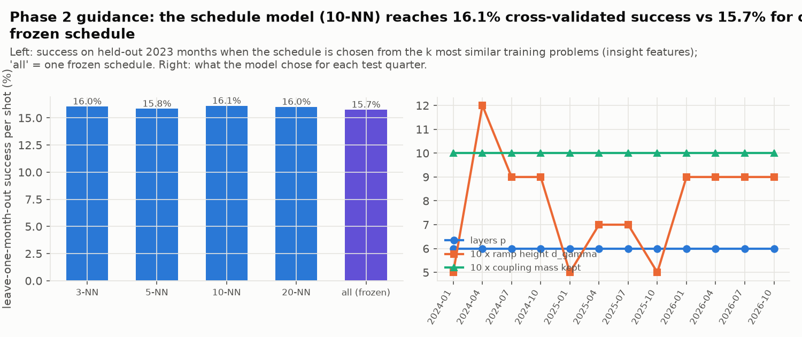
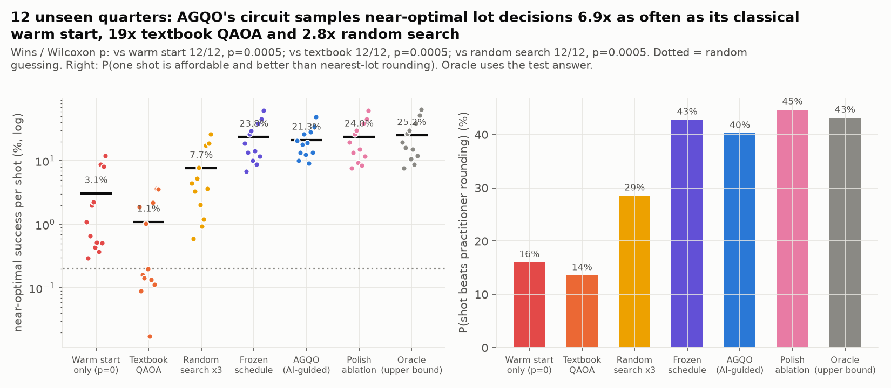
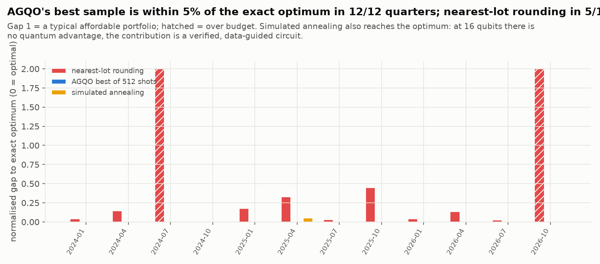
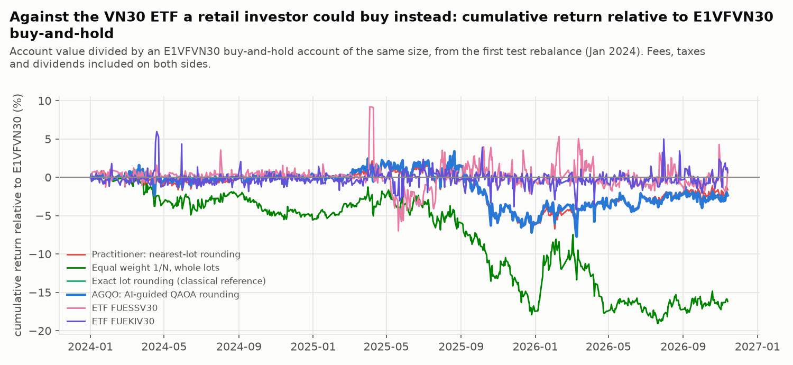

# AGQO — AI-Guided Quantum Optimisation for whole-lot VN30 portfolios

**AI-Quantum Challenge 2026 · Technical report · v3 (15 Nov 2026)**

AGQO helps a small Vietnamese investor hold "VN30, my way" in a real brokerage account, where
stocks trade only in **whole lots of 100 shares**. AI reads the market and the investor; a
QAOA circuit, designed and tuned from that insight, picks the whole-lot portfolio; exact
classical enumeration verifies every decision.

> **Tóm tắt.** AGQO giúp nhà đầu tư nhỏ nắm giữ danh mục bám VN30 theo quy tắc riêng (bỏ mã, giới hạn
> ngành, số mã, tiền mặt) bằng các lô 100 cổ phiếu. LLM Qwen3.8 chuyển yêu cầu tiếng Việt thành ràng
> buộc (đúng 35/35 câu thử, quy tắc từ khóa đúng 68,6 %) và viết giải thích tiếng Việt có kiểm tra số
> liệu (12/12 đạt). Mạch QAOA được thiết kế từ đặc trưng dữ liệu và chọn lịch tham số bằng mô hình học
> từ dữ liệu 2023; trên 12 quý 2024–2026 chưa từng thấy, mạch lấy được nghiệm gần tối ưu nhiều gấp 6,9
> lần trạng thái khởi động cổ điển, 19 lần QAOA sách giáo khoa và 2,8 lần tìm kiếm ngẫu nhiên (12/12 quý,
> p = 0,0005). Với tài khoản 20 triệu đồng, sai số bám giảm từ 12,1 % xuống 6,8 % so với cách làm tròn
> thông thường. Không tuyên bố ưu thế lượng tử: bộ giải cổ điển chính xác đạt cùng chất lượng.

| | |
|---|---|
| **Problem** | One lot of a VN30 stock costs 1.1–24 % of a 100M VND account, so optimiser weights cannot be bought as computed, and ETFs cannot exclude a stock or cap a sector. |
| **AI** | Statistics extract market and problem structure; **Qwen3.8-27B** turns Vietnamese instructions into checked constraints and writes verified explanations; a **learned model** chooses the circuit schedule from data features. |
| **Quantum** | A 16-qubit QAOA circuit built from the data insight (warm start, aligned mixer, RMS scaling, linear-ramp schedule) samples the whole-lot decision. |
| **Data** | 40 stocks ever in VN30 (point-in-time membership), VN30, VN-Index and three VN30 ETFs, daily 2022-01 → 2026-11. Train on 2023 only; test 2024-01 → 2026-11. |
| **Headline** | Circuit: 6.9× its classical warm start, 19× textbook QAOA, 2.8× random search, 12/12 test quarters (p = 0.0005). Finance: at 20M VND tracking error 6.8 % vs 12.1 % for practitioner rounding (95 % CI of the gap −6.9 to −3.8 pp). |

> **Claims we do not make.** 16 qubits can be enumerated classically in milliseconds, and simulated
> annealing also finds the optimum: there is **no quantum speed-up or advantage** here. Exact classical
> rounding tracks as well as AGQO. The contribution is a verified, data-guided circuit design method,
> an LLM that turns investor language into exact constraints, and an honest, statistically tested
> evaluation.

---

## 1. Why whole lots are the problem


A continuous optimiser over the VN30 members gives ideal weights. A small account must convert
them into whole lots under a cash budget, fees and a sale tax. Choosing *which* stocks get one more
lot is a binary problem — 2¹⁶ = 65,536 choices for 16 stocks — and that integer decision is the
quantum register. A VN30 ETF avoids lots but cannot follow personal rules.

## 2. How AGQO works

```mermaid
flowchart LR
    D[(Prices, point-in-time VN30<br/>membership, ETFs)] --> I1[Phase 1a · market insight<br/>correlation, effective bets,<br/>lot cost · statistics]
    U[/"Investor: 'Không đầu tư bất động sản,<br/>ngân hàng tối đa 30%'"/] --> L1[Phase 1b · LLM mandate compiler<br/>Qwen3.8 · JSON schema]
    L1 -->|validated constraints| QP[Continuous QP<br/>with the investor's caps]
    I1 --> QP
    QP --> H[Whole-lot QUBO<br/>cap-safe 16-qubit register]
    H --> I2[Phase 2a · problem insight<br/>warm start, couplings, scale]
    I2 --> G[Phase 2b · AI guidance<br/>k-NN schedule model<br/>trained on 2023]
    G --> C[QAOA circuit<br/>R1–R5 design rules]
    C -->|512 shots| V{Exact check<br/>cash · fees · tax · caps}
    H --> X[Exhaustive enumeration<br/>ground truth] -.scores.-> V
    V --> T[Trade list in whole lots]
    T --> L2[LLM explainer<br/>Vietnamese, every number verified]
```



| Phase | Input | Output | Who |
|---|---|---|---|
| 1a Market insight | 250 sessions of returns of the point-in-time members | correlation, market-factor share, effective number of bets, clusters, lot cost, rounding cost | statistics (`agqo/insight.py`) |
| 1b Investor insight | Vietnamese instruction + ticker/sector list | exclusions, sector caps, per-stock cap, max holdings, min cash, or a clarifying question | **Qwen3.8-27B** (`agqo/llm/tasks.py`) |
| — Problem | QP target, lots, prices, holdings, caps | 16-qubit QUBO equal to tracking error² + turnover + budget penalty; every state obeys the caps | code (`agqo/backtest.py`, `agqo/portfolio.py`) |
| 2a Problem insight | the QUBO and its continuous relaxation | warm-start probabilities and confidence, coupling sources and concentration, RMS scale | statistics (`agqo/insight.py`) |
| 2b AI guidance | five insight features | schedule (depth, ε, coupling mass, ramp heights), optional polish | **learned k-NN model** (`agqo/quantum/design.py`) |
| Quantum | Hamiltonian + designed circuit | 512 sampled lot decisions | QAOA (`agqo/quantum/simulator.py`, Qiskit export) |
| Verify | samples | the best affordable, rule-compliant decision; exact optimum for scoring | enumeration (`agqo/portfolio.py`) |
| Explain | code-built evidence pack | Vietnamese summary, trade notes, risk notes | **Qwen3.8-27B**, numbers checked |

**Circuit design rules** (each reads the data insight): R1 warm start from the continuous
relaxation (Egger et al. 2021); R2 mixer aligned with that start (He et al. 2023); R3 keep the
strongest couplings; R4 divide the Hamiltonian by its RMS so one schedule transfers between
quarters (Sureshbabu et al. 2024); R5 linear-ramp angles (Montañez-Barrera & Michielsen 2025).
Full mathematics: [docs/METHODS.md](docs/METHODS.md). Every number and table: [docs/RESULTS.md](docs/RESULTS.md).

## 3. Phase 1 — what the data says


VN30 behaves like ~13 independent bets, not 30: one market factor explains about 40 % of daily
variance. That is why a whole-lot portfolio can track the index and why the lot decisions of
different stocks are coupled.


About 90 % of the qubit coupling strength comes from stocks moving together, not from the cash
budget — the circuit's two-qubit gates encode co-movement risk.

## 4. Phase 2 — AI-guided circuit



1,080 schedules were scored on 48 training problems (every month of 2023 × four account sizes).
The schedule model (10 nearest neighbours in insight-feature space) wins leave-one-month-out
cross-validation narrowly (16.1 % vs 15.8 % success per shot for one frozen schedule). A short
COBYLA polish raised training success from 15.8 % to 17.3 % (45/48 problems), so by the rule fixed
before testing, AGQO uses it.

## 5. Results on 12 unseen quarters (2024-01 → 2026-10)

### 5.1 Quantum quality



| circuit (16 qubits) | near-optimal success / shot | P(shot beats practitioner rounding) | 2-qubit gates |
|---|---:|---:|---:|
| random guessing | 0.2 % | — | — |
| warm start only (classical, 0 layers) | 3.1 % | 16 % | 0 |
| textbook QAOA (p = 2, COBYLA) | 1.1 % | 14 % | 480 |
| random search over designs (3 seeds) | 7.7 % | 29 % | 381 |
| **AGQO (insight design + AI schedule + polish)** | **21.3 %** | **40 %** | 1,440 |
| frozen schedule (no model) | 23.8 % | 43 % | 1,440 |
| oracle schedule (uses the test answer) | 25.2 % | 43 % | 1,440 |

AGQO beats its warm start (6.9×), textbook QAOA (19×) and random search (2.8×) in **12 of 12**
quarters (Wilcoxon p = 0.0005 each). Two negative findings are reported as they are: the
training-chosen polish *lowered* test success (21.3 % vs 24.0 % without it; 7/12 quarters,
p = 0.42, not significant), and the learned schedule did not beat the frozen one on test. The gain
comes from the insight-driven circuit structure, not from per-quarter tuning. The circuit is deep
(p = 6, 1,440 two-qubit gates): fine for noiseless simulation, too deep for today's hardware.



### 5.2 Financial walk-forward at 100M VND


| strategy | TE vs VN30 (daily) | TE (weekly) | return / yr | vs E1VFVN30 / yr |
|---|---:|---:|---:|---:|
| **AGQO** | **2.96 %** | 3.22 % | 19.8 % | −1.06 % |
| exact lot rounding (classical) | 2.96 % | 3.22 % | 19.8 % | −1.06 % |
| textbook QAOA rounding | 2.96 % | 3.26 % | 20.2 % | −0.68 % |
| practitioner nearest-lot rounding | 3.03 % | 3.18 % | 20.1 % | −0.75 % |
| equal weight 1/N in lots | 6.58 % | 7.25 % | 13.5 % | −7.38 % |
| ETF E1VFVN30 buy-and-hold | 9.28 % | 5.17 % | 20.8 % | — |

At 100M VND AGQO matches the exact classical optimum and edges practitioner rounding by 0.07 pp —
inside the noise (95 % CI −0.19 to +0.04). It tracks VN30 more closely than the ETF's traded price
(weekly TE 3.2 % vs 5.2 %), while the ETF returned about 1 % a year more over this period.

### 5.3 Account size: where whole lots really matter


| account | practitioner TE | AGQO TE | difference (95 % CI) |
|---|---:|---:|---:|
| **20M VND** | 12.14 % | **6.77 %** | **−5.37 pp (−6.93, −3.84)** |
| 50M VND | 4.43 % | 3.83 % | −0.60 pp (−1.09, −0.19) |
| 100M VND | 3.03 % | 2.96 % | −0.07 pp (−0.19, +0.04) |
| 200M VND | 2.70 % | 2.50 % | −0.20 pp (−0.40, −0.04) |
| 500M VND | 2.51 % | 2.47 % | −0.05 pp (−0.10, −0.00) |

Moving-block bootstrap of paired daily active returns (21-day blocks). The smaller the account,
the more the integer lot decision decides tracking quality.

### 5.4 Personal rules (LLM → constraints → quantum)


Each instruction was compiled by Qwen3.8 and applied for the whole test period. **Every executed
portfolio obeyed every rule (0 violations, 0 fallbacks)**, because caps shape the qubit register so
that all 2ⁿ states are rule-compliant. AGQO tracks better than practitioner rounding under every
mandate (6.74 % vs 6.98 %, 3.93 % vs 4.21 %, 6.74 % vs 6.82 %). Excluding real estate and capping
banks costs about 3.8 pp of tracking error: the price of personalisation, shown to the investor.

### 5.5 LLM evaluation

| task | result |
|---|---|
| Mandate compiler, 35 hand-labelled Vietnamese instructions | **100 %** effective constraints correct (94.3 % strict JSON; two answers wrote a no-op "0 % cash") vs **68.6 %** for keyword rules; 2/2 vague instructions answered with a clarifying question; 0 invalid outputs |
| Explainer, 12 test quarters | **12/12** explanations with every number and trade verified against the evidence |
| Cost | one H100 batch per task on Modal, under 1 USD in total |



## 6. Run it

```bash
python3 -m venv .venv && source .venv/bin/activate
pip install -e '.[quantum,llm,dev]'
python -m agqo download                  # keyless data → data/vn30/ohlcv_daily.csv
modal run modal_app.py::download_weights # once: Qwen3.8-27B-FP8 weights into a Modal Volume
modal deploy modal_app.py
python -m agqo mandates --llm modal      # or --llm replay (no GPU, uses results/final/llm/llm_log.jsonl)
python -m agqo run                       # ~20 min on 8 CPU cores
python -m agqo explain --llm modal       # or --llm replay
python -m agqo report                    # figures + docs/RESULTS.md
pytest -q                                # 20 tests
```

Optional hardware run (IBM Quantum, needs your own token in `IBM_QUANTUM_TOKEN`):
`python -m agqo hardware --qasm results/final/circuits/<file>.qasm --confirm`.

```
agqo/
  download.py data.py        data and point-in-time universe
  insight.py                 phase 1 statistics
  mandate.py                 investor rules + keyword baseline
  portfolio.py classical.py  exact QUBO, QP, rounding, annealing
  backtest.py experiment.py  accounts, walk-forward, all stages
  stats.py report.py         tests and figures
  quantum/  design.py (rules + learned schedule) simulator.py spec.py search.py export.py hardware.py
  llm/      client.py (Modal / replay) tasks.py (mandate compiler, explainer)
modal_app.py                 Qwen3.8-27B on vLLM, one H100
results/final/               every number in this report, plus prompts and LLM outputs
```

## 7. Limitations

* **No quantum advantage.** Exact enumeration and simulated annealing solve the 16-qubit problem;
  the circuit is deep (1,440 two-qubit gates) and has not run on hardware.
* **Short sample.** 12 test quarters; at 100M VND the tracking gain over practitioner rounding is
  not statistically distinguishable from zero.
* **Data.** Provider back-adjusted prices understate historical lot costs (today's decision uses
  actual prices); cash-dividend treatment is unverified; membership is reconstructed from HOSE
  announcements; data redistribution rights are not granted by the connector.
* **LLM test set.** 35 instructions written by the developers, not real user requests.
* **Not investment advice.** AGQO proposes trades for the investor to review; it executes nothing.

## 8. AI-assistance declaration

Code, experiments and this report were developed with the help of an AI coding assistant (Claude
Code) under the team's direction; the team chose the method, reviewed results and can explain every
component. The product's own LLM is the open-weight Qwen3.8-27B, run on our Modal account.

References: see [docs/METHODS.md](docs/METHODS.md#references).
