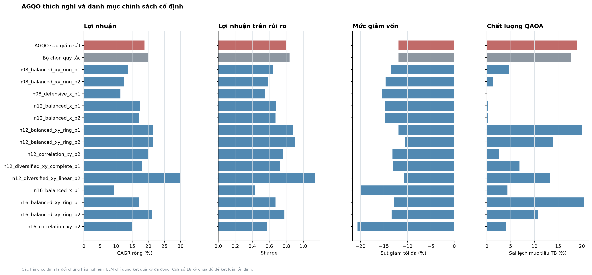
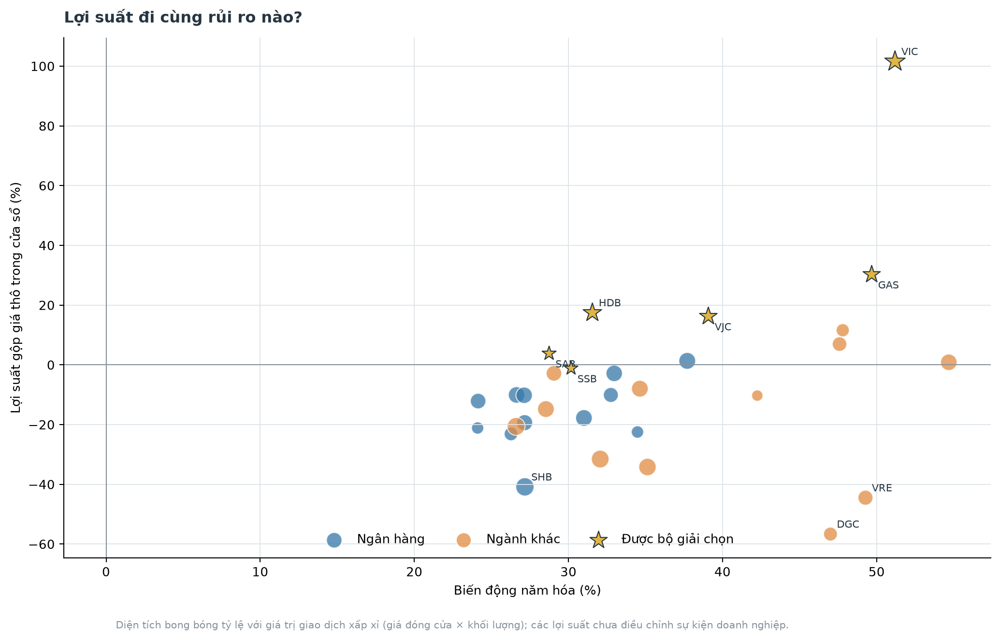
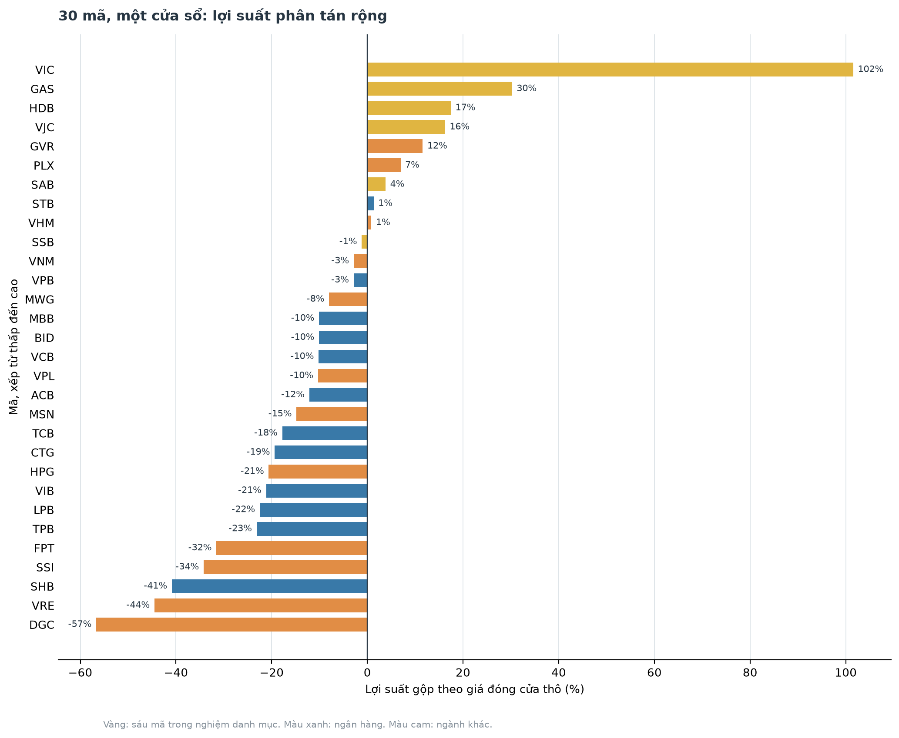

# AGQO: AI hướng dẫn tối ưu hóa lượng tử

AGQO kết hợp mô hình ngôn ngữ với QAOA để chọn cấu hình tối ưu danh mục cổ phiếu Việt Nam. Mô hình AI phân tích thống kê thị trường, insight có ngưỡng định lượng và kết quả của các chính sách đã hoàn tất; QAOA giải bài toán chọn đúng 6 mã. Bộ giám sát số học độc lập quyết định đề xuất nào đủ bằng chứng để thực thi.

## Kết quả hiện tại

Đây là kết quả walk-forward 16 kỳ từ **02/06/2025 đến 01/10/2026**, vốn mô phỏng 100 triệu đồng và phí 25 điểm cơ bản mỗi chiều. Thời gian kiểm định đã được xem ở các phiên bản trước, nên không còn là tập kiểm tra độc lập chưa từng quan sát.

| Phương pháp | CAGR ròng | Sharpe | Sụt giảm tối đa |
|---|---:|---:|---:|
| VN30 | 24,58% | 1,17 | -9,22% |
| VN-Index | 23,63% | 1,21 | -8,64% |
| Ledoit–Wolf, nghiệm chính xác trên toàn rổ | 49,68% | 1,53 | -15,92% |
| QAOA, XY vòng, p=1, 12 mã | 22,07% | 0,85 | -11,90% |
| Bộ chọn quy tắc → QAOA | 19,98% | 0,84 | -11,90% |
| **AGQO: Qwen → giám sát → QAOA** | **18,81%** | **0,80** | **-11,90%** |

Lượt chạy **chưa chứng minh AGQO tạo thêm lợi nhuận**: CAGR và Sharpe của AGQO thấp hơn VN30, bộ chọn quy tắc và cấu hình XY cố định. Bộ giám sát không đổi đề xuất nào (0/16); cả 16 lựa chọn đều qua kiểm tra thực thi theo bằng chứng đã khép. Vì thế, giá trị được chứng minh hiện tại là một quy trình AI–QAOA có thể kiểm toán, chứ chưa phải lợi thế đầu tư hay ưu thế lượng tử.


### QAOA có đo được ưu thế kỹ thuật không?

Đã so sánh 14 cấu hình trên 8, 12 và 16 qubit, với K=6, bộ trộn X/XY, độ sâu p=1/2 và nhiều cách nối. Mỗi lần tối ưu dùng 1.024 mẫu, COBYLA tối đa 100 lần đánh giá mỗi seed và ba seed cố định. Nghiệm vét cạn cổ điển trên cùng hàm mục tiêu là mốc tối ưu.

| Cấu hình | Kỳ regret ≤5% | Regret trung bình | Mẫu khả thi trung bình | Cổng hai qubit logic |
|---|---:|---:|---:|---:|
| X, p=1, 12 qubit | 16/16 | 0,36% | 40,05% | 66 |
| X, p=2, 12 qubit | 16/16 | 0,45% | 54,08% | 132 |
| XY vòng, p=1, 12 qubit | 0/16 | 20,51% | 100,00% | 90 |
| XY vòng, p=2, 12 qubit | 4/16 | 13,85% | 100,00% | 180 |
| XY tương quan, p=2, 12 qubit | 13/16 | 2,53% | 100,00% | 240 |

Trong mô phỏng này, bộ trộn X đạt regret thấp nhưng chỉ tạo khoảng 40–54% mẫu khả thi; XY luôn giữ đúng số mã nhưng chất lượng phụ thuộc cách nối. XY tương quan p=2 giảm regret đáng kể với chi phí cổng cao hơn. Các con số là proxy logic của mô phỏng, không phải số cổng sau biên dịch phần cứng. Chưa chạy QPU và chưa có bằng chứng ưu thế lượng tử.




## Thiết kế AI–Quantum

Toàn bộ prompt điều khiển Qwen được viết bằng tiếng Anh. Vì không giả định Qwen3-8B có kiến thức tài chính chuyên sâu, hệ thống giới hạn mô hình vào lựa chọn có cấu trúc và cung cấp định nghĩa theo đúng dữ liệu của dự án.

### Qwen3-8B, RAG và tiểu mô hình

- **Mô hình ngôn ngữ:** `Qwen/Qwen3-8B`, ghim phiên bản `b968826d9c46dd6066d109eabc6255188de91218`, NF4 4-bit qua Transformers trên Modal. Ưu tiên L4, dự phòng A10.
- **Phiên bản prompt:** `agqo-prompt-v9-en-rag-submodel-allowlisted-structured`; hướng dẫn và nhãn trong payload gửi mô hình dùng tiếng Anh.
- **RAG cục bộ:** bảy ghi chú có phiên bản về định nghĩa Sharpe/CAGR/CVaR, ý nghĩa trường VN30, hàm mục tiêu danh mục, QAOA, benchmark và các giới hạn dữ liệu. Kho tri thức không gọi API ngoài.
- **Tiểu mô hình dự báo:** `StandardScaler` + `LogisticRegression` dự báo xác suất VN30 vào chế độ biến động cao trong 21 phiên. Nó không dự báo lợi suất hoặc chọn mã.
- **Bộ insight định lượng:** tính xu hướng biến động, tương quan, độ phân tán, tỷ trọng ngành và thanh khoản đại diện theo ngưỡng cố định; từng insight được xác minh lại bằng mã.
- **Bộ giám sát:** so đề xuất với chính sách quy tắc dựa trên kết quả đã khép, regret, tỷ lệ mẫu khả thi, rủi ro và chi phí cổng.

Độ tin cậy dự báo biến động chưa đạt nền trong kỳ thử: Brier tháng **0,237** so với nền **0,217**, kỹ năng Brier **-9,32%**. Vì vậy prompt yêu cầu không tăng rủi ro hay độ sâu mạch chỉ dựa vào xác suất của mô hình này.

Qwen chỉ nhận payload thống kê tổng hợp, không nhận OHLCV thô. Ở từng tín hiệu, lược đồ JSON được tạo động để chỉ cho phép `policy_id`, `insight_codes` và `evidence_ids` nằm trong danh sách hợp lệ. Qwen không viết lời giải thích tự do hoặc tự tạo cờ rủi ro. Mã Python dựng phần diễn giải tiếng Việt và cờ rủi ro từ số liệu đã xác minh.

**Trích đoạn chỉ dẫn chính trong prompt:**

> You are a constrained decision controller in AGQO, not a financial analyst. Qwen3-8B may not know the project's finance definitions and must not fill gaps from memory. The supplied, date-cutoff payload and its retrieved method notes are the only authority. Choose one eligible policy, compare net financial outcomes with risk and solver evidence, and return only the allow-listed JSON fields.

Trong 16 tín hiệu, phiên bản prompt `agqo-prompt-v9-en-rag-submodel-allowlisted-structured` chọn XY vòng p=1 bảy lần và XY vòng p=2 chín lần. Cả 16 phản hồi đều hợp lệ theo lược đồ, không có sửa lỗi, và bộ giám sát không đổi đề xuất nào. Tổng mức dùng là 127.783 token đầu vào và 849 token đầu ra. Kết quả chưa cho thấy Qwen chọn ổn định được cấu hình có regret thấp nhất; đây là điểm cần cải thiện trước khi khẳng định AI làm bộ hướng dẫn tốt hơn bộ quy tắc.


### Bài toán tài chính và lượng tử

Mỗi qubit biểu diễn một mã cổ phiếu. Bài toán chọn đúng K=6 mã trong N ứng viên, giảm thiểu:

```text
λ (xᵀ Σα x) / K² − (μᵀ x) / K + chi phí tái cân bằng ước lượng
Σα = (1 − α) Σ + α diag(Σ),  với  Σ xi = K
```

`μ` và `Σ` được ước lượng từ dữ liệu lịch sử; `λ` điều chỉnh phạt rủi ro, `α` co rút hiệp phương sai. Mỗi chính sách định nghĩa sẵn N, mixer, bố trí mixer, p, λ, α và shots. Qwen chỉ chọn mã chính sách; QAOA không nhận văn bản tự do.


## Câu chuyện dữ liệu

Tập nghiên cứu cục bộ có **37.308 dòng**, **30 cổ phiếu cùng VN30 và VN-Index**, từ **04/01/2022 đến 19/10/2026**. Dữ liệu được lấy qua thư viện `vnstock-data` và đầu cuối DNSE chart API. Mã VN30 hiện tại được áp vào toàn bộ lịch sử; đây không phải lịch sử thành phần theo ngày hiệu lực. OHLCV thô chưa được xác minh điều chỉnh cổ tức, chia tách hay quyền mua. `close × volume` chỉ là đại diện thanh khoản.

Tệp OHLCV đầy đủ nằm tại `data/vn30_snapshot_20261002/ohlcv_daily.csv` trong máy làm việc và không đưa lên Git do quyền phân phối lại chưa được xác nhận. Bản kê khai nguồn, ngày tải và mã băm ở [manifest.json](data/vn30_snapshot_20261002/manifest.json); danh sách 30 mã ở [members.csv](data/vn30_snapshot_20261002/members.csv). Quy trình nạp và kiểm tra dữ liệu nằm trong [scripts/download_vn30_dataset.py](scripts/download_vn30_dataset.py) và [agqo/market_data.py](agqo/market_data.py).

Trong 252 phiên gần nhất (**14/10/2025–19/10/2026**), VN30 giảm **8,60%**, VN-Index giảm **4,26%** theo giá chỉ số. Giá cổ phiếu thô cho thấy phân tán lớn: VIC tăng **101,56%**, còn DGC giảm **56,67%**. Tương quan cao nhất gồm BID–VCB **0,813** và GAS–PLX **0,809**. Những số liệu này mô tả giai đoạn, không phải lợi suất điều chỉnh có thể giao dịch.








## Tài liệu, số liệu và cách chạy

- [Báo cáo kết quả đầy đủ](results/final/BAO_CAO_AGQO_CUOI_CUNG.md)
- [Số liệu walk-forward, QAOA và quyết định AGQO](results/final/agqo_final_walkforward.json)
- [Thống kê khám phá dữ liệu và nghiệm 30 mã](results/final/dataset_summary.json)
- [Toàn bộ quyết định Qwen3 đã xác thực](results/final/qwen3_decisions.json)
- [Tài liệu kỹ thuật từ đầu đến cuối](TAI_LIEU_KY_THUAT_AGQO.md)
- [Notebook chạy Qwen3 trên Modal](notebooks/AGQO_Qwen3_Modal.ipynb)

Môi trường dùng Python 3.12, pandas, NumPy, scikit-learn, SciPy/COBYLA, Matplotlib, Transformers, bitsandbytes và Modal. Bộ mô phỏng QAOA véc-tơ trạng thái dùng NumPy trên CPU; Qiskit/Aer và IBM Quantum là tùy chọn, không tạo kết quả trong báo cáo.

```bash
source .venv/bin/activate
set -a
source config/modal-qwen3.env
set +a
modal deploy modal_qwen3_agqo.py
python scripts/check_modal_qwen3.py
python scripts/run_ai_qaoa_walkforward.py --llm-guide modal-qwen3
```

Kết quả chính được ghi ở `results/final/`. Modal chỉ nhận insight đã tổng hợp; OHLCV và mô phỏng QAOA ở máy cục bộ. Không cần khóa API OpenAI.

## Giới hạn kết luận

- Chỉ có 16 kỳ danh mục; các phiên bản trước cũng đã xem giai đoạn này nên kết quả có nguy cơ thiên lệch lựa chọn.
- Dùng thành phần VN30 hiện tại áp ngược lịch sử, giá thô và chi phí mô phỏng; chưa có lịch thành phần point-in-time, giá total-return, thuế, trượt giá hay sổ lệnh.
- Bộ phân loại biến động có kỹ năng Brier âm trong mẫu.
- AGQO chưa vượt VN30, bộ chọn quy tắc hoặc các nghiệm cổ điển mạnh nhất.
- QAOA chạy bằng mô phỏng cổ điển; chưa chạy QPU và chưa có bằng chứng ưu thế lượng tử.
- Cần khóa dữ liệu và giai đoạn tương lai mới trước khi kết luận khả năng tổng quát hoặc tuyên bố lợi thế kinh tế.
