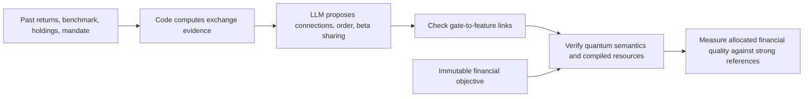
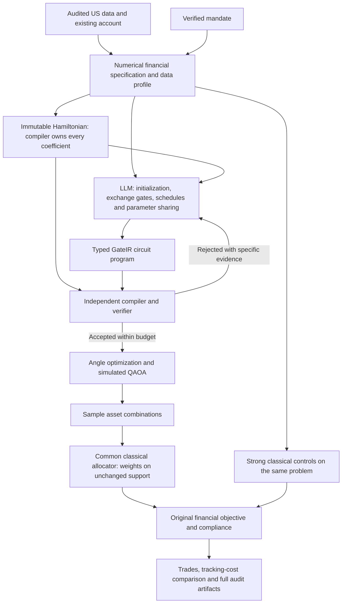
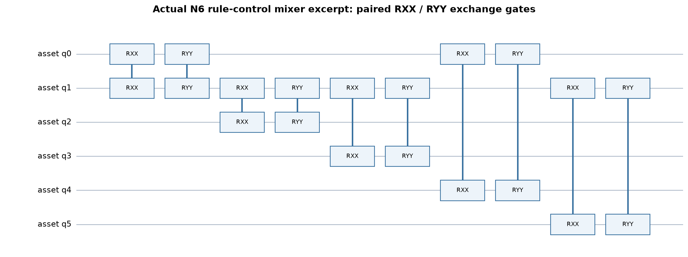
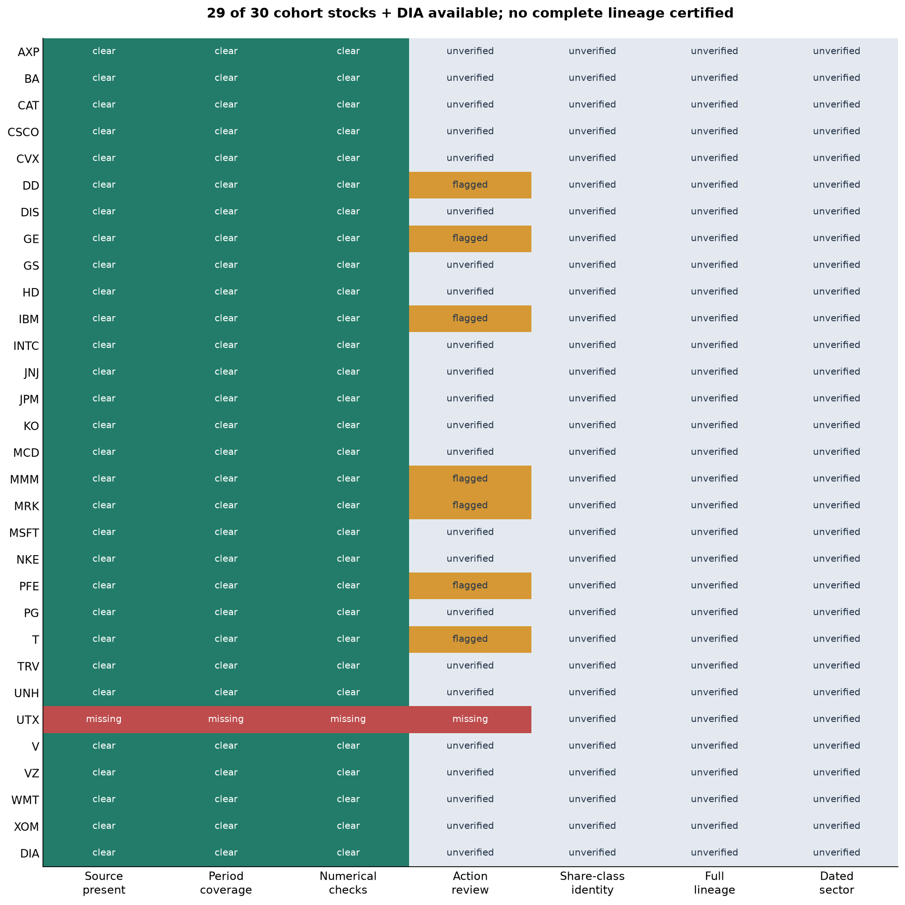
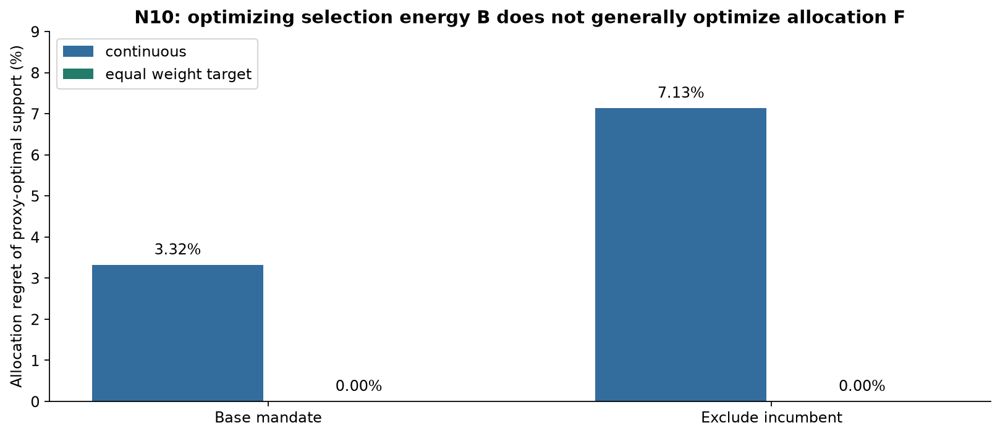
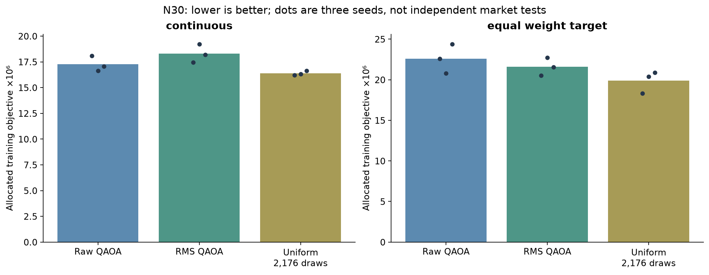
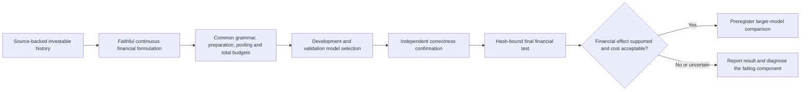

# AGQO — Verified LLM-Designed QAOA for Portfolio Repair

AGQO investigates whether data-conditioned LLM circuit design can improve the repair
of an existing constrained US-equity portfolio. The financial decision is concrete:
**which holdings should change to restore compliance while balancing index tracking
and trading cost?**

**Status · November 4, 2026:** the research application, compiler, simulations and
available-source audit run. Historical investment-data admission is blocked; no
production LLM, independent financial benefit or quantum advantage is qualified.
A larger model is a conditional next experiment, not a solution to missing data or
an unfaithful objective.

[Current findings](docs/research/QUALIFICATION_STATUS.md) ·
[How to resolve the blockers](docs/research/REMEDIATION_PLAN.md) ·
[Visual evidence](results/research/evidence_gallery_v1/GALLERY.md) ·
[User guide](docs/USER_GUIDE.md) · [Progress](PROGRESS.md) · [Agent handoff](AGENTS.md)

## Latest improvements

**Explicit data-to-gate guidance is now available as an offline, opt-in API.**
The older prompt supplied features but left their connection to circuit choices
largely implicit. `guidance.guided_request` now gives the designer exact numerical
exchange-sensitivity evidence and requires a matching evidence ID for every
selected connection, plus testable scheduling/parameter-sharing explanations.



| Numerical evidence | Design decision it can inform | Limit |
|---|---|---|
| Exact mean/RMS proxy change for an exchange | Compare candidate mixer connections | Sensitivity is not a favorable trade or proof of better allocated quality |
| Correlation and half-window change | Compare stable substitution hypotheses | Correlation alone does not determine a good mixer |
| Fixed assets and remaining cardinality | Connected exchanges on the free register | Other inequalities still need independent checks |
| Shared-qubit conflicts and compiled limits | Gate ordering and one/two beta groups | Overlapping reorderings change the circuit; resources must be measured |

Prepared **8 inspectable US-development requests / 964 pair records** without new
inference, stock filtering, allocation queries or holdout scoring. The descriptor
is checked against exhaustive small cases; continuous allocation quality remains
an independent test. This new prompt was **not used in the completed live run**.
Read the [feature visualization and requests](results/research/data_guidance_v1/RESULTS.md)
and [rationale, formulas and future ablation](docs/research/DATA_GUIDANCE_PROTOCOL.md).

Verified one-layer edits and disjoint exchange scheduling cut the recorded LLM
circuits' CX counts by **24–34%** and depth by **19–31%**, with the same selected
allocated objective on all12 opened edit runs. This is classical postprocessing,
not a new LLM achievement. The opt-in `--cost-aware` path now requires one layer,
measured resource budgets and independent admission before fitting, and gives its
uniform control the same fixed holdings/exclusions.

The new CPU-only US-return benchmark completed **168 runs and672 budget points**,
including N20/K5 with15,504 supports. Its curves reveal that the scheduled circuit
is7.63% better than conditioned uniform at8 observations but1.88% worse at88;
allocation-aware local swap is stronger on average at both budgets. These are
allocated training-objective differences on related development cases, not realized
returns or independent investment evidence. A larger LLM remains unjustified.

Read [results and charts](results/research/improvement_v1/RESULTS.md),
[the interpretation](results/research/improvement_v1/INSIGHTS.md),
[the frozen protocol](docs/research/IMPROVEMENT_PROTOCOL.md) and
[cost-aware implementation](docs/research/COST_AWARE_PIPELINE.md).

## Latest live Modal run

The connected cloud pipeline completed: **3/3 live Qwen Coder30 designs verified**,
**24/24 synthetic allocation decisions feasible**, and **9 exported QPY/QASM
circuits independently crosschecked** after download. Modal used an A100 80GB for
LLM inference and cloud CPU for simulation, allocation and accounting. All workers
were idle at the recorded post-run check.

All four methods reached the same small-case reference objective. LLM designs used
more CX gates, so this run establishes integration rather than an improvement in
quality/resources. The conservative reservation was USD2.33255; it is not an invoice.
Historical admission and production-model/financial qualification remain open.

Read the [measured results and charts](results/research/modal_e2e_v1/RESULTS.md),
[Modal runbook](docs/MODAL_RUNBOOK.md) and
[frozen integration protocol](docs/research/MODAL_E2E_PROTOCOL.md).

## What was done

| Work | Delivered | What the result establishes |
|---|---|---|
| Historical audit | Manifest/checksum, XNYS session, OHLC, volume and action-adjustment checks; source snapshot | 29/30 stocks plus DIA available; numerical cleanliness does not certify investability |
| Corporate actions | Eleven non-integer provider split labels flagged; ten primary-source event candidates recorded | Concrete reconstruction queue; not a complete accepted entitlement ledger |
| Runtime compatibility | Pinned artifact inventory, corrected Mistral weight-loader settings, three bounded Modal CPU tokenizer checks | All three tokenizer checks passed; no new model inference or full GPU-load qualification |
| Financial formulation | Shared continuous allocator, joint SCIP reference, exhaustive small support audit | Selection proxy B and allocated objective F differ materially under continuous weights |
| Quantum controls | Direct Ising compiler, gate verifier, conserved simulator, counter-Dicke and RMS controls | N30/K6 covers all 593,775 supports in ideal CPU simulation; stronger classical controls still matter |
| Independent-test protection | Exact reliability intervals and hash-bound final-test lock prerequisites | Actual readiness is blocked; final strategy outcomes were not opened by this work |
| English delivery | English maintained workflow, root guides, status, README and visual gallery | Historical originals and raw evidence are preserved, with English reading paths |

The software suite currently contains **168 passing tests**. See the worklog for
recorded checks and the [qualification status](docs/research/QUALIFICATION_STATUS.md)
for the substantive limitations.

## Where the LLM and QAOA contribute



The LLM **does not preselect winning stocks** or remove weak Hamiltonian terms.
QAOA searches support combinations; the common allocator solves the continuous
weight problem on each support. At N=30/K=6 the complete support space contains
593,775 combinations. That count does not establish quantum advantage: strong
classical solvers and uniform support sampling are explicit controls.

The model receives code-computed correlations, coefficient references, spectrum,
incumbent positions, mandate structure and resource budgets. It returns typed gate
choices and parameter sharing. The compiler implements the locked `COST`; generated
Python is never executed. Paired exchange gates preserve cardinality where verified;
sector, weight and turnover limits still require independent allocation checks.



**Figure 1. Verified gate-design example.** This is the first mixer from an actual verified **rule-control** GateIR. It is not
an LLM success example. Preparation, COST, slack and measurements are omitted from
this excerpt. GateIR, QASM, QPY, parameter values, source maps and verification are
retained together in the saved circuit bundle.

## Historical data: what is suitable and what is still missing

The investment-data candidate is the historical September 2013 DJIA inception cohort
with DIA as an ETF total-return benchmark proxy. Free provider files remain local.
A separate pinned academic US corpus supports conditional algorithm comparisons.

| Dataset | Useful property | Limitation and permitted use |
|---|---|---|
| Historical DJIA cohort + DIA | Manageable historical universe, long calendar span, incumbent holdings and real merger/spin-off complexity | UTX missing; identities, actions, sectors and tradability unresolved. No financial test admitted. DIA is not the official index. |
| Author-supplied 2010 index-tracking corpus | 386 identifiers × 252 dated returns; pinned revision and checksums; reproducible support experiments | Full-year membership conditioning. Algorithm comparisons only; not an unbiased investment backtest. |
| Synthetic fixtures | Exact edge cases, infeasibility, accounting and compiler invariants | Software validation only; cannot demonstrate market value. |

Thirty available files contain 3,520 sessions each. The audit found zero missing
internal sessions, invalid price rows, OHLC envelope violations or invalid volume
rows. It checked 1,725 internal cash adjustments with no residual above the review
threshold. These are provider-consistency diagnostics, not independent return proof.



**Figure 2. Historical admission readiness.** Source: historical_audit_v3. Eleven provider split labels across DD, GE, IBM, MMM, MRK, PFE and T need economic
classification. A vendor price-adjustment factor is not a share entitlement.
Reconstruct successor and distributed holdings, cash-in-lieu, availability and
reinvestment/trading treatment before claiming a tradable K-stock history. Do not
substitute current RTX for missing UTX or silently remove difficult securities.

[Full audit](results/research/historical_audit_v3/AUDIT.md) ·
[Primary event candidates](data/us_equities/review/action_evidence_candidates_v1.json) ·
[Source-reconciliation rationale](docs/research/DATA_RECONCILIATION.md)

## Model selection: evidence before size

The current shortlist contains Qwen3-Coder-30B-A3B-Instruct, Qiskit Mistral Small
3.2 24B and QUASAR 4B. Their roles are a general coding control, framework specialist
and quantum specialist. Published results motivate a shortlist; local independent
verification decides suitability for this particular gate grammar and financial task.


**Figure 3. Earlier model preflight checkpoint.** Source: tokenizer_preflight_v1 and the earlier QUASAR probe. All three passed pinned CPU tokenizer/chat rendering on Modal. No model weights or
GPU inference were requested in that preflight. Total CPU reservation was **USD 0.079125**, not a bill.
Mistral's registry now matches the pinned checkpoint's HF weight layout. Its full
GPU load and gate generation remain untested. The existing QUASAR interface probe
accepted 1/3 tasks; failures remain in the denominator. No production model is selected.
The subsequent connected Coder30 GPU run accepted 3/3 designs on small synthetic
cases; see the latest run above. That integration result does not qualify a model
on the independent correctness distribution or demonstrate financial value.

The confirmation protocol requires **72 independent cases and 72 first-pass successes**
to place a two-sided exact 95% reliability lower bound above 95%. This threshold is
conditional on justified independent cases, not repeated seeds. No model has run it.
The plot below is a **planning illustration**, not measured model performance.


**Figure 4. Planned confirmation threshold.** Exact binomial planning calculation from the qualification protocol; no observed model score is plotted, and independence must be justified.

[Published evidence and checkpoint rationale](docs/research/EVIDENCE_REVIEW.md) ·
[Qualification protocol](docs/research/QUALIFICATION_PROTOCOL.md) ·
[CPU receipts](results/research/tokenizer_preflight_v1/RESULTS.md)

## What the financial and quantum controls taught us

The primary financial task has continuous target weights. The support-selection
energy B(S) is a proxy for the actual post-allocation objective F(S). Exhaustive
N10 diagnostics found **3.32% and 7.13% allocation regret at the proxy optimum**.
A more capable circuit generator cannot make those two objective functions identical.
Explicit equal-weight targets pass identity, but they are a different mandate.



**Figure 5. Selection versus allocation.** Source: formulation_identity_v1, exhaustive opened N10 support audit. Regret concerns the allocated training objective, not realized investment returns.

Counter-Dicke preparation reaches all N30/K6 supports, at **33 physical qubits,
1,798 logical CX and depth 2,428**, compared with 30 / 998 / 445 for the sparse
control. This is a distinct counter construction, not a replication of the cited
ancilla-free Dicke algorithm. Clean workspace is counted in exported resources.
Published RMS conditioning changes optimization coordinates, not the financial
coefficients. Neither intervention consistently improves allocated quality.



**Figure 6. Allocated training quality.** Source: conditioning_control_v1. Bars show opened-development training objectives; lower is better. Dots are three
seeds, not independent market tests. The uniform reference uses 2,176 draws, the
maximum optimizer-plus-final allowance; the current quantum candidate pool uses
final samples only. Future pooling must be frozen before experiments. These
comparisons do not establish a same-runtime win, significance or realized returns.

[All control findings](results/research/control_summary_v1/FINDINGS.md) ·
[Preparation resources](results/research/evidence_gallery_v1/preparation-cost.png) ·
[Action-review chart](results/research/evidence_gallery_v1/action-review.png)

## Independent financial test and scaling decision



Proposed partitions are development **2014–2018**, validation **2019–2021**, and
final test **2022–2025**. Later rows have been inspected for hygiene and actions;
this work did not fit profiles or rank strategies on them. Prior exposure still
needs review, and historical holdout does not prove exclusion from LLM pretraining.

The final-test lock is currently **blocked**, with no strategy outcomes opened by
this readiness check. Admission requires reviewed data, confirmed model identity,
continuous-formulation evidence and a complete frozen comparison protocol. The
financial endpoint is compliance plus the out-of-sample tracking/cost frontier,
with uncertainty and full costs. A meaningful economic margin must be specified
before opening outcomes; the existing 20% quality/resource aspiration is not an
established investment-benefit threshold.

[Actual blockers](results/research/independent_test_readiness_v1/BLOCKED.json) ·
[Ordered repair queue](docs/research/QUALIFICATION_STATUS.md#why-financial-value-and-model-scaling-remain-unresolved)

## Run and reproduce

```bash
python3.12 -m venv .venv
.venv/bin/python -m pip install -e '.[dev,simulator,llm-modal,published-data,data-audit]'
.venv/bin/python -m pytest -q

# Local synthetic decisions; no GPU or market-performance claim.
.venv/bin/python -m agqo.research trajectory --source synthetic --output results/research/my_demo
.venv/bin/python -m agqo.research serve --output results/research/my_demo --port 8765
```

Open http://127.0.0.1:8765/ for the English decision interface. It compares existing
holdings, requirements, trades and verified evidence. The maintained UI does not
launch inference. Read saved artifacts without charges using `replay`.

```bash
# Historical hygiene audit, with source snapshot; blocked admission returns code 2.
.venv/bin/python -m agqo.research history-audit --output results/research/my_history_audit
.venv/bin/python -m agqo.research audit

# Conditional academic algorithm study; these commands use local CPU simulation.
.venv/bin/python -m agqo.research published-fetch
.venv/bin/python -m agqo.research published-study --output results/research/my_published
.venv/bin/python -m agqo.research preparation-study --output results/research/my_preparation
.venv/bin/python -m agqo.research formulation-audit --output results/research/my_formulation
.venv/bin/python -m agqo.research conditioning-study --output results/research/my_conditioning

# Regenerate charts from saved evidence only; use a new directory.
.venv/bin/python scripts/build_evidence_gallery.py --output results/research/my_gallery
.venv/bin/python -m http.server 8766 --bind 127.0.0.1 --directory results/research/my_gallery

# Read-only replay and explicit blocked market behavior.
.venv/bin/python -m agqo.research replay --output results/research/my_demo
.venv/bin/python -m agqo.research trajectory --source market --output results/research/my_market
```

The private Modal deployment and bounded dispatcher are reproducible with:

```bash
.venv/bin/modal deploy modal_research_pipeline.py
.venv/bin/python scripts/run_modal_pipeline.py --run-id modal_e2e_v1
```

The completed run ID returns without scheduling compute. New live experiments
require a new frozen protocol and run ID; see the runbook for source/hash checks,
resource reservations and explicit failure handling.

The gallery is available at http://127.0.0.1:8766/ when served. It filters evidence
by Data, Models, Finance and Quantum; clicking a chart opens the vector original.
Figures ship as PNG/SVG with generator source and input hashes. No model, optimizer
or trading action runs from this gallery. Source downloads require network access;
regenerating figures only needs the checked-in result records.

Use a new output directory whenever a frozen protocol changes. Do not relaunch the
completed tokenizer preflight to read its result. Paid model experiments are separate,
bounded Modal operations with reservations, revisions, request hashes, raw responses,
receipts and billing snapshots. The USD150 per-experiment policy is not an account-balance claim.

## Implementation and artifact map

| Module | Responsibility |
|---|---|
| `history_audit.py`, `data.py` | Source hygiene, provenance, reviewed market-data admission |
| `finance.py` | Financial specification, common allocator, joint SCIP, accounting and feasibility |
| `design.py`, `quantum.py` | Data-conditioned gate grammar, locked cost compilation and independent verification |
| `symmetry.py`, `preparation.py`, `conditioning.py` | Conserved simulation and explicitly versioned controls |
| `runner.py`, `workflow.py`, `walkforward.py` | Matched methods, common postprocessing and continuous accounts |
| `qualification.py` | Exact correctness intervals and fail-closed final-test integrity |
| `synthesis/client.py`, `budget.py`, Modal workers | Pinned requests, caching, bounded dispatch and complete accounting |
| `server.py`, gallery generator | English decisions, replay and visual evidence |

Full statevectors are capped at 16 total qubits. GateIR v2 supports up to 40 asset
qubits under a 2,000,000 represented-state cap, including slack. V1's 12-asset
schema remains compatible. The larger backend uses analytic certificates and
small-instance crosschecks, not a full independent Qiskit N30/N33 statevector check.
All results shown here are classical simulations, not hardware execution.

```text
results/research/<experiment>/
  protocol.json            # frozen settings and acceptance rules
  dataset_manifest.json    # provenance and coverage scope
  decisions.jsonl          # holdings, trades, feasibility and metrics
  circuits/                # GateIR, QASM, QPY and verification
  metrics.csv              # methods, seeds, resources and failures
  cost_report.json         # inference/execution accounting
  RESULTS.md               # measured findings and limitations
  PROGRESS.md              # status, blockers and next gate
```

Trajectory/pipeline runs produce this complete contract even when blocked; empty
decision records remain explicit. Source audits and specialist probes use their
own labeled contracts. A `completed` software stage is not a supported financial hypothesis.

## Documentation and preserved history

The maintained US CLI, application, documentation and reports use English. English
root guides replace superseded briefs; original Vietnamese documents are archived
unchanged under `docs/legacy/`. Historical raw responses, source snapshots, VN30
results and bilingual compatibility-parser examples retain their original language.
The older `agqo`, `agqo-repair` and `agqo-synthesize` commands remain compatibility
entry points; use `agqo-research` for the maintained US experiment semantics.
See [the language and archive guide](docs/LANGUAGE_AND_ARCHIVES.md).

For deeper review, read [technical decisions](docs/research/TECHNICAL_DECISIONS.md),
[data suitability](docs/research/DATA_SUITABILITY.md),
[result semantics](docs/RESULTS_SPEC.md), [the worklog](docs/research/WORKLOG.md)
and [AGENTS.md](AGENTS.md). The current findings take precedence over historical
plans; original negative results remain part of the evidence.
