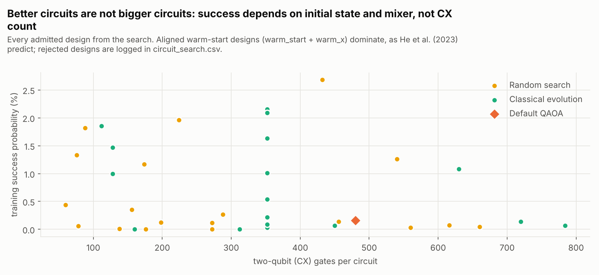
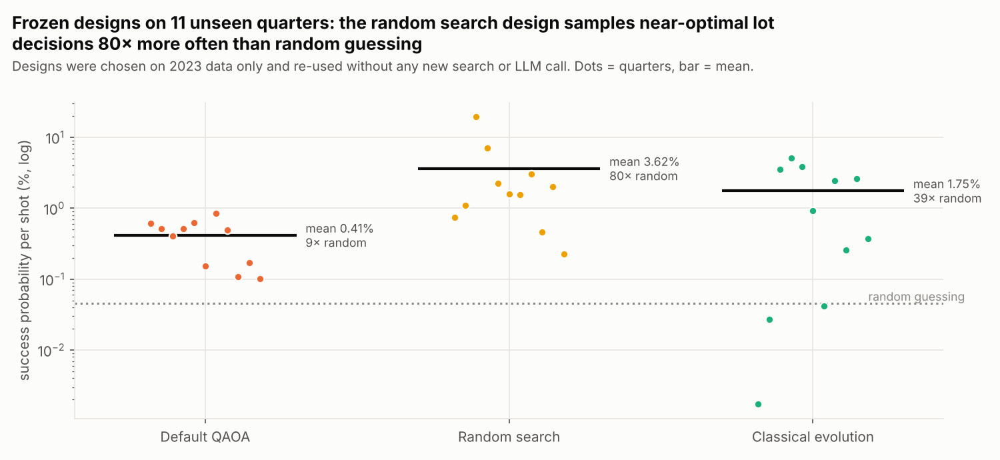
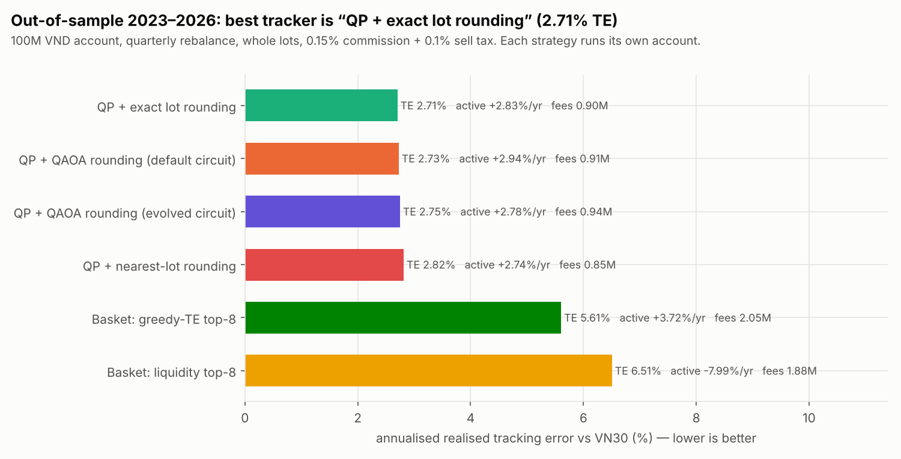

# AGQO — LLM-core, quantum-ready rebalancing for small VN30 investors

**AI-Quantum Challenge 2026 · Technical report · v2.0 (14 Nov 2026)**

AGQO helps a small Vietnamese investor hold "the VN30 index" in a real brokerage account,
where stocks trade only in **whole lots of 100 shares**. An **LLM** reads the market data and
writes two kinds of structured decisions: market **views**, and **quantum-circuit designs**. An
exact compiler turns the lot decision into a QUBO that *is* the financial objective. A
verified **QAOA** circuit samples near-optimal whole-lot portfolios. Everything is measured
against exact enumeration and strong classical baselines, out of sample.

| | |
|---|---|
| **Problem** | One lot of a VN30 stock costs **1.1 – 20.7 %** of a 100M VND account, so continuous optimiser weights cannot be bought as computed. |
| **Approach** | LLM market analyst → Black–Litterman tilt → continuous QP → **exact integer-lot QUBO** → LLM-designed, verified QAOA → affordable trade list |
| **Data** | VN30 daily prices and point-in-time membership, Jan 2022 – Oct 2026; 15 quarterly decisions, 2023 – 2026 |
| **Quantum** | 16-qubit lot-rounding register; frozen circuits reach **3.6 %** success per shot on 11 unseen quarters (**80×** random guessing, **9×** textbook QAOA) |
| **Finance** | Realised tracking error **2.71 %** (exact lot rounding) and **2.73 %** (QAOA) vs **2.82 %** for the practitioner baseline; 8-stock baskets: 5.6 – 6.5 % |
| **Status** | Baseline (no-LLM) run complete. Live LLM run: one command on Modal, see [Run it](#run-it). |

> **Claims we do not make.** 16 qubits can be enumerated classically in milliseconds, so there is
> **no quantum speed-up** here. The contribution is a faithful formulation, verified and
> transferable circuit designs, an LLM design method compared against same-budget controls,
> and a hardware-ready export.

---

## 1. Why lots are the hard part


A continuous min-tracking-error optimiser over all VN30 members gives the ideal weights. A
small account must convert them into whole lots under a cash budget, with fees and tax.
Rounding everything **down** wastes cash, and a naïve nearest rounding can overspend or pick
the wrong stocks to round up. Choosing *which* stocks get one more lot is a binary problem:
2¹⁶ = 65,536 choices for 16 stocks. **That integer decision is the quantum register.**

## 2. System


| Layer | What it does | Guard-rail |
|---|---|---|
| **LLM market analyst** (`agqo/llm/analyst.py`) | Reads code-computed features for every member and returns regime, views −2…+2 with confidence, and an 8-stock basket | Tickers and dates anonymised; JSON-schema decoding; invalid ids repaired and logged |
| **Compiler** (`agqo/portfolio.py`) | Turns the lot decision into $E(x)=x^\top Qx+h^\top x+c$ equal to tracking error² − view tilt + turnover + one calibrated affordability penalty | Unit test: identical on all 65,536 bitstrings to 1e-12; the LLM cannot touch coefficients |
| **LLM circuit architect** (`agqo/llm/architect.py`) | Evolutionary loop: proposes `CircuitSpec`s (depth, initial state, mixer, warm-start strength, coupling pruning, schedule, optimiser, CVaR), reads the scored leaderboard, proposes again | Verifier rejects misaligned or over-budget circuits; best design is frozen and reused with zero LLM calls |
| **QAOA** (`agqo/quantum/`) | Exact statevector simulator; Qiskit/OpenQASM export; IBM runner | Simulator and Qiskit agree to 1e-9 (test) |
| **Accounting** (`agqo/backtest.py`) | Separate 100M VND account per strategy; exact lots, 0.15 % commission, 0.1 % sale tax | Negative cash raises an error |

Mathematics: [docs/METHODS.md](docs/METHODS.md). Proposal: [docs/PROPOSAL.md](docs/PROPOSAL.md).

## 3. Results

All numbers come from `results/baseline/`; the full auto-generated page is
[docs/RESULTS.md](docs/RESULTS.md). Circuits are designed on the 4 quarters of 2023 and
tested on the 11 quarters from 2024-01 to 2026-07.

### 3.1 Circuit design matters more than circuit size


With the same budget of 24 designs, search finds circuits **17× better** than textbook QAOA
on the training quarters. The LLM architect competes in this exact race once the live run
is done (§5).



On average, aligned warm-start designs (`warm_start` initial state + `warm_x` mixer) succeed
**1.53 %** of the time, against **0.12 %** for the uniform/X-mixer textbook family and 0.65 %
for misaligned warm starts. This matches He et al. (2023) on initial-state/mixer
alignment, and it is the main lesson the architect should learn.

### 3.2 Frozen designs transfer to unseen quarters



| design (frozen on 2023) | success / shot | P(≥1 near-optimal in 512 shots) | CX gates | optimiser calls |
|---|---|---|---|---|
| random guessing | 0.045 % | 21 % | – | – |
| textbook QAOA (p=2) | 0.41 % | 77 % | 480 | 101 |
| classical evolution | 1.76 % | 72 % | 352 | 301 |
| random search | **3.62 %** | **96 %** | 432 | 105 |


QAOA's best sample is within 5 % of the exact optimum in **10/11** unseen quarters.
Nearest-lot rounding manages **2/11**, and once it overspends the budget. Simulated
annealing also reaches the optimum: the classical bar is high, as the literature warns.

### 3.3 Out-of-sample financial result



| strategy (100M VND, quarterly, lots, fees, tax) | realised TE | active return / yr | avg holdings |
|---|---|---|---|
| QP + nearest-lot rounding (practitioner) | 2.82 % | +2.74 % | 21.9 |
| **QP + exact lot rounding** | **2.71 %** | +2.83 % | 22.0 |
| QP + QAOA rounding (textbook circuit) | 2.73 % | +2.94 % | 22.3 |
| QP + QAOA rounding (evolved circuit) | 2.75 % | +2.78 % | 22.3 |
| 8-stock basket, greedy tracking-error | 5.61 % | +3.72 % | 8.0 |
| 8-stock basket, liquidity | 6.51 % | −7.99 % | 7.9 |


Solving the lot problem exactly lowers ex-ante tracking error by **11 bp** on average. Out of
sample, exact and QAOA rounding track **0.07 – 0.11 pp** better than practitioner rounding.
That is a small edge, consistent across the quantum variants, and smaller than the noise of
15 quarters. It should not be over-sold. Concentrated 8-stock baskets roughly **double**
tracking error, so the main product uses the full universe.

### 3.4 What the investor receives


`results/baseline/latest_trades.csv` lists the trades; `results/baseline/circuits/*.qasm` holds the
16-qubit circuits, ready for IBM hardware.

## 4. What changed from v1

| v1 (archived on branch `archive/agqo-v1-research`) | v2 (this branch) |
|---|---|
| US DJIA 2013 cohort, blocked by missing UTX and corporate actions | VN30 point-in-time, local and relevant to the judges |
| QAOA optimised an equal-weight proxy (3–11 % regret after allocation) | QUBO **is** the integer-lot objective (exact to 1e-12) |
| LLM edited circuits per instance; matched random search | LLM designs reusable circuit policies inside a scored evolutionary loop, with same-budget controls |
| 7,000 files, 40 protocols | ~20 source files, one command per step |

## 5. Run it

```bash
pip install -e '.[quantum,llm,dev]'
pytest -q                                              # 16 correctness tests
python -m agqo run --out results/baseline             # no LLM, ~17 min on 2 CPU cores
modal deploy modal_app.py                              # Qwen3 + vLLM on an A100-80GB
python -m agqo smoke-llm --llm modal --model coder30
python -m agqo run --llm modal --model coder30 --samples 3 --out results/llm_coder30
python -m agqo report --runs results/baseline results/llm_coder30   # rebuilds docs/RESULTS.md + figures
python -m agqo hardware --qasm results/llm_coder30/circuits/llm_2026-07-01.qasm   # dry run; add --confirm for IBM
```

Details and cost control: [docs/MODAL_RUNBOOK.md](docs/MODAL_RUNBOOK.md). Every LLM prompt and
answer is written to `results/<run>/llm_log.jsonl`.

## 6. Repository map

```text
agqo/
  config.py          every financial / quantum assumption in one place
  data.py            VN30 prices, point-in-time membership, rebalance calendar
  features.py        code-computed market features, anonymisation
  portfolio.py       Instance: integer-lot encoding, exact QUBO, Ising, accounting, Black–Litterman
  classical.py       continuous QP, greedy shortlist, simulated annealing, lot rounding
  backtest.py        accounts, instance builders (rounding / basket), performance
  experiment.py      stages A–D end to end
  report.py          figures with takeaway titles + docs/RESULTS.md
  llm/               client (Modal / OpenAI-compatible / replay / mock), analyst, architect
  quantum/           CircuitSpec + verifier, statevector QAOA, Qiskit export, IBM runner
modal_app.py         vLLM server class on Modal
data/vn30/           prices (local, git-ignored), membership with sources, manifest with SHA-256
results/baseline/    every table behind this report
docs/                PROPOSAL, METHODS, PLAN, CHECKPOINTS, RESULTS, MODAL_RUNBOOK, figures/
tests/               QUBO identity, Ising identity, PSD tracking error, exact cash, Qiskit agreement, parsing
```

## 7. Limitations

Adjusted prices are used for lot costs before 2026. 1–5 historical members per quarter have no
price file, so the universe is mildly survivor-biased. VN30 is a price index. LLM pre-training
may contain market history (mitigated by anonymisation). No hardware run is included yet.
Full list: [METHODS §7](docs/METHODS.md#7-known-limitations).

## References

Egger et al. 2021 (warm-start QAOA) · He et al. 2023 (initial-state/mixer alignment) ·
Barkoutsos et al. 2020 (CVaR) · Hodson et al. 2019 (discrete-lot rebalancing with QAOA) ·
Novikov et al. 2025 (AlphaEvolve) · Tyagin et al. 2025 (QAOA-GPT) · Yu et al. 2025 (QUASAR) ·
Lee et al. 2025 (LLM Black–Litterman) · Agliardi et al. 2025 (IBM–Vanguard) ·
Stopfer & Wagner 2025 (quantum portfolio benchmark) · Koch et al. 2025 (QOBLIB).
Full citations in [docs/METHODS.md](docs/METHODS.md#references).
