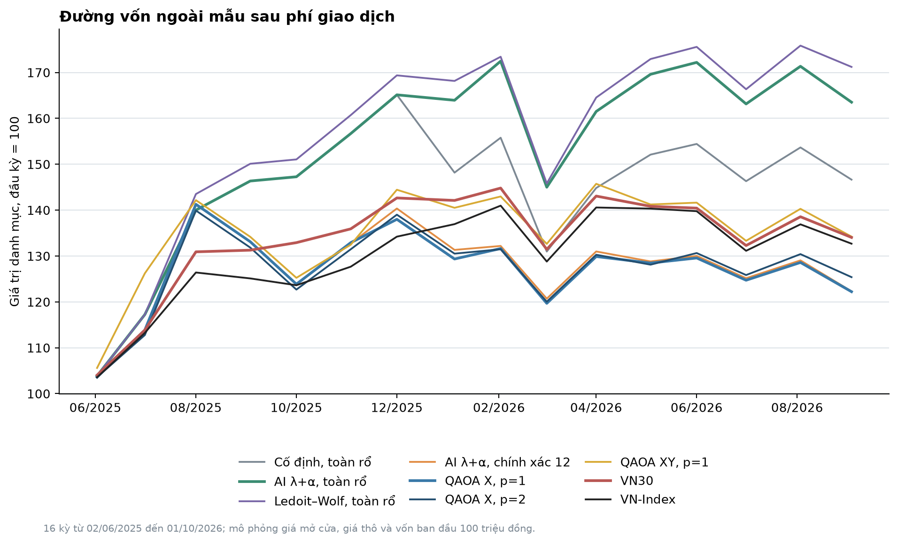
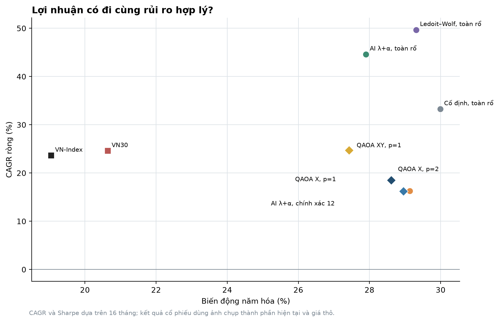
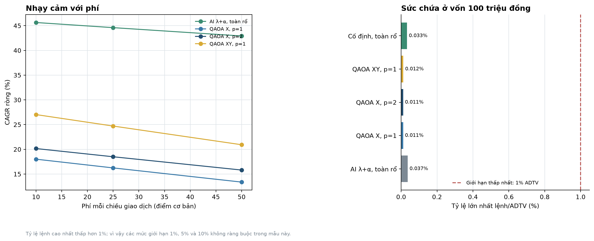
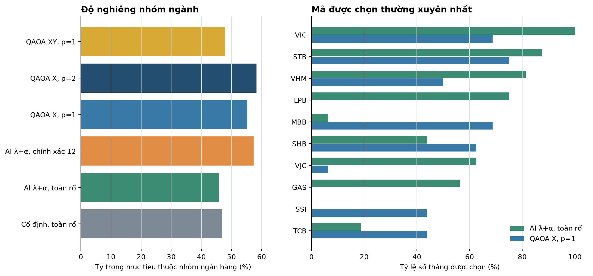
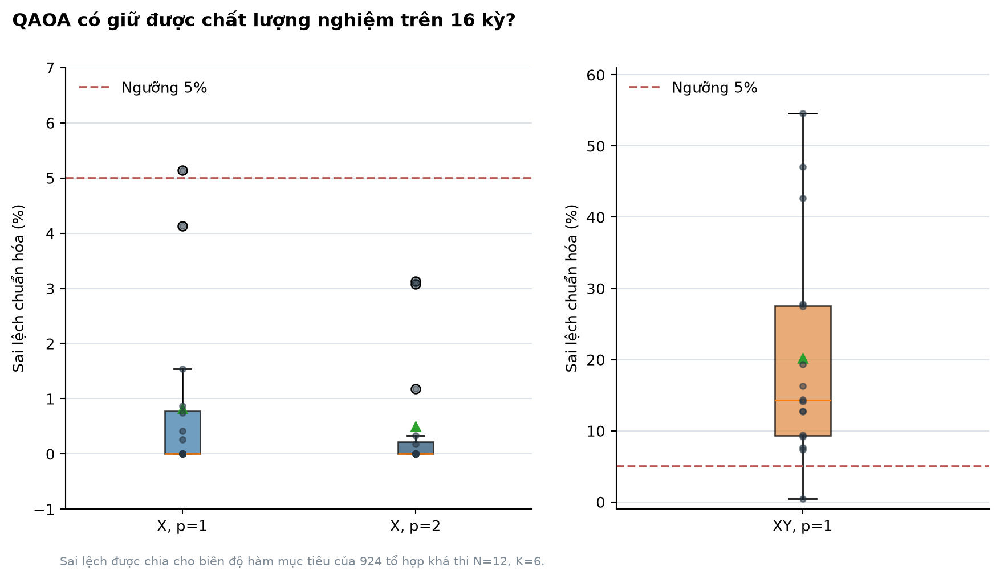
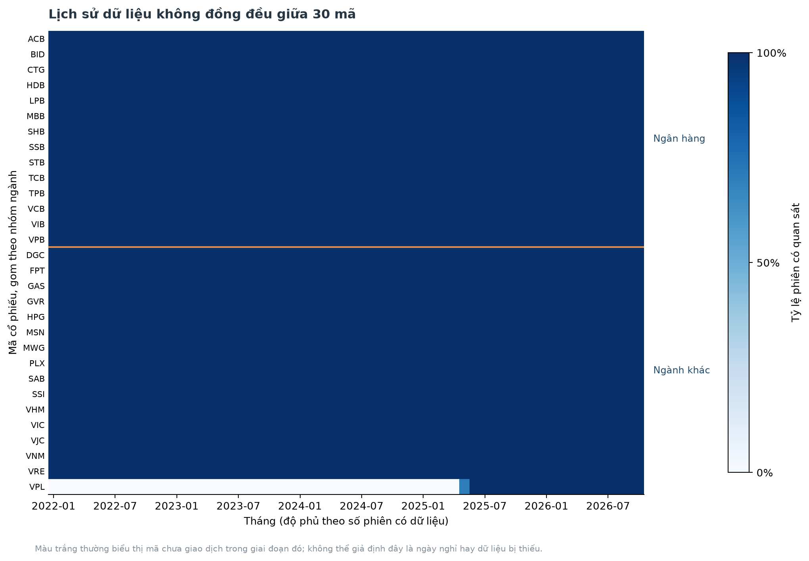
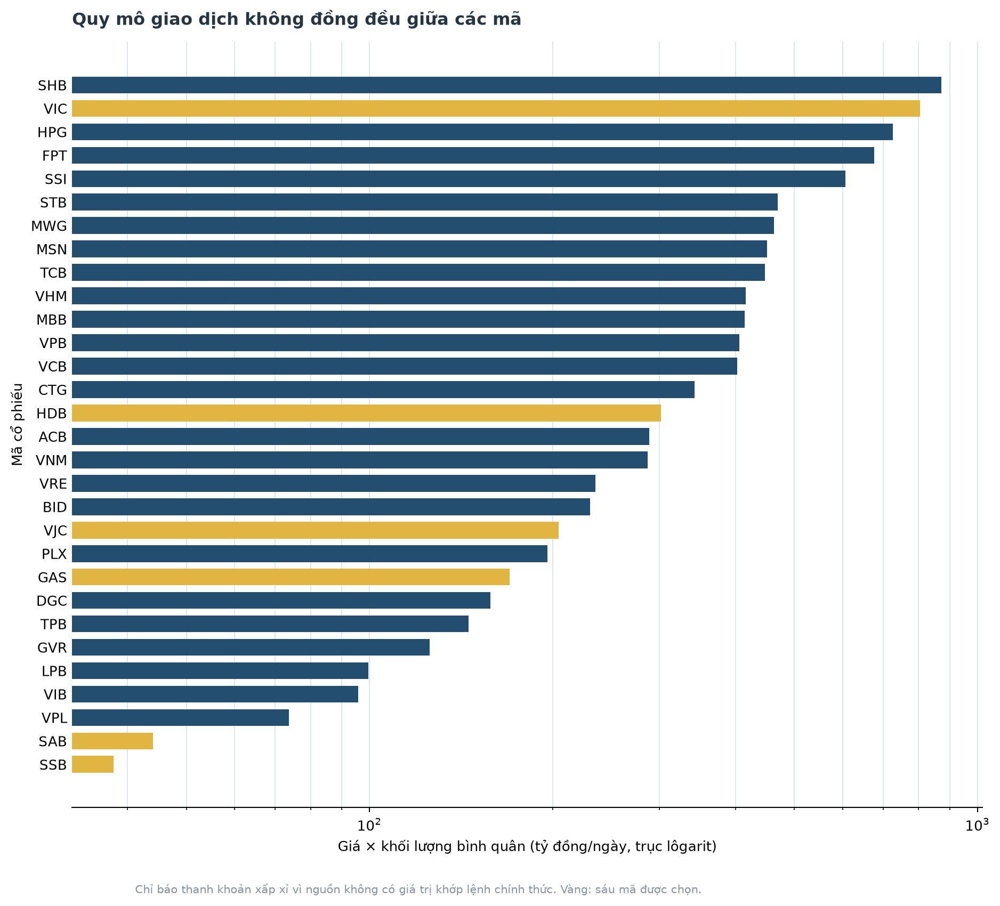
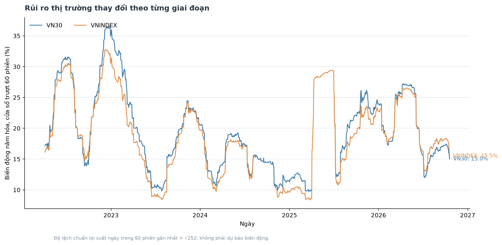

# AGQO: điều chỉnh rủi ro bằng AI và chọn danh mục bằng QAOA

AGQO là quy trình lai: mô hình học máy tạo xác suất chế độ thị trường, mô hình ngôn ngữ đọc các insight định lượng cùng kết quả đã khép của những chính sách trước, rồi chọn cấu hình QAOA từ một danh mục hữu hạn. QAOA giải bài toán chọn sáu cổ phiếu; các phương pháp hiện có tiếp tục chạy làm đối chứng. Hiệu quả được so trên lợi nhuận ròng, rủi ro, chi phí và chất lượng nghiệm.

**Kết quả đã lưu hiện tại là đường cơ sở:** lần chạy này chưa gọi LLM nên chưa có số liệu lợi nhuận AGQO thích nghi. Đã có [notebook Qwen3 trên Modal](notebooks/AGQO_Qwen3_Modal.ipynb), dùng mô hình mã nguồn mở trực tiếp trên GPU Modal, không cần API OpenAI. Khi bật, mỗi tín hiệu sẽ chạy bóng toàn bộ 12 chính sách QAOA để LLM dùng kết quả các kỳ đã đóng khi chọn cấu hình kế tiếp. Kết quả nền hiện có chưa cho thấy ưu thế lượng tử: mô hình phân loại chưa thắng tỷ lệ nền, Ledoit–Wolf có hiệu quả tài chính cao nhất trong cửa sổ ngắn, còn nghiệm chính xác cổ điển nhanh hơn QAOA.

> Các kết quả cổ phiếu dùng OHLCV thô và ảnh chụp thành phần VN30 hiện tại áp ngược lịch sử. Chưa xác nhận điều chỉnh cổ tức/quyền và chưa có lịch sử thành phần theo ngày; không dùng các con số dưới đây làm lợi nhuận đầu tư thực tế.

## Kết quả chính

Kiểm định danh mục gồm 16 kỳ, từ 02/06/2025 đến 01/10/2026. Mỗi tín hiệu được tính sau phiên cuối tháng, giao dịch ở giá mở cửa phiên kế tiếp và nắm giữ đến lần vào lệnh kế tiếp. Vốn mô phỏng 100 triệu đồng, phí giả định 25 điểm cơ bản cho mỗi chiều, giới hạn lệnh 5% giá trị giao dịch bình quân ngày.

| Phương pháp | CAGR ròng | Biến động năm hóa | Sharpe | Sụt giảm tối đa | Giá trị cuối kỳ từ 100 triệu |
|---|---:|---:|---:|---:|---:|
| VN30 | 24,58% | 20,64% | 1,17 | -9,22% | 134,04 triệu |
| VN-Index | 23,63% | 19,05% | 1,21 | -8,64% | 132,68 triệu |
| Rủi ro cố định, nghiệm chính xác trên toàn rổ | 33,26% | 29,99% | 1,11 | -20,69% | 146,64 triệu |
| AI điều chỉnh λ và α, nghiệm chính xác trên toàn rổ | 44,60% | 27,90% | 1,47 | -15,93% | 163,52 triệu |
| Ledoit–Wolf, nghiệm chính xác trên toàn rổ | 49,68% | 29,31% | 1,53 | -15,92% | 171,21 triệu |
| AI và nghiệm chính xác trên 12 mã thanh khoản cao | 16,30% | 29,13% | 0,65 | -14,56% | 122,30 triệu |
| AI + QAOA X, p=1 | 16,24% | 28,95% | 0,65 | -15,28% | 122,22 triệu |
| AI + QAOA X, p=2 | 18,50% | 28,61% | 0,72 | -14,20% | 125,39 triệu |
| AI + QAOA XY, p=1 | 24,70% | 27,42% | 0,94 | -11,90% | 134,23 triệu |

Ledoit–Wolf vượt cả VN30 và danh mục AI trong mẫu này, nhưng kiểm tra ngắn và dữ liệu thô không cho phép kết luận có thể lặp lại. AI điều chỉnh cả λ và α có kết quả cao hơn rủi ro cố định, song mô hình dự báo biến động lại kém chuẩn nền; không thể quy phần vượt trội cho năng lực dự báo của AI.

### Các thước đo tài chính bổ sung của đường cơ sở

| Phương pháp | Sortino | Calmar | VaR tháng 95% | CVaR tháng 95% | Hệ số lợi nhuận | Tháng dương |
|---|---:|---:|---:|---:|---:|---:|
| VN30 | 2,42 | 2,66 | -6,66% | -9,22% | 2,57 | 62,5% |
| VN-Index | 2,38 | 2,73 | -6,79% | -8,64% | 2,49 | 56,3% |
| AI λ+α, nghiệm chính xác toàn rổ | 2,73 | 2,80 | -7,92% | -15,93% | 3,07 | 75,0% |
| Ledoit–Wolf, nghiệm chính xác toàn rổ | 3,06 | 3,12 | -7,92% | -15,92% | 3,44 | 75,0% |
| QAOA X, p=1 | 1,39 | 1,06 | -7,48% | -9,07% | 1,66 | 56,3% |
| QAOA X, p=2 | 1,59 | 1,30 | -7,38% | -8,69% | 1,75 | 56,3% |
| QAOA XY, p=1 | 2,10 | 2,08 | -6,80% | -7,22% | 1,96 | 56,3% |

Sharpe giả định lãi suất phi rủi ro bằng 0. VaR là phân vị 5% của lợi suất tháng; CVaR là lợi suất trung bình ở phần đuôi đó. Chỉ có 16 kỳ nên cả các thước đo đuôi rủi ro lẫn hệ số lợi nhuận đều mang tính mô tả, chưa phải ước lượng ổn định.

### Đường vốn sau phí

### Lợi nhuận so với rủi ro

### Chi phí, doanh số và sức chứa

Danh mục AI toàn rổ có doanh số hai chiều trung bình 40,8% mỗi kỳ và tổng chi phí khoảng 2,41 triệu đồng trên vốn ban đầu 100 triệu. QAOA X p=1 có doanh số 81,5% và chi phí khoảng 4,06 triệu. Lệnh lớn nhất chỉ bằng khoảng 0,04% ADTV ở danh mục AI toàn rổ và 0,012% ở QAOA X; giới hạn thấp nhất 1% chưa ràng buộc ở quy mô vốn giả định này.

### Cơ cấu danh mục

Tỷ trọng nhóm ngân hàng trung bình chiếm 45,8% ở danh mục AI toàn rổ, 55,2% ở QAOA X p=1 và 58,3% ở QAOA X p=2. VIC xuất hiện trong cả 16 kỳ ở nghiệm AI toàn rổ; STB xuất hiện 14 kỳ. Đây là độ tập trung đáng kể cần đưa giới hạn ngành và giới hạn mã vào vòng tiếp theo.

## AI đã làm gì và đạt kết quả nào?

- Đầu vào là sáu đặc trưng chỉ số VN30: biến động 20/60/120 phiên, lợi suất tích lũy 20/60 phiên và tỷ số biến động 20/120.
- Nhãn là biến động năm hóa của 21 phiên tiếp theo vượt phân vị 70% đã tính trên tập huấn luyện.
- Dùng hồi quy logistic có điều chuẩn L2. Tập huấn luyện ban đầu kết thúc ngày 31/10/2024; tập xác nhận từ 01/11/2024 đến 30/04/2025 chọn C=10 bằng log-loss. Nhãn bị chặn 21 phiên trước từng ranh giới.
- Sau khi khóa C và ngưỡng, mô hình được khớp mở rộng tại mỗi ngày tín hiệu bằng nhãn đã trưởng thành; tập kiểm tra không tham gia chọn cấu hình.
- Xác suất p điều chỉnh λ = 2 + 8p và α = 0,10 + 0,60p. Từ đó, AI điều chỉnh mức ngại rủi ro và mức co hiệp phương sai về đường chéo.
- Trên 345 dự báo ngày ngoài mẫu, điểm Brier là 0,257 so với 0,225 của tỷ lệ nền mở rộng; kỹ năng Brier là -14,3%. Log-loss là 0,748 so với 0,643 của nền. Tại 16 tín hiệu tháng, Brier là 0,237 so với 0,217 của nền, kỹ năng -9,3%.
- Nhãn ngày sử dụng 21 phiên tương lai chồng lấn; do đó 345 dự báo không phải 345 quan sát độc lập.

## QAOA nằm ở đâu?

QAOA là bộ giải xấp xỉ cho bài toán chọn danh mục nhị phân sau khi AI đã thiết lập các tham số tài chính:

1. Một qubit biểu diễn một trong 12 cổ phiếu có giá trị giao dịch ước tính cao nhất trong 20 phiên.
2. Chọn đúng K=6 cổ phiếu, tương ứng 12 qubit và 924 tổ hợp khả thi.
3. Hàm mục tiêu là λ nhân phương sai danh mục chia K², trừ lợi nhuận trung bình ước lượng chia K.
4. Bộ trộn X bắt đầu bằng chồng chập đều và thêm hạng phạt để buộc tổng số bit 1 bằng K. Bộ trộn XY trao đổi trạng thái liền kề để giữ nguyên K.
5. COBYLA tối ưu góc QAOA với tối đa 50 lần đánh giá, 512 mẫu mỗi lần, ba hạt giống 11/23/47. Mỗi tháng chọn mẫu khả thi có điểm mục tiêu tốt nhất trong ba lượt.
6. Nghiệm được so với bộ duyệt chính xác trên đúng 12 mã, cùng μ, Σ, λ, α. Sai lệch chuẩn hóa chia cho biên độ mục tiêu giữa nghiệm tốt và xấu trong 924 tổ hợp.

| Cấu hình | Kỳ có sai lệch mục tiêu ≤5% | Sai lệch trung bình | Xác suất mẫu khả thi trung bình |
|---|---:|---:|---:|
| X, p=1 | 15/16 | 0,82% | 55,7% |
| X, p=2 | 16/16 | 0,49% | 75,4% |
| XY, p=1 | 1/16 | 20,20% | 100,0% |

Mỗi lớp có 66 tương tác cặp do ma trận hiệp phương sai dày; p=2 tăng gấp đôi số lớp tương tác. Mô phỏng dùng véc-tơ trạng thái NumPy với 4.096 trạng thái cơ sở. Nghiệm chính xác trên cùng 12 mã mất tổng cộng 0,0036 giây trong 16 kỳ; QAOA X p=1 cần 0,912 giây cho 48 lượt mô phỏng. Khi đủ 30 mã, C(30,6)=593.775 danh mục; do VPL chưa đủ lịch sử ở các kỳ đầu, kích thước thực tế là 29–30 mã. Năm cấu hình nghiệm chính xác toàn rổ trong 16 kỳ mất tổng cộng 5,11 giây.

**Chưa chạy QPU.** Vì vậy đây là kết quả mô phỏng QAOA cổ điển, không phải bằng chứng lợi thế lượng tử. Nghiệm chính xác cổ điển vừa là chuẩn kỹ thuật vừa là phương pháp tài chính mạnh hơn ở quy mô hiện tại.

## Dữ liệu

| Thuộc tính | Giá trị |
|---|---|
| Phạm vi | 30 cổ phiếu hiện thuộc VN30, chỉ số VN30 và VN-Index |
| Kích thước | 37.308 dòng OHLCV |
| Khoảng giá | 04/01/2022–19/10/2026 |
| Danh sách thành phần | Ảnh chụp ngày 02/10/2026 từ HODL.VN; không phải lịch sử thành phần theo ngày hiệu lực |
| Bộ lấy dữ liệu | [Thư viện vnstock-data](https://github.com/nguyenthdat/vnstock-data), mã nguồn ghim trong tệp kê khai |
| Đầu cuối giá | [DNSE chart API](https://services.entrade.com.vn/chart-api/v2/ohlcs) |
| Bản kê khai | [manifest.json](data/vn30_snapshot_20261002/manifest.json) |
| Mã trong ảnh chụp | [members.csv](data/vn30_snapshot_20261002/members.csv) |

Dữ liệu thô được giữ ở máy làm việc tại data/vn30_snapshot_20261002/ohlcv_daily.csv và bị loại khỏi Git vì quyền phân phối lại chưa được xác nhận. Danh sách thành phần 02/10/2026 được chụp từ [HODL.VN](https://www.hodl.vn/bai-hoc/vn30-gom-nhung-ma-nao); đây không phải nguồn lịch sử thành phần HOSE. Bộ nạp gộp nến trùng ngày theo giá mở cửa đầu tiên, cao nhất, thấp nhất, giá đóng cửa cuối và tổng khối lượng. Các giá phải dương, không trùng mã-ngày, không có OHLC sai thứ tự và không có khối lượng âm.

Lợi suất tính từ giá thô. Nghiệm danh mục dùng tối đa 252 phiên gần nhất, tối thiểu 126 quan sát hợp lệ mỗi mã. Ứng viên QAOA được lọc bằng giá trị giao dịch ước tính: giá đóng cửa nhân khối lượng, bình quân 20 phiên. Giá trị này không thay thế giá trị khớp lệnh chính thức.

### Nhận định dữ liệu gần nhất

Cửa sổ mô tả riêng gồm 252 phiên từ 14/10/2025 đến 19/10/2026; không nhầm với kỳ kiểm tra danh mục. Trong cửa sổ này, VN30 giảm 8,60%, VN-Index giảm 4,26%, còn danh mục đều 30 mã giảm 6,74%, trước phí. Lợi suất giá thô dao động mạnh giữa các mã: VIC tăng 101,56%, DGC giảm 56,67%. Tương quan cặp trung bình 0,305; 14/30 mã thuộc nhóm ngân hàng. Các kết quả này là mô tả dữ liệu, chưa điều chỉnh sự kiện doanh nghiệp.

### Biểu đồ khám phá dữ liệu

**Độ phủ:** VPL chỉ có lịch sử từ 13/05/2025; các ô trống là giai đoạn không có quan sát cho mã đó.

**Chỉ số:** chuẩn hóa VN30 và VN-Index về cùng mốc 100, đồng thời theo dõi sụt giảm từ đỉnh.

**Lợi suất và rủi ro:** lợi suất cao đi cùng biến động và sụt giảm riêng biệt; kích thước điểm là giá trị giao dịch ước tính.

**Phân tán mã:** VIC tăng mạnh trong khi DGC, VRE và một số mã khác giảm sâu trên giá thô.

**Tương quan:** các cặp ngân hàng và dầu khí có biến động đồng hướng rõ rệt; chọn mã riêng lẻ không đủ để kiểm soát rủi ro danh mục.

**Thanh khoản:** giá đóng cửa nhân khối lượng chỉ là đại diện thô, không phải giá trị khớp lệnh do sở giao dịch xác nhận.

**Chế độ rủi ro:** biến động trượt của hai chỉ số thay đổi đáng kể theo thời gian; đây là động lực để thử bộ điều khiển rủi ro AI.

Các chỉ số, danh mục từng kỳ, cấu hình QAOA, chi phí và khoảng tin cậy được trình bày trong [báo cáo kết quả đầy đủ](results/BAO_CAO_AI_QAOA_WALK_FORWARD.md).

## Công nghệ và mã nguồn

| Thành phần | Công nghệ/chức năng |
|---|---|
| Ngôn ngữ | Python 3.12 |
| Bảng dữ liệu và ma trận | pandas, NumPy |
| Mô hình AI | scikit-learn: StandardScaler, LogisticRegression |
| Tối ưu góc | SciPy COBYLA |
| Bộ giải danh mục | Duyệt chính xác cổ điển theo ma trận tổ hợp được lưu đệm |
| Mô phỏng QAOA | NumPy, mô phỏng véc-tơ trạng thái, bộ trộn X và XY |
| Mạch lượng tử tùy chọn | Qiskit và Aer; không tạo số liệu báo cáo này |
| Thiết bị lượng tử | IBM Quantum Runtime tùy chọn; chưa gửi công việc |
| Biểu đồ | Matplotlib, 7 hình kiểm định và 7 hình khám phá dữ liệu |
| Bộ hướng dẫn QAOA | Qwen3-4B qua Transformers trong hàm Modal hoặc Modal Notebook; không cần API OpenAI; chưa được gọi trong kết quả đã lưu |

### Đường đi của một tín hiệu

1. Nạp OHLCV và danh sách mã, kiểm tra dữ liệu và căn chỉnh lịch chỉ số.
2. Tính đặc trưng VN30 đến ngày tín hiệu; mô hình logistic dự báo xác suất biến động cao trong 21 phiên.
3. Tính insight về lợi suất, biến động, tương quan, độ phân tán, độ rộng thị trường, ngành và thanh khoản.
4. Khi bật AGQO, gửi insight cùng kết quả tài chính đã khép của các chính sách đến LLM; LLM chọn mã chính sách trong danh mục có sẵn.
5. Chính sách quy định λ, α, bộ trộn, độ sâu p và số mẫu; QAOA chạy cấu hình được chọn trên 12 mã thanh khoản cao.
6. Chạy đồng thời 12 đối chứng chính sách cố định, nghiệm chính xác và các chiến lược nền; không đưa lợi nhuận kỳ chưa khép vào quyết định.
7. Mô phỏng giao dịch tại phiên kế tiếp, tính phí, sức chứa, lợi nhuận và rủi ro; so với VN30 và VN-Index.
8. Xuất quyết định LLM, dữ liệu đầu vào, danh mục, chỉ số tài chính, chất lượng nghiệm, báo cáo và biểu đồ.

## AGQO đầy đủ: mô hình ngôn ngữ hướng dẫn QAOA

Phần triển khai nằm tại [guide.py](agqo/guide.py), [notebook Qwen3 trên Modal](notebooks/AGQO_Qwen3_Modal.ipynb) và [lệnh chạy walk-forward](scripts/run_ai_qaoa_walkforward.py). **Lựa chọn khuyến nghị là Qwen3-4B**, tải từ Hugging Face và suy luận trực tiếp bằng Transformers trong nhân Modal Notebook. Không cần khóa OpenAI và không gọi API OpenAI. Qwen3 là bộ điều khiển tham số: nó không tự giải bài toán danh mục, không viết mã lượng tử và không được quyền đặt λ hay độ sâu tùy ý.

Tại mỗi tín hiệu, LLM nhận xác suất biến động từ mô hình logistic, biến động và xu hướng VN30, tương quan cổ phiếu, độ phân tán lợi suất, độ rộng mã tăng, cơ cấu ngành, thanh khoản ứng viên và kết quả tài chính ròng của các kỳ đã khép cho từng chính sách cố định. Mỗi chính sách xác định mức ngại rủi ro λ, mức co rút α, bộ trộn X/XY, độ sâu p và số mẫu. QAOA của AGQO tối ưu mục tiêu có thêm phí đổi danh mục dự kiến từ tỷ trọng mục tiêu kỳ trước; sổ mô phỏng vẫn tính phí và sức chứa thực tế sau đó. LLM trả mã chính sách, insight được viện dẫn, lý do, ghi chú rủi ro và mức tin cậy tự khai. Mã kiểm tra lại đầu ra với danh mục cho phép trước khi chạy QAOA.

Kết quả mỗi tín hiệu được lưu vào tệp lưu đệm và JSON kiểm định; khóa lưu đệm tính từ nội dung tín hiệu, mô hình và phiên bản lời nhắc. Chạy lại cùng đầu vào không cần sinh lại quyết định. Lời nhắc chỉ chứa thống kê tổng hợp, không chứa nến OHLCV thô hay mã cổ phiếu. Đầu ra được kiểm tra bằng lược đồ cục bộ; nếu sai định dạng, Qwen3 được yêu cầu sửa một lần. Chỉ mã chính sách có trong danh sách cho phép mới được áp dụng. Notebook lưu CSV, trọng số mô hình và đầu ra trên Modal Volume; người dùng tải ZIP kết quả về máy từ bảng tệp Modal.

### Chạy QAOA cục bộ và gọi Qwen3 trên Modal

Đây là luồng khuyến nghị nếu muốn dữ liệu và mô phỏng QAOA ở máy cá nhân, còn Qwen3 chạy trên Modal. Máy cá nhân chỉ gửi insight tổng hợp và nhận lại mã chính sách cùng lời giải thích; OHLCV thô không được tải lên. Gói SDK Modal đã cài trong môi trường `.venv` của dự án.

~~~bash
source .venv/bin/activate
python -m pip install -e '.[llm-modal]'
modal setup
cp config/modal-qwen3.env.example config/modal-qwen3.env
set -a
source config/modal-qwen3.env
set +a
modal deploy modal_qwen3_agqo.py
python scripts/check_modal_qwen3.py
python scripts/run_ai_qaoa_walkforward.py --llm-guide modal-qwen3
~~~

`modal setup` mở trình duyệt để đăng nhập Modal và lưu thông tin vào hồ sơ cá nhân; không gửi mã bí mật vào cuộc trò chuyện hoặc thêm vào Git. Tệp `config/modal-qwen3.env` chỉ chứa tên ứng dụng, tên hàm, mô hình và bản trọng số đã ghim. Thay các giá trị nếu bạn đặt tên khác trên Modal. Lệnh kiểm tra gửi đúng một payload giả lập để xác nhận kết nối; chỉ sau đó mới chạy walk-forward trên CSV cục bộ. QAOA và các đối chứng tiếp tục chạy bằng CPU trên máy bạn. Lần gọi đầu tiên tải Qwen3 vào Volume Modal, các lần sau dùng bộ nhớ đệm trọng số.

Nếu Modal yêu cầu chọn môi trường làm việc, đặt `MODAL_ENVIRONMENT` trong `config/modal-qwen3.env` theo tên hiển thị trong tài khoản. Với tài khoản cá nhân chỉ có một môi trường, thường không cần điền mục này.

### Chạy toàn bộ trên Modal Notebook

1. Mở [Modal Notebooks](https://modal.com/notebooks), tải lên `notebooks/AGQO_Qwen3_Modal.ipynb` và tạo Volume `agqo-data`, gắn vào `/mnt/agqo`.
2. Chọn GPU T4 hoặc L4. Tải `modal_upload.zip` hoặc hai tệp `ohlcv_daily.csv` và `members.csv` từ thư mục dữ liệu cục bộ lên `/mnt/agqo/input/`; có thể tải thêm `manifest.json`.
3. Chạy lần lượt các ô. Notebook lấy mã dự án, cài thư viện, tải Qwen3-4B, chạy kiểm định AGQO và QAOA, tạo báo cáo/biểu đồ, rồi đóng gói kết quả tại `/mnt/agqo/results/agqo_qwen3_results.zip`.
4. Tải ZIP và báo cáo về từ bảng Files trong Modal. Tắt nhân sau khi xong.

Qwen3 và mã mô hình được cung cấp theo giấy phép Apache 2.0; Modal vẫn tính phí tài nguyên GPU/CPU theo mức sử dụng và gói tài khoản. Có thể đổi sang `Qwen/Qwen3-0.6B` cùng `REQUIRE_GPU = False` để chạy thử trên CPU, nhưng tốc độ và chất lượng hướng dẫn có thể thấp hơn. Không có kết quả AGQO nào được tạo sẵn trong kho mã; lần chạy trên notebook mới tạo kết quả này. Khi AGQO bật, thời gian tính tăng vì mỗi tín hiệu chạy 12 chính sách QAOA đối chứng.

#### Bộ OpenAI cũ (tùy chọn)

`modal_agqo.py` và tùy chọn `--llm-guide modal` vẫn được giữ để đối chiếu, nhưng cần khóa API OpenAI và không cần thiết khi dùng Qwen3. Nếu máy cục bộ có CUDA, có thể cài `.[qwen3]` và chọn `--llm-guide qwen3` để chạy mô hình ngay trên GPU cục bộ thay vì Modal.

### Tiêu chí so sánh

Tài chính được báo cáo riêng cho mỗi chính sách: CAGR ròng, Sharpe, Sortino, sụt giảm tối đa, VaR/CVaR tháng, hệ số lợi nhuận, tỷ lệ tháng dương, phí, doanh số, sức chứa ADTV và lợi nhuận vượt VN30 với khoảng tin cậy lấy mẫu khối. Chất lượng lượng tử được chấm bằng sai lệch so với nghiệm chính xác trên cùng hàm mục tiêu, tỷ lệ mẫu khả thi, xác suất khả thi và thời gian mô phỏng. Không gộp hai nhóm thành một điểm số tùy tiện.

LLM dùng lợi nhuận của các kỳ kiểm tra đã đóng để chọn cấu hình cho kỳ sau. Đây là kiểm định cuốn chiếu thích nghi, không phải một tập cuối cùng hoàn toàn chưa đụng đến; cần thêm giai đoạn khóa riêng trước khi kết luận AGQO tổng quát tốt hơn. Mức tin cậy do LLM tự khai không phải chỉ số dự báo đã hiệu chỉnh. Kết quả hiện đã lưu vẫn là đường cơ sở chưa gọi LLM; chỉ sau lần chạy Modal mới có thể đánh giá liệu AGQO có tạo thêm giá trị.

Tệp kỹ thuật giải thích từng hàm, biến số, công thức, giới hạn mạch và cách tái lập: [TAI_LIEU_KY_THUAT_AGQO.md](TAI_LIEU_KY_THUAT_AGQO.md).

## Tệp đầu ra và cách tái lập

- Báo cáo kết quả đầy đủ: [BAO_CAO_AI_QAOA_WALK_FORWARD.md](results/BAO_CAO_AI_QAOA_WALK_FORWARD.md)
- Mọi dự báo, danh mục theo tháng, phí, lợi nhuận, chỉ số và từng lượt QAOA: [vn30_ai_qaoa_walkforward.json](results/vn30_ai_qaoa_walkforward.json)
- Mã xử lý chính: [walkforward.py](agqo/walkforward.py)
- Mã vẽ biểu đồ: [walkforward_plots.py](agqo/walkforward_plots.py)
- Mã dựng báo cáo: [walkforward_report.py](agqo/walkforward_report.py)
- Lệnh chạy: [run_ai_qaoa_walkforward.py](scripts/run_ai_qaoa_walkforward.py)

Khi đã có tệp OHLCV cục bộ:

~~~bash
python3.12 -m venv .venv
source .venv/bin/activate
python -m pip install -r requirements-lock.txt
python -m pip install -e . --no-deps
python scripts/run_ai_qaoa_walkforward.py
~~~

Nếu thiếu CSV cục bộ, cài thêm phụ thuộc tải dữ liệu trong requirements-data.txt rồi chạy:

~~~bash
python -m pip install -r requirements-data.txt
python scripts/download_vn30_dataset.py
~~~

## Rủi ro kết luận và việc cần làm trước vòng chung kết

1. Lấy giá đã điều chỉnh cổ tức, chia tách và quyền mua; xác minh cách xử lý hành động doanh nghiệp.
2. Lấy thành phần VN30 theo ngày hiệu lực để bỏ thiên lệch sống sót.
3. Mở rộng kiểm tra cuốn chiếu qua nhiều chu kỳ thị trường độc lập và giữ tập kiểm tra cuối cùng chưa đụng đến.
4. Cải thiện AI chỉ khi thắng tỷ lệ nền ở các giai đoạn ngoài mẫu; nếu không, bỏ AI khỏi tuyên bố tạo giá trị.
5. Đăng ký trước ngưỡng thắng: log-loss/Brier cho AI; sai lệch mục tiêu, độ khả thi, thời gian và mức cổng cho QAOA; lợi nhuận ròng, mức giảm vốn, turnover và giới hạn sức chứa cho tài chính.
6. Chỉ tuyên bố lợi thế lượng tử sau khi chạy phần cứng hoặc so sánh quy mô công bằng với các bộ giải cổ điển hiện đại.

Mã nguồn tải dữ liệu, xử lý, tối ưu và biểu đồ có thể tái lập từ các tệp trong kho. Bản OHLCV thô hiện chỉ có ở máy cục bộ; kiểm tra điều khoản nguồn trước khi chia sẻ hoặc phân phối.
