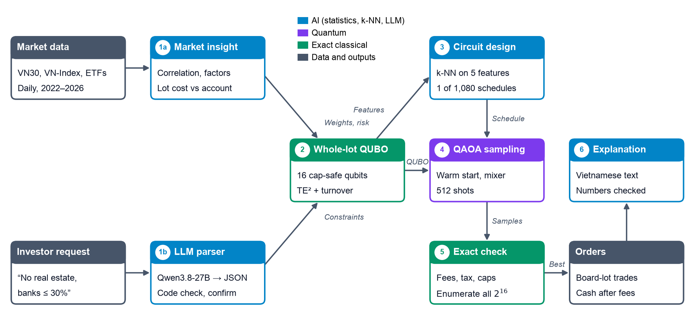
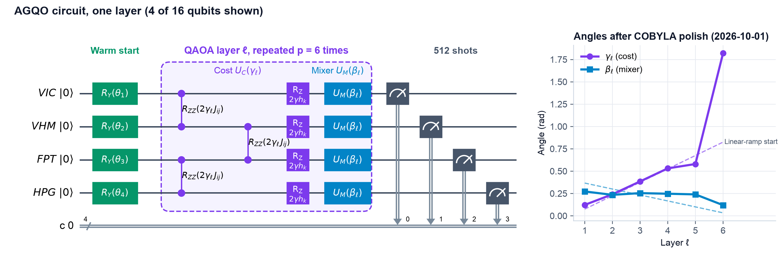

# AGQO: AI-Guided Quantum Optimisation cho danh mục VN30 lô chẵn

**AI-Quantum Challenge 2026 · Đội AQ2026-169 (UTEL) · Phiên bản 1.0.0**

AGQO giúp nhà đầu tư vốn nhỏ sở hữu một danh mục “VN30 theo cách của mình” (bỏ mã, giới hạn ngành, giữ tiền mặt) chỉ
bằng lệnh lô chẵn 100 cổ phiếu. LLM đọc yêu cầu tiếng Việt thành ràng buộc kiểm tra được, mạch QAOA do dữ liệu thiết
kế lấy mẫu các tổ hợp lô tốt, và exhaustive enumeration cổ điển kiểm chứng từng quyết định trước khi ra lệnh.

| | |
|---|---|
| **Prototype (công khai, không cần tài khoản)** | https://data1--agqo-prototype.us-east.modal.run |
| **Hướng dẫn cho giám khảo** | [docs/guides/HUONG_DAN_GIAM_KHAO.md](docs/guides/HUONG_DAN_GIAM_KHAO.md) |
| **Kết quả, bản dễ đọc** | [docs/guides/KET_QUA.md](docs/guides/KET_QUA.md) |
| **Phương pháp và kết quả đầy đủ (EN)** | [docs/technical/](docs/technical/) |
| **Hồ sơ nộp (báo cáo, slide, mã nguồn, hướng dẫn)** | [submission/README.md](submission/README.md) |

---

## 1. Bài toán

Sàn HOSE khớp lệnh theo lô 100 cổ phiếu. Với tài khoản 20 triệu đồng, một lô VIC đã bằng 110% tài khoản và 26/30 mã VN30
có một lô vượt 10% tài khoản. Bộ tối ưu thông thường nói “giữ 3,4% VIC”, nhưng tài khoản chỉ giữ được 0 hoặc trọn lô.

- **Vì sao không làm tròn:** Nearest-lot rounding đưa gần hết mã về 0 lô, 90% tiền nằm im, tracking error 18,4%.
- **Vì sao là bài toán tổ hợp:** Một mã rẻ có thể thay một mã đắt khi hai mã tương quan cao, nên phải chọn cả tổ hợp lô
  cùng lúc. Với 16 mã khó làm tròn nhất, đó là 2^16 = 65.536 phương án.
- **Vì sao là QUBO:** Mỗi quyết định “mua thêm một lô mã k” là 0 hoặc 1, còn rủi ro lệch chỉ số là tổng theo từng cặp
  mã (hiệp phương sai). Đó đúng là dạng bài QAOA được thiết kế để giải.

## 2. Giải pháp



| Bước | Thành phần | Việc làm | Vì sao như vậy |
|---|---|---|---|
| 1a | AI thống kê | Tương quan, market factor, effective number of bets, giá lô so với vốn | 30 mã chỉ tương đương ~13 khoản cược độc lập, nên nhiều mã thay thế được cho nhau |
| 1b | LLM (Qwen3.8-27B) | Câu tiếng Việt → ràng buộc JSON, hỏi lại khi mơ hồ | LLM chỉ đọc ngôn ngữ, không tạo con số; code kiểm tra và người dùng xác nhận |
| 2 | QUBO cổ điển | Capped continuous QP → 16-qubit cap-safe register | Mọi trạng thái của register đều thỏa trần, nên không có nghiệm “ảo” |
| 3 | k-NN | Chọn 1 trong 1.080 circuit schedule theo bài toán năm 2023 giống nhất | Không phải tối ưu góc lại cho từng quyết định |
| 4 | QAOA | Warm start, aligned mixer, coupling-mass pruning, RMS scaling, linear-ramp schedule, 512 shots | Mạch bắt đầu cạnh nghiệm tốt và giữ được điểm xuất phát đó |
| 5 | Exhaustive enumeration | Kiểm tra tiền, phí, thuế, trần trên toàn bộ 65.536 phương án | Trọng tài cuối cùng: QAOA chỉ đề xuất, không tự quyết |
| 6 | LLM giải thích | Lời giải thích tiếng Việt, mọi con số được đối chiếu với bằng chứng | Sai số hoặc gán nhầm phương án bị chặn trước khi hiển thị |



## 3. Kết quả chính

Huấn luyện chỉ trên năm 2023; kiểm định trên 12 quý out-of-sample (01/2024 → 10/2026, 711 phiên). Mọi so sánh là kiểm
định cặp.

| Chỉ số | Mốc so sánh | AGQO | Con số nói gì |
|---|---|---|---|
| Tracking error, tài khoản 20 triệu | 12,1% (nearest-lot rounding) | **6,8%** | Đi sát VN30 gần gấp đôi, KTC 95% −6,9 đến −3,8 điểm % |
| Shot near-optimal (trong 5% quanh exact optimum) | 3,1% (warm-start baseline), 1,1% (textbook QAOA) | **21,3%** | Cứ 5 shot có 1 shot gần tối ưu; thắng 12/12 quý, p = 0,0005 |
| Lợi thế khi tăng kích thước | Warm-start baseline | **4,3× → 16,7×** (8 → 20 qubit) | Bài toán càng lớn, lợi thế của mạch càng tăng |
| LLM đọc yêu cầu, 50 câu mới | 33/50 (keyword parser) | **49/50** | Hiểu đúng cả câu mơ hồ, mâu thuẫn, không khả thi |
| Vi phạm quy tắc cá nhân | — | **0** | Quy tắc tính trên NAV sau phí là ràng buộc cứng |
| Kiểm thử tự động | — | **58/58** trên Modal CPU | |

Điều đội **không** khẳng định: ở 16 qubit, exhaustive enumeration giải chính xác trong 0,12 giây nên không có quantum
advantage; greedy đạt 7,5% ở 20 triệu, khác biệt với AGQO chưa có ý nghĩa thống kê; mọi kết quả lượng tử là mô phỏng.
Chi tiết: [docs/technical/RESULTS.md](docs/technical/RESULTS.md) (nghiên cứu chính) và
[docs/technical/RESEARCH_RESULTS.md](docs/technical/RESEARCH_RESULTS.md) (nghiên cứu bổ sung).

## 4. Dùng thử prototype (3 phút, không cần cài đặt)

1. Mở https://data1--agqo-prototype.us-east.modal.run (lần đầu có thể mất 20–60 giây để container khởi động).
2. Ở mục **02 · Thử ngay**, chọn mẫu **“20 triệu, bỏ bất động sản, ngân hàng tối đa 30%”** hoặc gõ yêu cầu của bạn.
3. Xem các ô ràng buộc có nhãn nguồn, bấm **Xác nhận**, rồi **Chạy trên Modal**. Mỗi lần chạy là một job Modal thật
   (5–11 giây): lệnh mua, phí, tiền mặt sau phí, kiểm tra từng quy tắc.
4. Mở **Bên trong quyết định này** để xem Hamiltonian, mạch QAOA, phân bố xác suất và tải mạch OpenQASM.

## 5. Cài đặt

Yêu cầu Python 3.12 (≥ 3.10), khoảng 8 GB RAM.

```bash
python3.12 -m venv .venv
```

```bash
source .venv/bin/activate
```

```bash
python -m pip install -e '.[web,quantum,llm,dev]'
```

| Nhóm phụ thuộc | Dùng cho |
|---|---|
| `quantum` | Qiskit (dựng mạch, xuất OpenQASM) |
| `web` | FastAPI, Uvicorn (prototype) |
| `llm` | Modal (Qwen trên GPU, job tính toán, notebook nghiên cứu) |
| `studies`, `hardware` | Qiskit Aer, IBM Runtime (mô phỏng nhiễu, chạy phần cứng tùy chọn) |
| `submission` | python-docx, python-pptx, PyMuPDF, Playwright (dựng hồ sơ nộp) |
| `dev` | pytest |

Toàn bộ môi trường phát triển: `python -m pip install -r requirements.txt`.

**Dữ liệu giá.** Bộ giá DNSE không đi kèm repository (không có quyền phân phối lại). Đặt tệp được phép sử dụng tại
`data/vn30/ohlcv_daily.csv`, hoặc tải lại:

```bash
python -m agqo download --start 2022-01-01 --end 2026-11-15
```

Bản dùng cho mọi kết quả có SHA-256 `7f076128…3042` (ghi trong `data/vn30/manifest.json`); kiểm tra bằng
`python -m agqo verify-data --run results/final`. Tải lại có thể cho mã băm khác vì nhà cung cấp cập nhật lịch sử. Xem
[data/vn30/README.md](data/vn30/README.md).

## 6. Cách chạy

Quy ước: **mọi mô phỏng mạch lượng tử và bộ kiểm thử chạy trên Modal CPU** qua notebook; máy cá nhân chỉ gửi việc và giữ
bản sao kết quả. Đăng nhập Modal một lần bằng `modal token new` ([hướng dẫn](docs/guides/HUONG_DAN_MODAL.md)).

### 6.1. Kiểm thử và kiểm tra dữ liệu (Modal CPU)

```bash
papermill notebooks/AGQO_Research_Modal.ipynb results/runs/notebooks/$(date -u +%Y%m%d-%H%M%S)-test.ipynb -k agqo-venv -p TASKS '["smoke","pytest"]'
```

Kết quả mong đợi: `smoke` ok (mã băm dữ liệu khớp), `58 passed`. Mỗi lần chạy tạo `results/runs/<giờ UTC>-<commit>-<loại>/`
với `run.json` ghi commit, mã băm dữ liệu, cấu hình và lỗi.

### 6.2. Prototype

Triển khai lên Modal (trang web + job `decide_job` cho mỗi quyết định):

```bash
modal deploy app/modal_web.py
```

Chạy trang trên máy (mỗi lần bấm Chạy vẫn gửi job sang Modal; không có Modal thì các mẫu dùng bản phát lại có nhãn):

```bash
AGQO_LIVE_LLM=0 uvicorn app.server:api --port 8000
```

LLM trên GPU (một lần): `modal run modal_app.py::download_weights` rồi `modal deploy modal_app.py`.

### 6.3. Đối chiếu bằng chứng đã lưu (không cần GPU)

Phát lại các lời gọi LLM từ nhật ký, ghi ra thư mục tạm để không đè `results/final/`:

```bash
run_dir=$(mktemp -d) && cp -R results/final/. "$run_dir/" && python -m agqo mandates --llm replay --out "$run_dir"
```

### 6.4. Chạy lại nghiên cứu

| Mục đích | Lệnh |
|---|---|
| Thí nghiệm chính (huấn luyện 2023, 12 quý kiểm định) | `python -m agqo run --out <thư-mục-mới>` rồi `extras`, `report` |
| Nghiên cứu bổ sung | `papermill … -p TASKS '[…]'` với các task: `reproduce`, `knn_table`, `knn_study`, `knn_refine`, `llm_mandates`, `llm_circuits`, `presets`, `account_benchmark`, `llm_probe`, `pitch`, `sizes` |
| Chạy mạch trên IBM (tùy chọn) | `python -m agqo hardware --qasm results/final/circuits/agqo_2026-10-01.qasm [--confirm]` |

Toàn bộ lệnh CLI: `python -m agqo --help`. Mô tả từng task: [docs/guides/NGHIEN_CUU_MODAL.md](docs/guides/NGHIEN_CUU_MODAL.md).
Tái lập từng con số: [docs/guides/TAI_LAP.md](docs/guides/TAI_LAP.md).

### 6.5. Dựng hồ sơ nộp

```bash
python submission/report/figures.py
```

```bash
python submission/deck/make_data.py && python submission/deck/build_deck.py
```

```bash
python submission/source/build_source.py --out submission/out/AQ2026-R2-AQ2026-169-Ma_nguon.zip
```

Chi tiết từng tệp nộp: [submission/README.md](submission/README.md).

## 7. Cấu trúc thư mục

```text
.
├── README.md                     Tài liệu này
├── agent.md                      Nhật ký phát triển (EN), mọi quyết định và lần chạy
├── pyproject.toml, requirements.txt
├── agqo/                         Gói Python lõi, CLI `python -m agqo`
│   ├── data.py, download.py      Dữ liệu VN30 theo thời điểm, tải giá DNSE
│   ├── insight.py                AI thống kê: tương quan, market factor, effective bets
│   ├── mandate.py, feasibility.py  Quy tắc cá nhân, chẩn đoán yêu cầu không khả thi
│   ├── portfolio.py              Bài toán lô chẵn và QUBO cap-safe
│   ├── classical.py              Continuous QP, exact optimum, nearest-lot rounding, greedy
│   ├── backtest.py, experiment.py, stats.py   Walk-forward, thí nghiệm chính, kiểm định thống kê
│   ├── demo.py, service.py, presets.py        Lõi của prototype: một quyết định thành một job
│   ├── extras.py, report.py, visuals.py       Nghiên cứu phụ, trang kết quả, hình
│   ├── quantum/                  Mô phỏng QAOA statevector, thiết kế mạch, k-NN, OpenQASM, IBM
│   ├── llm/                      Qwen client, compiler ràng buộc, kiểm tra lời giải thích
│   └── research/                 Nghiên cứu bổ sung: tái hiện lỗi, k-NN, LLM, preset, benchmark
├── app/                          Prototype web
│   ├── server.py                 FastAPI
│   ├── modal_web.py              Triển khai trang + job `decide_job` trên Modal
│   ├── capture.py                Chụp ảnh màn hình cho hồ sơ
│   └── static/                   Giao diện (HTML, JS, CSS)
├── modal_app.py                  Qwen3.8-27B trên Modal H100 (vLLM, JSON-schema decoding)
├── modal_research.py             Mọi mô phỏng và kiểm thử trên Modal CPU
├── notebooks/                    Notebook điều phối nghiên cứu (sinh từ build_notebook.py)
├── data/vn30/                    Thành phần VN30 theo thời điểm, manifest bộ giá
├── results/
│   ├── final/                    Bằng chứng nghiên cứu chính (không sửa tay)
│   ├── runs/                     Mỗi lần chạy nghiên cứu bổ sung một thư mục
│   └── app/                      Dữ liệu prototype phát lại (preset, nhật ký LLM)
├── tests/                        58 kiểm thử: lõi, API web, sản phẩm, kiểm tra lời giải thích
├── docs/                         Tài liệu (xem mục 9)
└── submission/                   Công cụ dựng hồ sơ nộp (xem submission/README.md)
```

## 8. Mô-đun chính

| Mô-đun | Vai trò |
|---|---|
| `agqo/portfolio.py` | Bài toán tái cân bằng theo lô và biên dịch chính xác sang QUBO |
| `agqo/quantum/simulator.py` | Mô phỏng QAOA statevector chính xác bằng numpy (tới ~22 qubit) |
| `agqo/quantum/design.py` | Đặc trưng bài toán, lưới 1.080 schedule, mô hình k-NN chọn schedule |
| `agqo/quantum/spec.py`, `export.py` | Mô tả mạch có kiểm tra, xuất Qiskit / OpenQASM |
| `agqo/llm/compiler.py` | Câu tiếng Việt → ràng buộc (trạng thái ok / cần hỏi lại / mâu thuẫn) |
| `agqo/llm/attribution.py`, `fallback.py` | Kiểm tra từng con số trong lời giải thích; lời giải thích dự phòng từ dữ liệu |
| `agqo/feasibility.py` | Chỉ ra quy tắc chặn khi yêu cầu không khả thi |
| `agqo/service.py` | Một quyết định trọn vẹn: đầu vào dict, kết quả JSON (dùng cho job Modal) |
| `app/server.py` | API của prototype: preset, diễn giải yêu cầu, chạy job, theo dõi tiến trình |

## 9. Tài liệu

| Thư mục | Ngôn ngữ | Nội dung |
|---|---|---|
| [docs/guides/](docs/guides/) | Tiếng Việt | Hướng dẫn giám khảo, tái lập, cài Modal, chạy nghiên cứu, kết quả dễ đọc, kịch bản demo, lộ trình |
| [docs/technical/](docs/technical/) | English | Tổng quan kỹ thuật, phương pháp, kết quả nghiên cứu chính, giao thức và kết quả nghiên cứu bổ sung |
| [docs/presentation/](docs/presentation/) | Việt / Anh | Lời nói thuyết trình, kịch bản, câu hỏi phản biện, tập dượt |
| [docs/submission/](docs/submission/) | Tiếng Việt | Bàn giao hồ sơ, sổ đăng ký bằng chứng, thuật ngữ |
| [docs/assets/](docs/assets/) | — | Hình kết quả và ảnh chụp prototype |

## 10. Dữ liệu và giới hạn

- Giá: API công khai của DNSE, OHLCV ngày 01/2022 → 11/2026, 40 mã từng thuộc VN30, chỉ số VN30, VN-Index, 3 ETF. Giá
  đã được nhà cung cấp điều chỉnh cổ tức và chia tách; chưa có giá khớp lệnh gốc (đã đo giới hạn: lợi thế ở 20 triệu
  giữ được khi giá lô lịch sử cao hơn tới 50%).
- Thành phần VN30 theo thời điểm (tránh survivorship bias). Bộ câu tiếng Việt do nhóm viết, chưa có người dùng độc lập.
- Mọi kết quả lượng tử là mô phỏng; mạch chọn theo nhiễu mới được đánh giá bằng mô hình nhiễu ESP và Qiskit Aer.
