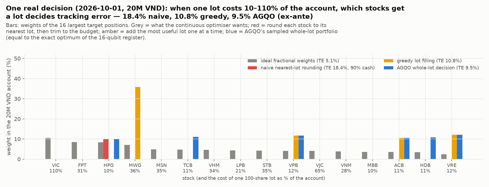
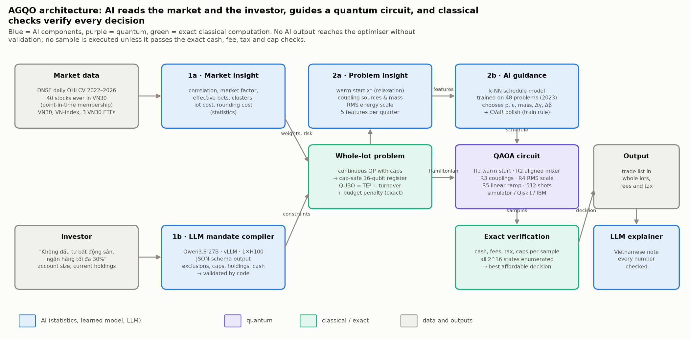
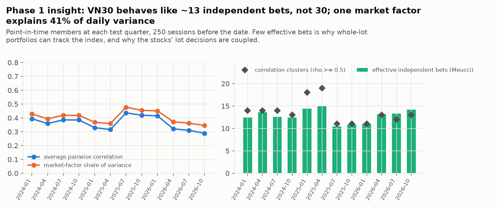
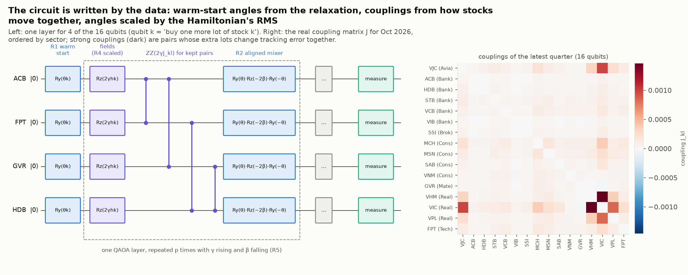
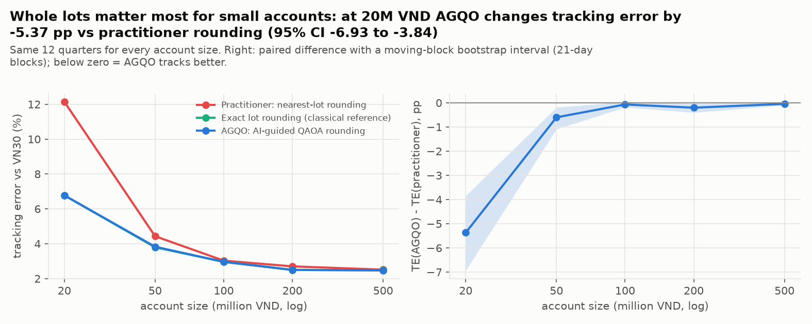
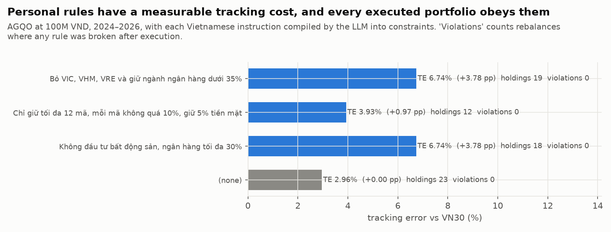
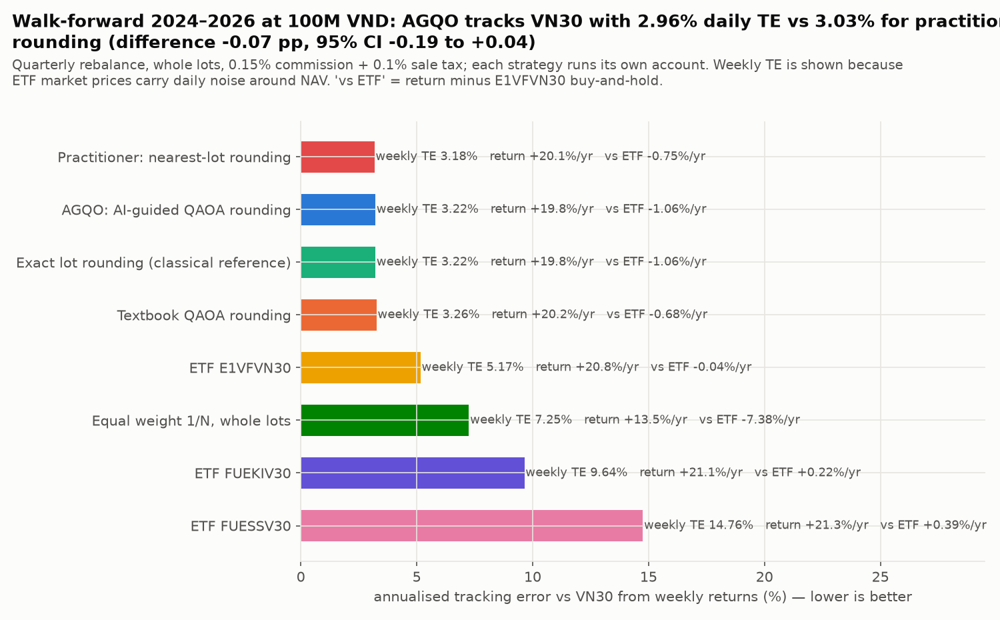
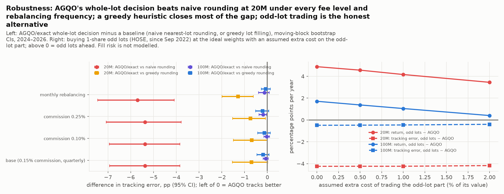
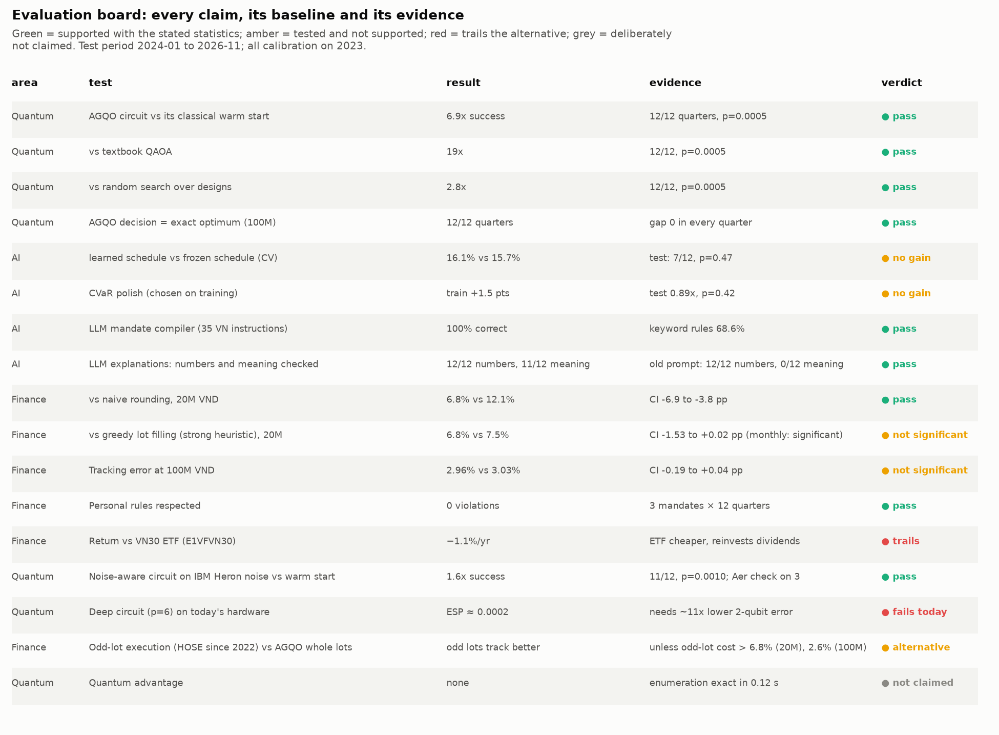
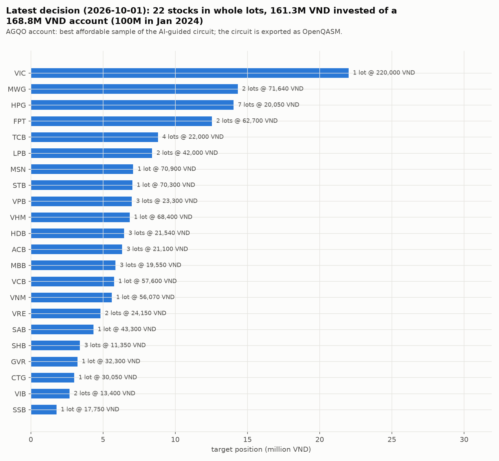

# AGQO: AI-Guided Quantum Optimisation for whole-lot VN30 portfolios

**AI-Quantum Challenge 2026 · technical report written as a slide deck · v3.1 (16 Nov 2026)**

AGQO helps a small Vietnamese investor hold "VN30, my way" in a real brokerage account, where stocks
trade only in **whole lots of 100 shares**. AI reads the market and the investor; a QAOA circuit,
designed and tuned from that insight, picks the whole-lot portfolio; exact classical computation
verifies every decision.

**Read next:** [judge Q&A (75 questions)](docs/QA.md) · [rehearsal: five hardest questions](docs/REHEARSAL.md) · [kịch bản thuyết trình tiếng Việt](docs/KICH_BAN_THUYET_TRINH.md) · [methods and equations](docs/METHODS.md) ·
[every table, auto-generated](docs/RESULTS.md)

> **Tóm tắt.** AGQO giúp nhà đầu tư nhỏ nắm giữ danh mục bám VN30 theo quy tắc riêng (bỏ mã, giới hạn
> ngành, số mã, tiền mặt) bằng các lô 100 cổ phiếu. LLM mã nguồn mở Qwen3.8-27B chuyển yêu cầu tiếng
> Việt thành ràng buộc (đúng 35/35 câu thử, bộ quy tắc từ khóa 68,6 %) và viết giải thích được kiểm tra
> từng con số (12/12) và ý nghĩa (11/12). Mạch QAOA được thiết kế từ đặc trưng dữ liệu; trên 12 quý 2024–2026 chưa từng
> thấy, mạch lấy được nghiệm gần tối ưu nhiều gấp 6,9 lần trạng thái khởi động cổ điển và 19 lần QAOA
> sách giáo khoa (12/12 quý, p = 0,0005). Với tài khoản 20 triệu đồng, sai số bám giảm từ 12,1 % xuống
> 6,8 % so với làm tròn thông thường; thuật toán tham lam đạt 7,5 %. Trên mô phỏng nhiễu IBM Heron, mạch
> nông do AI chọn theo nhiễu (16 cổng CZ) vẫn hơn khởi động cổ điển 1,6 lần. Không tuyên bố ưu thế
> lượng tử: liệt kê cổ điển giải chính xác bài 16 qubit trong 0,12 giây.

| | |
|---|---|
| **Problem** | One lot of a VN30 stock costs 1–24 % of a 100M VND account and up to 110 % of a 20M account; optimiser weights cannot be bought as computed, and an ETF cannot exclude a stock or cap a sector. |
| **AI** | Statistics extract market and problem structure; **Qwen3.8-27B** (open weights, vLLM, one H100) turns Vietnamese instructions into checked constraints and writes verified explanations; a **learned model** chooses the circuit schedule, also for noisy hardware. |
| **Quantum** | A 16-qubit QAOA circuit, written from the data (warm start, aligned mixer, coupling pruning, RMS scaling, linear ramp), samples the whole-lot decision on a register where every state obeys the investor's caps. |
| **Data** | 40 stocks ever in VN30 (point-in-time membership), VN30, VN-Index, three VN30 ETFs; daily 2022-01 → 2026-11. Calibrate on 2023 only; test on 12 quarters 2024-01 → 2026-10. |
| **Honest scope** | No quantum advantage is claimed: enumeration is exact in 0.12 s. A greedy heuristic captures most of the small-account gain. Odd-lot trading is a real alternative. All three are measured below. |

---

## The deck

| # | slide | the one thing to remember |
|---:|---|---|
| 1 | [Contributions](#1--contributions) | four things that are new, each with a test |
| 2 | [The problem](#2--the-problem-a-lot-is-a-big-bet-for-a-small-account) | in a 20M account, one lot is 10–110 % of the money |
| 3 | [Who it is for](#3--who-it-is-for-and-what-they-can-do-today) | 14.3M retail accounts; ETF, odd lots and rounding all fall short somewhere |
| 4 | [Architecture](#4--architecture-ai-reads-quantum-samples-classical-verifies) | AI never sends an unchecked number to the optimiser |
| 5 | [Phase 1a · market insight](#5--phase-1a-what-the-data-says) | VN30 ≈ 13 independent bets; couplings are co-movement |
| 6 | [Phase 1b · LLM compiler](#6--phase-1b-the-llm-turns-vietnamese-into-constraints) | 35/35 vs 68.6 % for keyword rules |
| 7 | [Finance → qubits](#7--from-finance-to-qubits) | the Hamiltonian *is* the tracking objective; caps live in the register |
| 8 | [Phase 2 · the circuit](#8--phase-2a-a-circuit-written-by-the-data) | five design rules, each read from a statistic |
| 9 | [Phase 2 · AI guidance](#9--phase-2b-ai-guidance-of-the-schedule) | a model trained on 2023 picks depth and angles |
| 10 | [Where probability goes](#10--result-where-the-probability-goes) | 21 % of shots near-optimal vs 0.2 % random |
| 11 | [Circuit vs baselines](#11--result-the-circuit-against-every-baseline) | 6.9× warm start, 19× textbook, 12/12 quarters |
| 12 | [Small accounts](#12--result-small-accounts-are-where-lots-decide-everything) | 20M: TE 12.1 % → 6.8 %; greedy 7.5 % |
| 13 | [Personal rules](#13--result-personal-rules-hold-with-zero-violations) | 0 violations; the cost of each rule is shown |
| 14 | [100M and the ETF](#14--result-at-100m-vnd-and-against-the-etf) | at 100M, no significant gain; the ETF returns 1.1 %/yr more |
| 15 | [The explanation](#15--the-llm-explains-every-number-is-checked) | numbers 12/12, meaning 11/12 (first prompt: 0/12) |
| 16 | [Hardware](#16--hardware-depth-is-the-enemy-and-ai-guidance-adapts) | deep circuit dies on Heron noise; noise-aware choice keeps 1.6× |
| 17 | [Scaling](#17--scaling-from-8-to-20-qubits) | schedule transfers 8→20 qubits; gain over warm start grows |
| 18 | [Robustness & alternatives](#18--robustness-and-the-honest-alternatives) | fee levels, monthly rebalancing, greedy, odd lots |
| 19 | [Evaluation board](#19--evaluation-board) | every claim, its baseline, its verdict |
| 20 | [Today's decision](#20--todays-decision) | the trade list a user would act on |
| 21 | [Discussion](#21--discussion-what-it-means) | what finance, AI and quantum each gain; limits; next steps |
| 22 | [Reproduce](#22--reproduce-cost-and-code-map) | one command per stage; LLM replay without a GPU |

---

## 1 · Contributions

1. **Cap-safe qubit register.** The investor's caps decide which stocks get a qubit, so all 2¹⁶
   states obey every cap and the Hamiltonian stays *exactly* the financial objective. (Penalty terms
   were tried first and fail: three extra lots can break a cap every pair respects.)
2. **Insight-driven QAOA design.** Five rules from the literature, each switched on by a statistic of
   the current problem, plus a schedule model trained on 2023 that also selects for hardware noise.
3. **LLM as a compiler, not an oracle.** Qwen3.8-27B turns Vietnamese investor language into
   schema-constrained, code-validated constraints, and explains decisions with every number verified.
   It never produces a weight or a trade.
4. **An audit-ready evaluation.** Exact enumeration of all 65,536 decisions as ground truth; nine
   circuit baselines; strong finance baselines (greedy, odd lots, ETFs); paired tests on unseen
   quarters; negative results reported next to positive ones.

---

## 2 · The problem: a lot is a big bet for a small account


**What it shows.** The cost of one 100-share lot of each current VN30 member as a share of a 100M VND
account: from 1.1 % (SHB) to 24.3 % (VIC).
**Why it matters.** A continuous optimiser says "hold 3.4 % VIC"; the account can only hold 0 % or
24.3 %. Which stocks get one more lot is a binary decision with 2ⁿ options. In a 20M account the
lots are five times coarser.



**What it shows.** One real decision for a new 20M VND account (2026-10-01): grey bars are the ideal
fractional weights; red is naive nearest-lot rounding; amber is greedy lot filling; blue is AGQO.
The label under each ticker is what one lot costs.
**Why it matters.** Naive rounding rounds almost everything to zero and leaves **90 % in cash**
(ex-ante TE 18.4 %). Greedy fills lots one by one but puts 36 % into one stock (10.8 %). AGQO picks the
combination of lots that tracks best (9.5 %), which is the exact optimum of the 16-qubit register.

---

## 3 · Who it is for, and what they can do today

Vietnam had **over 14.3 million domestic individual securities accounts** at the end of October 2026,
more than 14 % of the population (VSDC data, reported 6 Nov 2026). Most are small, which is exactly
where lot granularity bites. Their options for "VN30, my way":

| option | personal rules | whole-lot orders only | TE at 20M VND | the catch |
|---|:---:|:---:|---:|---|
| VN30 ETF (E1VFVN30) | ✗ | ✓ | — | cannot exclude a stock or cap a sector |
| naive nearest-lot rounding | ✓ | ✓ | 12.1 % | leaves most of a small account in cash |
| greedy lot filling | ✓ | ✓ | 7.5 % | concentrates; slightly worse than exact |
| odd lots (1–99 shares, HOSE since Sep 2022) | ✓ | ✗ | 2.5 % | thin separate order book; fill risk not modelled |
| **AGQO** | ✓ | ✓ | **6.8 %** | needs the optimisation pipeline |

---

## 4 · Architecture: AI reads, quantum samples, classical verifies



**What it shows.** Blue boxes are AI (statistics, a learned model, the LLM), purple is quantum, green is
exact classical computation, grey is data and output.
**Why it matters.** Each AI output passes a check before it is used: the LLM's constraints are
validated by code, the learned schedule only shapes the circuit, and no sample is executed unless it
passes exact cash, fee, tax and cap checks.

| phase | input | output | done by |
|---|---|---|---|
| 1a market insight | 250 sessions of member returns | correlation, market-factor share, effective bets, clusters, lot cost | statistics (`agqo/insight.py`) |
| 1b investor insight | Vietnamese instruction + ticker list | exclusions, caps, max holdings, min cash, or a question | **Qwen3.8-27B** (`agqo/llm/tasks.py`) |
| problem | QP target, prices, holdings, caps | 16-qubit QUBO = TE² + turnover + budget penalty | code (`agqo/backtest.py`, `agqo/portfolio.py`) |
| 2a problem insight | the QUBO and its relaxation | warm start, coupling sources and concentration, RMS scale | statistics (`agqo/insight.py`) |
| 2b AI guidance | five insight features | depth, ε, coupling mass, ramp heights; polish yes/no | **learned k-NN model** (`agqo/quantum/design.py`) |
| quantum | Hamiltonian + designed circuit | 512 sampled lot decisions | QAOA (`agqo/quantum/`) |
| verify | samples | best affordable, rule-compliant decision | exact checks + enumeration (`agqo/portfolio.py`) |
| explain | code-built evidence pack | Vietnamese note, every number checked | **Qwen3.8-27B** |

---

## 5 · Phase 1a: what the data says



**What it shows.** For each test quarter: average pairwise correlation, the share of variance in the
first market factor, the effective number of independent bets (Meucci 2009) and the number of
correlation clusters.
**Why it matters.** VN30 behaves like about 13 independent bets, not 30, with one market factor near
40 % of variance. So about 20 well-chosen whole-lot holdings can follow the index, and the lot decisions
of correlated stocks interact: that interaction is what the qubit couplings encode.


**What it shows.** Left: where the qubit couplings come from, co-movement of stocks (blue) or the
shared cash budget (amber). Right: couplings kept in the circuit and how confident the classical
relaxation already is.
**Why it matters.** About 90 % of coupling strength is risk, not budget: the two-qubit gates carry
financial information. The relaxation is only 20–45 % "decided", which leaves room for the circuit to
improve on its warm start.

---

## 6 · Phase 1b: the LLM turns Vietnamese into constraints

```
"Không đầu tư bất động sản, ngân hàng tối đa 30%"
        │  Qwen3.8-27B-FP8 · vLLM 0.32 · 1×H100 on Modal · non-thinking · temperature 0
        │  JSON-schema decoding: tickers and sectors are enums, numbers are bounded
        ▼
{"exclude_sectors": ["Real estate"], "sector_caps": [{"sector": "Banking", "max_weight": 0.30}], ...}
        │  code validation (parse_mandate) → QP constraints → cap-safe qubit register
        ▼
every one of the 2^16 lot decisions obeys "no real estate, banks ≤ 30 %"
```

**How it is called.** A Modal class loads vLLM once per container and takes a batch of requests (system
prompt, user text, JSON schema, seed, temperature); the client calls it with
`modal.Cls.from_name("agqo-llm", "Engine")().generate.remote(batch)` and logs every prompt, answer and
token count to `results/final/llm/llm_log.jsonl`. `--llm replay` reproduces the results without a GPU.

| test (35 hand-labelled Vietnamese instructions) | Qwen3.8-27B | keyword rules |
|---|---:|---:|
| effective constraints correct | **100 %** | 68.6 % |
| strict JSON match | 94.3 % (two no-op "0 % cash") | 68.6 % |
| clarify-or-not decision right | 35/35 | cannot ask |
| invalid outputs | 0 | — |

Vague instruction, live answer: *"Đừng mua quá nhiều cổ phiếu ngân hàng"* → *"Bạn muốn giới hạn tỷ trọng cổ
phiếu ngân hàng tối đa là bao nhiêu phần trăm?"* The keyword parser fails on text without diacritics,
fractions ("một phần ba", "1/4") and sectors named in everyday words.
Cost: 35 requests, 22.6k input and 3.2k output tokens; with the explainer, about 1–2 USD of H100 time in total.

---

## 7 · From finance to qubits

**One qubit = "buy one more lot of this stock than its floor".** The 16 stocks where rounding matters
most get a qubit; the rest take their nearest lot. Weights are affine in the bits, w = w_base + A·x.

**The Hamiltonian is the financial objective,** not a proxy:

E(x) = 252·(wᵀΣw − 2wᵀc + σ²_VN30) + γ‖w − w_prev‖² + λ(1ᵀw − t)²

tracking variance against VN30 (covariance from the previous 250 sessions) + turnover + one budget
penalty (λ = 0.01, calibrated on 2023). A unit test checks the identity on all 65,536 bitstrings to
10⁻¹². Mapping x = (1 − z)/2 gives fields h_k and couplings J_kl.

**Caps live in the register, not in penalties.** A stock in a capped group gets a qubit only if the
group's floor plus one lot for *every* qubit in it still fits the cap. Cash, fees, tax and minimum
cash are checked exactly on every sample.

---

## 8 · Phase 2a: a circuit written by the data



**What it shows.** Left: one QAOA layer on 4 of the 16 qubits. Right: the real coupling matrix J for
October 2026, ordered by sector; dark cells are pairs whose extra lots change tracking error together
(VIC–VHM, VIC–VJC).
**Why it matters.** Every gate angle comes from data, as the table shows.

| rule | circuit element | read from | source |
|---|---|---|---|
| R1 warm start | R_y(θ_k)\|0⟩, sin²(θ_k/2) = relaxed x*_k | continuous relaxation of the QUBO | Egger, Mareček & Woerner 2021 |
| R2 aligned mixer | R_y(θ)·R_z(−2β)·R_y(−θ) | same warm start: the start is the mixer's ground state | He et al. 2023 |
| R3 coupling pruning | ZZ(2γJ_kl) on pairs holding a fraction m of ΣJ² | coupling concentration | data-driven |
| R4 RMS scaling | divide H by its RMS | coefficient scale | Sureshbabu et al. 2024 |
| R5 linear ramp | γ_k = Δγ(k+½)/p, β_k = Δβ(1−(k+½)/p) | two numbers, not 2p | Montañez-Barrera & Michielsen 2025 |

---

## 9 · Phase 2b: AI guidance of the schedule


**What it shows.** Left: cross-validated success when the schedule is chosen from the k most similar
2023 problems (by five insight features), against one frozen schedule. Right: what the model chose
for each test quarter.
**Why it matters.** 1,080 schedules × 48 training problems (12 months of 2023 × 4 account sizes) were
simulated exactly. The 10-nearest-neighbour model wins cross-validation narrowly (16.1 % vs 15.7 %).
On test it does *not* beat the frozen schedule (7/12, p = 0.47), and a training-chosen COBYLA polish
did not help either (p = 0.42). We report both. The guidance pays off where the target changes: on
noisy hardware (slide 16).

---

## 10 · Result: where the probability goes


**What it shows.** Each bar is a full measurement distribution over the 65,536 lot decisions, binned by
distance from the exact optimum, averaged over 12 test quarters.
**Why it matters.** This is QAOA working as intended: AGQO moves probability from unaffordable and
poor portfolios (red, grey) to near-optimal ones (green): 21 % of shots within 5 % of the optimum,
3 % exactly optimal. Random guessing gets 0.2 %, textbook QAOA 1 %, the warm start alone 3 %.

---

## 11 · Result: the circuit against every baseline


| circuit (16 qubits, 12 unseen quarters) | near-optimal success / shot | P(shot beats naive rounding) | 2-qubit gates |
|---|---:|---:|---:|
| random guessing | 0.2 % | — | — |
| warm start only (classical, 0 layers) | 3.1 % | 16 % | 0 |
| textbook QAOA (p = 2, COBYLA) | 1.1 % | 14 % | 480 |
| random search over designs (3 seeds) | 7.7 % | 29 % | 381 |
| **AGQO (insight design + AI schedule + polish)** | **21.3 %** | **40 %** | 1,440 |
| frozen schedule (no model) | 23.8 % | 43 % | 1,440 |
| oracle schedule (uses the test answer) | 25.2 % | 43 % | 1,440 |

AGQO beats its warm start (6.9×), textbook QAOA (19×) and random search (2.8×) in **12 of 12** quarters
(Wilcoxon p = 0.0005 each). The gain comes from the insight-driven structure that AGQO, frozen and
oracle share; the oracle shows how little test-set tuning would add.


**What it shows.** Distance from the exact optimum per quarter. AGQO's 512 shots contain the exact
optimum in 12/12 quarters; naive rounding is within 5 % in 5/12 and twice goes over budget (hatched);
one short simulated-annealing run is exact in 6/12 and near-optimal in 12/12.
**Why it matters.** The circuit is reliable as a solver, and the classical comparison shows there is no
quantum advantage at this size.

---

## 12 · Result: small accounts are where lots decide everything



| account | naive rounding | greedy lot filling | **AGQO / exact** | AGQO − naive (95 % CI) | AGQO − greedy (95 % CI) |
|---|---:|---:|---:|---:|---:|
| **20M VND** | 12.14 % | 7.47 % | **6.77 %** | **−5.37 pp (−6.93, −3.84)** | −0.69 pp (−1.53, +0.02) |
| 50M VND | 4.43 % | — | 3.83 % | −0.60 pp (−1.09, −0.19) | — |
| 100M VND | 3.03 % | 3.14 % | 2.96 % | −0.07 pp (−0.19, +0.04) | −0.18 pp (−0.46, +0.07) |
| 200M VND | 2.70 % | — | 2.50 % | −0.20 pp (−0.40, −0.04) | — |
| 500M VND | 2.51 % | — | 2.47 % | −0.05 pp (−0.10, −0.00) | — |

Tracking error vs VN30, daily, annualised, 2024-01 → 2026-11. Intervals: moving-block bootstrap of
paired daily active returns (21-day blocks).

**What it means.** For a 20M account, TE falls from 12.1 % to 6.8 %: a typical yearly deviation from
VN30 of about ±1.4M VND instead of ±2.4M. A greedy heuristic captures most of that gain; solving the
lot problem exactly adds a further −0.7 pp quarterly (borderline) and −1.3 pp with monthly rebalancing
(significant, slide 18). Returns at 20M swing between 12 % and 26 %/yr depending on which few lots land
where, which is why we judge by tracking error, not return.

---

## 13 · Result: personal rules hold, with zero violations



**What it shows.** Three Vietnamese instructions, compiled by Qwen3.8 and applied for the whole test
period at 100M VND, against no rules.
**Why it matters.** **0 violations and 0 fallbacks** in 3 mandates × 12 quarters, because the caps shape
the qubit register. AGQO tracks better than naive rounding under every mandate (6.74 % vs 6.98 %,
3.93 % vs 4.21 %, 6.74 % vs 6.82 %). The price of each rule is visible: excluding real estate and capping
banks costs +3.8 pp TE; "12 stocks, 10 % each, 5 % cash" costs +1.0 pp. That is information an ETF
cannot give.

---

## 14 · Result: at 100M VND, and against the ETF



**What it shows.** Weekly tracking error, return and return vs E1VFVN30 for every strategy at 100M VND.
**Why it matters.** At 100M without rules, AGQO equals the exact optimum and edges naive rounding by
0.07 pp, inside the noise (CI −0.19 to +0.04). It tracks the VN30 *index* more closely than the ETF's
*traded price* (weekly TE 3.2 % vs 5.2 %; ETF prices drift around NAV).


**What it shows.** Account value divided by an E1VFVN30 buy-and-hold account of the same size.
**Why it matters.** The ETF returned about 1.1 %/yr more (it is cheaper to hold and reinvests
dividends). For an investor without personal rules, the ETF is the right product; AGQO is for those it
cannot serve.

---

## 15 · The LLM explains; every number is checked

Evidence pack for 2026-10-01 (built by code; every field names its reference, e.g.
`tracking_error_vs_vn30_index_pct`, with a Vietnamese label) → Qwen3.8-27B (temperature 0.3, JSON
schema) → two checks:

> *"… Phương pháp lượng tử (QAOA) đã giúp tìm ra giải pháp có sai số bám so với chỉ số VN30 là 5.39%,
> trong khi cách làm tròn đơn giản có sai số 5.56% và danh mục lý tưởng là 5.1%."*
> *"Nhóm cổ phiếu VN30 có 14.2 nguồn rủi ro độc lập hiệu dụng, nhưng 34.6% biến động đến từ một yếu tố
> thị trường chung, làm giảm hiệu quả phân tán rủi ro."*
> Trade notes: GVR mua 1 lô, SSI bán 1 lô, SSB bán 1 lô, VIB mua 1 lô, SHB mua 1 lô.

| check | what it tests | first prompt | current prompt |
|---|---|---:|---:|
| numbers | every number is in the evidence; every trade note matches an executed trade | 12/12 | **12/12** |
| meaning | each tracking error is stated against VN30 in its sentence; VN30 market statistics are never attributed to the investor's portfolio | 0/12 | **11/12** |

The first prompt passed the number check but wrote things like "5.39 % so với lý tưởng" (vs the ideal)
or "chỉ số AGQO", when the reference is VN30. Self-describing evidence fields and one prompt rule fixed
it. The one remaining flag (2025-07) says "chỉ số" (the index) without naming VN30; a failed check is
shown, not hidden. 12 requests: 11.8k input and 8.2k output tokens, 13 s of generation on a warm H100.

---

## 16 · Hardware: depth is the enemy, and AI guidance adapts


**What it shows.** Left: native two-qubit gates after routing to IBM Heron r2 (FakeKingston, 156
qubits, calibrated errors) and the estimated success probability of the whole circuit (ESP). Right:
near-optimal success without noise, with the ESP noise model, and in full Aer noise simulation.
**Why it matters.**
* AGQO's noiseless winner (p = 6, all pairs) needs 4,355 CZ gates; ESP ≈ 0.0002, so on today's
  hardware it is as good as random. It would need a two-qubit error of 0.016 % (today 0.18 %, about
  11× better) to keep half its advantage.
* **Noise-aware AI guidance** fits log ESP against gate count, then picks from the 2023 table the
  schedule with the best *expected noisy* success: p = 2 and 25 % of the coupling mass, **16 native CZ**,
  ESP 0.88. On all 12 test quarters it keeps **1.6× its warm start (11/12, p = 0.0010)**; full Aer
  simulation on 3 quarters lands close to the model (7.8 % vs 6.6 % near-optimal).
* The ready-to-run hardware path: `python -m agqo hardware --qasm … --confirm` (needs an IBM token;
  not run yet).

---

## 17 · Scaling from 8 to 20 qubits


**What it shows.** Left: decisions to check (2ⁿ) against logical CX gates of the circuit, with measured
enumeration time. Right: the same 2023 schedule, unchanged, on 8–20 qubit problems.
**Why it matters.** Enumeration time grows 2ⁿ (0.13 s at 16 qubits, 2.4 s at 20; a 60-qubit full VN30
register would take ~10⁵ years at this rate), while the circuit grows ~n². The schedule transfers
across sizes, and its gain over the warm start *grows*, 4.3× at 8 qubits to 16.7× at 20. Simulated
annealing stays near-optimal at 20 qubits, so it remains the classical bar to beat.

---

## 18 · Robustness, and the honest alternatives



**What it shows.** Left: tracking-error gap of the AGQO/exact decision against naive rounding and
against greedy lot filling, for 0.10 / 0.15 / 0.25 % commission and monthly rebalancing, at 20M and
100M. Right: buying the ideal weights with odd lots, with an assumed extra cost on the odd-lot part.
**Why it matters.**
* Against naive rounding at 20M, the gain holds in every scenario (−5.4 to −5.7 pp, all CIs below
  zero).
* Against greedy, the gain is small: borderline quarterly, significant monthly (−1.28 pp, CI −1.99 to
  −0.62). At 100M the methods are equivalent.
* Odd lots track better (TE 2.5 % at 20M) and return more unless their extra cost exceeds **6.8 %
  (20M) or 2.6 % (100M)** of the odd-lot value. We do not model fill risk in the thin odd-lot book. A
  production AGQO should offer "whole lots + odd-lot top-up" as a register option.

---

## 19 · Evaluation board



Every claim with its baseline, its statistic and a verdict. Green: supported. Amber: tested and not
supported, or an alternative that wins under some conditions. Red: trails or fails today. Grey: not
claimed.

---

## 20 · Today's decision



The AGQO account (100M VND in January 2024, 168.8M VND on 2026-10-01): 22 stocks in whole lots, the
best affordable sample of the AI-guided circuit. The trade list is `results/final/latest_trades.csv`, the
circuit is exported as OpenQASM in `results/final/circuits/`, and the Vietnamese note is slide 15.

---

## 21 · Discussion: what it means

**For finance.** The integer lot decision is a real cost for small accounts: at 20M VND, naive rounding adds 5.4 pp of tracking
error, almost half of its total deviation from the index. Any optimisation of that
decision (greedy or exact) removes most of it; exact optimisation adds a smaller, sometimes significant
gain. Personal rules can be honoured exactly and their cost shown. Odd lots are the competing tool.
**For AI.** The LLM is most valuable where language meets hard constraints: it compiles instructions
that keyword rules miss (100 % vs 68.6 %) and asks when a number is missing. Its output is always
validated. The learned schedule model adds little in noiseless simulation but chooses well when the
objective includes hardware noise.
**For quantum.** Data-driven design (warm start, aligned mixer, RMS scaling, linear ramp) beats
textbook QAOA by 19× and random design search by 2.8×, and the schedule transfers across quarters and
sizes. There is no advantage at 16 qubits; on today's hardware only shallow, noise-aware circuits
survive.

**Limitations.**
* No quantum advantage; no run on real IBM hardware yet (noise simulated with calibrated FakeKingston).
* 12 test quarters; at 100M the gain over naive rounding is within noise.
* Back-adjusted prices understate historical lot costs (today's decision uses actual prices);
  cash-dividend treatment is unverified; no slippage or odd-lot fill model.
* The LLM test set (35 instructions) was written by the team; the explanation meaning check is
  rule-based (references of tracking errors and market statistics), not a full semantic review.
* Not investment advice: AGQO proposes trades; the investor decides.

**Next steps.** Real user instructions for the LLM test set · regenerate an explanation that fails a check · odd-lot
top-up qubits · multi-lot encoding for a full ~60-qubit VN30 register · a live IBM Heron run of the
noise-aware circuit · comparison with the best classical heuristics at each register size.

---

## 22 · Reproduce, cost and code map

```bash
python3 -m venv .venv && source .venv/bin/activate
pip install -e '.[quantum,llm,dev]'
python -m agqo download                  # keyless DNSE data → data/vn30/ (git-ignored)
modal run modal_app.py::download_weights # once: Qwen3.8-27B-FP8 into a Modal Volume (~31 GB)
modal deploy modal_app.py
python -m agqo mandates --llm modal      # or --llm replay: no GPU, uses results/final/llm/llm_log.jsonl
python -m agqo run                       # training, QAOA, walk-forward, statistics: ~20 min on 8 cores
python -m agqo explain --llm modal       # or --llm replay
python -m agqo extras                    # hardware noise, scaling, robustness, greedy, odd lots
python -m agqo report                    # all figures + docs/RESULTS.md
pytest -q                                # 22 tests
```

**Cost.** LLM: about 1–2 USD of H100 time in total for all live runs (a cold start loads the model in ~5 min; a warm batch of 12 explanations takes 13 s).
Quantum: CPU only; one decision takes 1 s (0.12 s to enumerate, 1.0 s to simulate and polish).

```
agqo/
  download.py data.py        data, point-in-time universe
  insight.py                 phase 1 and 2a statistics
  mandate.py                 investor rules + keyword baseline
  portfolio.py classical.py  exact QUBO, QP, rounding, annealing
  backtest.py experiment.py  accounts, walk-forward, all stages
  extras.py                  judge studies: hardware, scaling, robustness, greedy, odd lots
  stats.py report.py visuals.py   tests and figures
  quantum/  design.py (rules + learned schedule) simulator.py spec.py search.py export.py hardware.py
  llm/      client.py (Modal / replay) tasks.py (mandate compiler, explainer)
modal_app.py                 Qwen3.8-27B on vLLM, one H100
results/final/               every number in this report, plus prompts and LLM outputs
```

**AI-assistance declaration.** Code, experiments and this report were developed with the help of an AI
coding assistant (Claude Code) under the team's direction; the team chose the method, reviewed results
and can explain every component. The product's own LLM is the open-weight Qwen3.8-27B, run on our
Modal account. References: [docs/METHODS.md](docs/METHODS.md#references).
