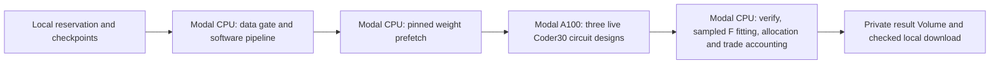

# Modal full-pipeline integration runbook

The private Functions deployment is `agqo-research-pipeline`. Live LLM inference
uses the existing `agqo-gate-synthesis` deployment. Both run under the authenticated
workspace; no public inference endpoint is exposed.

## Deploy and run

```bash
.venv/bin/modal deploy modal_research_pipeline.py
.venv/bin/python scripts/run_modal_pipeline.py --run-id modal_e2e_v1
```

The frozen integration protocol is [MODAL_E2E_PROTOCOL](research/MODAL_E2E_PROTOCOL.md).
The script reserves resources using fresh billing snapshots, dispatches bounded
CPU/GPU work sequentially, checkpoints call IDs, and downloads hash-verified outputs.
It refuses automatic paid retries after a recorded failed stage. Running it again
on a completed local run prints a replay message and does not schedule compute.
Use a new versioned protocol/run ID when changing the experiment.

The completed measured run is [modal_e2e_v1](../results/research/modal_e2e_v1/RESULTS.md).
Its3/3 live proposals passed,24/24 synthetic decisions were feasible, and9 exports
were independently checked. All controls reached the same small-case objective;
LLM circuits used more CX gates. No production or financial advantage is inferred.

## What runs where



The new path uses common compiler-owned counter-Dicke preparation, numerical RMS
coordinates and finite sampled allocation-aware F feedback. LLMs choose exchange
parents, schedules, sharing groups and depth. The compiler owns initialization and
COST. COST still implements the immutable B proxy; sampled F feedback is classical.
No coherent quantum F oracle or hardware advantage is claimed.
The sampled-F fitter in this integration uses small full-statevector cases. The
existing larger conserved executor is separate; this run does not claim N30
allocation-aware fitting or live-LLM continuous market walk-forward execution.

## Outputs

The local run directory contains:

- `orchestration/`: billing snapshots, shared reservation ledger, CPU dispatch IDs,
  model requests/cache/raw GPU receipts, completion and download manifest.
- `protocol.json`, `prepared.json`, `inputs/`, `source_snapshot/`: frozen case/
  request identities, financial specifications and actual remote code/environment.
- `software_pipeline/`: baseline controls, continuous synthetic accounts and the
  explicit blocked market trajectory artifact contract.
- `evaluation/`: complete protocol/manifest/decisions/metrics/cost/RESULTS/PROGRESS
  contract, actual model-derived GateIR/QASM/QPY, verification, references and plot.

Read `orchestration/cost_report.json` for final reservations and tokens. The cost
snapshot inside the cloud evaluation was taken before the finish CPU call completed;
its ledger status is historical. Monthly billing snapshots and reservations are not
an isolated job invoice. Image-build spending is not separately allocated by this
script; a during-build account-level snapshot is retained for this run.

## Interpretation

The small synthetic cases test the connected software path. They do not establish
production-model reliability, independent market benefit or quantum advantage.
Market admission remains closed; raw provider files are not mounted in this test.
Consequently, the remote manifest-only audit also reports unavailable raw files.
That is not a new claim that the locally audited histories disappeared. Refer to
historical_audit_v3 for the available-source coverage findings.

The allocation-aware comparisons are state-matched decisions; the separate existing
software stage tests continuous accounts. The run does not claim a continuous live-
LLM market trajectory, frontend hosting or an executed securities transaction.
