# AGQO — an LLM-core, quantum-ready rebalancing copilot for small VN30 investors

**AI-Quantum Challenge 2026 · Proposal (English working version)**
Results quoted here come from `results/baseline` (no LLM) unless marked *LLM run*; see
[RESULTS.md](RESULTS.md) for every figure and table, and [METHODS.md](METHODS.md) for the
mathematics.

---

## 1. The problem

Vietnamese retail investors who want “the VN30 index” in their own account face a problem
that index funds do not: **whole board lots**. On HOSE a stock trades in lots of 100
shares. In a 100 million VND account (≈ 4,000 USD), one lot of a single VN30 stock costs
between **1.1 % and 20.7 %** of the account (prices of Oct 2026). A textbook optimiser
returns continuous weights; turning them into whole lots is an *integer* problem whose
quality decides how closely the account tracks the index, and it has to be solved again
at every rebalance, with fees and a 0.1 % sale tax.

Three questions follow, and AGQO answers each with a different technology:

| Question | Technology | Output |
|---|---|---|
| What does the market data say, quarter by quarter? | **LLM market analyst** | regime, calibrated views, an 8-stock basket for concentrated mandates |
| Which whole-lot portfolio is best given those views, the index, fees and cash? | **Exact QUBO compiler** (classical) | a binary problem that *is* the financial objective |
| How do we search that binary space with a quantum computer? | **LLM circuit architect + QAOA** | a verified, hardware-exportable circuit that samples near-optimal lot decisions |

## 2. Objectives and measurable targets

| # | Objective | Metric | Target |
|---|---|---|---|
| O1 | Track VN30 in a 100M VND account with whole lots, fees and tax | realised annual tracking error, Jan 2023 – Oct 2026 | ≤ practitioner baseline (continuous QP + nearest-lot rounding) |
| O2 | Make the quantum problem faithful | max \|QUBO − (objective + penalty)\| over all bitstrings | < 1e-12 (no proxy gap) |
| O3 | Design circuits that find good decisions | success probability per shot on 11 unseen quarters | ≫ random guessing; beat textbook QAOA |
| O4 | Show the LLM adds value | LLM architect vs random search vs classical evolution (same budget); LLM views vs none | report with pre-registered decision rules (PLAN.md) |
| O5 | Be deployable | cost and latency per decision; hardware export | one command per step, OpenQASM output, < 1 GPU-hour per experiment |

## 3. Solution architecture

```mermaid
flowchart LR
    D[(VN30 prices, membership<br/>2022–2026, point-in-time)] --> F[Feature engine<br/>code-computed numbers]
    F -->|anonymised table| A[LLM market analyst<br/>Qwen3 on Modal, JSON schema]
    A -->|views + confidence| BL[Black–Litterman tilt]
    BL --> QP[Continuous min-tracking-error QP]
    QP --> C[Exact QUBO compiler<br/>owns every coefficient]
    C -->|16-qubit lot-rounding problem| ARCH[LLM circuit architect<br/>evolutionary loop]
    ARCH -->|CircuitSpec JSON| V{Verifier<br/>schema · alignment · CX budget}
    V -->|rejected + reasons| ARCH
    V -->|admitted| SIM[QAOA simulation / IBM hardware]
    SIM -->|samples| PICK[Best affordable sample<br/>exact cash, fee, tax check]
    PICK --> T[Trades in whole lots]
    C --> EX[Exact enumeration<br/>ground truth]
    EX -.score.-> ARCH
```

**Division of labour.** Code computes every number. The LLM *reads* numbers and *writes*
two kinds of structured decisions — market views and circuit designs — that are checked
before use. The LLM never edits the financial objective, so a wrong answer can only make a
decision worse, never invalid or unaffordable.

### 3.1 LLM market analyst
* Inputs per stock: liquidity share, beta, correlation to VN30, volatility, 20/60/250-day
  returns, drawdown, relative strength, lot value; plus an index summary.
* **Anonymised** (S01…, shuffled, dates hidden) so the model cannot recall later prices.
* Output: regime, views −2…+2 with confidence → Black–Litterman active returns
  (Lee et al. 2025 show LLM views can be mapped into BL inputs); an 8-stock basket.
* Self-consistency: 3 samples per quarter, majority vote, agreement-weighted confidence.

### 3.2 Exact compiler (the fix for AGQO v1's main flaw)
AGQO v1 optimised an equal-weight *proxy* whose optimum lost 3–11 % after re-allocation.
v2 encodes the real decision — whole lots — so the QUBO **is** the objective
(tracking error² − view tilt + turnover) plus one calibrated affordability penalty.
Unit test: identical on all 65,536 bitstrings to 1e-12. In the main mode every stock starts
at its nearest lot and the 16 stocks where rounding matters most (lot value × distance from
an integer) get one qubit each: “add one more lot?”.

### 3.3 LLM circuit architect
A FunSearch/AlphaEvolve-style loop (Novikov et al. 2025): the LLM proposes `CircuitSpec`s
(layers, initial state, mixer, warm-start strength, coupling pruning, angle schedule,
optimiser, CVaR level); a verifier rejects unsafe or inconsistent designs; an exact
evaluator scores the rest; the leaderboard is fed back. The best design is frozen and
reused on unseen quarters **with zero further LLM calls** — inference cost is paid once,
not per decision. Prior work generates circuits per instance (Agent-Q, QUASAR, QAOA-GPT);
AGQO uses the LLM as a *designer of reusable circuit policies* under a hard verifier, and
compares it against random search and classical evolution with an identical budget.

## 4. Data

* VN30 daily OHLCV for 31 tickers + VN30 and VN-Index, Jan 2022 – Oct 2026 (vnstock /
  Entrade endpoint, SHA-256 in `data/vn30/manifest.json`).
* Point-in-time VN30 membership 2022–2026 from HOSE review announcements (source URLs per
  row). 25–29 of 30 members are usable each quarter; missing ones are listed, not hidden.
* Rebalance: first trading day of each quarter, Jan 2023 – Jul 2026 (15 decisions).

## 5. Evaluation design

* **Train / test split for circuits:** designs are chosen on the 4 quarters of 2023 and
  tested on 11 later quarters.
* **Same-budget controls:** default QAOA, random search, classical evolution, LLM.
* **Financial controls:** continuous QP + nearest-lot rounding (what a practitioner does),
  exact lot rounding (enumeration), 8-stock baskets chosen by liquidity, by greedy
  tracking-error selection, and by the LLM.
* **Accounting:** each strategy has its own 100M VND account; exact lots, 0.15 %
  commission, 0.1 % sale tax; daily marking to market.

## 6. Results (summary — numbers in RESULTS.md)

| Objective | Result (baseline run, no LLM) | Status |
|---|---|---|
| O1 tracking | realised TE 2.71 % (exact rounding), 2.73 % (QAOA) vs 2.82 % practitioner; 8-stock baskets 5.6–6.5 % | met, small margin |
| O2 faithfulness | max \|QUBO − (objective + penalty)\| < 1e-12 on all 65,536 bitstrings | met |
| O3 circuit quality | frozen designs: 3.6 % success/shot on 11 unseen quarters (80× random guessing, 9× textbook QAOA); best sample within 5 % of optimum in 10/11 quarters vs 2/11 for nearest rounding | met |
| O4 LLM value | LLM arms run with `--llm modal`; decision rules fixed in PLAN.md before the run | pending live run |
| O5 deployability | one command per step; 5 LLM calls per experiment; QASM export; tests pass | met (hardware run optional) |

Key lesson from the design search: aligned warm-start circuits (initial state = ground state
of the warm-start mixer) average 1.53 % success vs 0.12 % for textbook QAOA, matching
He et al. (2023). This is the knowledge the LLM architect is expected to exploit.

## 7. Product and deployment

* **One command per step:** `python -m agqo run`, `report`, `smoke-llm`, `hardware`.
* **LLM serving:** Modal GPU class, vLLM, JSON-schema constrained decoding; 5 remote calls
  per experiment; warm container reused; any OpenAI-compatible endpoint also works.
* **Quantum execution:** exact simulator for development; Qiskit/OpenQASM export of every
  frozen design; IBM Quantum runner (free Open Plan: 10 QPU minutes per 28 days).
* **Decision output:** a trade list in whole lots with cash after fees and tax.
* **Transparency:** every prompt, raw answer, repair and token count in `llm_log.jsonl`.

## 8. Risks, limitations and ethics

* **No quantum advantage is claimed.** 16 qubits are enumerable; the contribution is a
  faithful formulation, verified and transferable circuit designs, and a measured design
  method. Large classical benchmarks show strong classical solvers win today
  (Stopfer & Wagner 2025).
* **Market risk:** a tracking tool reduces, but cannot remove, the risk of holding equities.
  Views are deliberately weak (η = 0.02) and logged with rationale.
* **LLM risk:** hallucinated ids or numbers cannot reach the optimiser unvalidated;
  repairs are logged; the system degrades to the classical rule if the LLM is unavailable.
* **Data limits:** adjusted prices, 1–5 missing historical members per quarter, VN30 is a
  price index. See METHODS §7.
* **Fairness/access:** the target user is the small investor who cannot buy an index fund in
  the exact composition they want; all code runs on a laptop except the optional GPU LLM.

## 9. Roadmap after the contest

1. Scale the register (30 stocks × 2–3 bits = 60–90 qubits) with sampling-based runs on IBM
   Heron hardware (cf. IBM–Vanguard 109-qubit portfolio experiments, Agliardi et al. 2025).
2. Add Vietnamese news and disclosures to the analyst with strict publication-time checks.
3. Natural-language mandates (exclusions, sector caps) compiled into the QUBO.
4. Fine-tune a small model on the architect's own leaderboard (QUASAR-style verifiable rewards).

## References

See [METHODS.md](METHODS.md#references).
