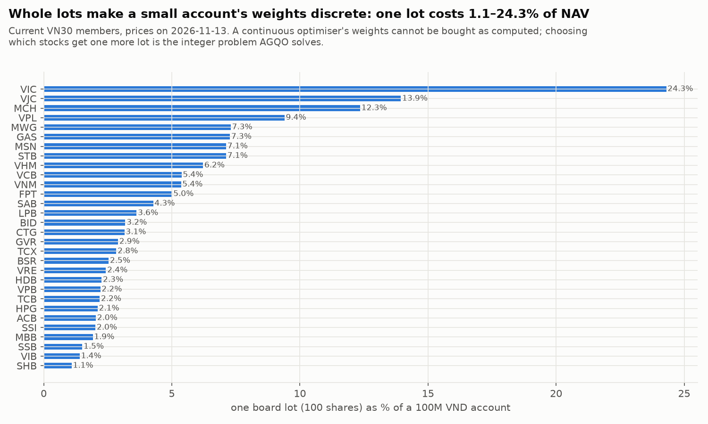
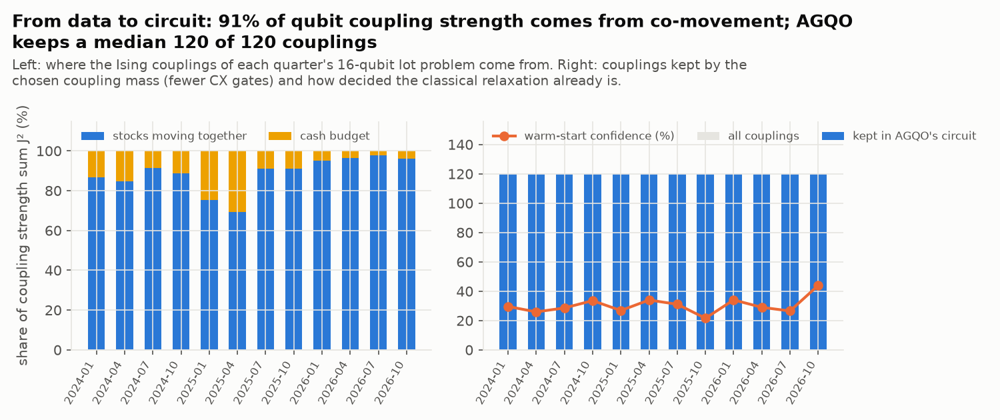
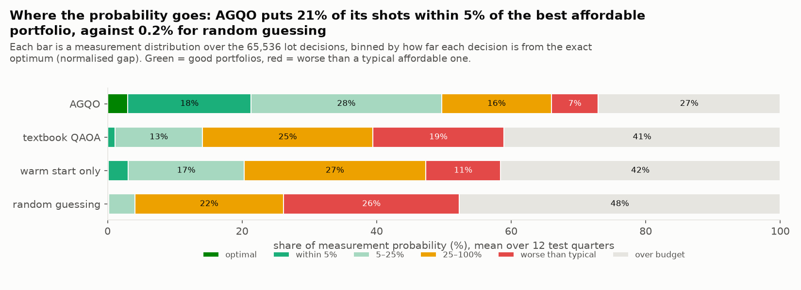
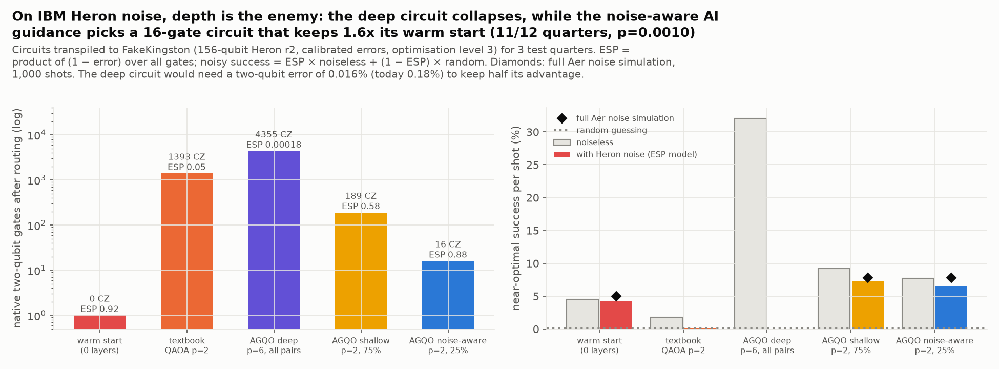
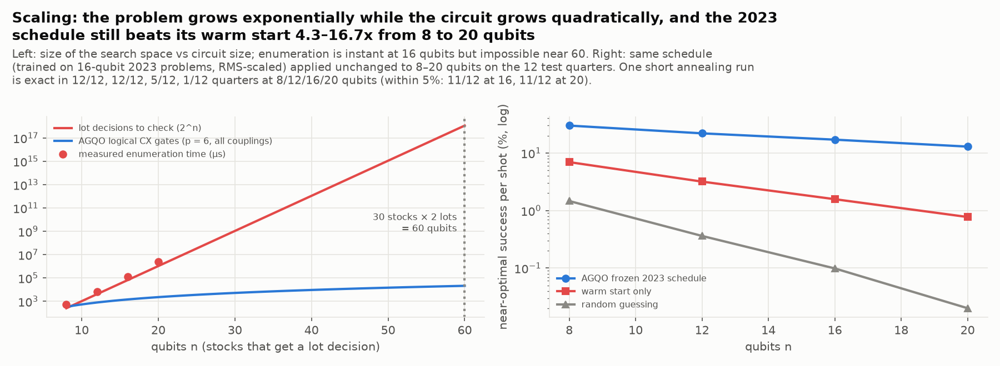

# Results

> V3.2 (2026-11-20): new runs, methods and results are in [RESULTS_V3_2.md](RESULTS_V3_2.md) and the pre-registered [protocol](research/PROTOCOL_V3_2.md). This file describes V3 and is unchanged otherwise.

_Auto-generated by `python -m agqo report` from `final` (run 1241s). Training: 2023-01-03 .. 2023-12-01 (monthly, 4 account sizes). Test: 2024-01-02 .. 2026-10-01 (quarterly). Budget penalty λ = 0.01._

## 1. Data and phase 1 insight

## 2. Phase 2: AI-guided circuit

| | cv_success | cv_success_sd | n |
|---|---:|---:|---:|
| 3-NN | 0.160 | 0.138 | 48.000 |
| 5-NN | 0.158 | 0.136 | 48.000 |
| 10-NN | 0.161 | 0.134 | 48.000 |
| 20-NN | 0.160 | 0.133 | 48.000 |
| all (frozen) | 0.157 | 0.134 | 48.000 |

## 3. Quantum quality on the 12 test quarters

| | success_pct | beats_rounding_pct | hit_in_512_shots_pct | feasible_mass_pct | median_best_gap | circuit_evals | cx | layers |
|---|---:|---:|---:|---:|---:|---:|---:|---:|
| Warm start only (p=0) | 3.095 | 16.022 | 94.550 | 58.397 | 0.013 | 0.000 | 0.000 | 1.000 |
| Textbook QAOA | 1.097 | 13.543 | 67.542 | 58.913 | 0.050 | 101.000 | 480.000 | 2.000 |
| Random search x3 | 7.653 | 28.508 | 99.446 | 74.086 | 0.003 | 154.333 | 381.333 | 4.667 |
| Frozen schedule | 23.834 | 42.762 | 100.000 | 80.437 | 0.000 | 1.000 | 1,440.000 | 6.000 |
| AGQO (AI-guided) | 21.315 | 40.259 | 100.000 | 72.930 | 0.000 | 41.000 | 1,440.000 | 6.000 |
| Polish ablation | 23.985 | 44.674 | 100.000 | 80.304 | 0.000 | 1.000 | 1,440.000 | 6.000 |
| Oracle (upper bound) | 25.207 | 43.143 | 100.000 | 78.961 | 0.000 | 1.000 | 1,440.000 | 6.000 |

Paired tests across quarters (a vs b; ratio of mean success with a 95% bootstrap interval):

| | n | wins | mean_a | mean_b | ratio | ratio_ci_low | ratio_ci_high | wilcoxon_p |
|---|---:|---:|---:|---:|---:|---:|---:|---:|
| agqo vs warm_start_only | 12 | 12 | 0.2132 | 0.03095 | 6.886 | 4.949 | 15.82 | 0.0004883 |
| agqo vs textbook | 12 | 12 | 0.2132 | 0.01097 | 19.42 | 14.09 | 39.29 | 0.0004883 |
| agqo vs random | 12 | 12 | 0.2132 | 0.07653 | 2.785 | 2.18 | 4.598 | 0.0004883 |
| agqo vs frozen | 12 | 7 | 0.2132 | 0.2383 | 0.8943 | 0.8148 | 1.037 | 0.4697 |
| agqo vs polish_ablation | 12 | 7 | 0.2132 | 0.2398 | 0.8887 | 0.8131 | 1.024 | 0.4238 |
| agqo vs uniform | 12 | 12 | 0.2132 | 0.002019 | 105.6 | 57.05 | 387 | 0.0004883 |
| better-than-rounding: agqo vs warm_start_only | 12 | 12 | 0.4026 | 0.1602 | 2.513 | 1.816 | 4.829 | 0.0004883 |

## 4. Financial walk-forward (100M VND, 2024-01 .. latest)

| | tracking_error_ann_pct | tracking_error_weekly_ann_pct | return_ann_pct | active_return_ann_pct | excess_return_vs_etf_ann_pct | fees_vnd | avg_holdings |
|---|---:|---:|---:|---:|---:|---:|---:|
| Practitioner: nearest-lot rounding | 3.029 | 3.177 | 20.136 | 1.221 | -0.748 | 586,137.000 | 22.250 |
| Equal weight 1/N, whole lots | 6.577 | 7.254 | 13.508 | -5.407 | -7.376 | 580,280.000 | 26.667 |
| Exact lot rounding (classical reference) | 2.960 | 3.217 | 19.822 | 0.908 | -1.061 | 567,712.500 | 22.833 |
| Textbook QAOA rounding | 2.959 | 3.264 | 20.201 | 1.286 | -0.683 | 630,031.500 | 22.667 |
| AGQO: AI-guided QAOA rounding | 2.960 | 3.217 | 19.822 | 0.908 | -1.061 | 567,712.500 | 22.833 |
| ETF E1VFVN30 | 9.279 | 5.166 | 20.840 | 1.925 | -0.044 | 149,404.500 | 1.000 |
| ETF FUEKIV30 | 15.461 | 9.644 | 21.109 | 2.194 | 0.225 | 149,425.500 | 1.000 |
| ETF FUESSV30 | 18.235 | 14.756 | 21.274 | 2.360 | 0.391 | 149,688.000 | 1.000 |

Tracking-error differences, moving-block bootstrap (21-day blocks, 2,000 resamples); `p_one_sided` = share of resamples in which the first strategy does not track better:

| | te_a | te_b | diff_pp | ci_low | ci_high | p_one_sided |
|---|---:|---:|---:|---:|---:|---:|
| AGQO: AI-guided QAOA rounding vs Practitioner: nearest-lot rounding | 2.960 | 3.029 | -0.070 | -0.185 | 0.042 | 0.099 |
| Exact lot rounding (classical reference) vs Practitioner: nearest-lot rounding | 2.960 | 3.029 | -0.070 | -0.185 | 0.042 | 0.099 |
| AGQO: AI-guided QAOA rounding vs Exact lot rounding (classical reference) | 2.960 | 2.960 | 0.000 | 0.000 | 0.000 | 1.000 |
| AGQO: AI-guided QAOA rounding vs Textbook QAOA rounding | 2.960 | 2.959 | 0.001 | -0.047 | 0.043 | 0.510 |
| AGQO: AI-guided QAOA rounding vs Equal weight 1/N, whole lots | 2.960 | 6.577 | -3.617 | -4.983 | -2.340 | 0.000 |

## 5. Account size

| | AGQO: AI-guided QAOA rounding | Exact lot rounding (classical reference) | Practitioner: nearest-lot rounding |
|---|---:|---:|---:|
| 20M VND | 6.774 | 6.774 | 12.143 |
| 50M VND | 3.828 | 3.796 | 4.430 |
| 100M VND | 2.960 | 2.960 | 3.029 |
| 200M VND | 2.498 | 2.498 | 2.701 |
| 500M VND | 2.468 | 2.481 | 2.513 |

| | diff_pp | ci_low | ci_high | p_one_sided |
|---|---:|---:|---:|---:|
| 20M VND | -5.370 | -6.931 | -3.842 | 0.000 |
| 50M VND | -0.602 | -1.087 | -0.188 | 0.001 |
| 100M VND | -0.070 | -0.185 | 0.042 | 0.099 |
| 200M VND | -0.203 | -0.404 | -0.040 | 0.003 |
| 500M VND | -0.045 | -0.102 | -0.001 | 0.023 |

## 6. Against the ETFs

## 7. Personal mandates

| | source | tracking_error_ann_pct | te_cost_vs_unconstrained_pp | avg_holdings | fallbacks | qaoa_success_mean | rule_violations_at_rebalance |
|---|---:|---:|---:|---:|---:|---:|---:|
| (none) · AGQO | - | 2.960 | 0.000 | 22.833 | 0 | 0.213 | 0 |
| (none) · Practitioner | - | 3.029 | 0.070 | 22.250 | 0 |  | 0 |
| Không đầu tư bất động sản, ngân hàng tối đa 30% · AGQO | LLM | 6.736 | 3.777 | 17.583 | 0 | 0.422 | 0 |
| Không đầu tư bất động sản, ngân hàng tối đa 30% · Practitioner | LLM | 6.985 | 4.025 | 16.583 | 0 |  | 0 |
| Chỉ giữ tối đa 12 mã, mỗi mã không quá 10%, giữ 5% tiền mặt · AGQO | LLM | 3.931 | 0.972 | 11.833 | 0 | 0.491 | 0 |
| Chỉ giữ tối đa 12 mã, mỗi mã không quá 10%, giữ 5% tiền mặt · Practitioner | LLM | 4.213 | 1.253 | 11.417 | 0 |  | 0 |
| Bỏ VIC, VHM, VRE và giữ ngành ngân hàng dưới 35% · AGQO | LLM | 6.743 | 3.784 | 18.750 | 0 | 0.342 | 0 |
| Bỏ VIC, VHM, VRE và giữ ngành ngân hàng dưới 35% · Practitioner | LLM | 6.816 | 3.857 | 17.250 | 0 |  | 0 |

## 8. LLM evaluation

Mandate compiler on 35 hand-labelled Vietnamese instructions: Qwen3.8-27B effective-constraint match **100.0%** (strict JSON match 94.3%), keyword rules 68.6%; clarification decisions correct 35/35; invalid outputs 0.

Explainer: 12/12 quarterly explanations had every number and trade verified against the evidence (92%). Latest (2026-10-01):

> Quý này, danh mục của bạn có giá trị 168.82 triệu đồng và đang nắm giữ 22 mã cổ phiếu. Việc mua bán theo lô chẵn là cần thiết vì thị trường không cho phép mua bán cổ phiếu lẻ, nên cần một công cụ tối ưu hóa để chọn tổ hợp lô tốt nhất. Phương pháp lượng tử (QAOA) đã giúp tìm ra giải pháp có sai số bám so với chỉ số VN30 là 5.39%, trong khi cách làm tròn đơn giản có sai số 5.56% và danh mục lý tưởng là 5.1%. Rủi ro chính là danh mục vẫn có sai số bám so với chỉ số VN30 do giới hạn của việc mua bán theo lô chẵn.

## 9. Latest decision

## 10. Presentation figures

