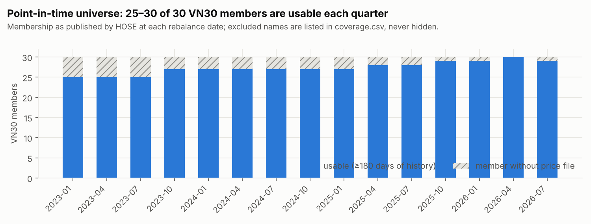
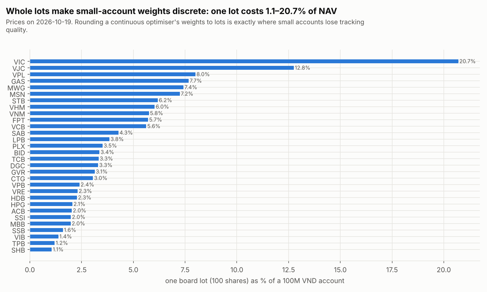
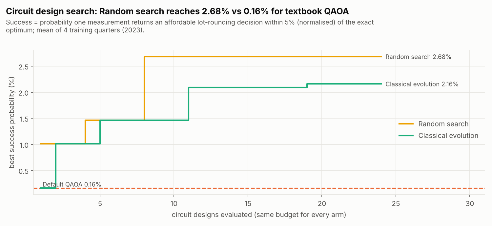
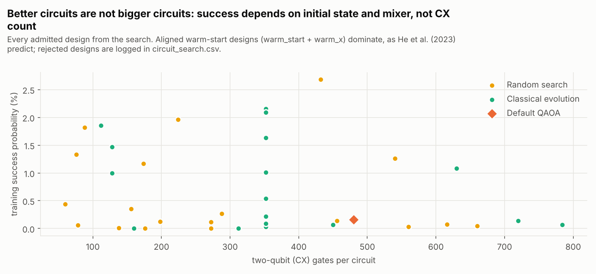
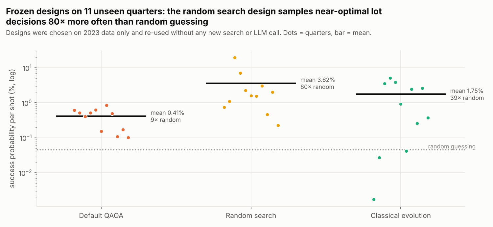
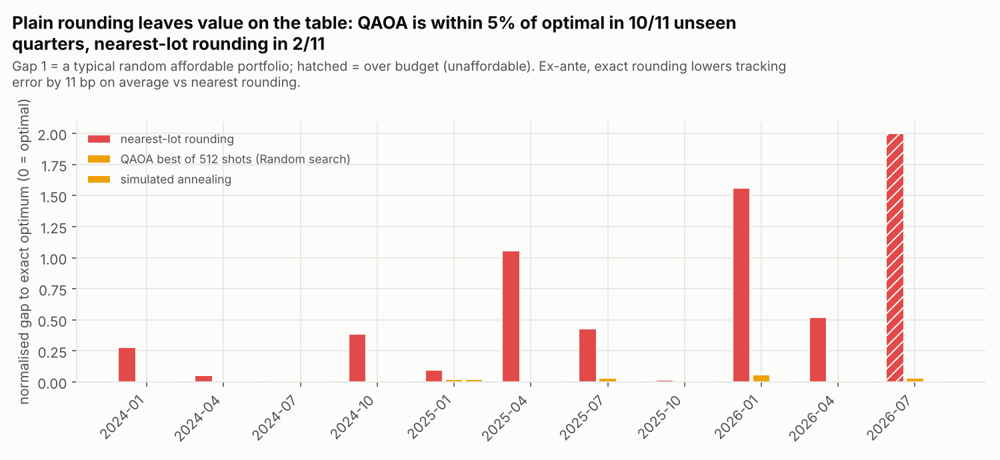
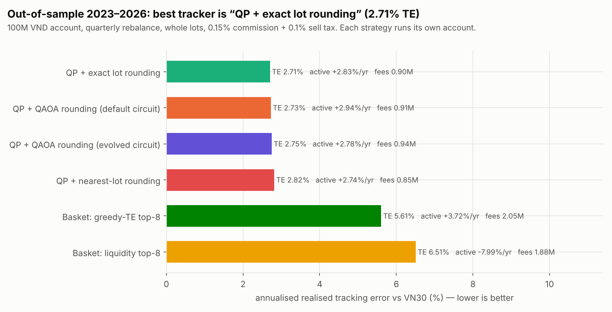
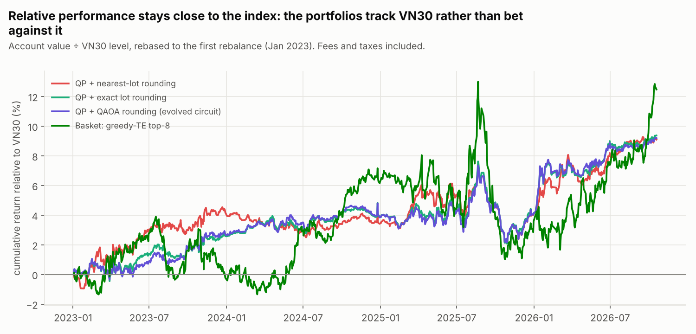
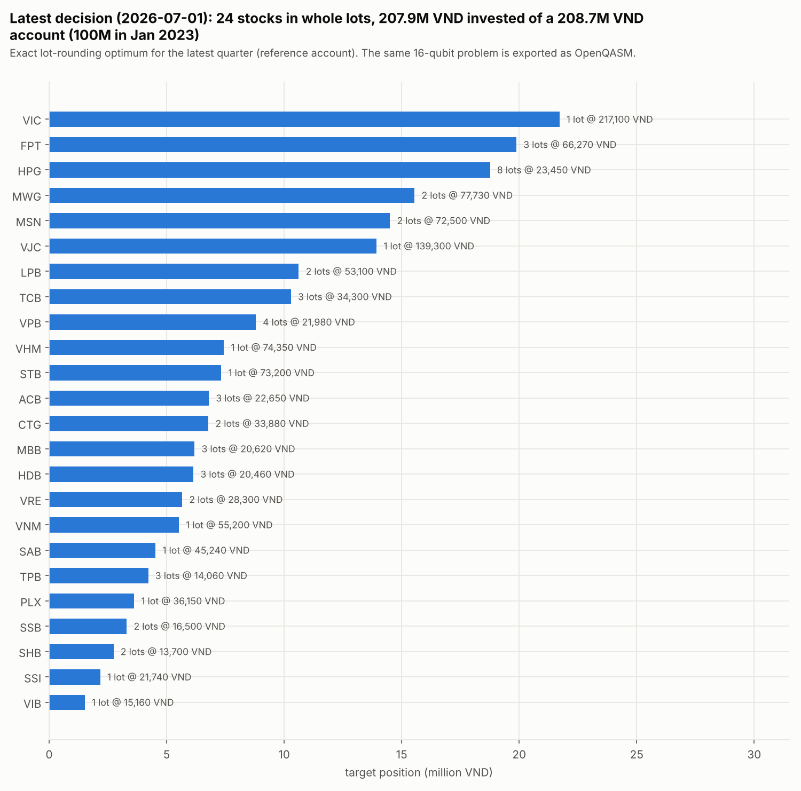

# Results

_Auto-generated by `python -m agqo report` from `results/baseline` (LLM backend: `None`, model: `None`, run time 1029s)._

> **No live LLM in this run.** LLM arms are absent (or mock). Run `python -m agqo run --llm modal --out results/llm_coder30` then re-run the report.

## 1. Data

## 2. Circuit design (training quarters)

Best design found by each arm:

| arm | layers | init | mixer | keep | optimizer | iters | CVaR α | train success |
|---|---|---|---|---|---|---|---|---|
| default | 2 | uniform | x | 1.00 | cobyla | 100 | 0.25 | 0.16% |
| random | 4 | warm_start | warm_x | 0.45 | nelder_mead | 104 | 0.82 | 2.68% |
| evolve | 4 | warm_start | warm_x | 0.37 | nelder_mead | 300 | 0.82 | 2.16% |

## 3. Quantum quality on unseen quarters

Random guessing succeeds with 0.0452% per shot. Simulated annealing (25,600 spin flips) reaches a median normalised gap of 0.000; the exact optimum is always known by enumeration.

| arm     |   success_pct |   hit_in_512_shots_pct |   feasible_mass_pct |   best_sample_gap |   circuit_evaluations |   cx |
|:--------|--------------:|-----------------------:|--------------------:|------------------:|----------------------:|-----:|
| default |         0.414 |                 77.411 |              64.454 |             0.03  |                   101 |  480 |
| evolve  |         1.755 |                 71.904 |              62.464 |             0.012 |                   301 |  352 |
| random  |         3.619 |                 96.093 |              69.938 |             0.006 |                   105 |  432 |

## 4. Financial out-of-sample backtest

|                                      |   tracking_error_ann_pct |   active_return_ann_pct |   correlation |         fees_vnd |   turnover_x |   avg_holdings |   avg_invested_pct |
|:-------------------------------------|-------------------------:|------------------------:|--------------:|-----------------:|-------------:|---------------:|-------------------:|
| QP + nearest-lot rounding            |                    2.816 |                   2.745 |         0.989 | 850745           |        4.475 |         21.933 |             93.303 |
| QP + exact lot rounding              |                    2.706 |                   2.827 |         0.989 | 899165           |        4.742 |         22     |             97.535 |
| QP + QAOA rounding (default circuit) |                    2.728 |                   2.94  |         0.989 | 910070           |        4.794 |         22.333 |             97.195 |
| QP + QAOA rounding (evolved circuit) |                    2.75  |                   2.777 |         0.989 | 936616           |        4.93  |         22.333 |             97.421 |
| Basket: liquidity top-8              |                    6.508 |                  -7.986 |         0.937 |      1.88142e+06 |        9.621 |          7.867 |             81.378 |
| Basket: greedy-TE top-8              |                    5.606 |                   3.723 |         0.955 |      2.05323e+06 |       10.428 |          8     |             85.945 |

## 5. Latest decision

