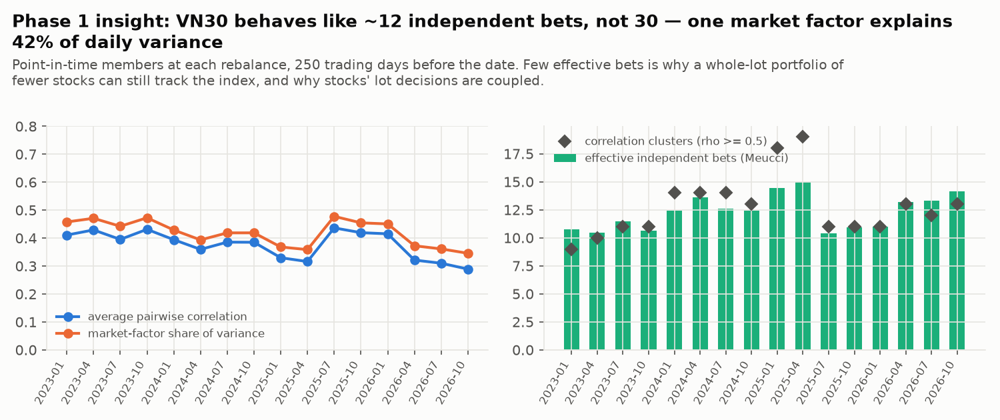
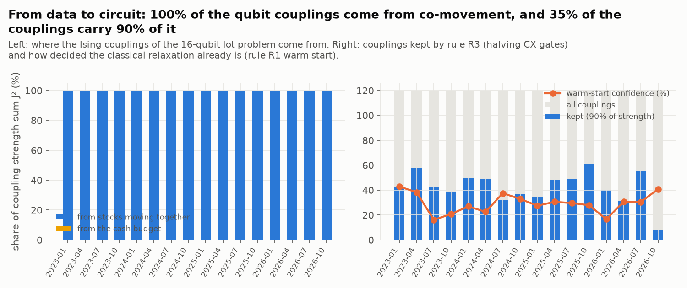
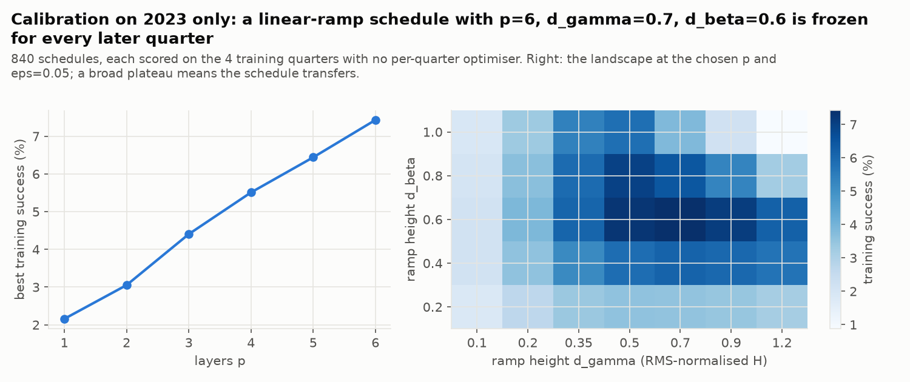
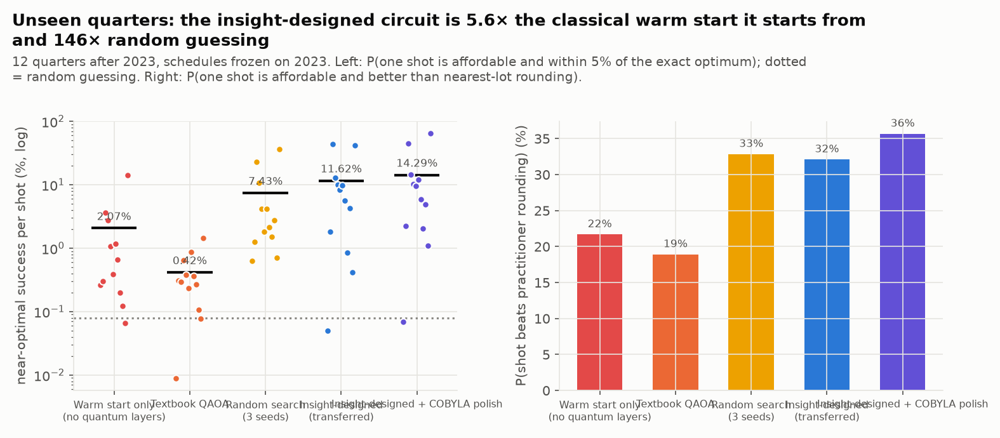
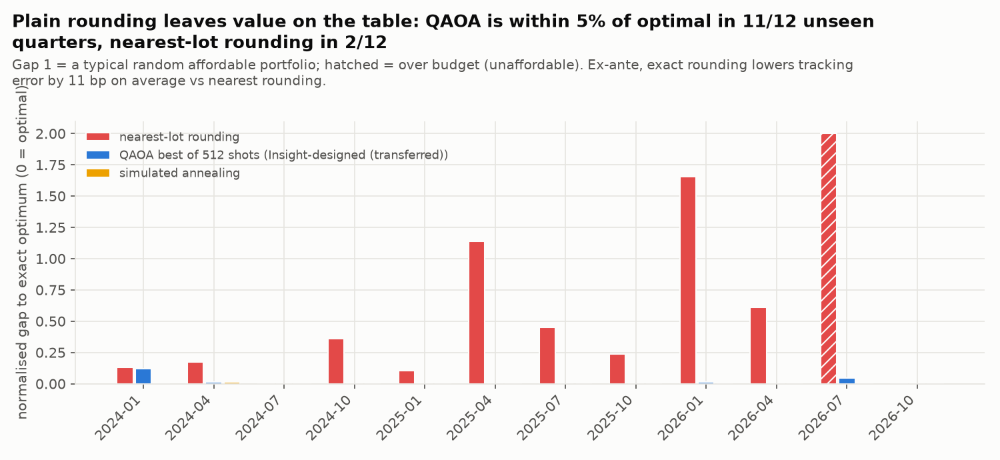
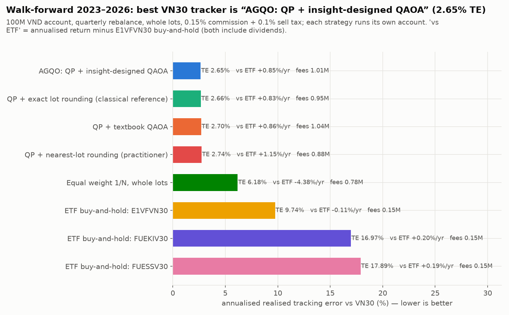
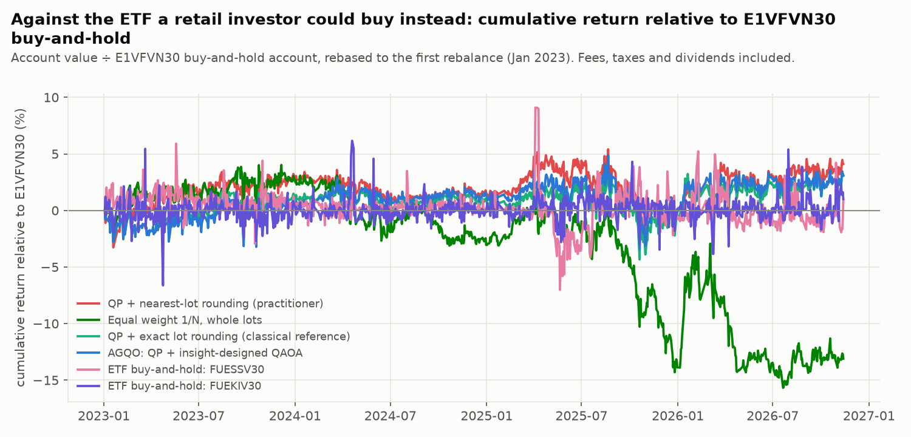
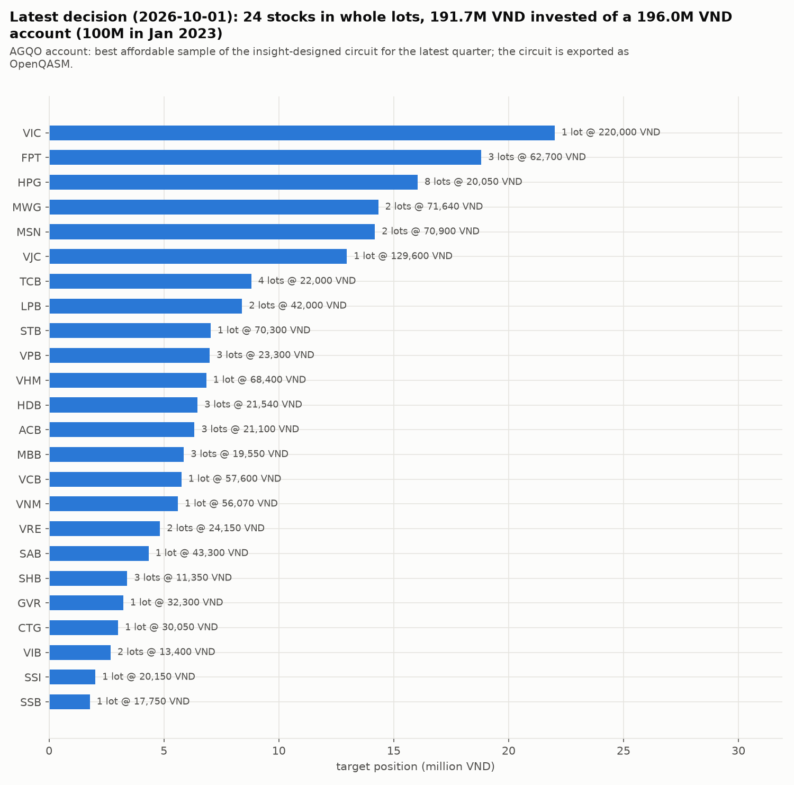

# Results

_Auto-generated by `python -m agqo report` from `results/insight_v1` (run time 535s; training quarters 2023-01-03..2023-10-02; budget penalty λ = 0.001 calibrated on them)._

## 1. Data

## 2. Phase 1 — value extracted from the data

## 3. Phase 2 — insight-driven circuit and optimiser

| rule | circuit element | data input | reference |
|---|---|---|---|
| R1 | warm-start initial state | continuous relaxation of the lot problem | Egger et al. 2021 |
| R2 | aligned warm-start mixer | same relaxation | He et al. 2023 |
| R3 | ZZ couplings kept | strongest pairs covering 90% of sum J² (co-movement + budget) | — |
| R4 | energy scale | RMS of Ising coefficients | Sureshbabu et al. 2024 |
| R5 | angle schedule | linear ramp, frozen after 2023 calibration | Montañez-Barrera & Michielsen 2025 |

Frozen design: p = 6, ε = 0.05, Δγ = 0.7, Δβ = 0.6, no per-quarter optimiser (the polished variant adds COBYLA on CVaR, Barkoutsos et al. 2020).

## 4. Quantum quality on unseen quarters

Random guessing succeeds 0.0799% per shot. Simulated annealing reaches a median normalised gap of 0.000; exact enumeration always finds the optimum. No quantum speed-up is claimed.

| | success_pct | beats_rounding_pct | hit_in_512_shots_pct | feasible_mass_pct | best_sample_gap | optimiser_calls | cx |
|---|---:|---:|---:|---:|---:|---:|---:|
| Warm start only (no quantum layers) | 2.065 | 21.695 | 81.191 | 58.886 | 0.033 | 0.000 | 0.000 |
| Textbook QAOA | 0.415 | 18.921 | 70.534 | 58.687 | 0.038 | 101.000 | 480.000 |
| Random search (3 seeds) | 7.432 | 32.854 | 98.659 | 66.299 | 0.008 | 154.333 | 381.333 |
| Insight-designed (transferred) | 11.619 | 32.112 | 92.441 | 63.032 | 0.000 | 1.000 | 494.000 |
| Insight-designed + COBYLA polish | 14.294 | 35.677 | 94.101 | 61.528 | 0.000 | 41.000 | 494.000 |

## 5. Walk-forward financial backtest

| | tracking_error_ann_pct | active_return_ann_pct | tracking_error_vs_etf_pct | excess_return_vs_etf_ann_pct | fees_vnd | turnover_x | avg_holdings | avg_invested_pct |
|---|---:|---:|---:|---:|---:|---:|---:|---:|
| QP + nearest-lot rounding (practitioner) | 2.739 | 3.216 | 9.595 | 1.148 | 877,341.000 | 4.625 | 22.812 | 93.814 |
| Equal weight 1/N, whole lots | 6.176 | -2.315 | 10.832 | -4.383 | 783,450.000 | 4.152 | 27.312 | 96.260 |
| QP + exact lot rounding (classical reference) | 2.658 | 2.899 | 9.777 | 0.831 | 954,323.500 | 5.014 | 23.375 | 97.628 |
| QP + textbook QAOA | 2.696 | 2.924 | 9.766 | 0.856 | 1,036,242.500 | 5.420 | 23.500 | 97.637 |
| AGQO: QP + insight-designed QAOA | 2.653 | 2.918 | 9.800 | 0.850 | 1,010,730.500 | 5.290 | 23.375 | 97.761 |
| ETF buy-and-hold: E1VFVN30 | 9.742 | 1.961 | 0.094 | -0.107 | 148,680.000 |  | 1.000 |  |
| ETF buy-and-hold: FUEKIV30 | 16.969 | 2.272 | 18.020 | 0.204 | 149,499.000 |  | 1.000 |  |
| ETF buy-and-hold: FUESSV30 | 17.889 | 2.256 | 17.396 | 0.188 | 148,954.500 |  | 1.000 |  |

ETF tracking errors are inflated by daily market-price noise around NAV (E1VFVN30 daily-return correlation with VN30 ≈ 0.84; FUESSV30 and FUEKIV30 trade ~13k units a day); compare ETFs on total return, not daily TE.

`active_return_ann_pct` is measured against the VN30 *price* index, so it includes dividends the index omits; the ETF columns compare like with like.

## 6. Latest decision

