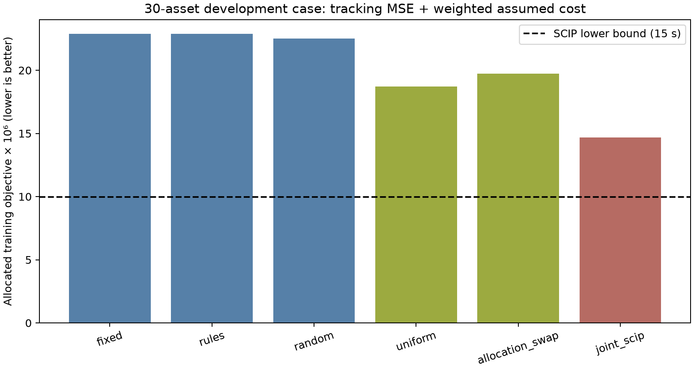

# Completion review and measured remaining gaps

Updated 2026-11-03. This file is the current reading entry point; historical raw
results are preserved. The project is implemented as a research application,
but financial usefulness and a production LLM are not yet qualified.

## Completed in this continuation

| Previous gap | Delivered change | Verification and scope |
|---|---|---|
| Only 12 asset qubits supported | GateIR v2 and exact fixed-cardinality executor, up to 40 asset qubits subject to a 2,000,000-state cap | Small full-state agreement with slack/frozen assets; N=30/K=6 executes all 593,775 supports. Classical simulation only. |
| No usable real US algorithm corpus | Pinned author-supplied INDEX_2010, 386 identifiers × 252 dates; exact R-date/matrix decoding and SHA256 checks | Separate conditional benchmark admission. Full-year membership conditioning prevents an unbiased investable-universe claim. |
| Large profiles overfill model context | Explicit descriptor projection for N>12, retaining strong pairs, spectrum, incumbent and selected coefficient references | Projection metadata/hash preserved; canonical Hamiltonian retains every coefficient. Ablations do not leak omitted objective values. |
| Financial result and proxy conflated | Exhaustive small-support allocation audit; exact 30-asset proxy audit; SCIP incumbent and lower bound | Reveals material selection/allocation distortion; no global allocation optimum is claimed at N=30. |
| Weak exclusion repair seed | Seed removes forbidden securities before bounded swap search | Regression verifies an exit with a four-query budget. Original failed run remains in v1. |
| Conditional allocation labeled globally optimal | Heuristic/QAOA decisions report feasible; allocation_status records conditional convex optimality | Joint SCIP remains the route to an optimality certificate, within numerical solver tolerances. Trajectory v2 uses the shared 32-query sample allocator. |
| Native model failures mixed format and semantics | Additional normalization-only unitary diagnostic of saved QUASAR outputs | Bell fidelity 0.4956; cost fidelity 0.5163. Both still fail. Original 1/3 probe score unchanged; zero new inference. |
| No visual QA | Chrome desktop/mobile interactions, screenshots, no page overflow or uncaught exceptions | Final UI QA includes clearing stale synthetic decisions/holdings after a blocked market request. |
| Uncommitted experiment source not recoverable | Full Python source snapshot, package versions and checksums in canonical v3 study | Reproduction can overlay source bytes on a checkout. V1/v2 intermediate development runs remain visible. |

All 120 tests passed; static F checks passed. No GPU inference was dispatched in
this continuation. Modal remained connected under data1; both deployed apps had
zero active tasks at the recorded check.

## Measured development findings

Canonical bundle: [published_development_v3](../../results/research/published_development_v3/RESULTS.md).
All 18 method/case rows returned feasible allocations. Four finite-shot objective
evaluations, one seed and 64 final shots constitute a scale/accounting test, not
adequate tuning or qualification.

For N=30/K=6, allocated training objectives (lower is better) were:

| Method | Objective | Supports with probability > 1e-12 | Transpiled CX / depth |
|---|---:|---:|---:|
| Fixed circuit | 2.28784e-5 | 21 | 998 / 445 |
| Correlation-rule circuit | 2.28784e-5 | 273 | 998 / 236 |
| Random circuit | 2.24967e-5 | 1,446 | 998 / 226 |
| Uniform final support draws | 1.87218e-5 | Not a circuit distribution | — |
| Allocation-aware swap | 1.97459e-5 | Not a circuit distribution | — |
| Joint SCIP incumbent, 15 s | 1.46777e-5 | Not a circuit distribution | — |

SCIP did not prove the 30-asset optimum; its incumbent/bound gap was about 32.18%.
The lower-bound and source-universe relaxation records are included. The relaxation
drops cardinality and other restrictions, so its gap is not measured loss due to
restricting the universe. CPU diagnostics score all proxy supports and count their
work; this is not a hardware query or runtime comparison.
Transpiled CX/depth use an all-to-all logical basis; hardware routing/noise are
not included. A separate post-run hold calculation gives base-case training MSE
3.45880e-5 (N=10) and 4.36185e-5 (N=30), with zero assumed trades. Holding the
original account violates the exclusion scenario. These opened diagnostics do not
replace a preregistered hold/repair investment study.

The exact proxy-optimal support allocates to 1.67205e-5: approximately 13.92% worse
than the SCIP incumbent, and potentially farther from the unknown global optimum.
Small-case rank correlations of 0.934/0.922 therefore do not suffice to qualify
the proxy. The full 386-asset training covariance has rank 125 from 126 rows;
condition number is undefined under the stated policy. Shrinkage does not remove
membership or return-semantics uncertainty.

See the [post-run analysis](../../results/research/published_development_v3/postrun_analysis/ANALYSIS.md)
for proxy audits, covariance diagnosis and the sources of exact classical access.

## Claims still not satisfied

| Claim / gate | Current evidence | Required next evidence |
|---|---|---|
| Unbiased historical investment backtest | Blocked for original cohort; published corpus has selection conditioning | Source-backed identity/action/sector reconciliation and aligned adjusted returns; do not substitute missing assets or edit audit flags. |
| Selection energy reflects allocated portfolio quality | Material proxy distortion observed | Freeze an economically justified regret/non-inferiority margin; qualify it on new periods/mandates, or revise the formulation before model comparison. |
| Data-conditioned circuit is useful | Rule circuit is shallower here, without better financial objective | Matched-resource broad-support initialization/sweep controls, multiple seeds and uncertainty; demonstrate downstream financial value. |
| Production LLM is qualified | None; native specialist primitives fail; earlier coder evidence exploratory | Native-task and structured-transfer evaluation are separate; lock protocol, compare candidates, then evaluate new structures without tuning on them. |
| LLM rationale uses data causally | No controlled positive evidence | Profile removal/shuffle and asset-permutation interventions at matched search budgets. |
| Quantum advantage | No supporting evidence | Hardware/resource evidence against strong classical solvers on an appropriate scaling study. Classical ideal simulation cannot establish this. |

The existing 95% first-pass validity and 20% quality/resource improvement targets
remain qualification targets with uncertainty estimates, not promised outputs.
H1 financial value: inconclusive. H2 LLM value: inconclusive. H3 adaptive QAOA value:
inconclusive. Current quantum advantage: unsupported.

## Next work in dependency order

1. Complete the source review in [DATA_RECONCILIATION.md](DATA_RECONCILIATION.md).
   Keep conditional academic results separate from investment-data admission.
2. Resolve proxy faithfulness first. Alternatives include a strictly equal-weight
   financial task with matching semantics, richer discrete-weight encoding with
   explicitly larger registers, or an allocation-aware outer method with all extra
   classical work counted. None is silently substituted into existing results.
3. Address sparse exploration through verified preparation/multiple sweeps. The
   [Dicke construction](https://arxiv.org/abs/1904.07358) and
   [XY-mixer study](https://arxiv.org/abs/1904.09314) motivate controls; neither
   guarantees improvement on these instances. The current dense Dicke reference
   is not an implementation of the efficient construction.
4. Freeze the revised financial/circuit protocol, then run bounded model selection.
   The failed primitive diagnostics give no reason to escalate parameter count
   automatically. Choose by validity, allocated quality and complete measured cost.
5. Run a powered evaluation on unopened periods and mandate structures; generate
   the final competition report only from actual outcomes, including failures.

## Reproduction and evidence locations

- [Protocol](COMPLETION_PROTOCOL.md) and [chronological worklog](WORKLOG.md).
- `data/published_us/dataset_manifest.json`, `assessment.json`, `ASSESSMENT.md`.
- `results/research/published_development_v3/`: complete artifact contract,
  source_snapshot, proxy diagnostics and figures.
- `results/research/quasar_native_diagnostics_v1/`: derived semantic failures.
- `results/research/ui_qa_v4/`: final browser checks and inspected screenshots.
- [AGENTS.md](../../AGENTS.md): compact handoff; `agent.md` points there.

The [published package](https://stat.ethz.ch/CRAN/web/packages/sparseIndexTracking/index.html)
and [author repository](https://github.com/dppalomar/sparseIndexTracking) supply the
corpus; their published algorithm results are not AGQO measurements.
