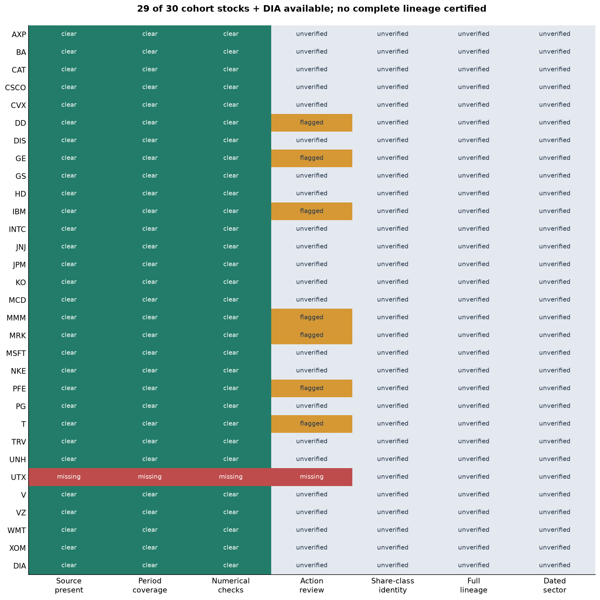
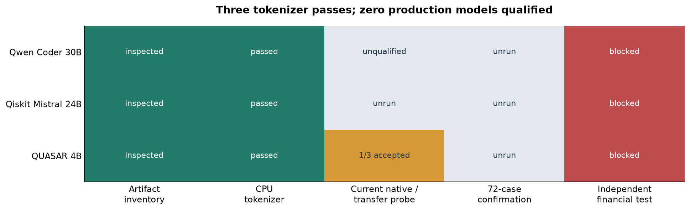
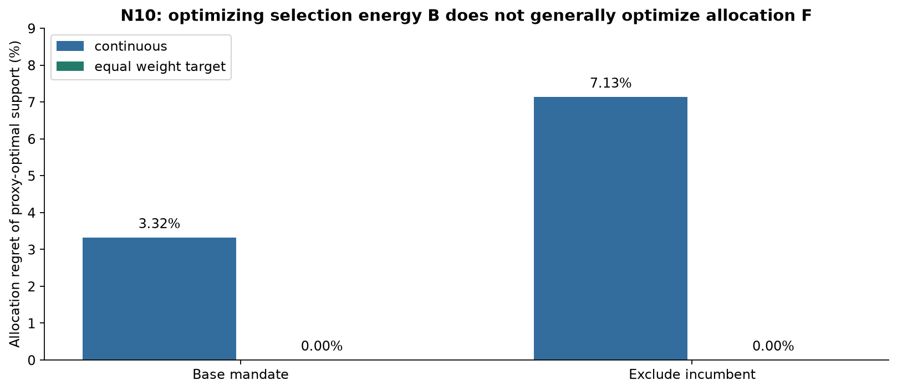

# Historical audit and qualification status

Updated: 2026-11-04, Asia/Ho_Chi_Minh.

For concrete next actions, alternatives and stop rules, read the
[remediation plan](REMEDIATION_PLAN.md). It proposes a study without changing
existing objectives, raw results or financial admission.

The subsequent [improvement controls](../../results/research/improvement_v1/RESULTS.md)
reduced opened-case circuit cost and added a more discriminating conditional-US
budget benchmark. Strong informed classical search still leads on these related
development cases. This improves engineering/evaluation, not historical admission
or independent financial qualification. No new LLM/GPU inference was used.

The [explicit guidance artifacts](../../results/research/data_guidance_v1/RESULTS.md)
add measured proxy-exchange evidence, a feature-to-gate procedure and checked
citations for each proposed connection. Eight requests are prepared offline; no
model has been evaluated under this new contract. Exact descriptor arithmetic
and traceable explanations do not establish financial utility or causal adaptation.

**The available-source audit and qualification infrastructure are implemented.
Historical investability, a production LLM and independent financial value are
not qualified. A larger model cannot resolve missing economic entitlements or
the current selection/allocation objective mismatch.**

## Work performed

Latest [real GPU study](../../results/research/live_edge_v2/FINDINGS.md) admits8/8
typed programs but produces identical star/group1 templates in both prompt arms.
Guidance adds no observed value; a rule reproduces the architectures and some
explanations are wrong. Engineering reliability improved, with schema/scheduling/
cap changes confounded versus the preserved0/8 v1. Financial and model qualification
remain open. Exact prompts and responses are in [LLM_TRANSPARENCY.md](LLM_TRANSPARENCY.md).

The [tail-fitting pilot](../../results/research/tail_fitting_v1/FINDINGS.md)
completed96 local CPU runs with independent objective/accounting audit. Tail
aggregation modestly improves N20 mean-F fitting but still loses to informed
classical search; it remains optional. No new model or financial qualification.

The [preregistered protocol](QUALIFICATION_PROTOCOL.md) separates source hygiene,
model reliability and independent financial utility. The new `history-audit` CLI
checks raw-source checksums, source symbols, New York session dates against XNYS,
duplicates, OHLC/volume validity, coverage and action-adjustment consistency.
Malformed source objects return explicit failures. Version 3 also snapshots the
actual audit code and environment; earlier audits remain unchanged.

| Available-source finding | Measured result | Interpretation |
|---|---:|---|
| Stock histories | 29 of 30 | UTX remains missing; no replacement or removal |
| Additional benchmark history | DIA | ETF total-return proxy, not the official DJIA series |
| Rows per available file | 3,520, 2012–2025 | Calendar coverage is a hygiene check |
| Missing internal sessions / invalid price rows | 0 / 0 | Does not establish point-in-time identity |
| OHLC violations / invalid volume rows | 0 / 0 | Internal consistency only |
| Provider dividend records / split labels | 1,726 / 17 | Vendor event metadata, not an accepted economic ledger |
| Internal cash-adjustment comparisons | 1,725 | None exceeded the 5e-5 log-residual review threshold |
| Non-integer split labels | 11 across 7 stocks | DD 3, GE 3; IBM/MMM/MRK/PFE/T 1 each |
| Complete independently verified security lineages | 0 | Market evaluation remains blocked |

These figures are generated from [the audit](../../results/research/historical_audit_v3/audit.json).
XNYS comes from pinned `exchange_calendars==4.13.2`, an independent software
reference rather than a primary exchange attestation. Audit thresholds diagnose
vendor consistency; they are not guarantees about executable total returns.

## Why the source review matters financially

A current ticker may describe a different historical share class or only one
successor in a merger or spin-off. A vendor adjustment factor is not the number
of distributed shares. For example, IBM's provider split label of 1.046 cannot
be substituted for the 0.2 Kyndryl shares per IBM share described by the
[issuer's completion release](https://newsroom.ibm.com/2021-11-03-IBM-Completes-the-Separation-of-Kyndryl?lnk=ithpv18nf).

The [partial primary-source candidate ledger](../../data/us_equities/review/action_evidence_candidates_v1.json)
contains ten events, not a complete accepted action history. Publication timestamps,
full source-byte capture, share-class lineage, cash-in-lieu, descendant prices and
tradability/reinvestment treatment are still missing. SEC direct requests returned
HTTP 403; no successful PDF download, source checksum or visual identity-table
verification has been invented. Restricted identifier-source content is not redistributed.

An adjusted wealth stream across legacy securities may represent a composite
economic basket rather than one stock that could actually be bought on each date.
Before making a K-stock or trading-cost claim, reconcile the securities held after
each action, availability intervals, distributions and any resulting trades. Merely
renaming UTX to RTX or carrying today's DD/GE labels backward is insufficient.
No new liquidation or universe policy has been silently introduced to avoid this issue.

## LLM shortlist and actual runtime evidence

**Subsequent integration checkpoint:** the connected [Modal run](../../results/research/modal_e2e_v1/RESULTS.md)
completed one live Coder30 A10080GB batch:3/3 designs verified,24/24 synthetic
decisions feasible and9 exported circuits independently crosschecked. Controls
and LLM reached the same small reference objectives; LLM designs used more CX.
This supersedes the earlier Coder30 "tokenizer only" runtime state below for that
one integration scope. Mistral generation remains unrun, and no production model,
independent financial benefit or quantum advantage is qualified.

The shortlist retains the general coding control, framework specialist and quantum
specialist from the [evidence review](EVIDENCE_REVIEW.md). It is not a model ranking.

| Candidate | Pinned revision | New result | Qualification |
|---|---|---|---|
| Qwen3-Coder-30B-A3B-Instruct | `b2cff646eb4bb1d68355c01b18ae02e7cf42d120` | CPU pass; subsequent live integration 3/3 verified | Integration verified; production unqualified |
| Qiskit Mistral Small 3.2 24B | `0c541958022de04bd7c200b14a4b7a58977ae751` | CPU tokenizer/chat rendering passed | Generation unrun |
| QUASAR / rl_quantum_4b | `b9581279345436e2b7eadcdf80e4f1417748eb8b` | CPU tokenizer/chat rendering passed | Prior interface probe accepted 1/3 tasks |

The [artifact inventory](../../results/research/model_artifact_audit_v1.json)
shows Mistral has both native and HF configuration/tokenizer metadata, but HF
weight shards. The initial statement that native metadata was absent was wrong;
the regression inventory test caught it. The actual incompatibility is that
[vLLM 0.17.1's native weight loader](https://github.com/vllm-project/vllm/blob/v0.17.1/vllm/model_executor/model_loader/default_loader.py)
looks for `consolidated*.safetensors`, absent from the pinned checkpoint. The worker
now uses HF tokenizer/config and safetensors loading. This is an artifact-layout
correction, not proof that a full GPU model load or generation will work.

Three sequential bounded Modal CPU calls completed. No weights were loaded, no GPU
was requested and no new circuit inference was run. Their total reservation was
**USD 0.079125**, not an invoice. The shared preflight image used vLLM 0.17.1; this
does not establish equivalence to every production GPU worker environment. Receipts,
tokens, revisions and billing snapshots are in
[tokenizer_preflight_v1](../../results/research/tokenizer_preflight_v1/RESULTS.md).
Both deployed Modal apps had zero active tasks at the recorded post-preflight check.

## Confirmation and independent-test protection

`qualification.reliability` computes an exact binomial interval and prevents
counting repeated problem IDs or extending the frozen confirmation set. The
planned criterion needs 72/72 first-pass successes to put the two-sided 95% lower
bound above 95%. No candidate has run this confirmation. Independence remains a
scientific design assumption; a unique hash alone does not prove it.

`freeze_final_test` checks admission, a qualified model record, continuous-formulation
evidence, temporal splits and configuration completeness. It binds a successful
lock to manifest, raw and processed-data hashes. It records blockers instead of
running outcomes when prerequisites fail. These integrity checks cannot replace
source review or authenticate a scientific claim from a manually supplied flag.

The actual [readiness artifact](../../results/research/independent_test_readiness_v1/BLOCKED.json)
is **blocked**: no final lock and no new final strategy outcomes. Proposed splits
remain development 2014–2018, validation 2019–2021 and final test 2022–2025.
Later data were exposed to hygiene and action review, not new strategy ranking or
profile fitting. Audit all earlier exposure before calling a partition unopened;
historical out-of-sample also does not establish exclusion from LLM pretraining.

## Why financial value and model scaling remain unresolved

The exhaustive N10 audit finds 3.32% / 7.13% allocated training-objective regret at
the proxy-optimal support under continuous weights. The explicit equal-weight
alternative passes identity but changes the mandate. N30 conditioning controls
still trail the stronger classical reference. These findings are preserved in
[the control report](../../results/research/control_summary_v1/FINDINGS.md).

Neither broad initial support coverage, better energy conditioning nor a larger LLM
proves improved allocated financial utility. Scaling is justified only after:

1. Complete investable data and action/sector reconstruction passes source review.
2. A faithful continuous selection formulation passes a frozen financial margin,
   or a new explicit formulation is reviewed and tested.
3. Common preparation, grammar, conditioning, candidate pooling and total budgets
   are locked for strong classical and circuit controls.
4. One candidate wins development/validation selection and independent correctness
   confirmation without tuning on confirmation failures.
5. A powered, once-opened financial test supports compliance and the predeclared
   tracking/cost effect, with full inference/optimization/allocation cost counted.

Current hypotheses: financial value **inconclusive**; LLM value **inconclusive**;
adaptive QAOA value **inconclusive**; quantum advantage **unsupported**. The
[English visual gallery](../../results/research/evidence_gallery_v1/GALLERY.md)
shows the measured findings and explicitly labeled qualification targets.
