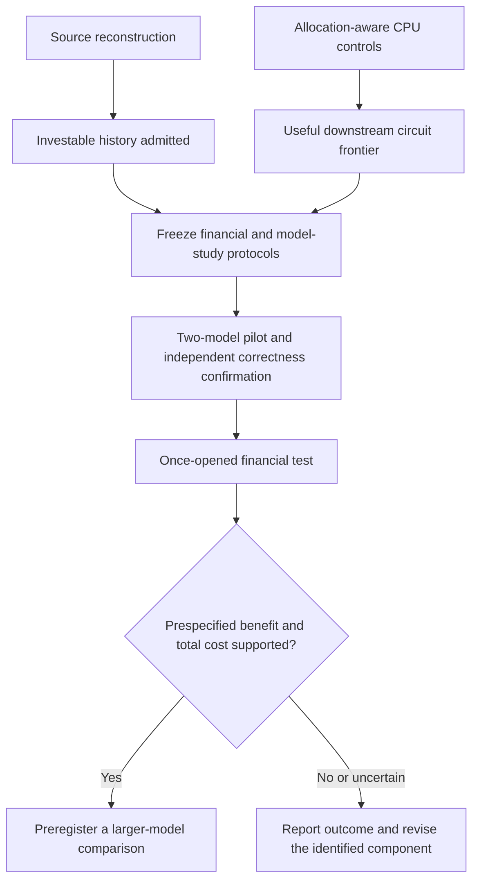

# Resolving data, financial formulation and LLM qualification blockers

Date: 2026-11-04. Status: recommendation and dependency plan, not an executed
experiment. Existing datasets, objectives, protocols and raw scores remain unchanged.
No inference or financial test is authorized by this memo alone beyond the existing
project contract. The next study needs its own frozen configuration and budget.

## Recommended decision

Retain continuous-weight, mandate-aware tracking/cost repair as the primary task.
Reconstruct investable history and test an allocation-aware circuit-search objective
in parallel. Do not choose a larger LLM until a non-LLM circuit control demonstrates
a useful downstream opportunity under complete, matched resource accounting.

The strongest immediate question is:

> Can a verified circuit sampler find allocation-feasible supports with a useful
> tracking/cost outcome per unit of total search effort after a mandate changes?

LLM contribution is a subsequent question: can data-conditioned circuit design
improve that frontier over fixed, rule-based and adaptive classical circuit search?

## Evidence behind the recommendation

| Evidence | Relevant finding | Design consequence |
|---|---|---|
| Local exhaustive support audit | Continuous B-optimum allocation has 3.32% / 7.13% regret on opened N10 cases | Better B optimization is not a sufficient financial endpoint |
| Local conditioning/preparation controls | Broader coverage and better energy conditioning still trail stronger uniform controls | Establish non-LLM downstream utility before a larger model |
| [Benidis/Feng/Palomar implementation](https://github.com/dppalomar/sparseIndexTracking) | Sparse tracking jointly concerns asset selection and capital allocation; INDEX_2010 is an available benchmark | Keep allocated quality and a strong classical sparse-tracking comparison |
| [Gambella/Simonetto, mixed-binary ADMM](https://arxiv.org/abs/2001.02069v2) | Decomposes supported mixed binary/continuous problems into QUBO and convex subproblems; numerical quantum simulations | Decomposition is an alternative to investigate, not an automatic convergence or speed guarantee |
| [Egger/Marecek/Woerner, warm-start QAOA](https://quantum-journal.org/papers/q-2021-06-17-479/) | Portfolio examples motivate relaxation-informed shallow circuits | Include a properly verified, charged warm-start comparator; do not assume transfer to every constrained mixer |
| [Stopfer/Wagner benchmark v3](https://arxiv.org/abs/2509.17876v3) | Strong MIP and tailored heuristics dominate the studied variance-minimization variant | Require strong classical controls; their result is not a theorem about our different tracking/cost task |
| [Qiskit Mistral model card](https://huggingface.co/Qiskit/mistral-small-3.2-24b-qiskit) | Qiskit-specialized training and publisher coding benchmarks | Candidate for local testing, not evidence of GateIR or portfolio reliability |

These sources were inspected before selecting this proposed direction. Their
metrics are not copied as AGQO financial pass thresholds. The primary historical
candidate still has the limitations in QUALIFICATION_STATUS.md.

## 1. Make the financial specification explicit

Write the account/use-case contract before another algorithm comparison:

- Exactly K selected stocks; minimum/maximum weight and cash policy.
- Incumbent holdings and how mandatory sales interact with turnover limits.
- Tracking loss, transaction-cost assumptions and units of the trade-off coefficient.
- Industry/sector taxonomy, dated classification policy and mandate persistence.
- Corporate-action accounting and permitted successor/distributed securities.
- Execution lag, decision frequency, infeasibility behavior and no-trade reference.

Set an acceptable tracking deterioration and meaningful cost saving in account units
on development, before validation/test. For example, annual tracking-error basis
points and cost basis points of NAV are interpretable units; this memo deliberately
does not invent values. Without a justified margin, report Pareto trade-offs rather
than a threshold-based financial win.

Output: `financial_contract_vNext.md` with source assumptions and numerical units.
No change to the current financial contract occurs until that revision is explicit.

## 2. Reconstruct an investable dataset rather than another clean CSV

### Required records

| Record | Minimum fields | Acceptance |
|---|---|---|
| Security master | Stable internal security ID, issuer CIK where applicable, share class, ticker-effective intervals, primary source | Identity continuity for every included security; CIK alone is not a share-class identifier |
| Universe snapshot | Observation date, publication/availability evidence, members, source bytes/checksum where accessible | Universe knowable before the first decision; no future-survivor filter |
| Corporate-action ledger | Effective date, input/output IDs, share ratios, cash, fractional-share policy, source | Shares and cash reconcile across every relevant event |
| Tradability ledger | Listing/delisting/suspension or successor availability | No assumed purchase of a nonexistent legacy ticker |
| Prices and distributions | Raw execution-price basis, split basis, dividends, adjusted-return convention, independent checks | No double adjustment; reconstructed account wealth agrees within justified rounding/valuation tolerances |
| Classification/context | Taxonomy, effective dates, source, conservative availability bound | No current classification or later report used as earlier-known information |

An internal stable security ID can be source-backed without a paid vendor ID.
It must distinguish share classes and successors. An issuer identifier or a current
ticker is insufficient. Where publication time is only known to a date, retain that
uncertainty and use a conservative availability bound rather than inventing seconds.

Prioritize missing UTX, DD and GE, then the flagged IBM/MMM/MRK/PFE/T actions.
The existing ten-event candidate file is not a complete ledger: unflagged events,
dividends and other lineage changes also need review. The [DIA October 2013 filing](https://www.sec.gov/Archives/edgar/data/1041130/000119312513486376/d643100dn30d.htm)
anchors a dated holding snapshot; it does not by itself certify September membership
or provide missing UTX prices.

Declare whether distributed securities are held or sold, when they become tradable,
and how costs/turnover and temporary extra positions are handled. A spin-off can
temporarily produce more than K holdings. Do not hide this by treating a composite
adjusted wealth stream as a single purchasable stock. Cash-in-lieu and sale prices
must be supported by a declared valuation/execution policy.

### Bounded alternative if the original cohort cannot be reconstructed

Complete a declared source search across issuer records, SEC material and suitable
independent free price sources. If essential history remains unavailable, report
the original cohort as ineligible and propose a new versioned historical scope.
Choose its universe from a source available at inception, before reviewing strategy
outcomes. Retain later delistings and complex events; do not select only names with
complete future histories. Changing scope is not evidence that the original data
passed, and a new scope is not guaranteed to solve all coverage problems.

Keep the pinned academic corpus for conditional algorithm testing while source
reconstruction continues. It cannot replace an investable independent financial test.

Output: reviewed `security_master`, `corporate_actions`, `tradability`, `classification`
and aligned prices, with a provenance manifest and explicit admission decision.

## 3. Stop optimizing only the wrong proxy

For a support S, let F(S) be the best feasible continuous tracking/cost allocation
under the original financial specification. B(S) is the present equal-weight proxy.
The measured difference is a change of optimization problem, not a coding error
that a larger model can repair.

| Approach | What it achieves | Limitation / recommendation |
|---|---|---|
| Allocation-aware sampled loss | Evaluate sampled supports with the common allocator and use F feedback for angle/design search | Recommended first CPU pilot. Extra classical solves count; the circuit's cost Hamiltonian is still a surrogate |
| Mixed-binary/convex decomposition | Coordinate binary support and continuous allocation subproblems using an explicit ADMM/Benders-style formulation | Research alternative; derive and test classically first. Nonconvex convergence and binary-subproblem difficulty require evidence |
| Discretize weights jointly | Encode support and weight grid in the quantum optimization problem | A different finite-grid approximation with more qubits/slack; report discretization regret and total resources |
| Explicit equal-weight mandate | Makes the supported equal-weight objective identity exact | Valid narrower task only if financially justified and separately versioned; does not solve the continuous primary task |

### Recommended CPU pilot

1. Retain immutable financial coefficients and validated circuit compilation. Treat
   the current B Hamiltonian as a proposal-generator component, not an exact oracle
   for F. Record both identities and do not claim F has been compiled into cost gates.
2. Use common verified broad-support preparation and declared conditioning across
   fixed, rule, random and adaptive circuit controls. Check mixer/initialization
   compatibility and resource overhead rather than inserting a warm start blindly.
3. Expose the sampled allocated objective F and allocation feasibility to the numerical
   optimizer. Freeze treatment of infeasible/unknown allocations and any loss scaling
   using development only; conditional quality must not hide low feasible mass.
4. Predeclare candidate pooling over optimizer and final shots. Charge every sample,
   allocator query, failed solve, cached lookup, gradient and architecture proposal.
   Increasing allocator queries requires a new protocol, not an undisclosed change
   to the old 32-query runs. Caching rules must be the same for all methods.
5. On small cases, enumerate feasible supports and solve each allocation for exact
   downstream reference values. Then assess an N30 case with joint SCIP incumbents
   and valid bounds; do not call a time-limited incumbent the global optimum.
6. Compare against uniform sampling, allocation-aware swaps and the joint reference.
   Budget both allocation queries and complete time; exact simulation access is
   separately labeled and is not free quantum hardware information.

This changes the feedback target, not the expressive limits or trainability of the
circuit. It is a proposed allocation-aware variational support sampler using a QAOA
circuit family. It does not implement a coherent quantum F oracle or demonstrate
computational advantage. Retain it only if the measured downstream frontier is useful.

For decomposition, check whether the binary subproblem remains combinatorially
meaningful. Some support/weight splitting choices produce nearly separable binary
updates, easily solved by sorting or simple classical routines. Moving complexity
to an expensive classical outer loop does not establish quantum value.

Output: a frozen `allocation_aware_protocol.json`, matched-budget CPU records and
a direct F-quality/feasibility/cost report. No LLM is needed to answer this first question.

## 4. Qualify the circuit family before the language model

Run the preceding CPU pilot using the existing conditional development corpus.
It tests algorithm mechanics, not investment performance. Measure quality against
the best strong classical result/bound, feasibility, resource use and sensitivity
to mandates. Include no-change, mandatory-exit and infeasible cases.

Go only if the circuit family shows a useful reproducible downstream trade-off
against the declared controls within the specified budget. A lower B expectation
alone fails this gate. If it fails, report that result and investigate formulation/
circuit limits; do not launch a large-model sweep to compensate for it.

## 5. Test two LLM candidates under one interface

After the prior prerequisites, compare pinned Qwen Coder30 and Qiskit Mistral24.
The former is the general control; the latter is a framework-specialized candidate.
QUASAR's existing adverse native-semantic evidence remains recorded; it is not the
automatic next run. No claim of a universal best model follows from this shortlist.

Use typed verified exchange/preparation blocks, explicit gate schedules/parameters,
structured decoding, immutable COST references and independent verification. The
LLM chooses circuit structure rather than stocks or coefficients. Test native-code
skills and transfer to our grammar separately. A native Qiskit coding score does
not qualify GateIR transfer or financial decision quality.

Freeze model revision, runtime, prompt, grammar, common preparation, optimizer,
feedback and complete proposal/token/shot/allocation budgets. Pilot on development;
select one model before confirmation. Do not fine-tune or change prompts on the
confirmation set. The existing 72/72 exact-interval criterion applies only to the
declared independent correctness distribution, not to financial returns.

All future live work needs the separate registered budget under the existing
USD150 reservation policy. This memo schedules no paid job. Prefer the cheaper
candidate if quality/reliability are equivalent within the predeclared criteria.

Output: bounded pilot comparison, frozen selected-model record and independent
correctness confirmation with every invalid/interrupted/unrun case distinguished.

## 6. Open the financial test only after the dependencies pass

Audit previous exposure before finalizing the proposed temporal partitions. Use
the same audited starting account, then each method's own continuous holdings,
cash, drift, entitlements, costs and execution lag. Mandate changes persist.

Hold and all solve methods must share the business specification; hold can be
noncompliant after a mandatory exit and must be labeled accordingly. Compare
compliance, realized tracking/cost frontiers, turnover and complete research/
deployment cost. Do not fit prompts or choose model size on the final outcomes.

Use window/trajectory-level uncertainty, not quantum seeds as market observations.
Determine sample size on development for the predeclared economic effect. An
underpowered test is inconclusive. Report simulated cost assumptions and their
sensitivity rather than claiming daily closes reveal historical bid/ask spreads.

If earlier tuning contaminated the intended final period, call that analysis
retrospective and obtain an untouched confirmation design. Historical holdout is
not proven absent from LLM pretraining; anonymization is a control, not a guarantee.

Output: locked test protocol, complete artifact contract, supported/unsupported/
inconclusive hypotheses and a model-scaling decision with its evidence.

## Immediate work order

Two workstreams can proceed independently: source reconstruction and the non-LLM,
allocation-aware CPU pilot. The next code change should serve those questions.
Model comparison, final financial evaluation and scaling follow their results.

