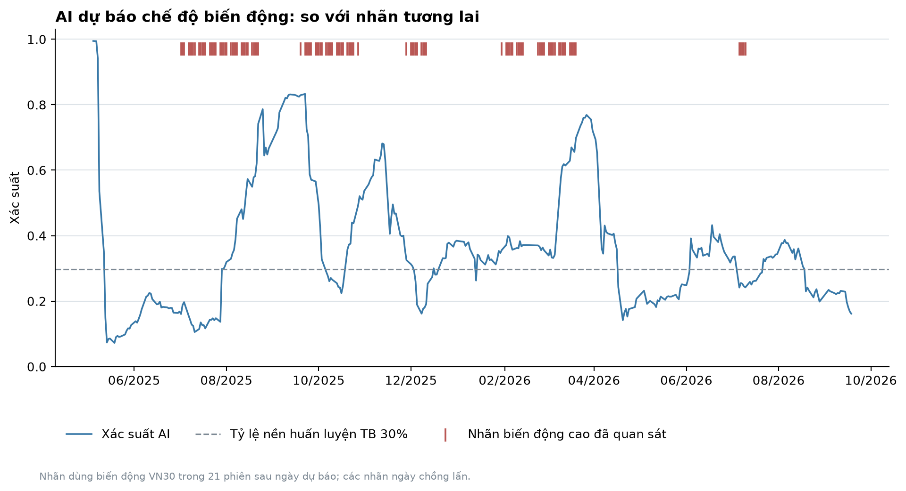
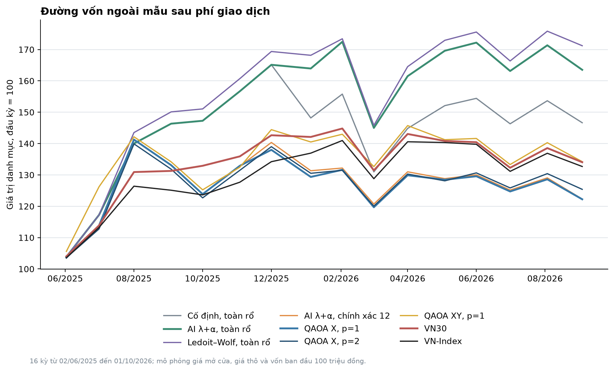
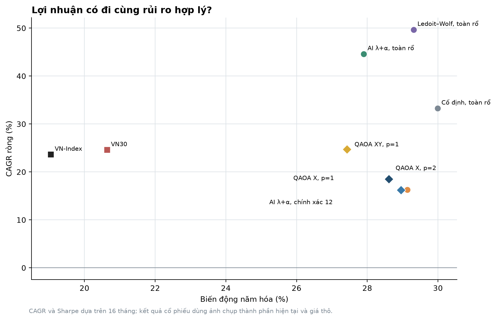
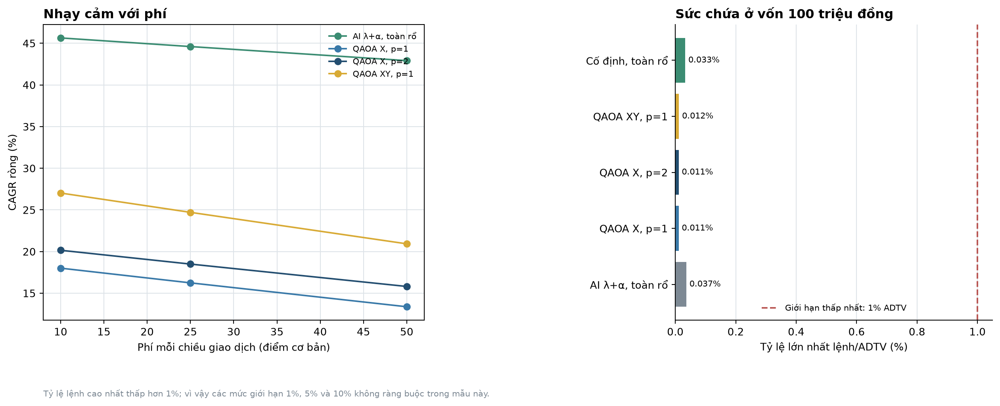
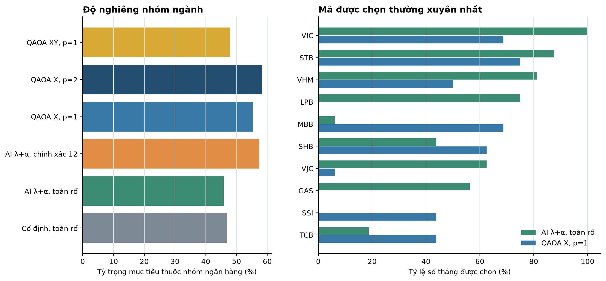
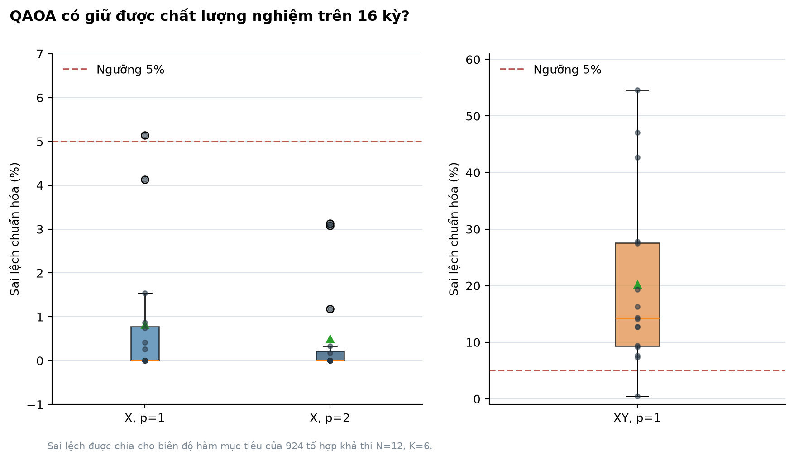
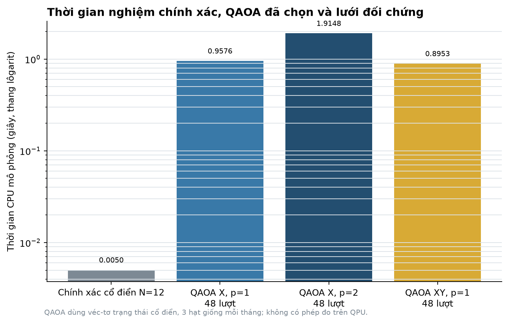

# Kiểm định ngoài mẫu: AI, QAOA và danh mục VN30

**Khoảng đo danh mục:** 2025-06-02 đến 2026-10-01 · **Số kỳ:** 16 · **Vốn mô phỏng:** 100.00 triệu · **Phí:** 25 điểm cơ bản mỗi chiều.

> Đây là thí nghiệm nghiên cứu trên giá OHLCV thô, dùng ảnh chụp thành phần VN30 ngày 02/10/2026. Chưa có điều chỉnh cổ tức/quyền hoặc lịch sử thành phần theo ngày. Kết quả chưa đủ căn cứ để tuyên bố chiến lược có thể tạo lợi nhuận thật.

## Kết luận điều hành

- Mô hình AI chọn C = 10 sau khi so log-loss trên 99 quan sát xác nhận; tỷ lệ nhãn biến động cao là 17.17%.
- Trên 345 dự báo ngày ngoài mẫu, điểm Brier là 0.257, cao hơn mức nền mở rộng 0.225; kỹ năng Brier so với nền là -14.30%. Log-loss AI 0.748 cũng kém mức nền 0.643. Nhãn 21 phiên chồng lấn, nên số này không tương đương số quan sát độc lập.
- Ở tần suất tái cân bằng, điểm Brier là 0.237 so với 0.217 của dự báo nền trên 16 tín hiệu tháng; kỹ năng so với nền là -9.30%.
- Tổ hợp AI điều chỉnh λ và α cùng nghiệm chính xác trên toàn bộ mã đủ điều kiện đạt CAGR ròng 44.60%, Sharpe 1.47. Đối chứng Ledoit–Wolf cao hơn với CAGR 49.68%; vì vậy kết quả chưa chứng minh AI là thành phần tạo thêm giá trị.
- Trên 12 mã thanh khoản cao, QAOA X p=1 đạt sai lệch mục tiêu chuẩn hóa trung bình 0.82% và đạt sai lệch không quá 5% ở 15/16 kỳ; p=2 đạt 16/16. Đây là kết quả mô phỏng cổ điển, chưa chạy QPU.
- Trên cùng 12 mã, bộ giải chính xác cổ điển nhanh hơn mô phỏng QAOA; hiện chưa có bằng chứng ưu thế lượng tử.
- Lượt này chưa bật LLM; các hàng bên dưới là đối chứng hiện tại để so với AGQO sau khi chạy Modal.

## 1. Thiết kế và chia thời gian

| Giai đoạn | Mốc | Cách sử dụng |
|---|---|---|
| Huấn luyện ban đầu | đến 2024-10-31 | Chuẩn hóa, xác lập ngưỡng phân vị 70% và khớp hồi quy logistic |
| Xác nhận | 2024-11-01–2025-04-30 | Chọn C theo log-loss; nhãn được chặn 21 phiên trước ranh giới |
| Kiểm tra khóa trước | tín hiệu từ 2025-05-01 | Cố định C/ngưỡng, sau đó mở rộng huấn luyện chỉ bằng nhãn đã trưởng thành |
| Danh mục ngoài mẫu | 2025-06-02–2026-10-01 | Tín hiệu cuối tháng, giao dịch ở phiên kế tiếp, nắm giữ đến lần vào lệnh tháng kế tiếp |

Ngưỡng biến động cao được ước lượng là 21.95% năm hóa. Tập huấn luyện ban đầu có 562 nhãn trưởng thành; tập xác nhận có 99 quan sát, trong đó 17.17% là nhãn biến động cao. Đặc trưng AI chỉ lấy từ VN30: biến động 20/60/120 phiên, lợi suất tích lũy 20/60 phiên và tỷ số biến động 20/120. Mô hình được khớp lại tại từng ngày tín hiệu bằng các nhãn tương lai đã đủ 21 phiên.

| C | Log-loss tập xác nhận |
|---:|---:|
| 0.01 | 0.538 |
| 0.1 | 0.598 |
| 1 | 0.558 |
| 10 | 0.502 |

Ở các tín hiệu tháng, tỷ lệ nhãn biến động cao thực tế là 31.25%, trong khi xác suất AI trung bình là 36.17%. Đây là thước đo sát tần suất giao dịch hơn, nhưng số quan sát vẫn nhỏ.

## 2. Hiệu quả tài chính trong kỳ kiểm tra

Lợi suất được tính từ giá mở cửa phiên kế tiếp đến giá mở cửa lần tái cân bằng kế tiếp. Phí được trừ ở mỗi lần mua và bán; lệnh bị giới hạn theo ADTV. Sharpe giả định lãi suất phi rủi ro bằng 0.

| Phương pháp | CAGR ròng | Biến động năm hóa | Sharpe | Sụt giảm tối đa | Giá trị cuối kỳ từ 100 triệu | Chi phí giao dịch | Doanh số hai chiều TB/kỳ |
|---|---:|---:|---:|---:|---:|---:|---:|
| VN30 | 24.58% | 20.64% | 1.17 | -9.22% | 134.04 triệu | — | — |
| VN-Index | 23.63% | 19.05% | 1.21 | -8.64% | 132.68 triệu | — | — |
| Cố định, toàn rổ | 33.26% | 29.99% | 1.11 | -20.69% | 146.64 triệu | 2.15 triệu | 38.36% |
| AI chỉ λ, toàn rổ | 33.94% | 30.17% | 1.12 | -20.69% | 147.65 triệu | 2.59 triệu | 45.90% |
| AI chỉ α, toàn rổ | 41.71% | 27.67% | 1.41 | -15.92% | 159.17 triệu | 2.39 triệu | 40.54% |
| AI λ+α, toàn rổ | 44.60% | 27.90% | 1.47 | -15.93% | 163.52 triệu | 2.41 triệu | 40.78% |
| Ledoit–Wolf, toàn rổ | 49.68% | 29.31% | 1.53 | -15.92% | 171.21 triệu | 2.42 triệu | 40.62% |
| AI λ+α, chính xác 12 | 16.30% | 29.13% | 0.65 | -14.56% | 122.30 triệu | 3.88 triệu | 77.74% |
| QAOA X, p=1 | 16.24% | 28.95% | 0.65 | -15.28% | 122.22 triệu | 4.06 triệu | 81.51% |
| QAOA X, p=2 | 18.50% | 28.61% | 0.72 | -14.20% | 125.39 triệu | 3.87 triệu | 77.58% |
| QAOA XY, p=1 | 24.70% | 27.42% | 0.94 | -11.90% | 134.23 triệu | 5.23 triệu | 98.84% |

### Chỉ số giao dịch bổ sung

| Phương pháp | Sortino | Calmar | VaR tháng 95% | CVaR tháng 95% | Hệ số lợi nhuận | Tỷ lệ tháng dương |
|---|---:|---:|---:|---:|---:|---:|
| VN30 | 2.42 | 2.66 | -6.66% | -9.22% | 2.57 | 62.50% |
| VN-Index | 2.38 | 2.73 | -6.79% | -8.64% | 2.49 | 56.25% |
| Cố định, toàn rổ | 1.90 | 1.61 | -11.68% | -15.93% | 2.23 | 75.00% |
| AI chỉ λ, toàn rổ | 1.97 | 1.64 | -11.68% | -15.93% | 2.31 | 75.00% |
| AI chỉ α, toàn rổ | 2.59 | 2.62 | -7.92% | -15.92% | 2.96 | 75.00% |
| AI λ+α, toàn rổ | 2.73 | 2.80 | -7.92% | -15.93% | 3.07 | 75.00% |
| Ledoit–Wolf, toàn rổ | 3.06 | 3.12 | -7.92% | -15.92% | 3.44 | 75.00% |
| AI λ+α, chính xác 12 | 1.40 | 1.12 | -7.38% | -8.69% | 1.66 | 56.25% |
| QAOA X, p=1 | 1.39 | 1.06 | -7.48% | -9.07% | 1.66 | 56.25% |
| QAOA X, p=2 | 1.59 | 1.30 | -7.38% | -8.69% | 1.75 | 56.25% |
| QAOA XY, p=1 | 2.10 | 2.08 | -6.80% | -7.22% | 1.96 | 56.25% |

### Đối chiếu lợi nhuận vượt VN30

Khoảng tin cậy lấy mẫu khối dùng chênh lệch lợi nhuận theo tháng; báo cả khối 3 và 6 tháng vì chỉ có 16 kỳ.

| Phương pháp | Lợi nhuận vượt năm hóa | Khoảng 95% (khối 3 tháng) | Khoảng 95% (khối 6 tháng) |
|---|---:|---:|---:|
| Cố định, toàn rổ | 9.16% | [-14.56%, 30.50%] | [-10.78%, 26.49%] |
| AI λ+α, toàn rổ | 16.97% | [1.61%, 32.48%] | [5.73%, 28.20%] |
| AI λ+α, chính xác 12 | -5.20% | [-20.74%, 11.37%] | [-18.71%, 6.76%] |
| QAOA X, p=1 | -5.30% | [-20.95%, 11.39%] | [-20.09%, 7.20%] |
| QAOA X, p=2 | -3.44% | [-18.93%, 12.39%] | [-17.57%, 8.98%] |
| QAOA XY, p=1 | 1.52% | [-21.91%, 20.82%] | [-13.68%, 15.88%] |

### Diễn giải tài chính

- Trong cửa sổ này, danh mục AI trên toàn bộ mã đủ điều kiện tạo 44.60% CAGR ròng so với 24.58% của VN30. Nhưng Ledoit–Wolf đạt 49.68%, nên phần vượt trội không thể quy riêng cho AI.
- Bộ phân loại AI không thắng dự báo tỷ lệ nền về Brier và log-loss. Lợi suất danh mục cao hơn không chứng minh AI đã dự báo đúng chế độ; thay đổi mức co rút, nhiễu ước lượng, thành phần sống sót và diễn biến thị trường đều có thể giải thích khác biệt.
- QAOA X p=1 trên 12 mã tạo 16.24% CAGR ròng và Sharpe 0.65, thấp hơn VN30 trong kỳ này. Mức doanh số hai chiều trung bình 81.51% so với 40.78% của danh mục AI toàn rổ làm chi phí giao dịch cao hơn.
- Với vốn 100 triệu đồng, lệnh lớn nhất của QAOA X bằng 0.01% ADTV, thấp hơn giới hạn thấp nhất 1%; sức chứa không phải nút thắt ở quy mô vốn giả định này. Phí và lựa chọn mã là yếu tố kinh tế đáng quan tâm hơn.
- Khoảng tin cậy của các cấu hình QAOA so với VN30 đều cắt qua 0; 16 kỳ và các lựa chọn cấu hình song song không đủ để khẳng định ưu thế thống kê.
- Tổ hợp AI toàn rổ có lợi nhuận vượt VN30 năm hóa 16.97%; khoảng lấy mẫu khối trong cửa sổ này dương, nhưng 16 kỳ, thiên lệch sống sót và việc so nhiều cấu hình khiến kết quả chưa đủ làm bằng chứng đầu tư.
- Tỷ trọng mục tiêu thuộc nhóm ngân hàng trung bình là 45.83% ở nghiệm AI toàn rổ và 55.21% ở QAOA X. VIC xuất hiện ở 16/16 kỳ của nghiệm AI toàn rổ; mức tập trung này cần được kiểm soát.

## 3. QAOA được thiết kế và đo như thế nào

| Thành phần | Thiết lập |
|---|---|
| Mã hóa | 1 qubit cho mỗi ứng viên trong 12 mã có ADTV 20 phiên cao nhất; tổng cộng 12 qubit |
| Ràng buộc | Chọn đúng K=6 mã; có 924 tổ hợp khả thi |
| Hàm mục tiêu | Giảm phương sai danh mục theo λ, thưởng lợi nhuận trung bình ước lượng; đường cơ sở dùng AI, AGQO để LLM chọn λ và α trong danh mục |
| Bộ trộn X | Chồng chập đều, cộng hạng phạt để giữ K; trạng thái có 2^12 = 4.096 chuỗi bit |
| Bộ trộn XY | Khởi tạo một chuỗi khả thi và dùng trao đổi lân cận trên vòng để bảo toàn K |
| Độ sâu | p=1 cơ sở; p=2 kiểm tra độ sâu; mỗi lớp có 66 tương tác cặp do ma trận hiệp phương sai dày |
| Tối ưu góc | COBYLA, tối đa 50 lần đánh giá, 512 mẫu/lần |
| Lặp lại | Hạt giống 11, 23, 47; chọn mẫu khả thi có điểm tốt nhất trong ba lượt |
| Đối chứng | Duyệt chính xác mọi tổ hợp N=12,K=6, dùng cùng μ, Σ, λ, α |

QUBO dùng mục tiêu λ(xᵀΣαx)/K² − (μᵀx)/K; phí giao dịch được đo ở lớp mô phỏng danh mục. Bộ trộn X cộng hạng phạt bình phương (Σxᵢ−K)²; XY bảo toàn số mã được chọn. Mỗi nghiệm được chấm lại bằng hàm mục tiêu danh mục gốc trước khi so với chuẩn chính xác.

| Cấu hình | Kỳ đạt sai lệch ≤5% | Sai lệch TB | Kỳ dự phòng nghiệm chính xác | Có mẫu khả thi trong lượt tối ưu | Xác suất khả thi TB của seed được chọn | Thời gian CPU tổng 48 lượt |
|---|---:|---:|---:|---:|---:|---:|
| X, p=1 | 15/16 | 0.82% | 0 | 100.00% | 55.70% | 0.958 giây |
| X, p=2 | 16/16 | 0.49% | 0 | 100.00% | 75.38% | 1.915 giây |
| XY, p=1 | 1/16 | 20.20% | 0 | 100.00% | 100.00% | 0.895 giây |

Lượt báo cáo này chưa gọi LLM. Khi bật AGQO trên Modal, phần quyết định theo từng tín hiệu, insight đầu vào, chính sách đã chọn và kết quả QAOA sẽ được ghi tại đây.

Chuẩn chính xác N=12 cần tổng 0.0050 giây cho 16 tín hiệu, còn QAOA X p=1 cần 0.958 giây cho 48 lượt mô phỏng. Khi đủ 30 mã, nghiệm chính xác xét tối đa 593.775 tổ hợp mỗi kỳ; các kỳ đầu có 29 mã do VPL chưa đủ lịch sử. Tổng thời gian của năm cấu hình cổ điển trên 16 tín hiệu là 5.23 giây. Hai cách không cùng quy mô; máy véc-tơ trạng thái chỉ là mô phỏng cổ điển.

### Kết luận chọn hướng đi

**Hướng AGQO:** AI/LLM rút insight tài chính từ dữ liệu có sẵn tại ngày tín hiệu, chọn một chính sách QAOA trong danh mục đã khóa, rồi QAOA giải danh mục theo chính sách đó. Hồi quy logistic, cấu hình QAOA cố định, Ledoit–Wolf và nghiệm chính xác vẫn được giữ làm đối chứng. Chỉ công nhận LLM có ích nếu AGQO thắng đối chứng theo tiêu chí tài chính và chất lượng nghiệm đã đăng ký trên dữ liệu ngoài mẫu.

Báo cáo này chưa bật LLM; các con số đang thấy là chuẩn đối chiếu, chưa phải kết quả của vòng AGQO đầy đủ.

Trước khi biến kết quả thành tuyên bố đầu tư, cần thay dữ liệu bằng chuỗi đã điều chỉnh, lấy thành phần VN30 theo ngày hiệu lực, mở rộng các chu kỳ thị trường độc lập, xác định phí/thuế/trượt giá theo nhà môi giới, và đăng ký trước tiêu chí chọn mô hình. Cần chạy lời hướng dẫn LLM trên Modal, lưu nguyên quyết định theo ngày, rồi kiểm định thêm nhiều chu kỳ chưa dùng để chọn chính sách.

## 4. Nguồn dữ liệu và xử lý

- Tệp: data/vn30_snapshot_20261002/ohlcv_daily.csv; 37,308 dòng; 2022-01-04–2026-10-19.
- Nguồn bộ lấy: thư viện vnstock-data; nguồn giá là DNSE chart API; danh sách thành phần là bản chụp HODL.VN ngày 02/10/2026.
- Lợi suất tính từ giá đóng cửa; chỉ dùng phiên cả VN30 và VN-Index đều có giá để thống nhất lịch chỉ số; không nội suy giá thiếu.
- Đầu vào danh mục dùng tối đa 252 phiên gần nhất, yêu cầu tối thiểu 126 quan sát đầy đủ mỗi mã.
- Mỗi tháng, 12 ứng viên QAOA là các mã đủ điều kiện có giá trị giao dịch ước tính close × volume bình quân 20 phiên cao nhất.
- Giới hạn ADTV được mô phỏng bằng lệnh khớp một phần; giá mở cửa, vốn 100 triệu đồng, phí 10/25/50 điểm cơ bản.
- Tệp dữ liệu thô bị bỏ khỏi Git; cần đối chiếu mã băm và giấy phép trước khi phân phối.

## 5. Giới hạn cần nói rõ với ban giám khảo

- Chỉ có khoảng 16 kỳ nắm giữ tháng kiểm tra; chưa đủ để kết luận lợi thế kinh tế ổn định.
- Giá OHLCV chưa xác nhận điều chỉnh cổ tức, chia tách và quyền mua.
- Dùng ảnh chụp thành phần VN30 ngày 02/10/2026 cho lịch sử; có thiên lệch sống sót.
- Khả năng khớp lệnh chỉ mô phỏng giới hạn theo tỷ lệ ADTV; không có dữ liệu sổ lệnh, bước giá, thuế và lô giao dịch.
- AI dùng nhãn biến động tương lai 21 phiên chồng lấn; số dự báo ngày không độc lập.
- QAOA là mô phỏng véc-tơ trạng thái cổ điển, không phải bằng chứng ưu thế lượng tử hay kết quả QPU.
- LLM chỉ chọn trong danh mục chính sách cho phép; hiệu quả chính sách AGQO phải được đánh giá ngoài mẫu và không được suy diễn thành bảo đảm lợi nhuận.

Tệp JSON lưu dự báo, xác suất, danh mục theo tháng, lợi nhuận từng kỳ, phí, doanh số, đối chiếu lấy mẫu khối, kết quả từng hạt giống QAOA và thời gian chạy: vn30_ai_qaoa_walkforward.json.
