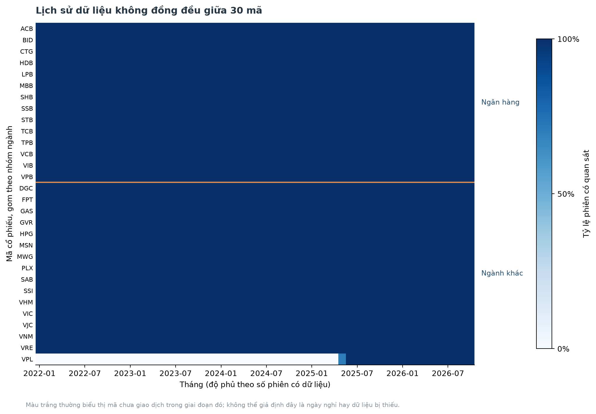
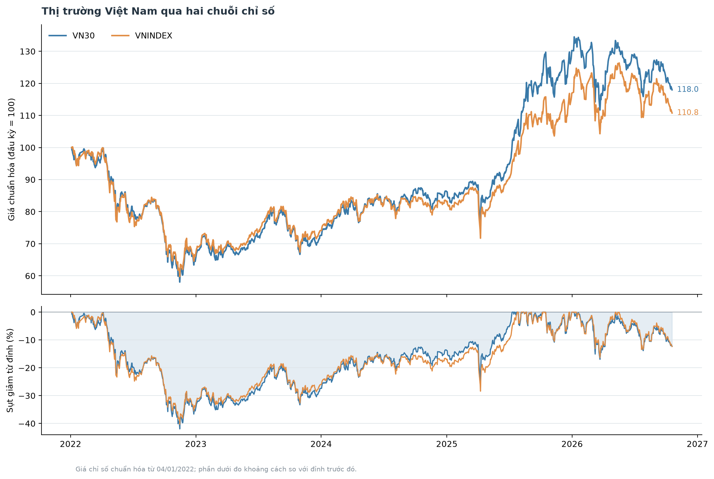
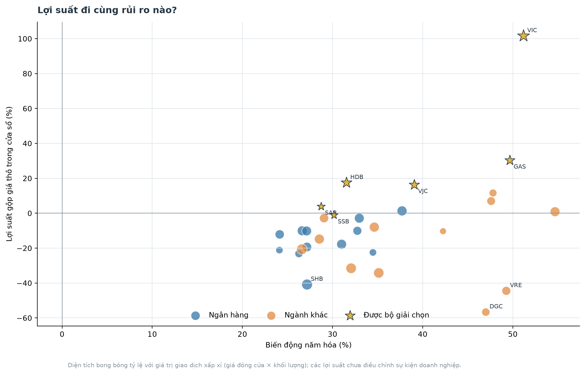
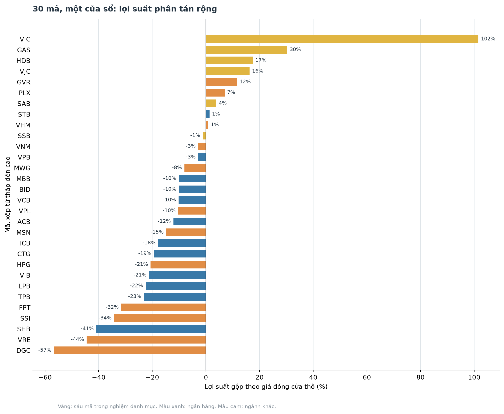
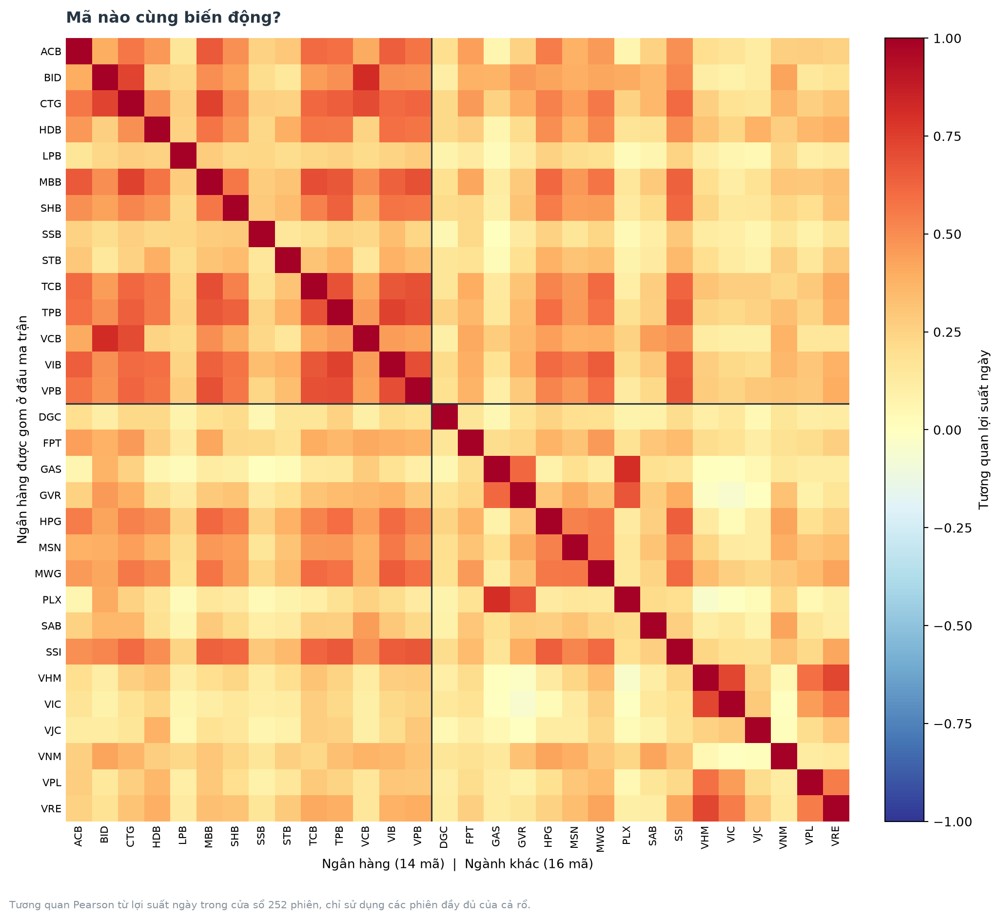
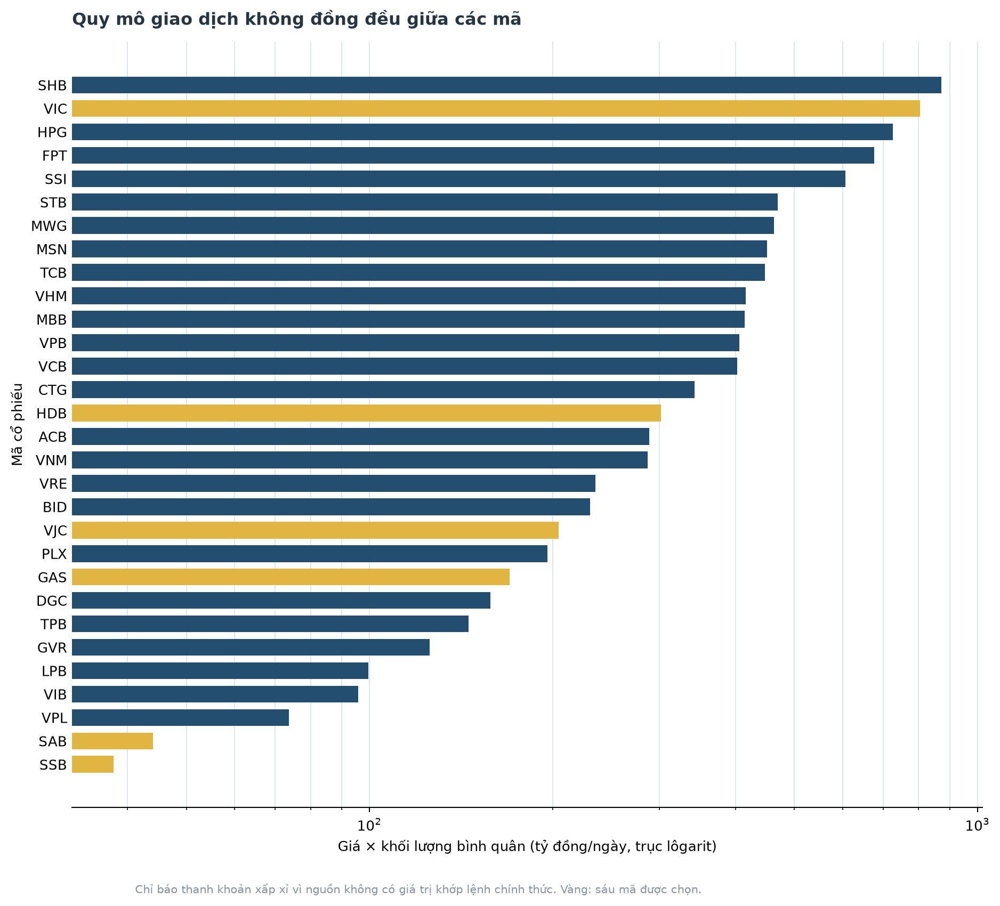
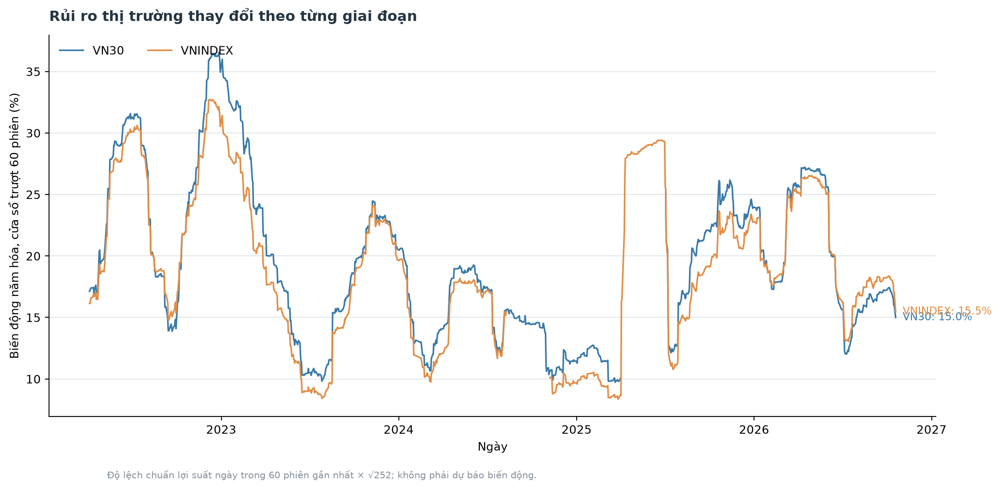
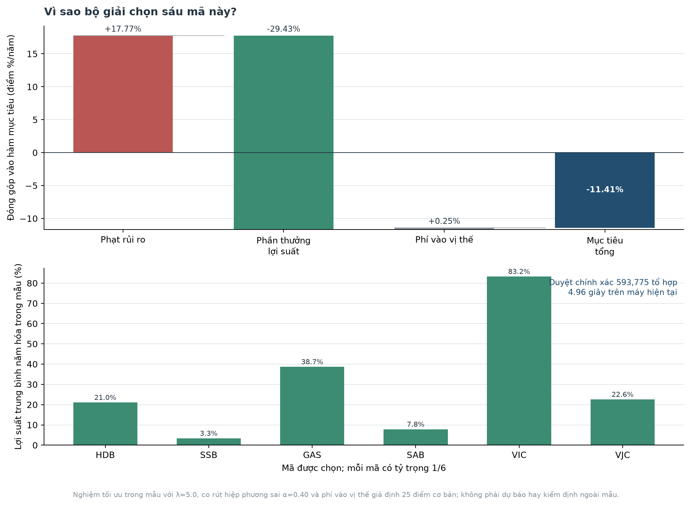
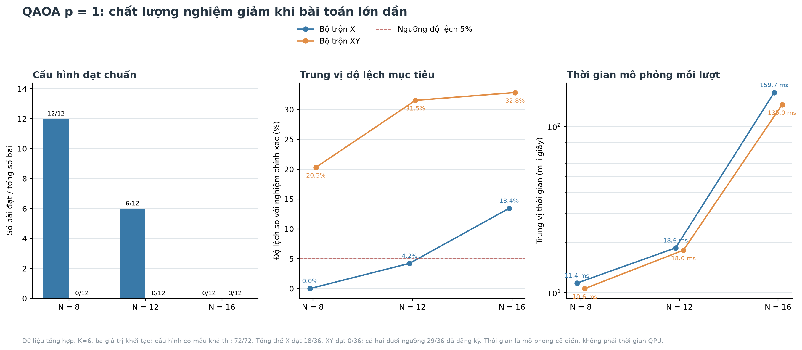

# Phân tích dữ liệu VN30 và hai chỉ số tham chiếu

## Phạm vi dữ liệu

- Dữ liệu OHLCV theo ngày: 2022-01-04 đến 2026-10-19.
- Số dòng: 37.308; gồm 30 cổ phiếu và 2 chỉ số.
- Rổ cổ phiếu được chụp tại ngày 2026-10-02; danh sách ghi nhận 14 mã ngân hàng và 16 mã thuộc nhóm ngành khác.
- Cửa sổ định lượng gần nhất: 252 phiên hoàn chỉnh, từ 2025-10-14 đến 2026-10-19.
- Giá là OHLCV do nguồn trả về; không có cột giá điều chỉnh, trạng thái quyền/cổ tức, giá trị giao dịch thực tế hay lịch thành phần chỉ số theo ngày.

## Câu chuyện dữ liệu qua biểu đồ

Các hình được dựng lại từ tệp OHLCV và cùng một cửa sổ phân tích với phần định lượng. Mọi lợi suất cổ phiếu đều dựa trên giá thô nên cần đọc cùng cảnh báo về sự kiện doanh nghiệp. Hình đối chiếu QAOA dùng bài toán tổng hợp riêng và không được diễn giải thành lợi nhuận thị trường.

### Độ phủ dữ liệu theo thời gian

Độ phủ theo tháng: các khoảng trắng cho thấy giai đoạn mã chưa có dữ liệu; nên dùng để thấy giới hạn lịch sử và thiên lệch sống sót.

### Diễn biến hai chỉ số

Đường chỉ số được chuẩn hóa về 100 ở đầu kỳ và sụt giảm từ đỉnh, giúp so sánh xu hướng thị trường với mức lỗ cực đại theo thời gian.

### Lợi suất và rủi ro theo mã

Bản đồ lợi suất–biến động của 30 mã trong cửa sổ gần nhất; ngôi sao viền đậm là mã được bộ giải chọn, bong bóng lớn hơn biểu thị giá trị giao dịch xấp xỉ cao hơn.

### Xếp hạng lợi suất

Xếp hạng đủ 30 mã làm lộ rõ độ phân tán lợi suất giá thô; màu vàng đánh dấu nghiệm danh mục.

### Tương quan giữa các mã

Ma trận tương quan cho thấy mức độ các mã cùng biến động; nhóm ngân hàng được gom cạnh nhau.

### Thanh khoản xấp xỉ

Thanh khoản xấp xỉ tính bằng giá đóng cửa nhân khối lượng; trục lôgarit giúp đọc cả mã lớn lẫn mã nhỏ.

### Chế độ rủi ro thị trường

Biến động trượt 60 phiên của hai chỉ số cho biết rủi ro thị trường thay đổi theo thời gian.

### Cấu phần nghiệm danh mục

Tách mục tiêu danh mục thành phạt rủi ro, phần thưởng lợi suất và chi phí vào vị thế; biểu đồ dưới cho biết lợi suất ước lượng của sáu mã được chọn với tỷ trọng bằng nhau.

### Kết quả đối chiếu QAOA

Đối chiếu kết quả QAOA p=1 theo kích thước: tỷ lệ đạt ngưỡng, độ lệch so với nghiệm chính xác và thời gian mô phỏng cổ điển; đây là thí nghiệm trên dữ liệu tổng hợp.

## Kiểm tra V1 trên bài toán tổng hợp nhỏ

Lượt chạy minh họa dùng N=8, K=6, hạt giống 20261012; xác suất trạng thái biến động 0,70 chỉ là giá trị đặt trước, không phải dự báo. V1 cố định mức co rút α=0,40, dùng λ=7,60, phí giả định 25 điểm cơ bản và 12 lần tái cân bằng năm hóa.

| Bộ giải | Kết quả |
|---|---|
| Duyệt chính xác | SYN00, SYN02, SYN03, SYN04, SYN06, SYN07; điểm mục tiêu -0,00698667 |
| Tham lam | Tìm cùng danh mục với nghiệm chính xác |
| Tôi luyện | Tìm cùng danh mục với nghiệm chính xác |
| QAOA, bộ trộn X | Tìm đúng nghiệm ở 2/3 hạt giống |
| QAOA, bộ trộn XY | 0/3 lượt đúng nghiệm; độ lệch trung vị 24,93% |

Phí làm điểm mục tiêu tăng 0,02000000 so với trường hợp không phí nhưng không đổi danh mục trên bài toán này. Kết quả chỉ kiểm tra đường đi của thuật toán trên dữ liệu sinh giả lập; quy mô nhỏ và ba hạt giống không chứng minh hiệu quả đầu tư hay ưu thế lượng tử.

## Kết quả đối chiếu thuật toán trên dữ liệu tổng hợp

Đây là thí nghiệm kỹ thuật tách biệt với dữ liệu VN30, không phải lợi nhuận thị trường. Mỗi cấu hình được so với nghiệm chính xác; cấu hình đạt khi cả ba lượt có nghiệm khả thi và trung vị độ lệch chuẩn hóa không quá 5%.

- Cấu hình: QAOA p=1, K=6, N=8, 12, 16; hạt giống 11, 23, 47, 512 mẫu mỗi đánh giá, tối đa 36 đánh giá mỗi lượt.
- Tổng cộng 72 cấu hình (216 lượt tối ưu), thời gian mô phỏng tích lũy 13.11 giây. Đây là thời gian mô phỏng cổ điển, không phải thời gian QPU.

| Bộ trộn | Đạt / số bài | Độ lệch trung vị | Có nghiệm khả thi ở cả ba lượt |
|---|---:|---:|---:|
| X | 18 / 36 | 4.22% | 36 / 36 |
| XY | 0 / 36 | 29.57% | 36 / 36 |

### Kết quả theo kích thước

| N | X đạt | Độ lệch trung vị X | XY đạt | Độ lệch trung vị XY |
|---:|---:|---:|---:|---:|
| 8 | 12 / 12 | 0.00% | 0 / 12 | 20.31% |
| 12 | 6 / 12 | 4.22% | 0 / 12 | 31.53% |
| 16 | 0 / 12 | 13.44% | 0 / 12 | 32.83% |

Kết quả tổng thể của cả hai bộ trộn thấp hơn ngưỡng đã đăng ký 29/36. Bộ trộn XY giữ ràng buộc số mã trong các mẫu đã đo nhưng chất lượng mục tiêu chưa đạt; bộ trộn X giảm mạnh khi tăng N. Chưa có lượt chạy QPU thật và chưa có bằng chứng ưu thế lượng tử.

- Bản ghi chi tiết có từng hạt giống, tỷ lệ khả thi, khoảng cách, góc và thời gian: `results/qaoa_h2_20261013.jsonl`.

## Hiệu suất quan sát trong cửa sổ gần nhất

Các lợi suất bên dưới là thay đổi giá đóng cửa, trước chi phí. Chuỗi 30 mã là danh mục trọng số đều tái cân bằng mỗi phiên. Đây là thống kê mô tả trên cửa sổ dùng để ước lượng đầu vào, không phải kết quả ngoài mẫu của chiến lược.

| Chuỗi | Lợi suất gộp | Biến động năm hóa | Sụt giảm tối đa | Tỷ lệ phiên tăng |
|---|---:|---:|---:|---:|
| VN30 | -8.60% | 20.44% | -16.96% | 47.22% |
| VNINDEX | -4.26% | 20.36% | -16.38% | 49.60% |
| Tái cân bằng đều 30 mã mỗi phiên | -6.74% | 19.33% | -16.49% | 54.37% |

## Nhận định về cấu trúc dữ liệu

- Rổ có 14 mã ngân hàng trên 30 mã (46.7% theo số mã). Đây là mức tập trung đáng lưu ý khi chọn sáu cổ phiếu; tối ưu hóa tương quan và rủi ro riêng có ý nghĩa thực tế.
- Trung bình tương quan cặp là 0.305; trung vị là 0.264. Các mã không độc lập, nên chỉ chọn theo lợi suất lịch sử có thể giữ lại nhiều rủi ro chung.
- Số phiên theo mã không đồng nhất; một số mã gia nhập thị trường muộn hơn. Bộ tính toán chỉ dùng các ngày có lợi suất hợp lệ đồng thời cho đủ 30 mã.

### Năm cặp tương quan cao nhất

| Cặp mã | Tương quan |
|---|---:|
| BID / VCB | 0.813 |
| GAS / PLX | 0.809 |
| CTG / MBB | 0.741 |
| TPB / VIB | 0.737 |
| BID / CTG | 0.733 |

### Năm cặp tương quan thấp nhất

| Cặp mã | Tương quan |
|---|---:|
| GVR / VIC | -0.047 |
| PLX / VHM | -0.043 |
| GVR / VHM | -0.018 |
| PLX / VIC | -0.011 |
| VIC / VNM | -0.004 |

### Mã tăng/giảm mạnh nhất theo giá đóng cửa thô

Các thứ hạng này chưa điều chỉnh quyền và cổ tức; cần kiểm tra sự kiện doanh nghiệp trước khi diễn giải là hiệu suất đầu tư.

| Mã | Lợi suất gộp | Biến động năm hóa | Sụt giảm tối đa | GTGD bình quân xấp xỉ (tỷ đồng/ngày) |
|---|---:|---:|---:|---:|
| VIC | 101.56% | 51.19% | -32.07% | 804.6 |
| GAS | 30.24% | 49.68% | -49.96% | 169.9 |
| HDB | 17.45% | 31.55% | -18.86% | 301.5 |
| VJC | 16.24% | 39.08% | -30.72% | 204.9 |
| GVR | 11.57% | 47.80% | -43.17% | 125.5 |
| DGC | -56.67% | 47.00% | -62.42% | 158.2 |
| VRE | -44.50% | 49.27% | -49.18% | 235.2 |
| SHB | -40.86% | 27.17% | -44.26% | 871.4 |
| SSI | -34.22% | 35.13% | -41.70% | 606.8 |
| FPT | -31.56% | 32.06% | -40.83% | 675.7 |

## Bài toán danh mục trên dữ liệu thật

- Nghiệm chính xác chọn: **HDB, SSB, GAS, SAB, VIC, VJC** (N=30, K=6). Duyệt hết 593.775 tổ hợp khả thi trong 4.958 giây trên máy hiện tại.
- Đầu vào: lợi suất ngày trong cửa sổ trên; lợi suất trung bình và hiệp phương sai năm hóa; co rút đường chéo α=0.40; λ=5.0; phí giả định 25 điểm cơ bản cho một lần mua từ tiền mặt, chưa mô phỏng tái cân bằng định kỳ.
- Ước lượng lịch sử trong mẫu của danh mục chọn: lợi suất trung bình 29.43%/năm, biến động mô hình 18.85%/năm. Đây là tham số đầu vào/đầu ra của mục tiêu, không phải dự báo hay bằng chứng sinh lời.
- Không chạy QAOA trên đủ 30 mã: bộ mô phỏng véc-tơ trạng thái có chi phí tăng theo 2^N; bộ giải chính xác cổ điển dùng được cho N=30, K=6.

## Chất lượng dữ liệu và giới hạn kết luận

1. Rổ thành phần được chụp tại một ngày rồi áp ngược lên lịch sử; kiểm định lịch sử như vậy có thiên lệch sống sót. Cần lịch thành phần theo ngày hiệu lực từ HOSE để khắc phục.
2. Nguồn trả OHLCV chứ không xác nhận giá đóng cửa điều chỉnh. Lợi suất cổ phiếu có thể bị gián đoạn bởi cổ tức, chia tách hoặc quyền mua. Không nên công bố CAGR, Sharpe hay tuyên bố chiến lược thắng thị trường từ bộ này.
3. GTGD xấp xỉ trong báo cáo được tính bằng giá đóng cửa nhân khối lượng, không thay thế trường giá trị khớp lệnh chính thức.
4. Lợi thế kỹ thuật hiện chứng minh được là: cùng một hàm mục tiêu rủi ro–lợi nhuận có chi phí, bộ giải chính xác cổ điển tìm nghiệm toàn cục cho VN30/K=6; QAOA vẫn cần được đối chiếu trên bài toán rút gọn và cùng cửa sổ dữ liệu.

## Nguồn và cách tái lập

- Kết quả đối chiếu QAOA trên dữ liệu tổng hợp: `results/qaoa_h2_20261013.jsonl`.
- Bộ nạp: kho GitHub nguyenthdat/vnstock-data, mã nguồn ghim trong requirements-data.txt; gọi stock_historical_data theo ngày.
- Dịch vụ lịch sử mà bộ kết nối gọi: DNSE chart API.
- Danh sách rổ ngày 02/10/2026: [HODL.VN](https://www.hodl.vn/bai-hoc/vn30-gom-nhung-ma-nao); đây là bản chụp bên thứ ba, không phải tệp lịch sử thành phần HOSE.
- Tệp gốc, phạm vi ngày, số dòng và mã băm nằm trong data/vn30_snapshot_20261002/manifest.json.
- Mã dựng biểu đồ: `agqo/plots.py`; mã phân tích và ghi báo cáo: `agqo/market_data.py`.
