# Báo cáo kết quả cuối cùng: AGQO trên cổ phiếu Việt Nam

> **Lưu ý cập nhật dữ liệu 21/10/2026:** các số liệu và hình trong báo cáo này được tạo từ lượt chạy cũ với giá thô và snapshot thành phần VN30, chưa chạy lại bằng lịch thành phần theo thời điểm và chuỗi giá VCI điều chỉnh đang được thiết lập. Không diễn giải chúng như kết quả đã loại bỏ thiên lệch sống sót hoặc đã đối soát sự kiện doanh nghiệp. Chi tiết mã nguồn và điều kiện chạy lại nằm ở [README](../../README.md).

**Giai đoạn danh mục:** 2025-06-02 đến 2026-10-01 · **16 kỳ tháng** · **vốn mô phỏng:** 100.00 triệu đồng · **phí cơ sở:** 25 điểm cơ bản mỗi chiều · **ngày tạo:** 2026-10-21T17:50:50.092908+07:00

> Kết quả là nghiên cứu lịch sử, không phải lợi nhuận đầu tư có thể thực hiện. Dữ liệu dùng giá OHLCV thô và ảnh chụp thành phần VN30 hiện tại áp ngược lịch sử. Các phiên bản trước của dự án đã xem cùng khoảng kiểm định; vì vậy đây không còn là một tập kiểm tra độc lập chưa từng được quan sát.

## Kết luận điều hành

- AGQO sau bộ giám sát đạt CAGR ròng **18.81%**, Sharpe **0.80**, Sortino **1.66** và sụt giảm tối đa **-11.90%**. VN30 đạt 24.58% CAGR, Sharpe 1.17, sụt giảm -9.22%.
- Chênh CAGR AGQO so với VN30 là -5.77 điểm phần trăm. Khoảng tin cậy 95% của lợi nhuận vượt bình quân năm hóa theo khối 3 tháng là [-25.00%, 13.67%]; khối 6 tháng là [-19.46%, 8.93%].
- LLM tạo 16 đề xuất. Bộ giám sát đổi 0 đề xuất theo bằng chứng đã khép; 0 phản hồi có trường định dạng phải sửa. Đề xuất ban đầu, cấu hình thực thi và lý do đều được lưu.
- Nếu AGQO không vượt VN30, bộ chọn quy tắc, nghiệm chính xác hoặc cấu hình cố định, kết quả được báo đúng như vậy; không diễn giải việc pipeline chạy thành bằng chứng tạo thêm lợi nhuận.
- QAOA được mô phỏng bằng véc-tơ trạng thái trên CPU. Nghiệm vét cạn cổ điển là chuẩn tối ưu từng bài toán nhỏ; không có QPU hay bằng chứng ưu thế lượng tử trong báo cáo này.

## Kết quả tài chính

Lợi suất danh mục tính từ giá mở cửa phiên sau tín hiệu đến phiên thoát lệnh kế tiếp. Sổ giao dịch trừ phí, mô phỏng khớp lệnh giới hạn theo ADTV và cho phép tiền mặt khi lệnh không khớp đủ. Sharpe/Sortino giả định lãi suất phi rủi ro tháng bằng 0.

| Phương pháp | CAGR ròng | Biến động năm hóa | Sharpe | Sortino | Sụt giảm tối đa | CVaR tháng 95% | Giá trị cuối từ 100 triệu | Phí giao dịch |
|---|---:|---:|---:|---:|---:|---:|---:|---:|
| VN30 | 24.58% | 20.64% | 1.17 | 2.42 | -9.22% | -9.22% | 134.04 triệu đồng | — |
| VN-Index | 23.63% | 19.05% | 1.21 | 2.38 | -8.64% | -8.64% | 132.68 triệu đồng | — |
| Ledoit–Wolf, nghiệm chính xác | 49.68% | 29.31% | 1.53 | 3.06 | -15.92% | -15.92% | 171.21 triệu đồng | 2.42 triệu đồng |
| AI tham số + nghiệm chính xác, 12 mã | 16.30% | 29.13% | 0.65 | 1.40 | -14.56% | -8.69% | 122.30 triệu đồng | 3.88 triệu đồng |
| QAOA X, p=1, 12 mã | 17.22% | 29.01% | 0.68 | 1.48 | -15.00% | -9.08% | 123.59 triệu đồng | 3.87 triệu đồng |
| QAOA X, p=2, 12 mã | 19.23% | 28.95% | 0.74 | 1.63 | -14.56% | -8.69% | 126.43 triệu đồng | 4.00 triệu đồng |
| QAOA XY, p=1, 12 mã | 22.07% | 27.55% | 0.85 | 1.95 | -11.90% | -6.88% | 130.45 triệu đồng | 5.44 triệu đồng |
| Tham lam cổ điển, 12 mã | 16.94% | 29.12% | 0.67 | 1.44 | -13.92% | -8.69% | 123.21 triệu đồng | 3.89 triệu đồng |
| Tôi luyện mô phỏng, 12 mã | 16.30% | 29.13% | 0.65 | 1.40 | -14.56% | -8.69% | 122.30 triệu đồng | 3.88 triệu đồng |
| Bộ chọn quy tắc → QAOA | 19.98% | 25.39% | 0.84 | 1.75 | -11.90% | -6.66% | 127.49 triệu đồng | 4.80 triệu đồng |
| AGQO: Qwen → giám sát → QAOA | 18.81% | 25.44% | 0.80 | 1.66 | -11.90% | -6.66% | 125.84 triệu đồng | 4.79 triệu đồng |

### So sánh AGQO với các mốc

| Mốc so sánh | CAGR ròng | Sharpe | Sụt giảm tối đa | Chênh lợi suất chủ động năm hóa | Khoảng 95%, khối 3 tháng | Khoảng 95%, khối 6 tháng |
|---|---:|---:|---:|---:|---:|---:|
| VN30 | 24.58% | 1.17 | -9.22% | -3.83% | [-25.00%, 13.67%] | [-19.46%, 8.93%] |
| VN-Index | 23.63% | 1.21 | -8.64% | -2.79% | [-19.86%, 15.62%] | [-17.61%, 12.30%] |

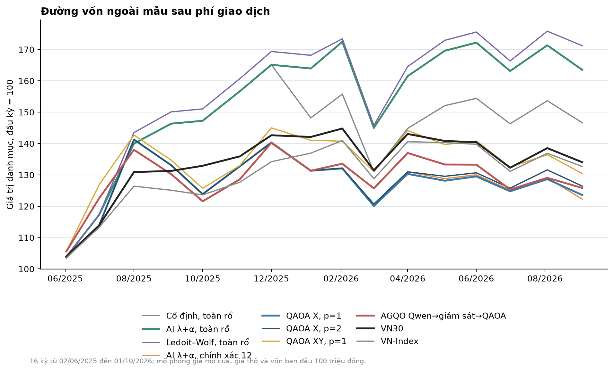

**Hình 2. Đường vốn ròng và chuẩn so sánh.** Giá trị vốn mô phỏng 100 triệu đồng của AGQO, bộ chọn quy tắc, VN30 và các đối chứng; AGQO kết thúc thấp hơn VN30 trong 16 kỳ, nên đây là bằng chứng chống lại tuyên bố alpha hiện tại. Nguồn: results/final/agqo_final_walkforward.json · portfolio.performance. Kỳ: 2025-06 đến 2026-10. Đơn vị: VND, lợi nhuận ròng. Lưu ý: Giá thô, giả định phí và lệnh khớp; tập đã xem.

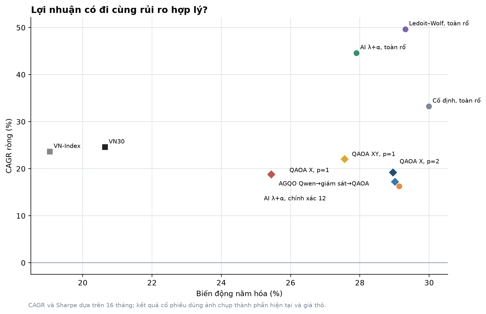

**Hình 4. Lợi nhuận và rủi ro sau chi phí.** CAGR và biến động/độ sụt giảm đặt cạnh nhau để tránh chọn chiến lược chỉ theo lợi nhuận; Ledoit–Wolf toàn rổ mạnh hơn trong cửa sổ này nhưng rủi ro và phạm vi tài sản cũng khác. Nguồn: results/final/agqo_final_walkforward.json · portfolio.performance. Kỳ: 2025-06 đến 2026-10. Đơn vị: CAGR, biến động, sụt giảm. Lưu ý: Chỉ 16 kỳ; các phương pháp có thể khác quy mô vũ trụ.

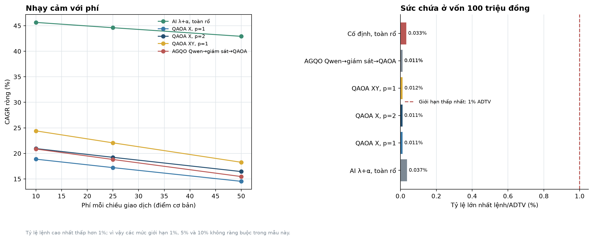

**Hình 5. Độ nhạy với phí và sức chứa.** Cho biết thay đổi phí giả định và giới hạn tham gia thanh khoản ảnh hưởng ra sao đến kết quả mô phỏng; cần đọc như độ nhạy trên proxy, không phải mô hình khớp lệnh đầy đủ. Nguồn: results/final/agqo_final_walkforward.json · portfolio.cost_capacity_sensitivity. Kỳ: 2025-06 đến 2026-10. Đơn vị: điểm cơ bản, phần trăm ADTV, CAGR/Sharpe. Lưu ý: Không có sổ lệnh, spread, thuế đầy đủ hoặc trượt giá quan sát.

### Bộ phân loại chế độ biến động

Mô hình LogisticRegression sau StandardScaler dự báo biến động VN30 trong 21 phiên vượt ngưỡng phân vị 70% của tập huấn luyện. Đặc trưng là biến động 20/60/120 phiên, lợi suất 20/60 phiên và tỷ số biến động 20/120. Đây không phải mô hình dự báo lợi suất.

- Brier ở các tín hiệu tháng: 0.237; nền tỷ lệ huấn luyện: 0.217; kỹ năng Brier: -9.32%.
- Brier dự báo ngày chồng lấn: 0.257; nền mở rộng: 0.225; kỹ năng: -14.30%. Dự báo ngày không độc lập vì nhãn 21 phiên chồng lấn.
- Khi kỹ năng Brier âm hoặc có dưới 6 dự báo tháng đã trưởng thành, prompt yêu cầu Qwen xem xác suất này là tín hiệu yếu; không được tự tăng rủi ro hay độ sâu mạch chỉ vì xác suất biến động cao.

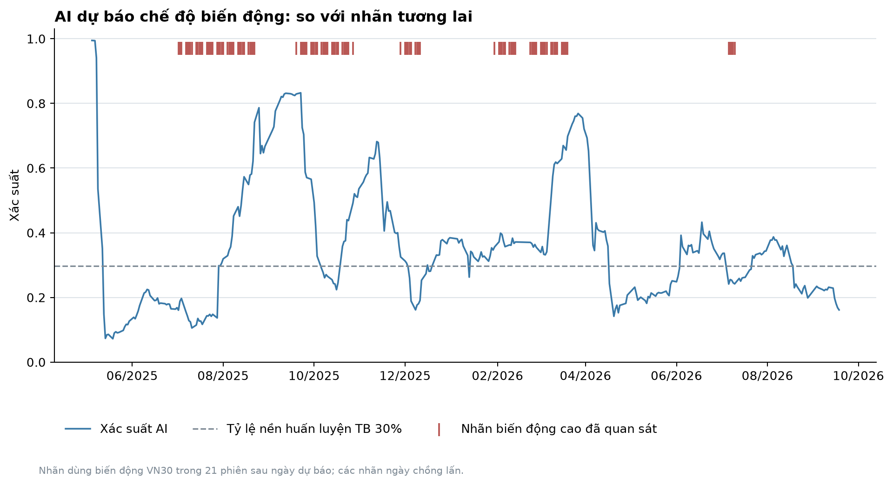

**Hình 1. Dự báo chế độ biến động theo thời gian.** Đối chiếu xác suất do bộ phân loại tạo ra với nhãn biến động đã trưởng thành; Brier của mô hình là 0,237, kém nền 0,217, nên hiện chưa có căn cứ dùng xác suất này như tín hiệu tăng rủi ro. Nguồn: results/final/agqo_final_walkforward.json · ai.daily_forecasts. Kỳ: giai đoạn huấn luyện đến 2026-08. Đơn vị: xác suất, độ biến động năm hóa. Lưu ý: Nhãn 21 phiên chồng lấn; kiểm định đã xem.

## Insight dữ liệu và ý nghĩa tài chính

Tập dữ liệu cục bộ gồm 37,308 dòng OHLCV, 32 mã/chỉ số, từ 2022-01-04 đến 2026-10-19. Tại mỗi tín hiệu, AGQO tổng hợp xác suất chế độ, biến động và xu hướng VN30, tương quan chéo, độ phân tán, độ rộng tăng giảm, thanh khoản đại diện và kết quả các cấu hình đã thoát lệnh.

Trung bình các ngày tín hiệu trong lượt chạy:

- Xác suất chế độ biến động cao do mô hình dự báo: 36.18%.
- Tỷ số biến động VN30 20/120 phiên: 0.88; tương quan cặp cổ phiếu: 0.36.
- Độ phân tán lợi suất 20 phiên giữa cổ phiếu: 9.67%; tỷ lệ mã dương: 53.73%.
- Tỷ trọng ngân hàng trong rổ đủ điều kiện: 47.27%; trung vị giá trị giao dịch đại diện của ứng viên: 518,182.16 triệu đồng mỗi ngày.
- Tại tín hiệu cuối, mô hình có 14 dự báo tháng đã trưởng thành; Brier skill đến thời điểm đó là -10.52%.

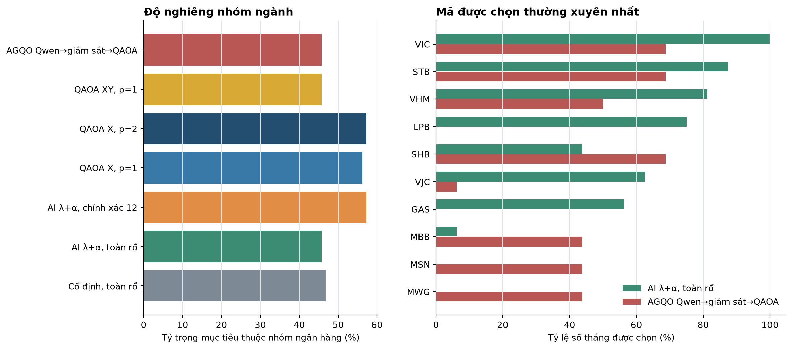

**Hình 6. Mức tập trung danh mục và tần suất nắm giữ.** Thể hiện tần suất mã/ngành được chọn và mức tập trung; dùng để đánh giá liệu lợi nhuận có phụ thuộc quá nhiều vào vài cổ phiếu hay nhóm ngành. Nguồn: results/final/agqo_final_walkforward.json · portfolio.selection_summary. Kỳ: 2025-06 đến 2026-10. Đơn vị: tỷ trọng, số kỳ được chọn. Lưu ý: Thành phần VN30 hiện tại áp ngược lịch sử.

## Cách AGQO dùng LLM, RAG và bộ giám sát

Qwen3-8B chạy trên Modal ở chế độ NF4 4-bit. LLM không tự giải danh mục và không được tự tạo λ, α, số qubit, bộ trộn, độ sâu hay số shots; nó chỉ chọn một mã trong danh mục đã chạy đối chứng. Toàn bộ prompt được viết bằng tiếng Anh. Do không giả định Qwen là chuyên gia tài chính, system prompt yêu cầu chỉ dùng định nghĩa và bằng chứng trong payload, không lấp chỗ trống bằng kiến thức ghi nhớ và không sinh nhận định tự do.

Phiên bản prompt: `agqo-prompt-v9-en-rag-submodel-allowlisted-structured`. Trong 16 tín hiệu, bộ giám sát đổi 0 đề xuất; 0 phản hồi cần sửa lược đồ. Tổng mức dùng: 127,783 token đầu vào, 849 token đầu ra.

RAG dùng kho bảy ghi chú cục bộ có phiên bản, không truy cập mạng trong lúc suy luận. Mỗi tín hiệu lưu các ghi chú được truy xuất, nguồn, phiên bản và JSON gửi đến mô hình. Nội dung định nghĩa metrics, fields, mục tiêu danh mục, QAOA, benchmark và giới hạn dữ liệu. Bộ luật insight định lượng áp dụng ngưỡng đã khóa; LogisticRegression là tiểu mô hình dự báo duy nhất và ước tính chế độ biến động, không phải lợi suất. Hiệu quả của classifier được đo bằng Brier so với tỷ lệ nền đã trưởng thành.

Mỗi payload chứa lược đồ đầu ra riêng, chỉ liệt kê cấu hình, mã insight và mã evidence được phép tại ngày tín hiệu. Qwen trả ba trường JSON: `policy_id`, `insight_codes`, `evidence_ids`; mã cục bộ xác thực lại và tạo câu giải thích tiếng Việt cùng cờ rủi ro từ số đo. Bộ giám sát độc lập dùng tối thiểu 6 kỳ đã khép rồi kiểm tra tỷ lệ mẫu khả thi, sai lệch nghiệm, Sharpe và sụt giảm lịch sử. Khi bằng chứng chưa đủ hoặc đề xuất kém rõ rệt so với bộ chọn quy tắc, hệ thống lưu đề xuất ban đầu nhưng thực thi cấu hình đối chứng.

| Ngày tín hiệu | LLM đề xuất | Cấu hình thực thi | λ | α | Bộ trộn / bố trí / p | Lý do giám sát | Regret sau QAOA |
|---|---|---|---:|---:|---|---|---:|
| 2025-05-30 | `n12_balanced_xy_ring_p1` | `n12_balanced_xy_ring_p1` | 5.0 | 0.40 | XY / ring / 1 | Chấp nhận đề xuất | 42.48% |
| 2025-06-30 | `n12_balanced_xy_ring_p1` | `n12_balanced_xy_ring_p1` | 5.0 | 0.40 | XY / ring / 1 | Chấp nhận đề xuất | 49.15% |
| 2025-07-31 | `n12_balanced_xy_ring_p1` | `n12_balanced_xy_ring_p1` | 5.0 | 0.40 | XY / ring / 1 | Chấp nhận đề xuất | 25.35% |
| 2025-08-29 | `n12_balanced_xy_ring_p1` | `n12_balanced_xy_ring_p1` | 5.0 | 0.40 | XY / ring / 1 | Chấp nhận đề xuất | 45.66% |
| 2025-09-30 | `n12_balanced_xy_ring_p1` | `n12_balanced_xy_ring_p1` | 5.0 | 0.40 | XY / ring / 1 | Chấp nhận đề xuất | 13.64% |
| 2025-10-31 | `n12_balanced_xy_ring_p1` | `n12_balanced_xy_ring_p1` | 5.0 | 0.40 | XY / ring / 1 | Chấp nhận đề xuất | 13.70% |
| 2025-11-28 | `n12_balanced_xy_ring_p1` | `n12_balanced_xy_ring_p1` | 5.0 | 0.40 | XY / ring / 1 | Chấp nhận đề xuất | 11.78% |
| 2025-12-31 | `n12_balanced_xy_ring_p2` | `n12_balanced_xy_ring_p2` | 5.0 | 0.40 | XY / ring / 2 | Chấp nhận đề xuất | 2.35% |
| 2026-01-30 | `n12_balanced_xy_ring_p2` | `n12_balanced_xy_ring_p2` | 5.0 | 0.40 | XY / ring / 2 | Chấp nhận đề xuất | 0.52% |
| 2026-02-27 | `n12_balanced_xy_ring_p2` | `n12_balanced_xy_ring_p2` | 5.0 | 0.40 | XY / ring / 2 | Chấp nhận đề xuất | 5.12% |
| 2026-03-31 | `n12_balanced_xy_ring_p2` | `n12_balanced_xy_ring_p2` | 5.0 | 0.40 | XY / ring / 2 | Chấp nhận đề xuất | 4.30% |
| 2026-04-29 | `n12_balanced_xy_ring_p2` | `n12_balanced_xy_ring_p2` | 5.0 | 0.40 | XY / ring / 2 | Chấp nhận đề xuất | 6.14% |
| 2026-05-29 | `n12_balanced_xy_ring_p2` | `n12_balanced_xy_ring_p2` | 5.0 | 0.40 | XY / ring / 2 | Chấp nhận đề xuất | 32.13% |
| 2026-06-30 | `n12_balanced_xy_ring_p2` | `n12_balanced_xy_ring_p2` | 5.0 | 0.40 | XY / ring / 2 | Chấp nhận đề xuất | 9.29% |
| 2026-07-31 | `n12_balanced_xy_ring_p2` | `n12_balanced_xy_ring_p2` | 5.0 | 0.40 | XY / ring / 2 | Chấp nhận đề xuất | 15.66% |
| 2026-08-28 | `n12_balanced_xy_ring_p2` | `n12_balanced_xy_ring_p2` | 5.0 | 0.40 | XY / ring / 2 | Chấp nhận đề xuất | 26.07% |

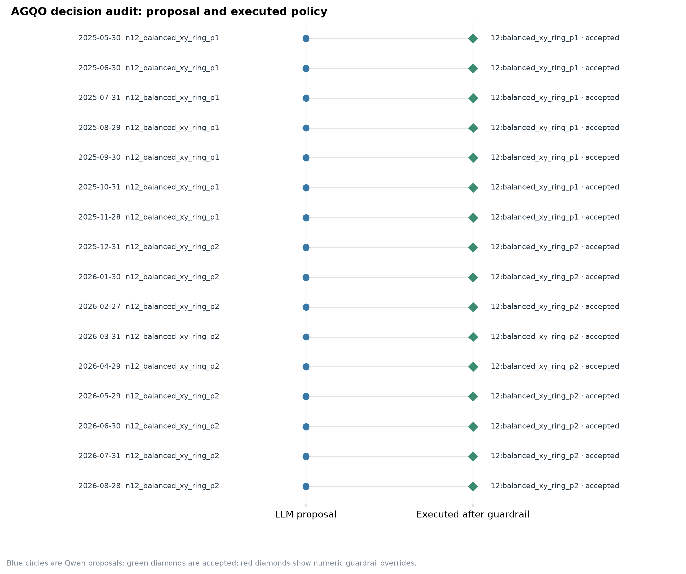

**Hình 11. Kiểm toán đề xuất LLM và policy được thực thi.** Đối chiếu policy Qwen đề xuất với policy vượt qua giám sát số học; biểu đồ giúp xác nhận quyết định nào được chấp nhận hay fallback và lý do. Nguồn: results/final/agqo_final_walkforward.json · agqo_guidance.decisions. Kỳ: 16 tín hiệu 2025-05 đến 2026-08. Đơn vị: mã policy, ngày tín hiệu. Lưu ý: Đầu ra hợp lệ không đồng nghĩa với lợi ích tài chính.

Ghi chú phương pháp được truy xuất trong lượt chạy:

- **AGQO-BENCHMARK-01 · How to interpret QAOA solution quality** — Project implementation: agqo/walkforward.py and agqo/simulator.py
- **AGQO-DATA-01 · Vietnam equity dataset limitations** — Project data manifest and experiment configuration
- **AGQO-FEATURES-01 · Meaning and units of the VN30 and cross-sectional fields** — Project implementation: agqo/walkforward.py and agqo/walkforward.py::_eligible_universe
- **AGQO-METRICS-01 · Definitions of the financial evaluation metrics** — Project implementation: agqo/evaluation.py and agqo/problem.py
- **AGQO-OBJECTIVE-01 · Portfolio objective and parameter meaning** — Project implementation: agqo/estimators.py and agqo/problem.py
- **AGQO-QAOA-01 · QAOA depth, mixers and feasibility** — Farhi, Goldstone & Gutmann (2014), https://arxiv.org/abs/1411.4028; Hadfield et al. (2019), https://arxiv.org/abs/1709.03489
- **AGQO-REGIME-01 · Limits and reliability of the volatility-regime submodel** — Project implementation: agqo/ai.py and agqo/walkforward.py

## Thiết kế QAOA và phép đo

Danh mục AGQO gồm 14 cấu hình kiểm soát: N=8, 12, 16 qubit; K=6; bộ trộn X hoặc XY; p=1/2; vòng, đường thẳng, đầy đủ hoặc tương quan; λ và mức co rút hiệp phương sai khác nhau. Mỗi lần tối ưu dùng 1,024 shots, COBYLA tối đa 100 lần đánh giá mỗi seed và các seed 11, 23, 47.

Hàm mục tiêu tối thiểu hóa `λ(xᵀΣαx)/K² − (μᵀx)/K + chi phí tái cân bằng năm hóa`, với `Σα=(1−α)Σ+α diag(Σ)` và `Σxᵢ=K`. `λ` là trọng số phạt rủi ro, `α` là mức co rút hiệp phương sai. Bộ trộn X có hạng phạt cardinality; bộ trộn XY khởi tạo trạng thái khả thi và dùng cổng RXX/RYY để bảo toàn số bit 1. Hệ số `p` là số lớp cost/mixer xen kẽ.

Chuẩn so sánh là duyệt chính xác mọi tổ hợp khả thi trên cùng N, K và cùng mục tiêu. Sai lệch chuẩn hóa là `(điểm QAOA khả thi − điểm tối ưu chính xác)/(điểm lớn nhất − nhỏ nhất trong các nghiệm khả thi)`; 0 nghĩa là khớp nghiệm chính xác. Tỷ lệ mẫu khả thi là tỷ phần shots có đúng K lựa chọn, không phải xác suất kiếm lời. Báo cả chất lượng, tỷ lệ khả thi, số cổng logic và thời gian CPU; cổng logic không đồng nghĩa với cổng vật lý sau biên dịch.

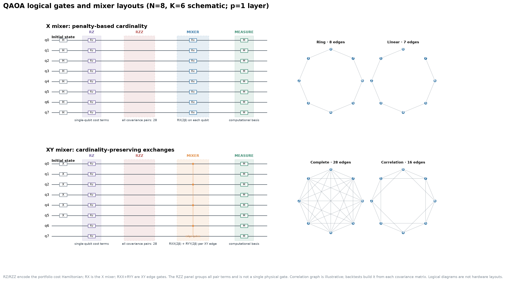

**Hình 9. Nguyên lý cổng logic và đồ thị bộ trộn.** Hình khái quát cách mã hóa cost Hamiltonian và mixer X/XY để giải thích lựa chọn thiết kế; đây là sơ đồ phương pháp, không đại diện cho một lần chạy cụ thể. Nguồn: agqo/simulator.py · statevector và mixer_edges_for_problem. Kỳ: thiết kế bộ giải hiện tại. Đơn vị: cổng logic, qubit, lớp p. Lưu ý: Sơ đồ nguyên lý; mạch của một run cụ thể nằm ở Hình 15.

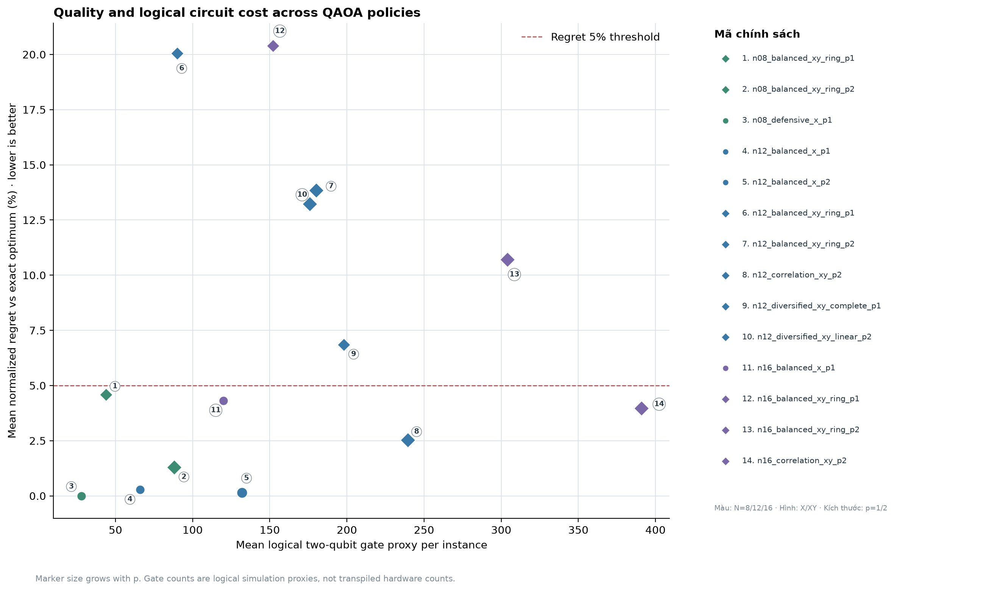

**Hình 10. Regret QAOA so với chi phí cổng logic.** Biểu đồ chất lượng–tài nguyên cho các policy; kích thước nút biểu diễn độ sâu và màu biểu diễn số qubit, giúp thấy rằng tăng mạch không tự động cải thiện regret. Nguồn: results/final/agqo_final_walkforward.json · qaoa.quality_summary và policy_catalog. Kỳ: các tín hiệu 2025-05 đến 2026-08. Đơn vị: regret phần trăm, số cổng logic hai qubit. Lưu ý: Bộ đếm logic chưa transpile, không gồm nhiễu phần cứng.

### Đối chứng lượng tử và cổ điển

| Cấu hình | N/K | Mixer / bố trí / p | Kỳ regret ≤5% | Regret trung bình | Tỷ lệ feasible trung bình | Cổng hai qubit logic TB | CAGR / Sharpe / MaxDD |
|---|---:|---|---:|---:|---:|---:|---|

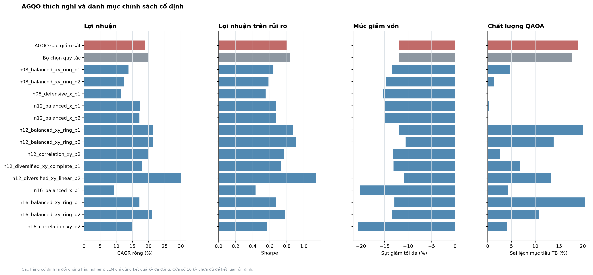

**Hình 8. So sánh chính sách thích nghi và cố định.** Đặt AGQO, bộ chọn quy tắc và danh mục policy cố định trên cùng các kỳ đã ghi; khoảng cách với bộ chọn quy tắc cho thấy Qwen chưa tạo thêm giá trị trong mẫu hiện có. Nguồn: results/final/agqo_final_walkforward.json · portfolio.performance. Kỳ: 2025-06 đến 2026-10. Đơn vị: CAGR, Sharpe, sụt giảm tối đa. Lưu ý: Kỳ đã mở và ngắn; không dùng làm xác nhận ngoài mẫu.

| `n08_balanced_xy_ring_p1` | 8/6 | XY / ring / 1 | 10/16 | 4.59% | 100.00% | 44 | 13.80% / 0.64 / -13.41% |
| `n08_balanced_xy_ring_p2` | 8/6 | XY / ring / 2 | 15/16 | 1.29% | 100.00% | 88 | 12.48% / 0.58 / -14.64% |
| `n08_defensive_x_p1` | 8/6 | X / single / 1 | 16/16 | -0.00% | 41.76% | 28 | 11.33% / 0.55 / -15.38% |
| `n12_balanced_x_p1` | 12/6 | X / single / 1 | 16/16 | 0.28% | 40.81% | 66 | 17.32% / 0.68 / -14.86% |
| `n12_balanced_x_p2` | 12/6 | X / single / 2 | 16/16 | 0.14% | 54.16% | 132 | 17.16% / 0.67 / -14.86% |
| `n12_balanced_xy_ring_p1` | 12/6 | XY / ring / 1 | 0/16 | 20.04% | 100.00% | 90 | 21.33% / 0.87 / -11.90% |
| `n12_balanced_xy_ring_p2` | 12/6 | XY / ring / 2 | 4/16 | 13.85% | 100.00% | 180 | 21.34% / 0.91 / -10.54% |
| `n12_correlation_xy_p2` | 12/6 | XY / correlation / 2 | 13/16 | 2.53% | 100.00% | 240 | 19.78% / 0.76 / -13.16% |
| `n12_diversified_xy_complete_p1` | 12/6 | XY / complete / 1 | 5/16 | 6.86% | 100.00% | 198 | 18.02% / 0.73 / -13.08% |
| `n12_diversified_xy_linear_p2` | 12/6 | XY / linear / 2 | 4/16 | 13.22% | 100.00% | 176 | 30.07% / 1.14 / -10.81% |
| `n16_balanced_x_p1` | 16/6 | X / single / 1 | 8/16 | 4.31% | 15.95% | 120 | 9.33% / 0.43 / -20.15% |
| `n16_balanced_xy_ring_p1` | 16/6 | XY / ring / 1 | 0/16 | 20.40% | 100.00% | 152 | 17.16% / 0.67 / -12.92% |
| `n16_balanced_xy_ring_p2` | 16/6 | XY / ring / 2 | 2/16 | 10.70% | 100.00% | 304 | 21.19% / 0.78 / -13.38% |
| `n16_correlation_xy_p2` | 16/6 | XY / correlation / 2 | 12/16 | 3.97% | 100.00% | 391 | 14.82% / 0.57 / -20.64% |
| Đối chứng cố định X, p=1 | 12/6 | X, p=1 | 16/16 | 0.36% | 40.05% | — | — |
| Đối chứng cố định X, p=2 | 12/6 | X, p=2 | 16/16 | 0.45% | 54.08% | — | — |
| Đối chứng cố định XY, p=1 | 12/6 | XY, p=1 | 0/16 | 20.51% | 100.00% | — | — |

### Đọc kết quả QAOA

Không gian trạng thái của bài cơ sở N=12 là 4,096; có 924 tổ hợp khả thi K=6. Trong AGQO, N=8/12/16 tương ứng 256/4.096/65.536 trạng thái mô phỏng cổ điển và 28/924/8.008 tập con khả thi.

Mạch XY bảo toàn cardinality, trong khi X cần hạng phạt và có thể lấy mẫu trạng thái sai K. Đồ thị tương quan được xây từ hai liên kết đồng biến mạnh nhất cho mỗi mã cùng với vòng liên thông. Độ sâu lớn và đồ thị dày làm tăng công việc logic; chỉ nên chọn nếu regret giảm đủ để bù chi phí tính toán và rủi ro thực thi.

Bộ giải vét cạn là đối chứng cổ điển khả thi cho N≤16 và K=6; greedy và simulated annealing cũng chạy trên cùng hàm mục tiêu. Nếu exact giải nhanh hơn QAOA mô phỏng, đó là kết quả thực nghiệm cần trình bày. Không có căn cứ gọi QAOA vượt trội chỉ vì nó dùng cổng lượng tử trong mô hình toán học.

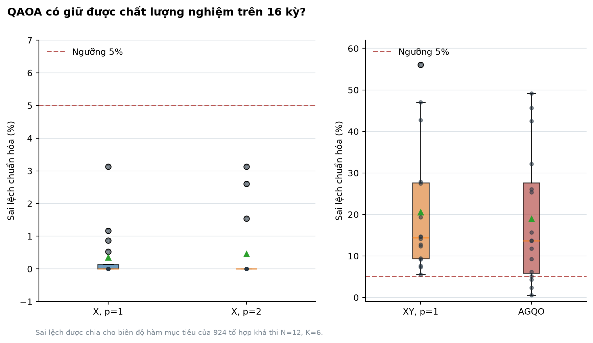

**Hình 3. Regret QAOA so với nghiệm chính xác.** Regret chuẩn hóa đo khoảng cách giữa nghiệm khả thi tốt nhất tìm được và nghiệm vét cạn trên cùng mục tiêu; giá trị thấp hơn là tốt hơn, nhưng không phải lợi nhuận đầu tư. Nguồn: results/final/agqo_final_walkforward.json · qaoa.monthly_runs. Kỳ: 16 tín hiệu tháng 2025-05 đến 2026-08. Đơn vị: phần trăm regret chuẩn hóa. Lưu ý: Statevector CPU; exact enumeration làm chuẩn ở quy mô nhỏ.

## Quy trình và mốc thời gian

| Giai đoạn | Mốc | Cách dùng |
|---|---|---|
| Huấn luyện ban đầu | đến 2024-10-31 | Fit scaler/logistic và xác lập ngưỡng biến động |
| Xác nhận | 2024-11-01 đến 2025-04-30 | Chọn C theo log-loss; chặn nhãn tương lai trước ranh giới |
| Kiểm định walk-forward | tín hiệu từ 2025-05-01 | Mở rộng huấn luyện theo nhãn đã trưởng thành; chỉ dùng kết quả kỳ đã đóng cho kỳ sau |
| Thời gian danh mục | 2025-06-02 đến 2026-10-01 | Tín hiệu tháng, giao dịch ở phiên mở cửa kế tiếp |

LLM chạy zero-shot inference, không có epoch huấn luyện Qwen. Dữ liệu chỉ có ít tín hiệu tháng và không đủ để fine-tune hoặc đánh giá đáng tin cậy mô hình ngôn ngữ. Tăng `max_evaluations`, số shots hay seed là tăng ngân sách tối ưu QAOA, không phải tăng epoch huấn luyện LLM.

## Dữ liệu, tái lập và giới hạn

Nguồn tệp đã lưu trong dự án: `data/vn30_snapshot_20261002/ohlcv_daily.csv` · 37,308 dòng · 2022-01-04–2026-10-19. Bản đầy đủ về nguồn và cách xử lý nằm ở README và tài liệu kỹ thuật.

- Chỉ có khoảng 16 kỳ nắm giữ tháng kiểm tra; chưa đủ để kết luận lợi thế kinh tế ổn định.
- Giá OHLCV chưa xác nhận điều chỉnh cổ tức, chia tách và quyền mua.
- Dùng ảnh chụp thành phần VN30 ngày 02/10/2026 cho lịch sử; có thiên lệch sống sót.
- Khả năng khớp lệnh chỉ mô phỏng giới hạn theo tỷ lệ ADTV; không có dữ liệu sổ lệnh, bước giá, thuế và lô giao dịch.
- AI dùng nhãn biến động tương lai 21 phiên chồng lấn; số dự báo ngày không độc lập.
- QAOA là mô phỏng véc-tơ trạng thái cổ điển, không phải bằng chứng ưu thế lượng tử hay kết quả QPU.
- LLM chỉ chọn trong danh mục chính sách cho phép; hiệu quả chính sách AGQO phải được đánh giá ngoài mẫu và không được suy diễn thành bảo đảm lợi nhuận.
- AGQO dùng lợi nhuận của các kỳ kiểm tra đã đóng để điều chỉnh lựa chọn ở kỳ sau; đây là walk-forward thích nghi, cần thêm một giai đoạn cuối khóa riêng trước khi kết luận tổng quát.
- Kết quả của nhiều cấu hình dùng chung một cửa sổ kiểm định; lựa chọn tốt nhất hậu nghiệm có thiên lệch lựa chọn.
- Kỳ thử nghiệm ngắn và các phiên bản AGQO cũ đã xem cùng mốc dữ liệu; cần khóa một giai đoạn tương lai riêng trước khi tuyên bố khả năng tổng quát.

Mọi quyết định, payload, ghi chú RAG, phản hồi token, số liệu theo tháng, cấu hình, kết quả từng seed và chỉ số tài chính được lưu trong JSON cạnh báo cáo.

### Tài liệu phương pháp

- [Qwen3-8B model card và phiên bản đã ghim](https://huggingface.co/Qwen/Qwen3-8B)
- [Tài liệu Transformers về lượng tử hóa 4-bit NF4](https://huggingface.co/docs/transformers/main/quantization/bitsandbytes?bnb=4-bit)
- [Modal: cấu hình GPU](https://modal.com/docs/guide/gpu)
- [Farhi, Goldstone và Gutmann: QAOA](https://arxiv.org/abs/1411.4028)
- [Hadfield và cộng sự: mixer cho tối ưu tổ hợp](https://arxiv.org/abs/1709.03489)

## Hình bổ sung: thị trường, pipeline và circuit đã chạy

Các hình này kết nối trạng thái dữ liệu với luồng AGQO và circuit được dựng từ log thực tế. Mỗi hình có tên, giải thích, nguồn, kỳ, đơn vị và lưu ý đi kèm.

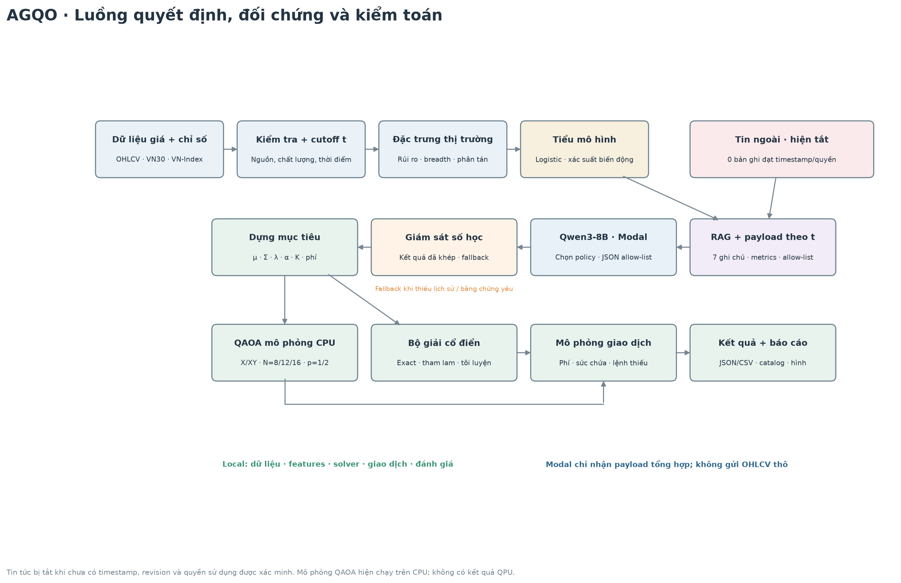

**Hình 12. Kiến trúc AGQO từ dữ liệu đến bằng chứng.** Luồng chỉ ra ranh giới cắt thời gian, local/Modal, RAG, Qwen, bộ giám sát, QAOA, đối chứng cổ điển và đường fallback; lớp tin ngoài được đánh dấu tắt do chưa có dữ liệu hợp lệ. Nguồn: Mã nguồn AGQO và manifest tin tức. Kỳ: kiến trúc phiên bản hiện tại. Đơn vị: thành phần và luồng dữ liệu. Lưu ý: QAOA hiện mô phỏng trên CPU; không có QPU.

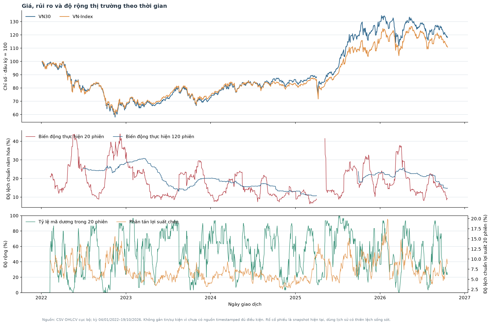

**Hình 13. Giá, biến động, độ rộng và phân tán thị trường.** Các trục căn chỉnh cho thấy giai đoạn thị trường theo chỉ số, biến động thực hiện, tỷ lệ cổ phiếu dương và phân tán chéo; không gắn tiêu đề tin khi kho sự kiện đang rỗng. Nguồn: CSV OHLCV cục bộ. Kỳ: 2022-01-04 đến 2026-10-19. Đơn vị: chỉ số chuẩn hóa, phần trăm, độ lệch chuẩn. Lưu ý: Dữ liệu giá chưa xác nhận điều chỉnh; vũ trụ có thiên lệch sống sót.

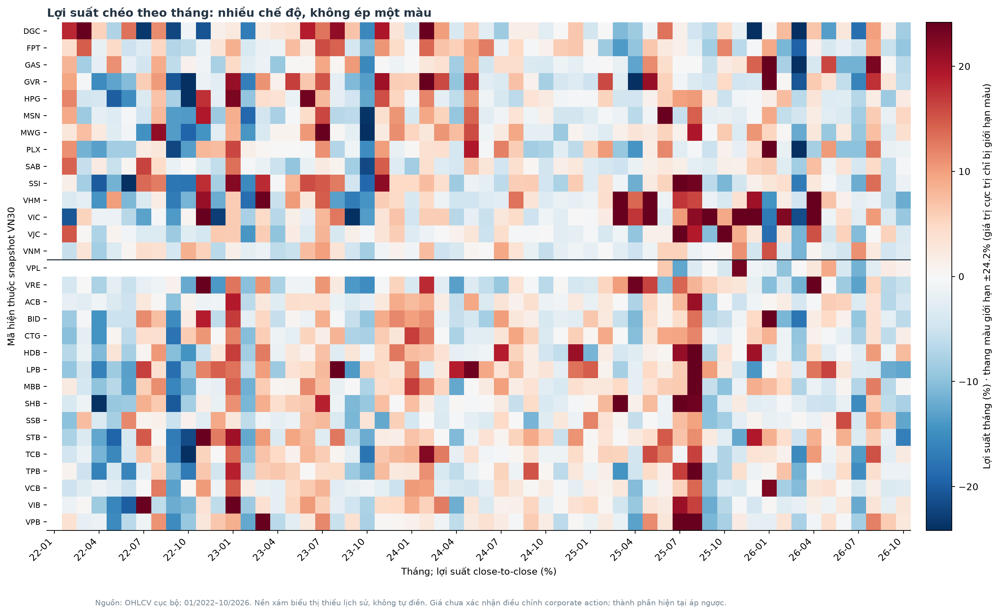

**Hình 14. Bản đồ lợi suất tháng theo cổ phiếu.** Ma trận mã–tháng dùng thang màu phân kỳ có tâm 0 để nhìn rõ tháng tăng/giảm và độ đa dạng thực tế; thang màu được giới hạn theo phân vị 97,5 nhưng lợi suất gốc không bị thay đổi. Nguồn: CSV OHLCV cục bộ · monthly close-to-close. Kỳ: 2022-01 đến 2026-10. Đơn vị: lợi suất tháng phần trăm. Lưu ý: Ô xám là thiếu lịch sử; giá chưa xác nhận điều chỉnh và snapshot thành phần gây survivorship bias.

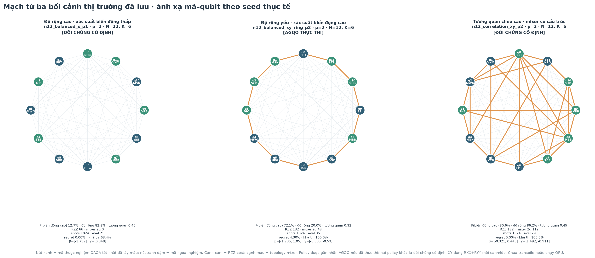

**Hình 15. Mạch QAOA qua ba bối cảnh thị trường đã lưu.** Ba đồ thị dùng tín hiệu xác suất biến động thấp, cao và tương quan chéo cao; từng ánh xạ mã–qubit, seed, góc beta/gamma, cạnh cost, cạnh mixer, shots và regret được dựng từ lần chạy đã lưu. Màu nút cho biết mã thuộc nghiệm tốt nhất đã lấy mẫu; nhãn phân biệt policy AGQO thực thi với policy đối chứng cố định. Nguồn: results/final/circuit_metadata.json và results/final/agqo_final_walkforward.json. Kỳ: tín hiệu 2025-05-30, 2026-03-31 và 2025-07-31; kết quả tháng liền sau. Đơn vị: qubit, RZZ/RXX/RYY/RX, shots, regret. Lưu ý: Cổng logic của simulator, chưa transpile hoặc chạy QPU.
