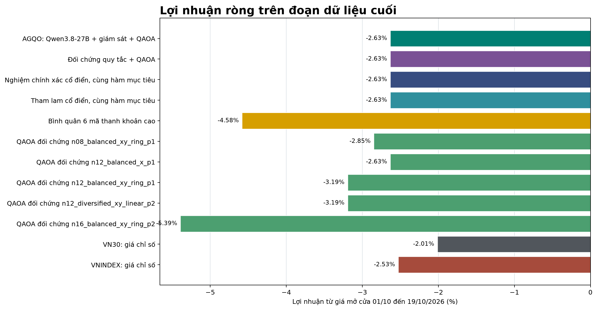
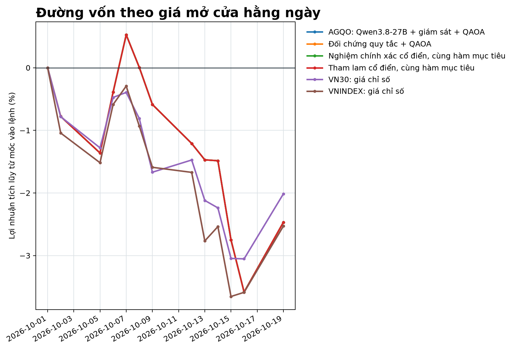
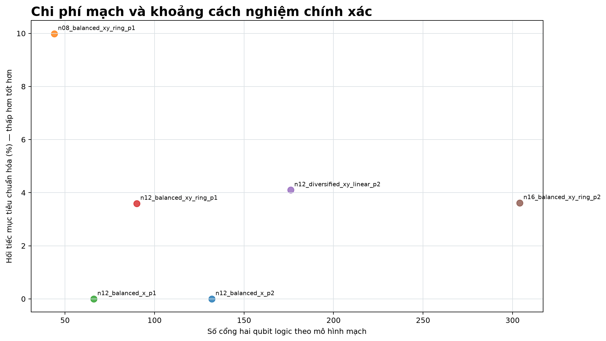

> **KẾT QUẢ TẠM — MỘT CHUỖI GIÁ DNSE DÙNG CHO CẢ HAI VAI TRÒ.** Lượt chạy này dùng chuỗi giá DNSE chart API cho cả cột giá thô lẫn cột `*_adjusted`. Kiểm tra dữ liệu cho thấy chuỗi này đã được nhà cung cấp điều chỉnh lùi theo cổ tức cổ phiếu/chia tách (không có khoảng trống ngày không hưởng quyền vượt biên độ; giá lệch bước giá HOSE), nên lợi suất dùng được. Tuy nhiên mức giá lịch sử, giá khớp giả định và đại diện thanh khoản `close × volume` không phải giá giao dịch thực tại thời điểm đó; việc điều chỉnh cổ tức tiền mặt chưa được xác minh và chưa đối soát với nguồn thứ hai.

# Kiểm định đuôi dữ liệu AGQO: Qwen3.8-27B mới → giám sát → QAOA

**Ngày quyết định:** 2026-09-30  |  **Ngày vào lệnh:** 2026-10-01  |  **Ngày định giá cuối:** 2026-10-19

> Đây là một phép thử đuôi ngắn có ngày quyết định trước ngày giao dịch, gồm 12 phiên lợi nhuận mở cửa sau ngày vào. Nó chưa được chấm trong kết quả danh mục cũ, nhưng không phải tập mù tuyệt đối vì dữ liệu tới 19/10 đã có trong dự án. Không dùng một đoạn ngắn để tuyên bố alpha bền vững hay Sharpe dài hạn.

## Kết luận bằng số liệu

- LLM gọi trực tiếp, không dùng bộ nhớ đệm: **fresh_inference_succeeded**; mô hình **Qwen/Qwen3.8-27B-FP8**, phiên bản **c3a462cc3d38cf351f3b26cbd763469eeb74ef81**, lượng tử hóa **FP8 (official Qwen3.8-27B-FP8 checkpoint); FP8 KV cache**, tổng 11,958 token.
- Chính sách LLM đề xuất: `n12_balanced_xy_ring_p1`; chính sách sau giám sát: `n12_balanced_x_p2`; đối chứng quy tắc: `n12_balanced_x_p2`. Rổ QAOA chọn: **VIC, VHM, VPB, BSR, HPG, VCB**.
- Trạng thái thị trường tại mốc quyết định: xác suất biến động cao **20.6%**, biến động VN30 20 phiên **13.6%**, lợi nhuận VN30 20 phiên **-3.8%**, độ phân tán chéo lợi suất **6.2%**, tương quan trung bình cổ phiếu **0.289**; rổ ứng viên có 16 mã, danh mục nắm 6 mã.
- Lợi nhuận ròng của AGQO trên đoạn kiểm định: **-2.63%** sau phí khớp lệnh và thanh lý cuối kỳ giới hạn theo thanh khoản. So với VN30/VNINDEX, xem biểu đồ và bảng bên dưới.

Trong đúng đoạn này, AGQO hơn bình quân sáu mã thanh khoản cao **1.95 điểm phần trăm**, giảm phí mô phỏng khoảng **207,954 đồng**. Tuy vậy, AGQO thấp hơn VN30 **0.62 điểm phần trăm** và thấp hơn đối chứng quy tắc **0.00 điểm phần trăm**. Vì vậy chỉ có một thắng lợi nhỏ trước đối chứng đơn giản, chưa có bằng chứng lợi thế tài chính tổng thể.

### Hình 1. Lợi nhuận ròng theo phương án

So sánh cùng vốn khởi điểm và cùng giá mở cửa. Các danh mục cổ phiếu tính phí giao dịch và giới hạn khớp theo 5% giá trị giao dịch bình quân; chỉ số được dùng làm mốc giá, chưa trừ chi phí đầu tư.

### Hình 2. Đường vốn hằng ngày

Đường AGQO tính theo lượng cổ phiếu khớp được, tiền mặt còn lại và phí; hai chỉ số dùng lợi nhuận giá mở cửa. 12 phiên lợi nhuận chỉ cho thấy đường đi trong đoạn này, chưa đủ để ước lượng rủi ro dài hạn.

### Bảng lợi nhuận và rủi ro trong đoạn kiểm định

| Phương án | Lợi nhuận ròng | Sharpe ngày quy đổi năm* | Sụt giảm lớn nhất* | Phí mô phỏng | Phần lệnh chưa khớp |
|---|---:|---:|---:|---:|---:|
| AGQO: Qwen3.8-27B + giám sát + QAOA | -2.63% | -4.064 | -4.09% | 541,663 đồng | 0.10% |
| Đối chứng quy tắc + QAOA | -2.63% | -4.064 | -4.09% | 541,663 đồng | 0.10% |
| Nghiệm chính xác cổ điển, cùng hàm mục tiêu | -2.63% | -4.064 | -4.09% | 541,663 đồng | 0.10% |
| Tham lam cổ điển, cùng hàm mục tiêu | -2.63% | -4.064 | -4.09% | 541,663 đồng | 0.10% |
| Bình quân 6 mã thanh khoản cao | -4.58% | -4.845 | -5.61% | 749,618 đồng | 0.15% |
| QAOA đối chứng n08_balanced_xy_ring_p1 | -2.85% | -4.058 | -4.34% | 649,922 đồng | 0.13% |
| QAOA đối chứng n12_balanced_x_p1 | -2.63% | -4.064 | -4.09% | 541,663 đồng | 0.10% |
| QAOA đối chứng n12_balanced_xy_ring_p1 | -3.19% | -4.620 | -4.66% | 539,821 đồng | 0.10% |
| QAOA đối chứng n12_diversified_xy_linear_p2 | -3.19% | -4.620 | -4.66% | 539,821 đồng | 0.10% |
| QAOA đối chứng n16_balanced_xy_ring_p2 | -5.39% | -7.387 | -6.14% | 639,012 đồng | 0.13% |
| VN30: giá chỉ số | -2.01% | -4.191 | -3.05% | 0 đồng | 0.00% |
| VNINDEX: giá chỉ số | -2.53% | -4.369 | -3.65% | 0 đồng | 0.00% |

*Sharpe và sụt giảm tính từ lợi nhuận ngày trên đúng đoạn ngắn này, chỉ là chỉ báo mô tả; không phải ước lượng đáng tin cậy của Sharpe năm. Lợi nhuận đã cộng dồn toàn kỳ và có tính thanh lý cuối kỳ trong giới hạn năng lực giao dịch.

## LLM đã hướng dẫn gì và QAOA đã làm gì

- Qwen3.8-27B nhận dữ liệu tại mốc **2026-09-30**, thống kê tài chính đã trưởng thành trước mốc đó, danh mục chính sách được phép, sổ tay phương pháp nội bộ và các mã insight có thể dẫn chứng. Nội dung prompt, phản hồi, phiên bản mô hình và số token được lưu trong JSON để kiểm tra.
- Qwen3.8-27B chọn chính sách `n12_balanced_xy_ring_p1`. Bộ giám sát dựa vào hiệu quả lịch sử đã hoàn tất và ngưỡng rủi ro; quyết định thực thi là `n12_balanced_x_p2`. LLM không chọn cổ phiếu.
- QAOA tối ưu danh mục gồm đúng **K=6** mã trên **n12_balanced_x_p2**. Nghiệm cổ điển vét cạn được tính trên cùng hàm mục tiêu làm chuẩn đối chiếu; QAOA là bộ tìm nghiệm, không được diễn giải là phần cứng lượng tử hay lợi thế lượng tử.
- Bộ trộn XY tốt nhất (`n08_balanced_xy_ring_p1`) đạt tỷ lệ mẫu khả thi **100.00%**, so với **92.68%** của bộ trộn X tốt nhất (`n12_balanced_x_p2`). XY này dùng **44 cổng hai qubit logic** và hối tiếc **9.99%**; X dùng **132** cổng, hối tiếc **-0.00%**. Khác biệt tỷ lệ khả thi là về khả năng lấy mẫu nghiệm đúng ràng buộc, không phải lợi thế lợi nhuận.
- Trên chính sách được thực thi `n12_balanced_x_p2`, QAOA lấy ra **VIC, VHM, VPB, BSR, HPG, VCB**, trong khi nghiệm vét cạn chọn **VIC, VHM, VPB, BSR, HPG, VCB**. Hối tiếc **-0.00%**; lợi nhuận ròng của nghiệm QAOA là **-2.63%**, của nghiệm vét cạn là **-2.63%**. QAOA tìm lại đúng nghiệm vét cạn trên ca này; với bài toán nhỏ, đây là kiểm tra tính đúng của bộ giải, không phải lợi thế lượng tử.

### Hình 3. Cấu hình mạch và khoảng cách tới nghiệm chính xác

Mỗi điểm biểu diễn một cấu hình đã chạy trên cùng mốc quyết định. Số cổng hai qubit là số logic theo bộ mô phỏng; hối tiếc bằng 0 nghĩa là QAOA đạt nghiệm tối ưu vét cạn cho đúng hàm mục tiêu đó.

| Chính sách | Qubit | K | Bộ trộn | Bố trí | p | Cổng hai qubit logic | Hối tiếc chuẩn hóa | Tỷ lệ mẫu khả thi tốt nhất | Lợi nhuận tài chính ròng |
|---|---:|---:|---|---|---:|---:|---:|---:|---:|
| `n12_balanced_x_p2` | 12 | 6 | X | single | 2 | 132 | -0.00% | 92.68% | -2.63% |
| `n08_balanced_xy_ring_p1` | 8 | 6 | XY | ring | 1 | 44 | 9.99% | 100.00% | -2.85% |
| `n12_balanced_x_p1` | 12 | 6 | X | single | 1 | 66 | -0.00% | 45.61% | -2.63% |
| `n12_balanced_xy_ring_p1` | 12 | 6 | XY | ring | 1 | 90 | 3.59% | 100.00% | -3.19% |
| `n12_diversified_xy_linear_p2` | 12 | 6 | XY | linear | 2 | 176 | 4.10% | 100.00% | -3.19% |
| `n16_balanced_xy_ring_p2` | 16 | 6 | XY | ring | 2 | 304 | 3.62% | 100.00% | -5.39% |

## Ý nghĩa tài chính có thể bảo vệ

1. Kết quả này kiểm tra một quy trình ra quyết định thật: đọc trạng thái thị trường tại ngày chốt, LLM chọn trong danh mục tham số có kiểm soát, bộ giám sát có quyền bác đề xuất, QAOA lập danh mục, rồi mô phỏng khớp lệnh theo thanh khoản và phí.
2. Nếu AGQO không thắng chỉ số hoặc đối chứng trong đoạn này, không được gọi đó là lợi thế lợi nhuận. Giá trị ứng dụng khi ấy chỉ nằm ở quyết định có thể kiểm toán, đo được độ lệch so với nghiệm tối ưu cổ điển và mức lệnh có thể khớp; các yếu tố này cần được kiểm tra trên nhiều kỳ độc lập trước khi gọi là lợi thế kinh tế.
3. So sánh kinh tế chính là AGQO với đối chứng chọn chính sách bằng quy tắc trên cùng danh mục đang nắm, cùng mốc giao dịch và cùng phí. So sánh mạch là hối tiếc, tỷ lệ nghiệm khả thi, số qubit, độ sâu và cổng logic. Nghiệm chính xác vét cạn cho biết thuật toán lượng tử có giải được hàm mục tiêu tốt hơn nghiệm cổ điển trong bài toán nhỏ này hay không; nó không đo lợi thế tốc độ hay lợi thế lượng tử.

## Hạn chế và điều kiện để nâng thành bằng chứng

- Chỉ một đoạn 12 phiên và một quyết định LLM; mọi Sharpe/độ sụt giảm đều thiếu độ tin cậy thống kê. Không thể chứng minh bền vững hay dùng làm khuyến nghị đầu tư.
- Dữ liệu dùng ảnh chụp thành phần VN30 hiện tại áp ngược lịch sử, giá thô chưa xác nhận điều chỉnh quyền/cổ tức, giá trị giao dịch dùng close × volume; các điểm này tạo sai lệch có thể làm thay đổi danh mục.
- Mô phỏng giá mở cửa không gồm trượt giá, thuế, lô giao dịch, tác động thị trường và các trường hợp dừng/không khớp. Giới hạn 5% ADTV vẫn là giả định.
- Không nạp tin tức bên ngoài; các insight chỉ mô tả chuỗi giá và độ phân tán, không gán biến động cho một sự kiện cụ thể.
- Tập này mới được giữ ngoài kết quả danh mục trước; dữ liệu đã được xem ở các phân tích trước. Để có kết luận đáng tin hơn cần chạy walk-forward cuốn chiếu trên nhiều kỳ chưa chạm, khóa prompt/tham số trước khi mở mỗi kỳ, so sánh paired với VN30/VNINDEX, equal-weight, Markowitz/Ledoit–Wolf exact, quy tắc→QAOA, và báo khoảng tin cậy theo block bootstrap.

## Tệp tái lập

- Mã chạy: [`scripts/run_tail_probe.py`](../../scripts/run_tail_probe.py).
- Dữ liệu chi tiết, prompt đã gửi, phản hồi LLM, QAOA từng seed, danh mục, phí, đường NAV và dấu vết nguồn: [`agqo_tail_probe_20261019.json`](agqo_tail_probe_20261019.json).
- Dữ liệu quyết định chỉ dùng đến 30/09; ngày 01/10–19/10 chỉ đi vào phần chấm điểm tài chính.
