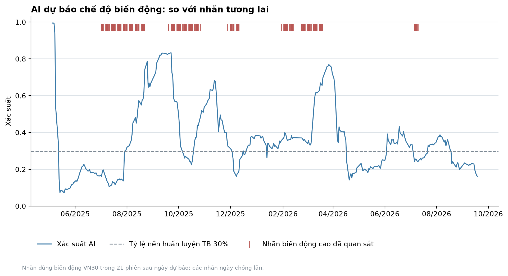
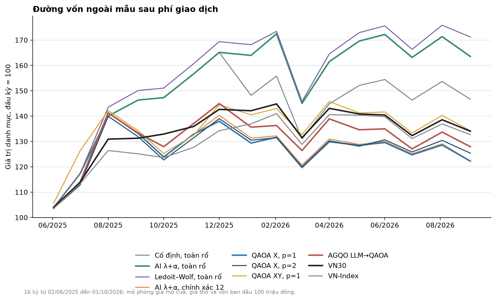
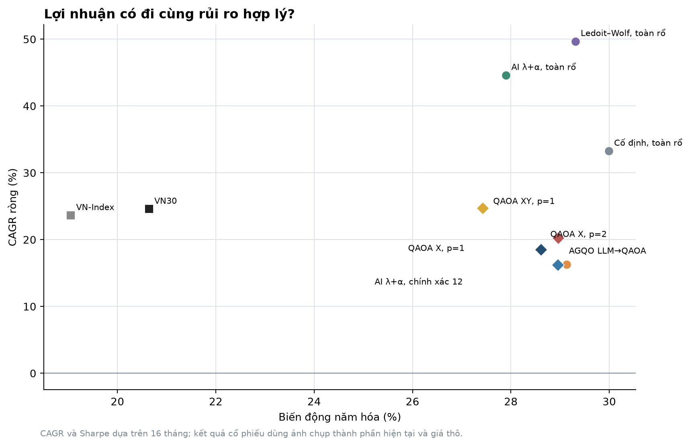
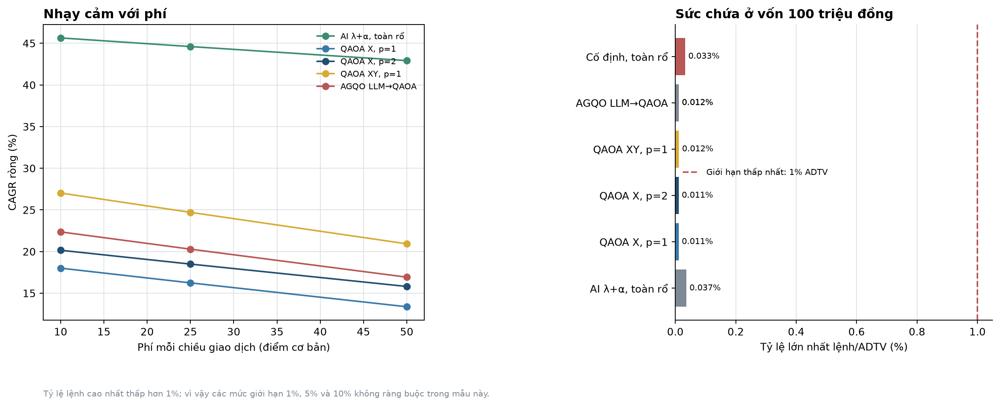
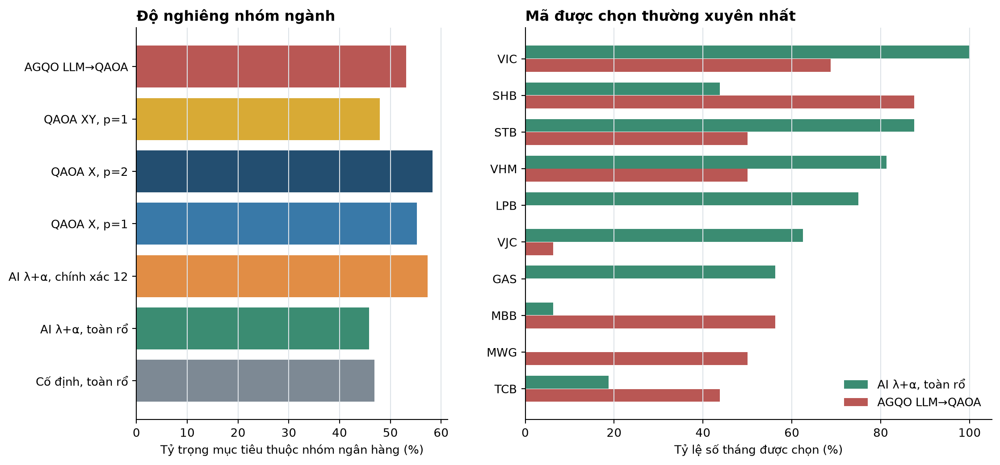
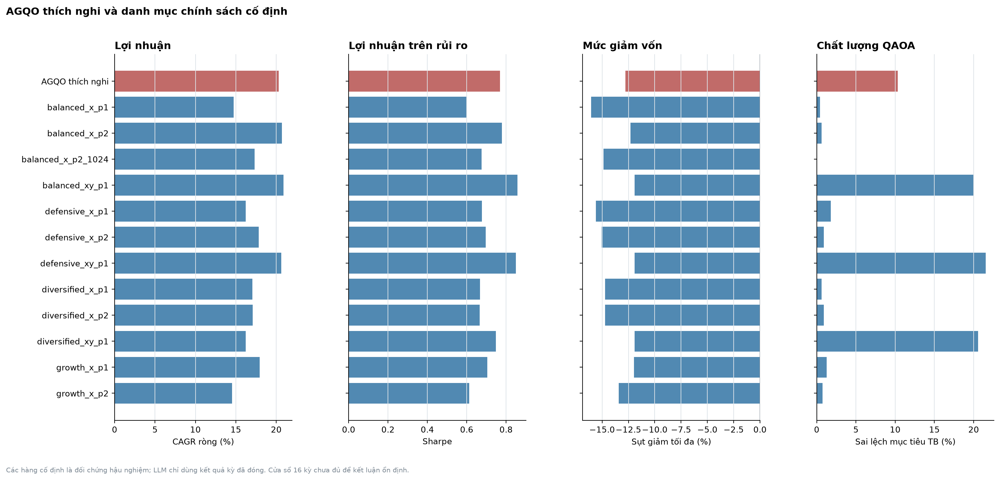
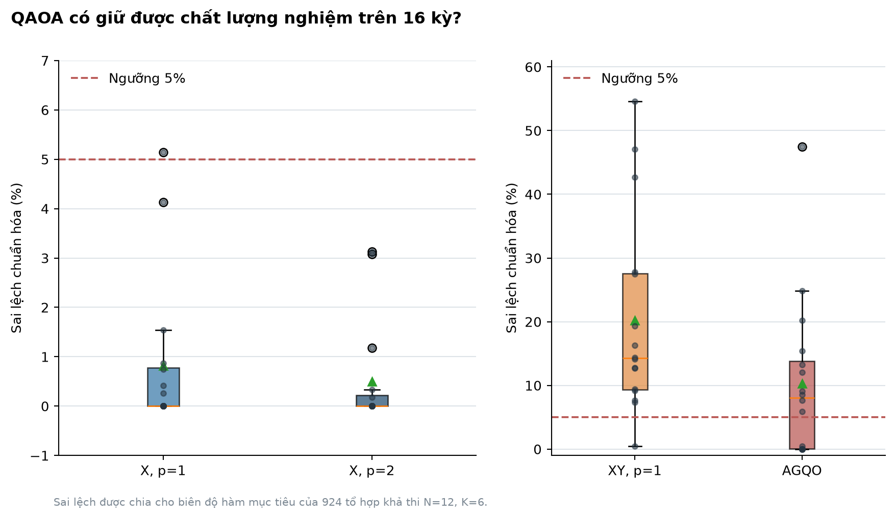
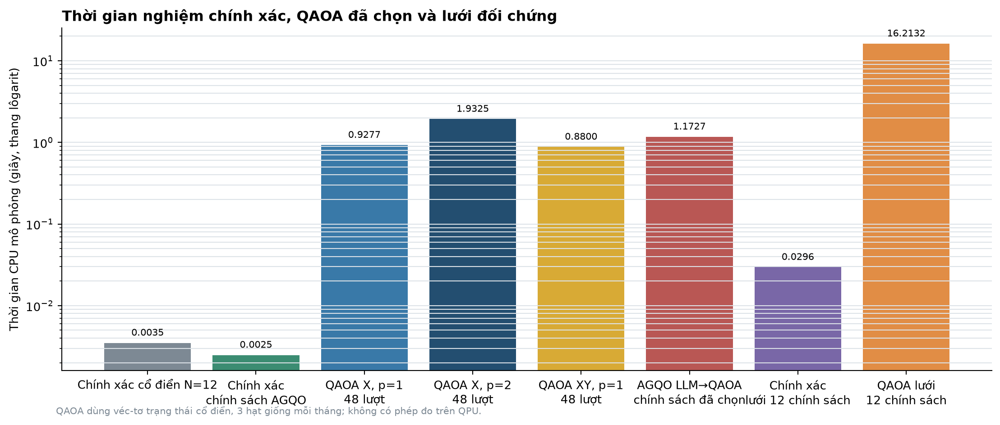

# Kiểm định ngoài mẫu: AI, QAOA và danh mục VN30

**Khoảng đo danh mục:** 2025-06-02 đến 2026-10-01 · **Số kỳ:** 16 · **Vốn mô phỏng:** 100.00 triệu · **Phí:** 25 điểm cơ bản mỗi chiều.

> Đây là thí nghiệm nghiên cứu trên giá OHLCV thô, dùng ảnh chụp thành phần VN30 ngày 02/10/2026. Chưa có điều chỉnh cổ tức/quyền hoặc lịch sử thành phần theo ngày. Kết quả chưa đủ căn cứ để tuyên bố chiến lược có thể tạo lợi nhuận thật.

## Kết luận điều hành

- Mô hình AI chọn C = 10 sau khi so log-loss trên 99 quan sát xác nhận; tỷ lệ nhãn biến động cao là 17.17%.
- Trên 345 dự báo ngày ngoài mẫu, điểm Brier là 0.257, cao hơn mức nền mở rộng 0.225; kỹ năng Brier so với nền là -14.30%. Log-loss AI 0.748 cũng kém mức nền 0.643. Nhãn 21 phiên chồng lấn, nên số này không tương đương số quan sát độc lập.
- Ở tần suất tái cân bằng, điểm Brier là 0.237 so với 0.217 của dự báo nền trên 16 tín hiệu tháng; kỹ năng so với nền là -9.30%.
- Tổ hợp AI điều chỉnh λ và α cùng nghiệm chính xác trên toàn bộ mã đủ điều kiện đạt CAGR ròng 44.60%, Sharpe 1.47. Đối chứng Ledoit–Wolf cao hơn với CAGR 49.68%; vì vậy kết quả chưa chứng minh AI là thành phần tạo thêm giá trị.
- Trên 12 mã thanh khoản cao, QAOA X p=1 đạt sai lệch mục tiêu chuẩn hóa trung bình 0.82% và đạt sai lệch không quá 5% ở 15/16 kỳ; p=2 đạt 16/16. Đây là kết quả mô phỏng cổ điển, chưa chạy QPU.
- Trên cùng 12 mã, bộ giải chính xác cổ điển nhanh hơn mô phỏng QAOA; hiện chưa có bằng chứng ưu thế lượng tử.
- Bộ điều khiển AGQO dùng Qwen/Qwen3-4B để chọn chính sách ở 16 tín hiệu; đã ghi nhận 129,614 token trong các phản hồi đã lưu. Kết quả được đo cùng các đối chứng bên dưới.

## 1. Thiết kế và chia thời gian

| Giai đoạn | Mốc | Cách sử dụng |
|---|---|---|
| Huấn luyện ban đầu | đến 2024-10-31 | Chuẩn hóa, xác lập ngưỡng phân vị 70% và khớp hồi quy logistic |
| Xác nhận | 2024-11-01–2025-04-30 | Chọn C theo log-loss; nhãn được chặn 21 phiên trước ranh giới |
| Kiểm tra khóa trước | tín hiệu từ 2025-05-01 | Cố định C/ngưỡng, sau đó mở rộng huấn luyện chỉ bằng nhãn đã trưởng thành |
| Danh mục ngoài mẫu | 2025-06-02–2026-10-01 | Tín hiệu cuối tháng, giao dịch ở phiên kế tiếp, nắm giữ đến lần vào lệnh tháng kế tiếp |

Ngưỡng biến động cao được ước lượng là 21.95% năm hóa. Tập huấn luyện ban đầu có 562 nhãn trưởng thành; tập xác nhận có 99 quan sát, trong đó 17.17% là nhãn biến động cao. Đặc trưng AI chỉ lấy từ VN30: biến động 20/60/120 phiên, lợi suất tích lũy 20/60 phiên và tỷ số biến động 20/120. Mô hình được khớp lại tại từng ngày tín hiệu bằng các nhãn tương lai đã đủ 21 phiên.

| C | Log-loss tập xác nhận |
|---:|---:|
| 0.01 | 0.538 |
| 0.1 | 0.598 |
| 1 | 0.558 |
| 10 | 0.502 |

Ở các tín hiệu tháng, tỷ lệ nhãn biến động cao thực tế là 31.25%, trong khi xác suất AI trung bình là 36.17%. Đây là thước đo sát tần suất giao dịch hơn, nhưng số quan sát vẫn nhỏ.

## 2. Hiệu quả tài chính trong kỳ kiểm tra

Lợi suất được tính từ giá mở cửa phiên kế tiếp đến giá mở cửa lần tái cân bằng kế tiếp. Phí được trừ ở mỗi lần mua và bán; lệnh bị giới hạn theo ADTV. Sharpe giả định lãi suất phi rủi ro bằng 0.

| Phương pháp | CAGR ròng | Biến động năm hóa | Sharpe | Sụt giảm tối đa | Giá trị cuối kỳ từ 100 triệu | Chi phí giao dịch | Doanh số hai chiều TB/kỳ |
|---|---:|---:|---:|---:|---:|---:|---:|
| VN30 | 24.58% | 20.64% | 1.17 | -9.22% | 134.04 triệu | — | — |
| VN-Index | 23.63% | 19.05% | 1.21 | -8.64% | 132.68 triệu | — | — |
| Cố định, toàn rổ | 33.26% | 29.99% | 1.11 | -20.69% | 146.64 triệu | 2.15 triệu | 38.36% |
| AI chỉ λ, toàn rổ | 33.94% | 30.17% | 1.12 | -20.69% | 147.65 triệu | 2.59 triệu | 45.90% |
| AI chỉ α, toàn rổ | 41.71% | 27.67% | 1.41 | -15.92% | 159.17 triệu | 2.39 triệu | 40.54% |
| AI λ+α, toàn rổ | 44.60% | 27.90% | 1.47 | -15.93% | 163.52 triệu | 2.41 triệu | 40.78% |
| Ledoit–Wolf, toàn rổ | 49.68% | 29.31% | 1.53 | -15.92% | 171.21 triệu | 2.42 triệu | 40.62% |
| AI λ+α, chính xác 12 | 16.30% | 29.13% | 0.65 | -14.56% | 122.30 triệu | 3.88 triệu | 77.74% |
| QAOA X, p=1 | 16.24% | 28.95% | 0.65 | -15.28% | 122.22 triệu | 4.06 triệu | 81.51% |
| QAOA X, p=2 | 18.50% | 28.61% | 0.72 | -14.20% | 125.39 triệu | 3.87 triệu | 77.58% |
| QAOA XY, p=1 | 24.70% | 27.42% | 0.94 | -11.90% | 134.23 triệu | 5.23 triệu | 98.84% |
| AGQO LLM→QAOA | 20.29% | 28.96% | 0.77 | -12.78% | 127.92 triệu | 4.79 triệu | 92.09% |

### Chỉ số giao dịch bổ sung

| Phương pháp | Sortino | Calmar | VaR tháng 95% | CVaR tháng 95% | Hệ số lợi nhuận | Tỷ lệ tháng dương |
|---|---:|---:|---:|---:|---:|---:|
| VN30 | 2.42 | 2.66 | -6.66% | -9.22% | 2.57 | 62.50% |
| VN-Index | 2.38 | 2.73 | -6.79% | -8.64% | 2.49 | 56.25% |
| Cố định, toàn rổ | 1.90 | 1.61 | -11.68% | -15.93% | 2.23 | 75.00% |
| AI chỉ λ, toàn rổ | 1.97 | 1.64 | -11.68% | -15.93% | 2.31 | 75.00% |
| AI chỉ α, toàn rổ | 2.59 | 2.62 | -7.92% | -15.92% | 2.96 | 75.00% |
| AI λ+α, toàn rổ | 2.73 | 2.80 | -7.92% | -15.93% | 3.07 | 75.00% |
| Ledoit–Wolf, toàn rổ | 3.06 | 3.12 | -7.92% | -15.92% | 3.44 | 75.00% |
| AI λ+α, chính xác 12 | 1.40 | 1.12 | -7.38% | -8.69% | 1.66 | 56.25% |
| QAOA X, p=1 | 1.39 | 1.06 | -7.48% | -9.07% | 1.66 | 56.25% |
| QAOA X, p=2 | 1.59 | 1.30 | -7.38% | -8.69% | 1.75 | 56.25% |
| QAOA XY, p=1 | 2.10 | 2.08 | -6.80% | -7.22% | 1.96 | 56.25% |
| AGQO LLM→QAOA | 1.80 | 1.59 | -6.63% | -7.23% | 1.81 | 56.25% |

### Đối chiếu lợi nhuận vượt VN30

Khoảng tin cậy lấy mẫu khối dùng chênh lệch lợi nhuận theo tháng; báo cả khối 3 và 6 tháng vì chỉ có 16 kỳ.

| Phương pháp | Lợi nhuận vượt năm hóa | Khoảng 95% (khối 3 tháng) | Khoảng 95% (khối 6 tháng) |
|---|---:|---:|---:|
| Cố định, toàn rổ | 9.16% | [-14.56%, 30.50%] | [-10.78%, 26.49%] |
| AI λ+α, toàn rổ | 16.97% | [1.61%, 32.48%] | [5.73%, 28.20%] |
| AI λ+α, chính xác 12 | -5.20% | [-20.74%, 11.37%] | [-18.71%, 6.76%] |
| QAOA X, p=1 | -5.30% | [-20.95%, 11.39%] | [-20.09%, 7.20%] |
| QAOA X, p=2 | -3.44% | [-18.93%, 12.39%] | [-17.57%, 8.98%] |
| QAOA XY, p=1 | 1.52% | [-21.91%, 20.82%] | [-13.68%, 15.88%] |
| AGQO LLM→QAOA | -1.84% | [-14.60%, 12.39%] | [-13.91%, 8.88%] |

### Diễn giải tài chính

- Trong cửa sổ này, danh mục AI trên toàn bộ mã đủ điều kiện tạo 44.60% CAGR ròng so với 24.58% của VN30. Nhưng Ledoit–Wolf đạt 49.68%, nên phần vượt trội không thể quy riêng cho AI.
- Bộ phân loại AI không thắng dự báo tỷ lệ nền về Brier và log-loss. Lợi suất danh mục cao hơn không chứng minh AI đã dự báo đúng chế độ; thay đổi mức co rút, nhiễu ước lượng, thành phần sống sót và diễn biến thị trường đều có thể giải thích khác biệt.
- QAOA X p=1 trên 12 mã tạo 16.24% CAGR ròng và Sharpe 0.65, thấp hơn VN30 trong kỳ này. Mức doanh số hai chiều trung bình 81.51% so với 40.78% của danh mục AI toàn rổ làm chi phí giao dịch cao hơn.
- Với vốn 100 triệu đồng, lệnh lớn nhất của QAOA X bằng 0.01% ADTV, thấp hơn giới hạn thấp nhất 1%; sức chứa không phải nút thắt ở quy mô vốn giả định này. Phí và lựa chọn mã là yếu tố kinh tế đáng quan tâm hơn.
- Khoảng tin cậy của các cấu hình QAOA so với VN30 đều cắt qua 0; 16 kỳ và các lựa chọn cấu hình song song không đủ để khẳng định ưu thế thống kê.
- Tổ hợp AI toàn rổ có lợi nhuận vượt VN30 năm hóa 16.97%; khoảng lấy mẫu khối trong cửa sổ này dương, nhưng 16 kỳ, thiên lệch sống sót và việc so nhiều cấu hình khiến kết quả chưa đủ làm bằng chứng đầu tư.
- Tỷ trọng mục tiêu thuộc nhóm ngân hàng trung bình là 45.83% ở nghiệm AI toàn rổ và 55.21% ở QAOA X. VIC xuất hiện ở 16/16 kỳ của nghiệm AI toàn rổ; mức tập trung này cần được kiểm soát.
- AGQO LLM→QAOA đạt CAGR 20.29%, Sharpe 0.77, Sortino 1.80 và sụt giảm tối đa -12.78%; LLM chọn 16 cấu hình theo insight đã lưu. Đây là kết quả cần đối chiếu, không phải bằng chứng LLM tốt hơn các phương pháp hiện tại.

## 3. QAOA được thiết kế và đo như thế nào

| Thành phần | Thiết lập |
|---|---|
| Mã hóa | 1 qubit cho mỗi ứng viên trong 12 mã có ADTV 20 phiên cao nhất; tổng cộng 12 qubit |
| Ràng buộc | Chọn đúng K=6 mã; có 924 tổ hợp khả thi |
| Hàm mục tiêu | Giảm phương sai danh mục theo λ, thưởng lợi nhuận trung bình ước lượng; đường cơ sở dùng AI, AGQO để LLM chọn λ và α trong danh mục |
| Bộ trộn X | Chồng chập đều, cộng hạng phạt để giữ K; trạng thái có 2^12 = 4.096 chuỗi bit |
| Bộ trộn XY | Khởi tạo một chuỗi khả thi và dùng trao đổi lân cận trên vòng để bảo toàn K |
| Độ sâu | p=1 cơ sở; p=2 kiểm tra độ sâu; mỗi lớp có 66 tương tác cặp do ma trận hiệp phương sai dày |
| Tối ưu góc | COBYLA, tối đa 50 lần đánh giá, 512 mẫu/lần |
| Lặp lại | Hạt giống 11, 23, 47; chọn mẫu khả thi có điểm tốt nhất trong ba lượt |
| Đối chứng | Duyệt chính xác mọi tổ hợp N=12,K=6, dùng cùng μ, Σ, λ, α |

AGQO tối ưu λ(xᵀΣαx)/K² − (μᵀx)/K cộng phí đổi danh mục năm hóa 12 × phí × Σᵢ|xᵢ/K − wᵢ_trước|; w trước là danh mục mục tiêu AGQO kỳ liền trước. Đường cơ sở giữ nguyên hàm mục tiêu cũ và tính phí ở lớp mô phỏng giao dịch. Bộ trộn X cộng hạng phạt bình phương (Σxᵢ−K)²; XY bảo toàn số mã được chọn. Mỗi nghiệm được chấm lại bằng đúng hàm mục tiêu của nhánh trước khi so với nghiệm chính xác.

| Cấu hình | Kỳ đạt sai lệch ≤5% | Sai lệch TB | Kỳ dự phòng nghiệm chính xác | Có mẫu khả thi trong lượt tối ưu | Xác suất khả thi TB của seed được chọn | Thời gian CPU tổng 48 lượt |
|---|---:|---:|---:|---:|---:|---:|
| X, p=1 | 15/16 | 0.82% | 0 | 100.00% | 55.70% | 0.928 giây |
| X, p=2 | 16/16 | 0.49% | 0 | 100.00% | 75.38% | 1.933 giây |
| XY, p=1 | 1/16 | 20.20% | 0 | 100.00% | 100.00% | 0.880 giây |
| AGQO LLM→QAOA | 6/16 | 10.32% | 0 | 100.00% | 81.75% | 1.173 giây |

### LLM đã đọc insight nào và chọn cấu hình ra sao?

LLM chỉ nhận số liệu đến ngày tín hiệu: xác suất biến động từ mô hình học máy, biến động và xu hướng VN30, tương quan giữa cổ phiếu, độ phân tán lợi suất, tỷ lệ ngân hàng, thanh khoản ước tính và kết quả các kỳ đã đóng. Đầu ra bị giới hạn vào danh mục chính sách; λ, α, bộ trộn, độ sâu và số mẫu đều được kiểm tra lại trong mã trước khi chạy QAOA.

| Ngày tín hiệu | Mã chính sách | λ | α | Bộ trộn | p | Số mẫu | Kỳ lịch sử | Lợi suất 3 kỳ đã khép | Sharpe lịch sử | Mức giảm lịch sử | Insight được gắn | Tin cậy | Sai lệch nghiệm |
|---|---|---:|---:|---|---:|---:|---:|---:|---:|---:|---|---:|---:|
| 2025-05-30 | balanced_x_p2 | 5.0 | 0.40 | X | 2 | 512 | 0 | — | — | — | high_volatility, high_correlation, bank_concentration | 75% | 0.00% |
| 2025-06-30 | balanced_x_p1 | 5.0 | 0.40 | X | 1 | 512 | 0 | — | — | — | high_volatility, high_correlation, bank_concentration | 75% | 0.04% |
| 2025-07-31 | diversified_x_p1 | 5.0 | 0.70 | X | 1 | 512 | 1 | 6.01% | — | 0.00% | high_volatility, high_correlation, high_dispersion, bank_concentration | 80% | -0.00% |
| 2025-08-29 | diversified_xy_p1 | 5.0 | 0.70 | XY | 1 | 512 | 2 | 16.22% | 8.60 | 0.00% | high_volatility, high_correlation, high_dispersion, bank_concentration | 85% | 47.48% |
| 2025-09-30 | diversified_x_p2 | 5.0 | 0.70 | X | 2 | 512 | 3 | 44.66% | 4.88 | 0.00% | high_volatility, high_correlation, bank_concentration | 80% | 8.50% |
| 2025-10-31 | diversified_x_p2 | 5.0 | 0.70 | X | 2 | 512 | 4 | 28.58% | 2.41 | -5.77% | high_volatility, high_correlation, high_dispersion, bank_concentration | 85% | 0.00% |
| 2025-11-28 | diversified_x_p2 | 5.0 | 0.70 | X | 2 | 512 | 5 | 8.79% | 1.49 | -12.32% | high_volatility, high_correlation, high_dispersion, bank_concentration | 85% | 0.47% |
| 2025-12-31 | diversified_x_p2 | 5.0 | 0.70 | X | 2 | 512 | 6 | -6.03% | 1.75 | -12.32% | high_volatility, high_correlation, high_dispersion, bank_concentration | 80% | -0.00% |
| 2026-01-30 | balanced_xy_p1 | 5.0 | 0.40 | XY | 1 | 512 | 7 | 7.65% | 2.11 | -11.90% | high_volatility, high_correlation, high_dispersion | 85% | 5.92% |
| 2026-02-27 | balanced_xy_p1 | 5.0 | 0.40 | XY | 1 | 512 | 8 | 12.19% | 1.74 | -11.90% | high_volatility, high_correlation, high_dispersion | 85% | 12.05% |
| 2026-03-31 | balanced_xy_p1 | 5.0 | 0.40 | XY | 1 | 512 | 9 | 6.69% | 1.66 | -11.90% | high_volatility, high_correlation, high_dispersion | 85% | 9.12% |
| 2026-04-29 | balanced_xy_p1 | 5.0 | 0.40 | XY | 1 | 512 | 10 | -9.24% | 1.14 | -11.90% | high_volatility, high_correlation, high_dispersion | 80% | 20.25% |
| 2026-05-29 | balanced_xy_p1 | 5.0 | 0.40 | XY | 1 | 512 | 11 | 2.50% | 1.43 | -11.90% | high_volatility, high_correlation, high_dispersion | 85% | 13.25% |
| 2026-06-30 | balanced_xy_p1 | 5.0 | 0.40 | XY | 1 | 512 | 12 | -1.23% | 1.23 | -11.90% | high_volatility, high_correlation, high_dispersion | 85% | 7.67% |
| 2026-07-31 | balanced_xy_p1 | 5.0 | 0.40 | XY | 1 | 512 | 13 | 6.77% | 1.19 | -11.90% | high_correlation, high_volatility | 80% | 15.45% |
| 2026-08-28 | balanced_xy_p1 | 5.0 | 0.40 | XY | 1 | 512 | 14 | -8.52% | 0.91 | -11.90% | high_correlation, high_dispersion, bank_concentration | 85% | 24.86% |

**Lý do và ghi chú rủi ro do LLM trả về:**

- **2025-05-30** Cổ phiếu ngân hàng chiếm 41.67% trong danh mục ứng cử, thể hiện sự tập trung cao trong ngành, đồng thời tỷ lệ tương quan cặp đôi 252 ngày là 0.64, cho thấy sự liên kết cao giữa các cổ phiếu. Tỷ lệ biến động hàng ngày của cổ phiếu ứng cử là 0.105, cho thấy mức độ biến động cao. Chính sách balanced_x_p2 có độ nhạy rủi ro trung bình (risk_aversion = 5.0) phù hợp với môi trường thị trường hiện tại, với số mẫu lớn (shots = 512) và mức co rút vừa phải (shrinkage = 0.4), giúp cân bằng giữa hiệu suất và rủi ro. Ghi chú rủi ro: Sự tập trung vào ngành ngân hàng có thể làm tăng rủi ro nếu thị trường ngành này biến động mạnh. Tỷ lệ tương quan cao giữa các cổ phiếu có thể làm giảm lợi nhuận do sự đồng biến của các tài sản.
- **2025-06-30** Cổ phiếu ngân hàng chiếm 50% trong danh mục ứng cử, thể hiện sự tập trung cao trong ngành, đồng thời tỷ lệ tương quan cặp đôi 252 ngày là 0.64, cho thấy sự liên kết cao giữa các cổ phiếu. Tỷ lệ biến động hàng ngày của cổ phiếu ứng cử cao, với giá trị trung bình hàng ngày giao dịch là 435.714 tỷ VND, cho thấy tính thanh khoản thấp. Tỷ lệ lợi nhuận 20 ngày dương là 79.31%, nhưng cùng với tỷ lệ biến động cao, điều này có thể dẫn đến rủi ro lớn. Chính sách balanced_x_p1 có độ nhạy rủi ro trung bình, phù hợp với bối cảnh thị trường hiện tại. Ghi chú rủi ro: Sự tập trung vào ngành ngân hàng và mức độ tương quan cao giữa các cổ phiếu có thể làm tăng rủi ro thanh khoản và biến động. Cần theo dõi sát hơn các yếu tố thị trường trong thời gian tới.
- **2025-07-31** Chính sách diversified_x_p1 có CAGR cao nhất (1.0149) và có mức sụt giảm tối đa bằng 0, cho thấy khả năng quản lý rủi ro tốt. Tuy nhiên, tỷ lệ biến động (volatility) cao (0.2311) và độ tương quan cao (0.4494) giữa các cổ phiếu trong danh mục cho thấy rủi ro về biến động giá. Ngoài ra, tỷ lệ cổ phiếu ngân hàng trong danh mục (0.4828) cho thấy sự tập trung vào lĩnh vực có rủi ro cao. Mặc dù có lợi nhuận cao, cần lưu ý đến rủi ro từ sự biến động và tập trung trong ngành ngân hàng. Ghi chú rủi ro: Dù có CAGR cao, chính sách này có thể chịu ảnh hưởng từ biến động thị trường và tập trung vào ngành ngân hàng, điều này có thể dẫn đến rủi ro cao hơn trong trường hợp thị trường biến động mạnh.
- **2025-08-29** Chính sách diversified_xy_p1 có CAGR cao nhất (1.4645583240591074) và Sharpe cao nhất (8.601035645079504), cho thấy hiệu suất vượt trội so với các chính sách khác. Tuy nhiên, tỷ lệ biến động cao (90th percentile pairwise correlation 0.6047) và độ phân tán cao (cross_sectional 20d return dispersion 0.1198) cho thấy rủi ro cao. Ngoài ra, tỷ lệ cổ phiếu ngân hàng trong danh mục (0.5833) cho thấy sự tập trung vào lĩnh vực có rủi ro cao. Ghi chú rủi ro: Dù có hiệu suất cao, chính sách này có rủi ro cao do biến động giá và tập trung vào ngành ngân hàng. Cần theo dõi sát hơn để đảm bảo không bị ảnh hưởng bởi biến động thị trường.
- **2025-09-30** Chính sách diversified_x_p2 có CAGR cao nhất (3.3794707103979427%) và Sharpe cao (4.87700417279057), cho thấy hiệu suất vượt trội so với các chính sách khác. Tuy nhiên, tỷ lệ phần trăm cổ phiếu ngân hàng (bank_fraction_of_eligible_stocks: 0.4827586206896552) cao, thể hiện sự tập trung vào lĩnh vực này, có thể dẫn đến rủi ro cao hơn. Ngoài ra, tỷ lệ biến động cặp đôi (mean_pairwise_correlation_252d: 0.4190719254737773) và tỷ lệ biến động trong 20 ngày (cross_sectional_20d_return_dispersion: 0.09232237082108309) cho thấy mức độ biến động cao, phù hợp với insight_codes 'high_volatility' và 'high_correlation'. Ghi chú rủi ro: Sự tập trung vào ngân hàng có thể làm tăng rủi ro, và mức độ biến động cao có thể dẫn đến sụt giảm giá trong tương lai. Dữ liệu lịch sử ngắn (3 kỳ) có thể không đủ để đánh giá đầy đủ.
- **2025-10-31** Chính sách diversified_x_p2 có CAGR cao nhất (1.5328938952935003) và Sharpe cao (2.4133979176222957), cho thấy hiệu suất vượt trội so với các chính sách khác. Tuy nhiên, có sự tập trung vào ngân hàng (bank_fraction_of_eligible_stocks: 0.3333333333333333) và độ phân tán cao (cross_sectional_20d_return_dispersion: 0.10118788236756004), điều này có thể dẫn đến rủi ro cao hơn. Ngoài ra, độ biến động cao (vn30_annualized_volatility_20d: 0.31996861971128215) và tương quan cao (mean_pairwise_correlation_252d: 0.4356189537974712) cũng là yếu tố cần lưu ý. Ghi chú rủi ro: Dù có hiệu suất tốt, chính sách này có thể chịu rủi ro cao do sự tập trung vào ngân hàng và độ phân tán cao trong thị trường. Cần theo dõi sát hơn để đảm bảo tính ổn định.
- **2025-11-28** Chính sách diversified_x_p2 có CAGR cao nhất (0.769589) và Sharpe cao nhất (1.489915), đồng thời có mức sụt giảm tối đa thấp nhất (-0.123151). Tuy nhiên, có sự tập trung vào ngân hàng (bank_fraction_of_eligible_stocks: 0.4667) và độ phân tán cao (cross_sectional_20d_return_dispersion: 0.0911), điều này có thể dẫn đến rủi ro cao hơn. Ngoài ra, có sự tương quan cao giữa các tài sản (mean_pairwise_correlation_252d: 0.3391) và xác suất cao về biến động (ai_high_volatility_probability: 0.3251). Chính sách này có tiềm năng cao nhưng cần lưu ý về rủi ro liên quan đến tập trung và biến động. Ghi chú rủi ro: Có sự tập trung vào ngân hàng và độ phân tán cao trong danh mục đầu tư, điều này có thể làm tăng rủi ro. Ngoài ra, mức độ biến động cao (ai_high_volatility_probability: 0.3251) và tương quan cao giữa các tài sản (mean_pairwise_correlation_252d: 0.3391) có thể làm giảm hiệu quả phân tán rủi ro.
- **2025-12-31** Chính sách diversified_x_p2 có CAGR cao nhất (0.8478) và Sharpe cao (1.7485), đồng thời có mức sụt giảm tối đa thấp (-0.1231). Tuy nhiên, có sự phân tán cao (cross_sectional_20d_return_dispersion 0.1005) và tỷ lệ cổ phiếu ngân hàng cao (0.4167), cho thấy rủi ro về sự phụ thuộc vào ngành ngân hàng. Mặc dù có lợi nhuận ròng cao, nhưng cần lưu ý rằng dữ liệu lịch sử có thể không đủ để đánh giá đầy đủ. Ghi chú rủi ro: Dù có CAGR và Sharpe cao, nhưng sự phân tán cao và tỷ lệ cổ phiếu ngân hàng cao có thể dẫn đến rủi ro về sự phụ thuộc vào ngành. Dữ liệu lịch sử ngắn có thể không phản ánh đầy đủ tính năng của chính sách.
- **2026-01-30** Chính sách balanced_xy_p1 có CAGR cao nhất (0.7851) và Sharpe cao nhất (2.1134), đồng thời có tỷ lệ lợi nhuận dương cao (100%) và sụt giảm tối đa thấp (-0.1190). Tuy nhiên, nó có tỷ lệ giao dịch cao nhất (1.0231), điều này có thể dẫn đến chi phí giao dịch cao hơn. Dù vậy, do hiệu suất tài chính vượt trội, chính sách này được chọn. Ghi chú rủi ro: Chính sách này có tỷ lệ giao dịch cao, có thể dẫn đến chi phí giao dịch cao hơn. Ngoài ra, sụt giảm tối đa mặc dù thấp nhưng vẫn có thể ảnh hưởng đến lợi nhuận trong trường hợp thị trường biến động mạnh.
- **2026-02-27** Chính sách balanced_xy_p1 có CAGR cao nhất (0.5930) và Sharpe cao nhất (1.7436), đồng thời có Sortino cao nhất (4.5709), cho thấy hiệu suất vượt trội so với các chính sách khác. Tỷ lệ lợi nhuận (profit_factor) cũng cao (3.2710), cho thấy khả năng sinh lời tốt. Tuy nhiên, có sự phân tán cao (cross_sectional_20d_return_dispersion: 0.0602) và tương quan cao (mean_pairwise_correlation_252d: 0.2789), cho thấy rủi ro về biến động giá. Do đó, chính sách này phù hợp với mục tiêu tối ưu hóa lợi nhuận ròng sau khi điều chỉnh rủi ro. Ghi chú rủi ro: Dù có hiệu suất cao, chính sách balanced_xy_p1 có mức sụt giảm tối đa (-0.1190) và VaR/CVaR (-0.0666), cho thấy rủi ro về biến động giá. Cần theo dõi chặt chẽ để đảm bảo không vượt quá giới hạn rủi ro.
- **2026-03-31** Chính sách balanced_xy_p1 có CAGR cao nhất (0.5243) và Sharpe cao nhất (1.6649), đồng thời có Sortino cao nhất (4.3822), cho thấy hiệu suất vượt trội so với các chính sách khác. Tỷ lệ lợi nhuận (profit factor) cũng cao (3.3093), cho thấy khả năng sinh lời tốt. Tuy nhiên, có sự phân tán cao (high_dispersion) và tương quan cao (high_correlation) giữa các tài sản, điều này có thể dẫn đến rủi ro khi thị trường biến động. Ngoài ra, tỷ lệ biến động (volatility) cao (0.2509) và tỷ lệ VaR/CVaR (monthly_var_95_to_date: -0.0624) cho thấy rủi ro về biến động giá. Ghi chú rủi ro: Dù có hiệu suất tốt, chính sách balanced_xy_p1 có thể chịu rủi ro cao do sự phân tán và tương quan cao giữa các tài sản. Cần theo dõi sát thị trường để điều chỉnh chiến lược khi cần thiết.
- **2026-04-29** Chính sách balanced_xy_p1 có CAGR cao nhất (0.33546) và Sharpe cao nhất (1.14064), đồng thời có mức sụt giảm tối đa thấp nhất (-0.11904). Tuy nhiên, có sự phân tán cao (0.13651) và độ tương quan cao (0.32015), cho thấy rủi ro cao. Do đó, chính sách này phù hợp với mục tiêu cân bằng giữa lợi nhuận và rủi ro. Ghi chú rủi ro: Mặc dù có CAGR và Sharpe cao, nhưng mức sụt giảm tối đa và độ phân tán cao cho thấy rủi ro không nhỏ. Cần theo dõi sát hơn trong tương lai.
- **2026-05-29** Chính sách balanced_xy_p1 có CAGR cao nhất (0.4414) và Sharpe cao nhất (1.4343), đồng thời có mức sụt giảm tối đa thấp nhất (-0.1190). Tuy nhiên, có sự phân tán cao trong lợi nhuận (0.0651) và độ lệch tương quan cao (0.5698), cho thấy rủi ro về biến động và tương quan giữa các tài sản. Dù có lợi nhuận ròng cao, nhưng cần lưu ý đến rủi ro về biến động và tương quan cao. Ghi chú rủi ro: Có thể gặp rủi ro về biến động và tương quan cao giữa các tài sản trong danh mục, ảnh hưởng đến ổn định của lợi nhuận. Cần theo dõi sát hơn các chỉ số VaR/CVaR và phân tán lợi nhuận.
- **2026-06-30** Chính sách balanced_xy_p1 có CAGR cao nhất (0.354961) và Sharpe cao nhất (1.229877), đồng thời có tỷ lệ lợi nhuận cao (2.349990) và giảm thiểu rủi ro với sụt giảm tối đa (-0.119042). Tuy nhiên, có sự phân tán cao (0.048180) và tương quan cao (0.568014), cho thấy rủi ro về biến động giá. Do đó, chính sách này phù hợp với mục tiêu cân bằng giữa lợi nhuận và rủi ro. Ghi chú rủi ro: Có thể xảy ra biến động giá do phân tán cao và tương quan cao trong danh mục đầu tư, ảnh hưởng đến lợi nhuận ròng sau khi tính phí.
- **2026-07-31** Chính sách balanced_xy_p1 có CAGR cao nhất (0.3271) và Sharpe cao (1.1904), đồng thời có tỷ lệ Sharpe cao hơn nhiều so với các chính sách khác. Tuy nhiên, có sự tương quan cao giữa các tài sản (90th percentile pairwise correlation 252d là 0.5845), điều này có thể dẫn đến rủi ro tăng. Ngoài ra, tỷ lệ sụt giảm tối đa (-0.1190) không quá lớn, nhưng vẫn cần lưu ý về tính ổn định của chính sách. Ghi chú rủi ro: Có thể xảy ra rủi ro do tương quan cao giữa các tài sản trong danh mục, ảnh hưởng đến hiệu quả phân tán rủi ro. Cần theo dõi sát hơn về biến động và sự ổn định của chính sách trong tương lai.
- **2026-08-28** Chính sách balanced_xy_p1 có CAGR cao nhất (0.2348) và Sharpe cao nhất (0.9124), đồng thời có tỷ lệ lợi nhuận cao (1.9166) và giảm thiểu rủi ro với mức sụt giảm tối đa (-0.1190). Tuy nhiên, có sự tương quan cao (90th percentile pairwise correlation 0.6079) và phân tán cao (cross-sectional 20d return dispersion 0.0609), đồng thời có sự tập trung vào ngân hàng (bank fraction 0.4667). Ghi chú rủi ro: Có thể có rủi ro từ sự tương quan cao và phân tán cao, đồng thời sự tập trung vào ngân hàng có thể làm tăng rủi ro trong trường hợp thị trường biến động.

### Dữ liệu định lượng LLM nhận tại từng tín hiệu

Mô hình: Qwen/Qwen3-4B; tổng token đầu vào 125,032, đầu ra 4,582. Đây là số token trong các phản hồi đã lưu, không phải ước lượng chi phí tiền tệ.

| Ngày | Xác suất biến động cao | Biến động VN30 20/60/120 phiên | Lợi suất VN30 20/60 phiên | Tỷ số biến động | Tương quan cặp TB / phân vị 90% | Độ phân tán 20 phiên | Mã tăng 20 phiên | Tỷ trọng ngân hàng trong rổ / ứng viên | Cơ cấu ngành 12 ứng viên | ADTV ứng viên min / trung vị / max | Số chính sách có lịch sử |
|---|---:|---|---|---:|---|---:|---:|---|---|---|---:|
| 2025-05-30 | 12.65% | 13.43%/29.15%/22.06% | 8.79%/6.02% | 0.61 | 0.447/0.644 | 10.52% | 82.76% | 48.28% / 41.67% | Ngành khác 58.33%, Ngân hàng 41.67% | 280447.94 triệu/458828.38 triệu/851404.55 triệu | 0/12 |
| 2025-06-30 | 16.37% | 11.73%/29.50%/21.93% | 3.89%/9.46% | 0.53 | 0.444/0.640 | 6.05% | 79.31% | 48.28% / 50.00% | Ngành khác 50.00%, Ngân hàng 50.00% | 197401.75 triệu/435714.72 triệu/633553.86 triệu | 0/12 |
| 2025-07-31 | 30.66% | 22.49%/16.04%/23.11% | 9.28%/19.94% | 0.97 | 0.449/0.641 | 11.66% | 86.21% | 48.28% / 50.00% | Ngành khác 50.00%, Ngân hàng 50.00% | 371658.20 triệu/734802.30 triệu/1273978.40 triệu | 12/12 |
| 2025-08-29 | 66.66% | 25.24%/20.38%/25.27% | 15.91%/32.19% | 1.00 | 0.421/0.605 | 11.98% | 86.21% | 48.28% / 58.33% | Ngành khác 41.67%, Ngân hàng 58.33% | 755867.10 triệu/1094634.19 triệu/2214382.31 triệu | 12/12 |
| 2025-09-30 | 52.91% | 17.24%/22.09%/21.56% | -0.01%/25.92% | 0.80 | 0.419/0.609 | 9.23% | 17.24% | 48.28% / 58.33% | Ngành khác 41.67%, Ngân hàng 58.33% | 375898.07 triệu/730484.41 triệu/1934419.34 triệu | 12/12 |
| 2025-10-31 | 53.59% | 32.00%/24.70%/21.24% | 1.79%/10.20% | 1.51 | 0.436/0.622 | 10.12% | 37.93% | 48.28% / 33.33% | Ngành khác 66.67%, Ngân hàng 33.33% | 461625.42 triệu/840966.06 triệu/1785736.82 triệu | 12/12 |
| 2025-11-28 | 32.51% | 19.07%/22.80%/21.90% | 2.19%/4.89% | 0.87 | 0.339/0.561 | 9.11% | 36.67% | 46.67% / 41.67% | Ngành khác 58.33%, Ngân hàng 41.67% | 329749.84 triệu/430180.73 triệu/1041799.97 triệu | 12/12 |
| 2025-12-31 | 38.44% | 22.54%/23.97%/23.20% | 3.17%/6.32% | 0.97 | 0.326/0.563 | 10.05% | 33.33% | 46.67% / 41.67% | Ngành khác 58.33%, Ngân hàng 41.67% | 348982.75 triệu/506806.39 triệu/1118488.62 triệu | 12/12 |
| 2026-01-30 | 35.62% | 16.68%/18.66%/22.10% | 0.06%/8.04% | 0.75 | 0.284/0.535 | 20.86% | 66.67% | 46.67% / 50.00% | Ngành khác 50.00%, Ngân hàng 50.00% | 662343.20 triệu/895825.85 triệu/1132288.14 triệu | 12/12 |
| 2026-02-27 | 35.48% | 17.09%/17.93%/20.73% | -0.66%/7.59% | 0.82 | 0.279/0.537 | 6.02% | 43.33% | 46.67% / 41.67% | Ngành khác 58.33%, Ngân hàng 41.67% | 495693.90 triệu/712332.30 triệu/1260728.79 triệu | 12/12 |
| 2026-03-31 | 72.11% | 36.69%/25.66%/25.09% | -6.13%/-6.20% | 1.46 | 0.321/0.579 | 12.12% | 20.00% | 46.67% / 41.67% | Ngành khác 58.33%, Ngân hàng 41.67% | 406174.94 triệu/651837.30 triệu/1063369.51 triệu | 12/12 |
| 2026-04-29 | 20.71% | 20.67%/26.98%/23.32% | 10.76%/1.01% | 0.89 | 0.320/0.574 | 13.65% | 73.33% | 46.67% / 41.67% | Ngành khác 58.33%, Ngân hàng 41.67% | 325199.67 triệu/498677.13 triệu/1108384.80 triệu | 12/12 |
| 2026-05-29 | 25.12% | 12.85%/25.59%/22.64% | -1.21%/2.72% | 0.57 | 0.311/0.570 | 6.51% | 40.00% | 46.67% / 41.67% | Ngành khác 58.33%, Ngân hàng 41.67% | 366122.00 triệu/468502.71 triệu/819390.86 triệu | 12/12 |
| 2026-06-30 | 31.76% | 12.11%/15.69%/21.30% | 1.21%/8.01% | 0.57 | 0.308/0.568 | 4.82% | 63.33% | 46.67% / 50.00% | Ngành khác 50.00%, Ngân hàng 50.00% | 239662.37 triệu/376136.22 triệu/727814.31 triệu | 12/12 |
| 2026-07-31 | 34.32% | 20.19%/15.05%/21.78% | -6.36%/-9.49% | 0.93 | 0.319/0.585 | 5.95% | 6.67% | 46.67% / 41.67% | Ngành khác 58.33%, Ngân hàng 41.67% | 292599.26 triệu/395662.59 triệu/761612.36 triệu | 12/12 |
| 2026-08-28 | 19.85% | 16.46%/16.90%/18.65% | 6.04%/0.17% | 0.88 | 0.320/0.608 | 6.09% | 86.67% | 46.67% / 41.67% | Ngành khác 58.33%, Ngân hàng 41.67% | 259718.29 triệu/414891.40 triệu/1286692.83 triệu | 12/12 |

### AGQO so với từng chính sách cố định

Các chính sách cố định được chạy song song ở chế độ bóng trên từng tín hiệu. Chúng không được dùng để thay đổi lợi nhuận đã xảy ra; tại tín hiệu kế tiếp, LLM chỉ thấy các kỳ đã đóng. Bảng này so danh mục thích nghi với từng chính sách cố định trên cùng cửa sổ, nhưng chính sách tốt nhất sau toàn bộ kỳ là đối chứng hậu nghiệm chứ không phải lựa chọn có thể biết trước.

| Danh mục | CAGR ròng | Vượt VN30 năm hóa TB | Sharpe | Sortino | Sụt giảm tối đa | VaR tháng 95% | CVaR tháng 95% | Hệ số lợi nhuận | Tháng dương | Doanh số TB | Sai lệch QAOA TB | Số kỳ sai lệch ≤5% | Kỳ dự phòng chính xác |
|---|---:|---:|---:|---:|---:|---:|---:|---:|---:|---:|---:|---:|---:|
| AGQO thích nghi | 20.29% | -1.84% | 0.77 | 1.80 | -12.78% | -6.63% | -7.23% | 1.81 | 56.25% | 92.09% | 10.32% | 6/16 | 0 |
| balanced_x_p1 | 14.74% | -6.50% | 0.60 | 1.27 | -16.04% | -7.43% | -8.70% | 1.59 | 56.25% | 65.66% | 0.43% | 16/16 | 0 |
| balanced_x_p2 | 20.70% | -1.45% | 0.78 | 1.75 | -12.30% | -7.07% | -7.27% | 1.81 | 56.25% | 61.70% | 0.60% | 15/16 | 0 |
| balanced_x_p2_1024 | 17.33% | -4.20% | 0.67 | 1.45 | -14.86% | -7.48% | -9.08% | 1.68 | 56.25% | 63.80% | 0.00% | 16/16 | 0 |
| balanced_xy_p1 | 20.89% | -1.99% | 0.86 | 1.81 | -11.90% | -6.80% | -7.23% | 1.83 | 56.25% | 94.20% | 19.98% | 0/16 | 0 |
| defensive_x_p1 | 16.21% | -5.67% | 0.68 | 1.37 | -15.59% | -7.11% | -8.69% | 1.63 | 56.25% | 69.68% | 1.78% | 14/16 | 0 |
| defensive_x_p2 | 17.82% | -3.93% | 0.70 | 1.55 | -15.06% | -7.10% | -7.34% | 1.72 | 56.25% | 65.59% | 0.89% | 15/16 | 0 |
| defensive_xy_p1 | 20.62% | -2.21% | 0.85 | 1.80 | -11.90% | -6.80% | -7.23% | 1.82 | 50.00% | 100.18% | 21.52% | 0/16 | 0 |
| diversified_x_p1 | 17.06% | -4.44% | 0.67 | 1.44 | -14.72% | -6.96% | -7.00% | 1.65 | 56.25% | 59.54% | 0.61% | 15/16 | 0 |
| diversified_x_p2 | 17.08% | -4.41% | 0.67 | 1.45 | -14.70% | -7.04% | -7.34% | 1.65 | 56.25% | 65.63% | 0.92% | 15/16 | 0 |
| diversified_xy_p1 | 16.21% | -6.45% | 0.75 | 1.45 | -11.90% | -6.80% | -7.23% | 1.66 | 56.25% | 94.09% | 20.55% | 1/16 | 0 |
| growth_x_p1 | 17.94% | -3.91% | 0.70 | 1.60 | -11.97% | -6.41% | -6.71% | 1.73 | 56.25% | 63.72% | 1.26% | 14/16 | 0 |
| growth_x_p2 | 14.53% | -6.98% | 0.61 | 1.23 | -13.41% | -7.36% | -8.62% | 1.56 | 56.25% | 65.57% | 0.74% | 15/16 | 0 |

Chuẩn chính xác N=12 cần tổng 0.0035 giây cho 16 tín hiệu, còn QAOA X p=1 cần 0.928 giây cho 48 lượt mô phỏng. Khi đủ 30 mã, nghiệm chính xác xét tối đa 593.775 tổ hợp mỗi kỳ; các kỳ đầu có 29 mã do VPL chưa đủ lịch sử. Tổng thời gian của năm cấu hình cổ điển trên 16 tín hiệu là 5.42 giây. Hai cách không cùng quy mô; máy véc-tơ trạng thái chỉ là mô phỏng cổ điển. Lưới đối chứng AGQO chạy 576 lượt QAOA trên 12 chính sách, tốn 16.213 giây mô phỏng CPU (không tính thời gian chờ LLM).

### Kết luận chọn hướng đi

**Hướng AGQO:** AI/LLM rút insight tài chính từ dữ liệu có sẵn tại ngày tín hiệu, chọn một chính sách QAOA trong danh mục đã khóa, rồi QAOA giải danh mục theo chính sách đó. Hồi quy logistic, cấu hình QAOA cố định, Ledoit–Wolf và nghiệm chính xác vẫn được giữ làm đối chứng. Chỉ công nhận LLM có ích nếu AGQO thắng đối chứng theo tiêu chí tài chính và chất lượng nghiệm đã đăng ký trên dữ liệu ngoài mẫu.
Các kỳ AGQO sau sử dụng kết quả của các kỳ đã đóng trước đó trong cùng cửa sổ; đây là walk-forward thích nghi. Cần thêm một giai đoạn kiểm tra cuối được khóa trước khi dùng kết quả để tuyên bố khả năng khái quát.
Kết quả hiện tại có bật LLM và đã đo đường AGQO cùng CAGR, Sharpe, Sortino, sụt giảm, chi phí, doanh số và sai lệch QAOA.

Trước khi biến kết quả thành tuyên bố đầu tư, cần thay dữ liệu bằng chuỗi đã điều chỉnh, lấy thành phần VN30 theo ngày hiệu lực, mở rộng các chu kỳ thị trường độc lập, xác định phí/thuế/trượt giá theo nhà môi giới, và đăng ký trước tiêu chí chọn mô hình. Cần chạy lời hướng dẫn LLM trên Modal, lưu nguyên quyết định theo ngày, rồi kiểm định thêm nhiều chu kỳ chưa dùng để chọn chính sách.

## 4. Nguồn dữ liệu và xử lý

- Tệp: data/vn30_snapshot_20261002/ohlcv_daily.csv; 37,308 dòng; 2022-01-04–2026-10-19.
- Nguồn bộ lấy: thư viện vnstock-data; nguồn giá là DNSE chart API; danh sách thành phần là bản chụp HODL.VN ngày 02/10/2026.
- Lợi suất tính từ giá đóng cửa; chỉ dùng phiên cả VN30 và VN-Index đều có giá để thống nhất lịch chỉ số; không nội suy giá thiếu.
- Đầu vào danh mục dùng tối đa 252 phiên gần nhất, yêu cầu tối thiểu 126 quan sát đầy đủ mỗi mã.
- Mỗi tháng, 12 ứng viên QAOA là các mã đủ điều kiện có giá trị giao dịch ước tính close × volume bình quân 20 phiên cao nhất.
- Giới hạn ADTV được mô phỏng bằng lệnh khớp một phần; giá mở cửa, vốn 100 triệu đồng, phí 10/25/50 điểm cơ bản.
- Tệp dữ liệu thô bị bỏ khỏi Git; cần đối chiếu mã băm và giấy phép trước khi phân phối.

## 5. Giới hạn cần nói rõ với ban giám khảo

- Chỉ có khoảng 16 kỳ nắm giữ tháng kiểm tra; chưa đủ để kết luận lợi thế kinh tế ổn định.
- Giá OHLCV chưa xác nhận điều chỉnh cổ tức, chia tách và quyền mua.
- Dùng ảnh chụp thành phần VN30 ngày 02/10/2026 cho lịch sử; có thiên lệch sống sót.
- Khả năng khớp lệnh chỉ mô phỏng giới hạn theo tỷ lệ ADTV; không có dữ liệu sổ lệnh, bước giá, thuế và lô giao dịch.
- AI dùng nhãn biến động tương lai 21 phiên chồng lấn; số dự báo ngày không độc lập.
- QAOA là mô phỏng véc-tơ trạng thái cổ điển, không phải bằng chứng ưu thế lượng tử hay kết quả QPU.
- LLM chỉ chọn trong danh mục chính sách cho phép; hiệu quả chính sách AGQO phải được đánh giá ngoài mẫu và không được suy diễn thành bảo đảm lợi nhuận.
- AGQO dùng lợi nhuận của các kỳ kiểm tra đã đóng để điều chỉnh lựa chọn ở kỳ sau; đây là walk-forward thích nghi, cần thêm một giai đoạn cuối khóa riêng trước khi kết luận tổng quát.

Tệp JSON lưu dự báo, xác suất, danh mục theo tháng, lợi nhuận từng kỳ, phí, doanh số, đối chiếu lấy mẫu khối, kết quả từng hạt giống QAOA và thời gian chạy: vn30_ai_qaoa_walkforward.json.
