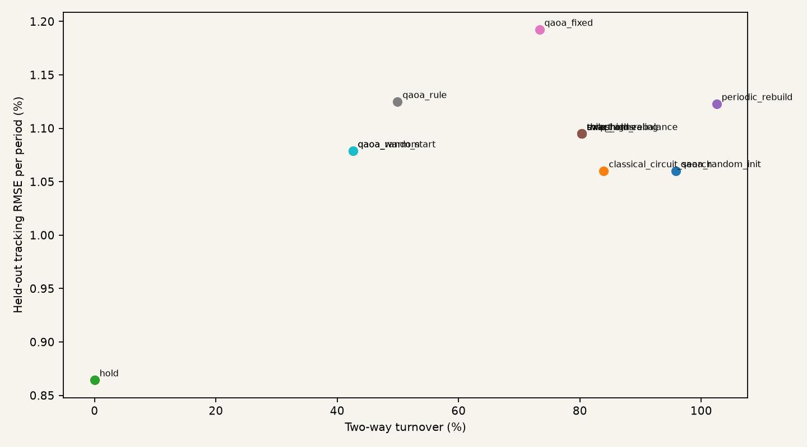
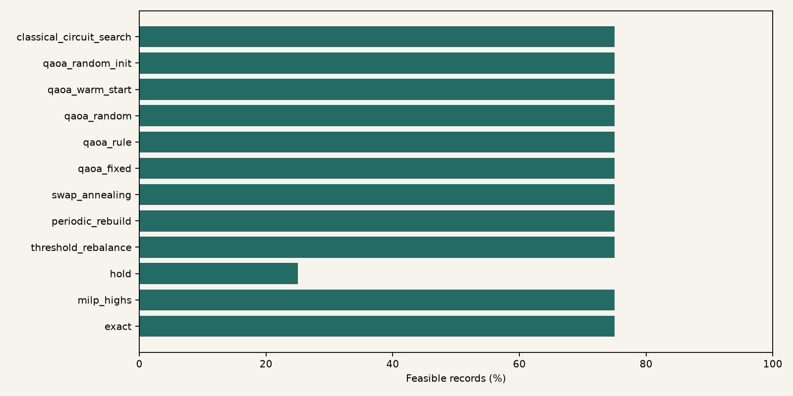
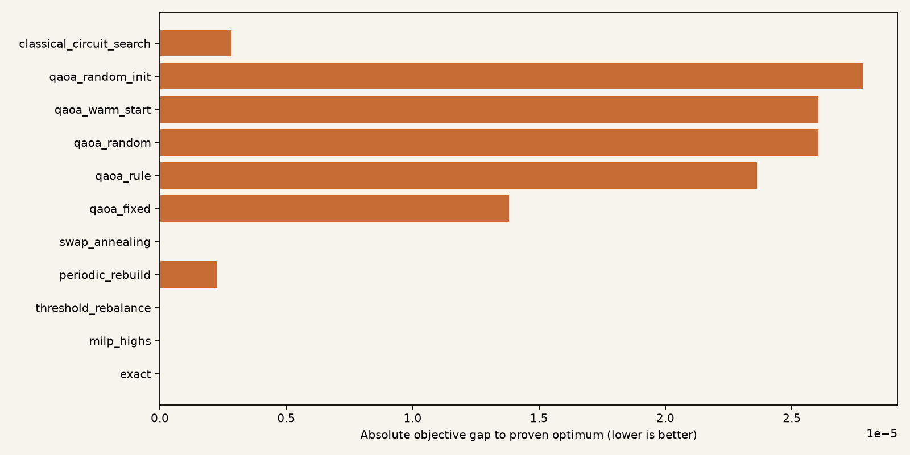
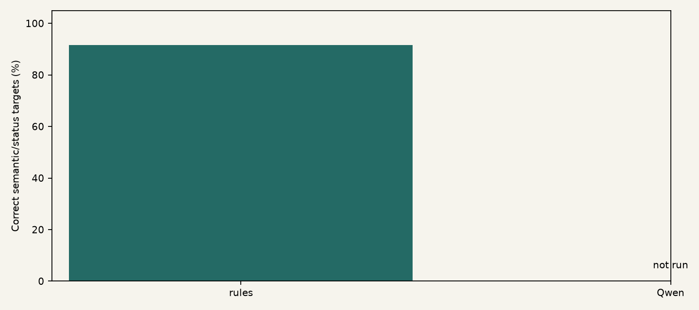
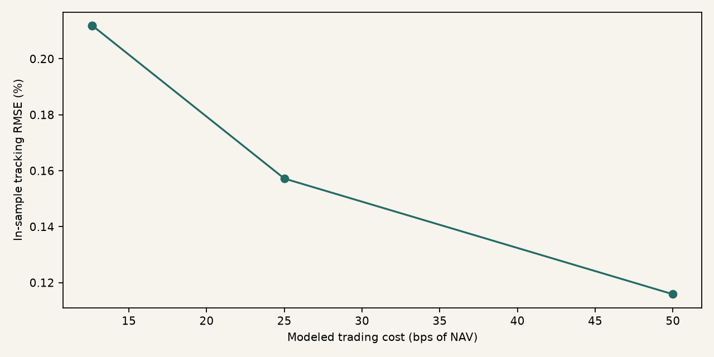
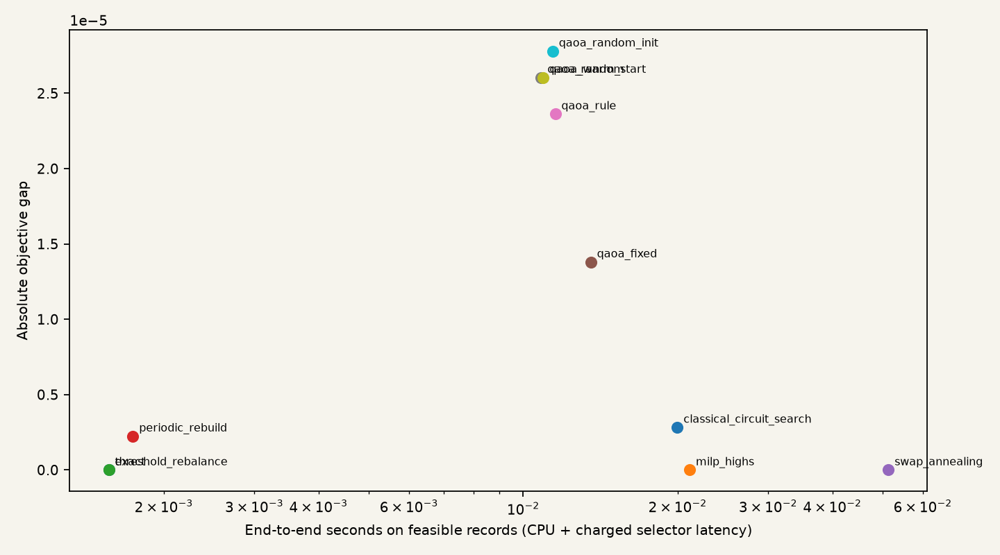
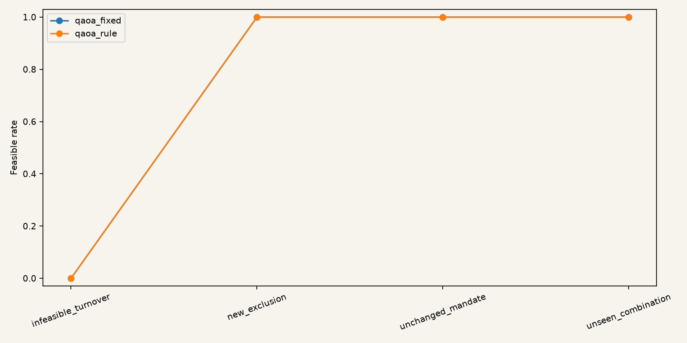

# AGQO — bằng chứng tái cân bằng theo mandate

Nguồn: or_library

Protocol SHA-256: `7d469f13e07747bb6479b367206d1478b92882c0948d7980dceb2ebad03fc7bc`

Kết quả là benchmark nghiên cứu; chưa chứng minh lợi thế lượng tử hoặc tiết kiệm thực tế cho quỹ.

Các kỳ của nguồn OR-Library chưa được xác minh tần suất; chỉ báo số liệu mỗi kỳ, không năm hóa.

| Phương pháp | Đã chạy | Hợp lệ | RMSE ngoài mẫu (%) | Turnover hai chiều (%) |
|---|---:|---:|---:|---:|
| exact | 8/8 | 6 | 1.095 | 80.319 |
| milp_highs | 8/8 | 6 | 1.095 | 80.319 |
| hold | 8/8 | 2 | 0.864 | 0.000 |
| threshold_rebalance | 8/8 | 6 | 1.095 | 80.319 |
| periodic_rebuild | 8/8 | 6 | 1.123 | 102.531 |
| swap_annealing | 16/16 | 12 | 1.095 | 80.319 |
| qaoa_fixed | 16/16 | 12 | 1.192 | 73.327 |
| qaoa_rule | 16/16 | 12 | 1.125 | 49.945 |
| qaoa_random | 16/16 | 12 | 1.079 | 42.569 |
| qaoa_warm_start | 16/16 | 12 | 1.079 | 42.569 |
| qaoa_random_init | 16/16 | 12 | 1.060 | 95.790 |
| classical_circuit_search | 16/16 | 12 | 1.060 | 83.939 |
| qwen_circuit | 0/16 | 0 | — | — |
| qwen_mandate_classical | 0/8 | 0 | — | — |
| qwen_full_pipeline | 0/8 | 0 | — | — |

Giá trị trung bình chỉ gồm nghiệm hợp lệ; tỷ lệ thất bại phải được đọc cùng. Các seed không phải các mẫu tài chính độc lập.

## Bằng chứng và giới hạn

- Exact và MILP cùng mô hình; các nhánh QAOA không được đổi universe, K hoặc mục tiêu.
- Oracle pha chéo được dựng đầy đủ trên 2^N trạng thái; đây là chi phí cổ điển tăng theo hàm mũ và giới hạn quan trọng của prototype.
- Khởi tạo previous bảo toàn số tài sản khi dùng XY; không bảo đảm mọi giới hạn ngành/turnover.
- LLM disabled/error/invalid được ghi đúng trạng thái, không thay bằng quy tắc rồi gắn nhãn Qwen.
- Chuỗi benchmark đã được mở trong quá trình phát triển; tập test là tách theo giao thức, không phải dữ liệu tương lai mới thu.
- Gap phương pháp là giả thuyết; không khẳng định tính mới tuyệt đối từ việc tích hợp.

**Hình 1. Đánh đổi tracking–turnover.** Mỗi điểm là trung bình có điều kiện trên những nghiệm hợp lệ. Đọc cùng tỷ lệ khả thi ở Hình 2; đây không phải đường biên hiệu quả đã được chứng minh. Nguồn: or_library.

**Hình 2. Tỷ lệ phương án đáp ứng yêu cầu.** Tất cả giới hạn được kiểm tra bằng mô hình gốc. Case không có nghiệm vẫn xuất hiện trong mẫu; bộ giải báo infeasible không phải là lỗi. Nguồn: or_library.

**Hình 3. Khoảng cách tới nghiệm tối ưu.** Khoảng cách tuyệt đối trên đúng cùng hàm mục tiêu; không chia cho giá trị tối ưu có thể gần 0. Phương án không hợp lệ được báo riêng. Nguồn: or_library.

**Hình 4. Kiểm tra chuẩn hóa yêu cầu.** Bộ yêu cầu tự biên soạn có nhãn chuẩn độc lập gồm diễn đạt lại, mâu thuẫn, phủ định và thiếu thông tin; kết quả nhỏ mang tính chẩn đoán. Nguồn: or_library.

**Hình 5. Độ nhạy tracking–chi phí.** Nghiệm exact trên một fixture tổng hợp riêng, thay hệ số chi phí đã khai báo. Biểu đồ minh họa đánh đổi của mô hình, không dùng để chọn cấu hình từ tập test. Nguồn: separate_synthetic_fixture.

**Hình 6. Chất lượng và tài nguyên.** Thời gian gồm dựng oracle và tối ưu; nhánh LLM tính thêm latency chọn mạch. Điểm trung bình có điều kiện không thay thế phân tích thất bại hay chứng minh speedup. Nguồn: or_library.

**Hình 7. Khả năng thích nghi theo nhóm yêu cầu.** Nhóm unseen là tổ hợp giới hạn không dùng để chọn cấu hình cố định. Nhóm không có nghiệm được giữ lại để kiểm tra phản hồi; không kỳ vọng tỷ lệ khả thi dương. Nguồn: or_library.

## Tái lập

Xem protocol.json, benchmark.json, mandates_gold.json, summary.csv và figure_catalog.json trong cùng thư mục.