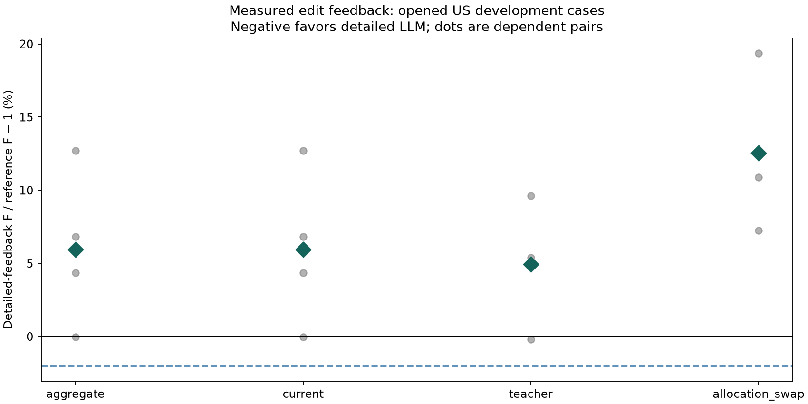

# Final live GPU findings and next decision

**The complete pipeline runs, but incremental financial value from this LLM is not established.** One pinned Qwen3-Coder-30B-A3B-Instruct checkpoint ran real inference on Modal A100 and H200. CUDA quantum simulation, independent compilation/financial checking and exported artifacts were executed. No physical quantum processor or independent investment test was used.

## Results that matter

The first live loop completed12/12 admitted designs and88/88 numerical runs. All eight revisions kept their initial physical circuit. Mean paired best allocated training F was0.77% lower than matched random architecture search, but3.16% worse than allocation-aware swap. Its registered usefulness target failed.

The final measured-edit study completed4/4 actual normal responses and28/28 numerical runs on **NVIDIA H200**. Both aggregate-feedback outputs retained the current circuit; both detailed-feedback outputs produced new physical circuit families rather than simply selecting a supplied program. The structural signature rules out simple parameter renaming and copying supplied GateIR structures; it does not certify all possible unitary equivalences or paper-level novelty. Extra feedback changed the output in these cases. That is a mechanism diagnostic, not proof of generalization or uniquely financial reasoning.

| Reference | Detailed-feedback mean best-F difference | Interpretation |
|---|---:|---|
| Aggregate feedback / unchanged current | +5.960% | Worse |
| Direct numerical teacher | +4.941% | Worse |
| Allocation-aware swap | +12.548% | Worse |

Percentages compare the best observed continuous allocated **estimation objective**, not returns. Four related pairs and previously opened stochastic seeds are descriptive development comparisons. Registered2% improvement, feasibility and novelty criteria remain unchanged; the usefulness target is **unsupported**.

## Why more context did not solve portfolio quality

The three quantities differ: immutable cost B is an equal-weight support proxy; angle fitting minimizes mean sampled allocated F; the actual decision selects the best observed F. They are not interchangeable. A better average distribution need not expose a better best candidate at a fixed draw budget. B/F formulation distortion was already demonstrated in prior audits and is not repaired by prompt text.

| Case | Final mean-F difference | Best-F difference | Circuit depth difference |
|---|---:|---:|---:|
| family1_n20_base | -4.726% | +9.764% | -1.901% |
| family1_n20_exit | +1.922% | +2.156% | -2.857% |

Both arms have2 active parameters in each case; extra parameter count does not explain this observed gap. CX counts remain998 for base and967 for exit. Depth improves only1.90%/2.86%; this is not a quality/resource dominance result. The base case improves mean sampled-F while worsening the selected best portfolio. The exit case worsens both. These are post-result diagnostics, not newly declared wins.

The model can react to scored alternatives but has not shown reliable financial circuit optimization. Combining individually scored exchanges can alter noncommuting gate order and the sampled distribution; additive benefit is not guaranteed. This is a plausible mechanism, not a causal proof. Raw explanations remain unverified prose. The direct financial search still leads.

## Practical decision

Do not promote these detailed-feedback circuits or this checkpoint as a qualified portfolio optimizer. Preserve the verified current implementation and explicit rejection/failure statuses; a circuit that passes quantum/resource checks can still fail the financial usefulness gate. No more paid attempts or size escalation are scheduled.

The next justified work is objective alignment and a real learning/evaluation design: quantify a faithful continuous-weight selection encoding or explicitly bounded surrogate, verify it against allocated F before circuit search, then consider training a bounded edit policy from scored examples across disjoint instance families. Include direct numerical selection and informed classical portfolio search. A generic LLM plus another prompt is not yet a demonstrated contribution. Earlier tail-fitting controls also failed to beat strong search; do not simply relabel that approach. Historical investable-data admission must pass before any independent market-value claim. These are dependencies, not completed results or permission to run another sweep.

## Audit and actual outputs

Final study:211 downloaded hashes checked;15,462 feasible allocations independently rescored;16,128 support observations. All8 final QPY/QASM exports parsed with immutable H identities; full statevectors explicitly skipped because these N20 circuits exceed the16-physical-qubit cap. Actual CUDA/NumPy checks and earlier small Qiskit checks support implementation correctness, not hardware advantage.

[Exact new model outputs](ACTUAL_RESPONSES.md) · [Full prompts, features and measured edits](evaluation/prepared_requests.json) · [GPU receipt](evaluation/gpu_runtime.json) · [Numerical audit](analysis.json) · [Export audit](EXPORT_AUDIT.json) · [Frozen protocol](../../../docs/research/COUNTERFACTUAL_EDITOR_PROTOCOL.md)

## Operational failures are part of the evidence

Preparation v1 exceeded context in a local tokenizer-only preflight and was never dispatched. V2 had a worker import startup failure before usable outputs. V3 was interrupted after8 actual numerical edit runs:4,418 feasible allocations independently rescored,19 captured partial files, no saved model answer/runtime/completion artifacts. Model loading or inference may have begun; this is not evidence of model incapability. Stale PENDING/empty-task call status was incorrectly treated as no execution; its zero software-reservation release was retracted and full3.64 restored. The partial run is preserved, not excluded from costs.

V4 corrected inherited budget metadata before its outputs, kept exact financial/compiler semantics and used one documented H200/A100 fallback worker to address capacity. Prompts/teacher selection were frozen before final outcome inspection. Both arms use the same declared designer-context projection; coefficients in executed COST remain exact.

[Execution deviations and correction](EXECUTION_DEVIATIONS.md) · [Interrupted-run audit](../counterfactual_editor_v3/INTERRUPTED_AUDIT.json) · [Full reconciled cost report](COMBINED_COST_REPORT.json)

Conservative reservations total **USD16.754838**, including failures, interruption and CPU preflights. This exceeds the earlier agent-chosen15USD planning cap; the explicitly renewed resource instruction/150USD policy supports a20USD operational ceiling for these existing attempts. It is not a provider invoice, account balance or isolated billed-cost assertion. All apps were observed with0 active tasks after completion.

Maintained code/docs are English.232 tests passed, with targeted tests additionally checking the one-proposal metadata and unchanged H. Earlier experiment raw outputs/source snapshots are unchanged.
