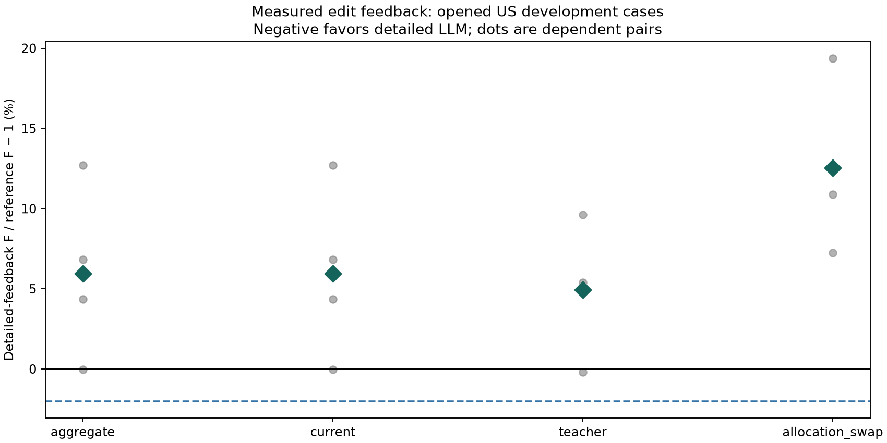

# Counterfactual gate-editor results

Registered incremental-LLM target: **unsupported**. Actual live GPU requests4; admitted4/4; completed28/28. Verified211 downloaded hashes and independently rescored15,462 feasible allocations (max residual1.63e-19).

One pinned Coder30 on one available H200/A10080GB generated actual full circuits after either aggregate-only or measured gate-edit feedback. CUDA executes quantum evolution; CPU executes compilation/control/CLARABEL allocation. All comparisons use opened, conditional US estimation data and previously opened seeds; no independent investment test or quantum hardware execution.

| Reference | Valid/4 pairs | Detailed LLM mean F difference |
|---|---:|---:|
| aggregate | 4/4 | +5.960% |
| current | 4/4 | +5.960% |
| teacher | 4/4 | +4.941% |
| allocation_swap | 4/4 | +12.548% |



## Did the model contribute a new circuit?

```json
[
  {
    "case_id": "family1_n20_base",
    "arm": "aggregate",
    "status": "ok",
    "admission": "accepted",
    "novel_vs_all_supplied": false,
    "changed_from_current": false,
    "physical_family_signature": "06f65f0f1c630577893fa61f3b6198ed59a026ab702278618c367c343ee21c18",
    "input_tokens": 11184,
    "output_tokens": 608
  },
  {
    "case_id": "family1_n20_base",
    "arm": "counterfactual",
    "status": "ok",
    "admission": "accepted",
    "novel_vs_all_supplied": true,
    "changed_from_current": true,
    "physical_family_signature": "ed52c2d37bc5cbe4a11ecec8d120d2f4447e1cbc3fc7cb5cd85bbdf13c4f0a42",
    "input_tokens": 12988,
    "output_tokens": 605
  },
  {
    "case_id": "family1_n20_exit",
    "arm": "aggregate",
    "status": "ok",
    "admission": "accepted",
    "novel_vs_all_supplied": false,
    "changed_from_current": false,
    "physical_family_signature": "0081602bfc428929eab215ae9e78fade0663c221d61a0bb284ec514bdc1f8285",
    "input_tokens": 10415,
    "output_tokens": 690
  },
  {
    "case_id": "family1_n20_exit",
    "arm": "counterfactual",
    "status": "ok",
    "admission": "accepted",
    "novel_vs_all_supplied": true,
    "changed_from_current": true,
    "physical_family_signature": "8f33c7e15c4af284af6380120f3d5e6a52cf9a379a204821bd42f749ed992c47",
    "input_tokens": 12212,
    "output_tokens": 693
  }
]
```

Physical-family signatures remove prose and parameter renaming, retaining preparation, actual gate order and sharing. Merely selecting a known numerical candidate is not an incremental LLM discovery. Both2% margins (aggregate and numerical teacher), no>5% case regression, empirical final feasibility and novelty versus all supplied candidates are required. Four dependent pairs cannot qualify a production model or financial advantage.

## Complete evidence and costs

[Exact raw responses](ACTUAL_RESPONSES.md) · [Full requests, numerical feedback and schemas](evaluation/prepared_requests.json) · [Actual GPU proof](evaluation/gpu_runtime.json) · [Source-bound historical anchors](evaluation/historical_anchors.json) · [Numerical teacher lock](evaluation/teacher_lock.json) · [All runs](metrics.csv) · [Audit](analysis.json)

The new worker took332.39s; reserved USD5.81, not an invoice. Prior source study reservedUSD3.64. Shared numerical-neighborhood costs, all new attempts and historical anchor costs remain explicit. The numerical teacher is the direct lookup control. A better model-assisted decision is not a model discovery if the program was supplied. Prior preparation v1 was stopped on tokenizer sizing with zero GPU dispatch; v2 declares a coefficient-list context projection in both arms, while exact full COST/H remains unchanged.

Historical investable-data admission and B-versus-F formulation mismatch remain unresolved. No automatic model sweep or additional paid retry is scheduled. Negative results remain part of the project.
