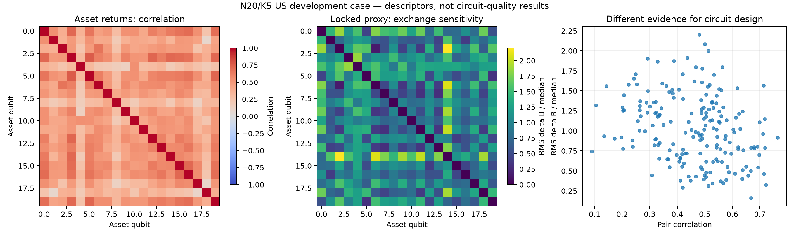

# Explicit data-to-circuit guidance: offline evidence

The previous prompt supplied data but did not require a specific feature-to-gate link. The new optional API supplies exact exchange-difference statistics and requires every chosen tree connection to cite the matching pair. No new model was run.

Correlation describes returns; exchange sensitivity additionally reflects benchmark and cost terms in the locked selection proxy. Neither implies that a pair is a good mixer edge. The figure has no measured quantum or financial performance claim.

Prepared 8 requests covering 964 permitted pair records; no stock filtering, allocation queries, new optimization or holdout scoring. Requests include every allowed pair, in rounded compact rows, and preserve the compiler-owned objective. Byte sizes below are not tokenizer counts or a context-fit certificate; actual tokenization must precede any future inference.

| Opened development case | Pair records | Largest RMS pair | Pair correlation | Request bytes |
|---|---:|---|---:|---:|
| family0_n12_base | 66 | EDGE_3_4 | 0.328 | 19,351 |
| family0_n12_exit | 55 | EDGE_3_4 | 0.328 | 18,468 |
| family0_n20_base | 190 | EDGE_2_14 | 0.480 | 24,507 |
| family0_n20_exit | 171 | EDGE_3_4 | 0.328 | 23,352 |
| family1_n12_base | 66 | EDGE_2_6 | 0.376 | 19,324 |
| family1_n12_exit | 55 | EDGE_2_6 | 0.376 | 18,460 |
| family1_n20_base | 190 | EDGE_2_6 | 0.376 | 24,480 |
| family1_n20_exit | 171 | EDGE_2_6 | 0.376 | 23,332 |

## What the LLM must decide

1. Which permitted exchange connections offer a testable tradeoff, using both sensitivity and stability rather than mechanically ranking correlation.
2. How to order overlapping/disjoint exchanges within compiled resource limits.
3. Whether one or two shared beta groups earn their additional fitting cost.

Compiler-owned preparation and cost remain locked. The response adapter rejects missing or unrelated pair citations, then independently verifies quantum semantics and resources. Explanation validity cannot substitute for measured allocated F.

## Limits and next decision

Statistics are exact for equal-weight B under cardinality/fixed bits, not for the continuous allocated objective F or all mandate inequalities. The 2010 corpus has full-year membership conditioning and artificial policy buckets. These are opened algorithm-development cases; independent financial value remains unqualified.

Compare an identical LLM with/without guidance, a deterministic feature rule, random and adaptive classical circuit search, and strong allocation-aware local search under a frozen matched total budget on untouched cases. Gate changes and plausible explanations alone are insufficient. No new paid experiment is scheduled.

Protocol: [DATA_GUIDANCE_PROTOCOL](../../../docs/research/DATA_GUIDANCE_PROTOCOL.md). API: agqo.research.guidance.guided_request / admit_guided_program. Legacy Modal request paths are unchanged; these prepared requests are not deployed live-model results.
