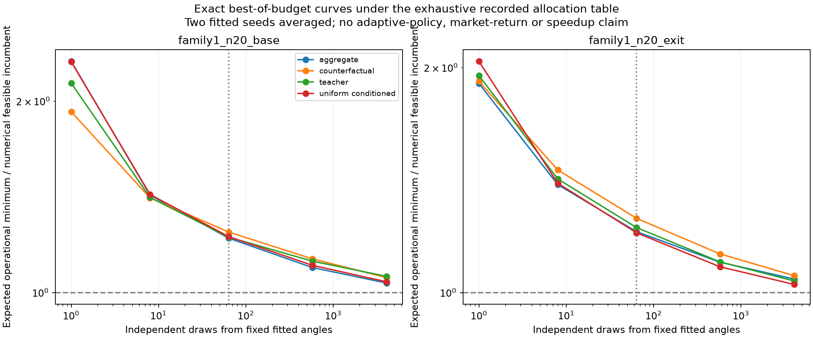
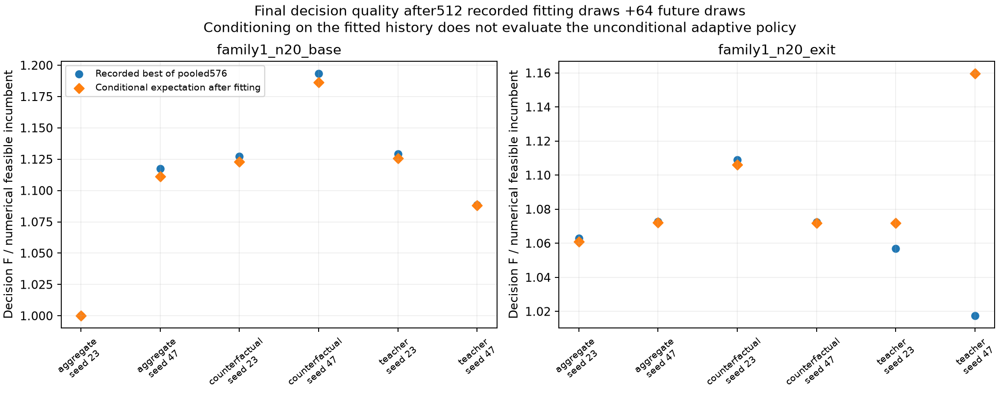
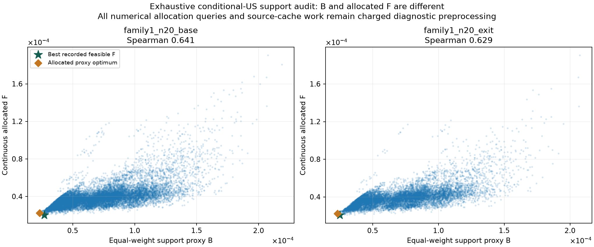

# Decision-level audit results

Full diagnostic supports:27,132; newly evaluated:10,078; independently rescored feasible allocations:27,105. Verified121 raw hashes. Logical fixed distributions:18; unique actual CUDA evaluations:12. No new LLM calls, architecture search or angle fitting.

The F table is exhaustive, classical and exponential. It supplies a numerical reference, not a production financial oracle or quantum win. Cached source generation and all new allocation costs remain explicit. Historical source admission stays closed; the two opened2010 US cases have full-year membership conditioning and artificial policy buckets.

## What differs from the previous comparison

Earlier results use the realized best from512 adaptive fitting draws +64 final draws. We now compute exact operational metrics for each fixed fitted sampler. The conditional final-decision expectation clips future64-draw scores at that run's recorded fitting incumbent. It is exact **given that realized history and this recorded allocator table**; it is not an unconditional expectation of the adaptive576-shot algorithm. Solver-status sensitivity intervals are numerical diagnostics, not formal joint certificates.

| Detailed versus aggregate, four related pairs | Mean difference |
|---|---:|
| observed_best_576 | +5.960% |
| expected_final_with_incumbent | +5.814% |
| expected_best_64_final_only | +3.264% |
| exact_mean_score | -7.978% |

Negative favors detailed guidance. These are descriptive ratios over two cases/two fitted seeds; no significance or independent market claim.

## Reference and proxy faithfulness

| Case | Support count | Solver statuses | Numerical reference complete | B-optimum allocated regret |
|---|---:|---|---|---:|
| family1_n20_base | 15504 | {"optimal": 15483, "infeasible": 21} | True | 11.072% |
| family1_n20_exit | 11628 | {"optimal": 11622, "infeasible": 6} | True | 8.354% |

A complete numerical reference reflects solver statuses, not a formal exact-arithmetic certificate. If the table is known, directly taking its minimum is the strongest trivial reference. Quantum curves do not receive free preprocessing credit.

## Limits and decision

This audit separates observed sampling outcomes, final-only distribution quality and the already-acquired fitting incumbent. It does not prove which mechanism caused an unconditional policy-level performance difference. No optimizer/default has been changed and no further paid/model sweep is scheduled by this report. Use these metrics to justify a separate fitting/formulation experiment, rather than interpreting four realized minima or a better mean as proof of financial value.

Financial rescoring residual <= 1.63e-19; independent atom-probability expectation check residual <= 9.5e-16. Reservations USD1.80, not an invoice. CPU table time:178.07s; GPU audit stage:20.41s. Cache provenance, all statuses and partial-stage accounting are retained.

[Full curves](curves.csv) · [Conditional decisions](decisions.csv) · [Audit details](analysis.json) · [Exhaustive table summary](evaluation/table_completion.json) · [Cache provenance](evaluation/cache_provenance.json) · [Cost report](orchestration/cost_report.json)
