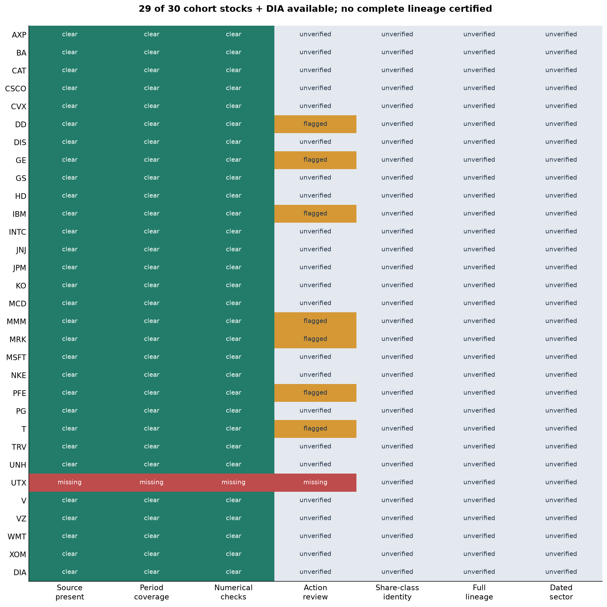
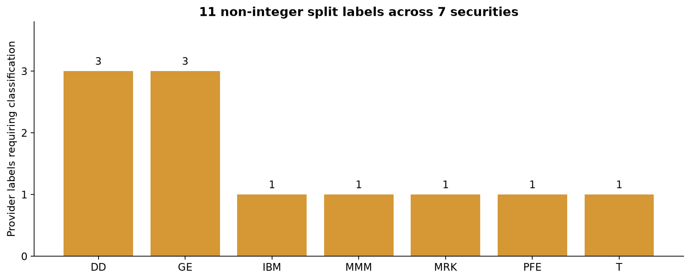
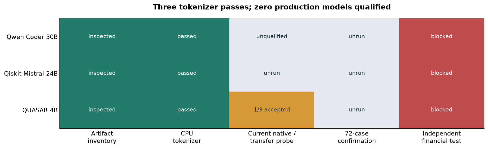
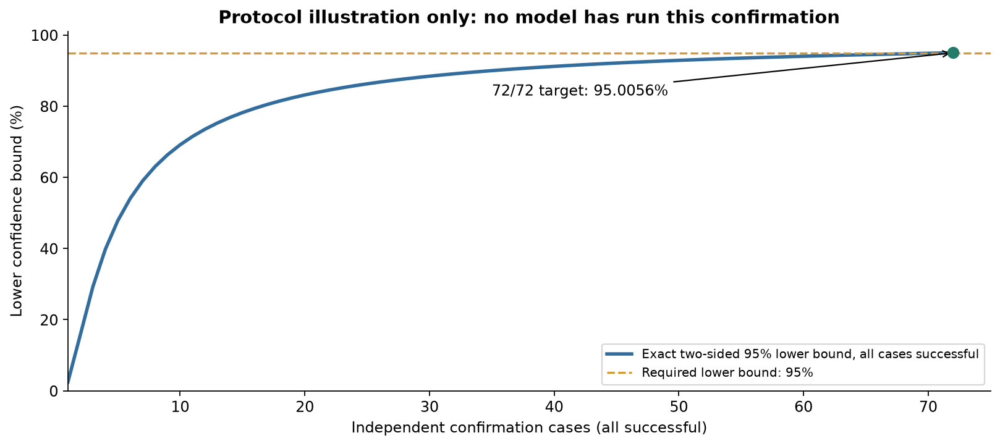
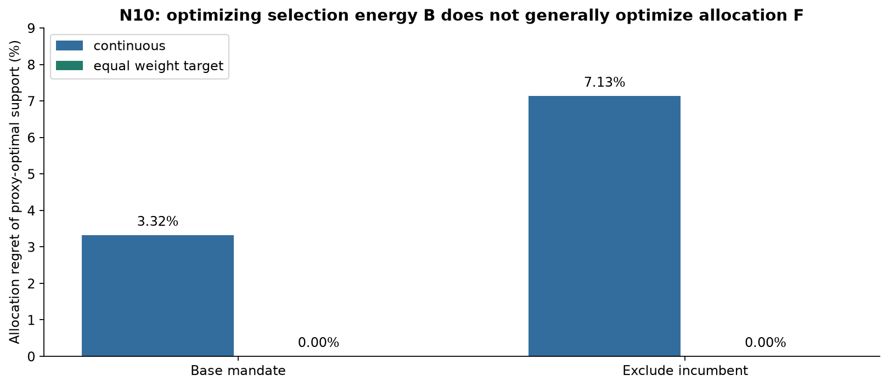
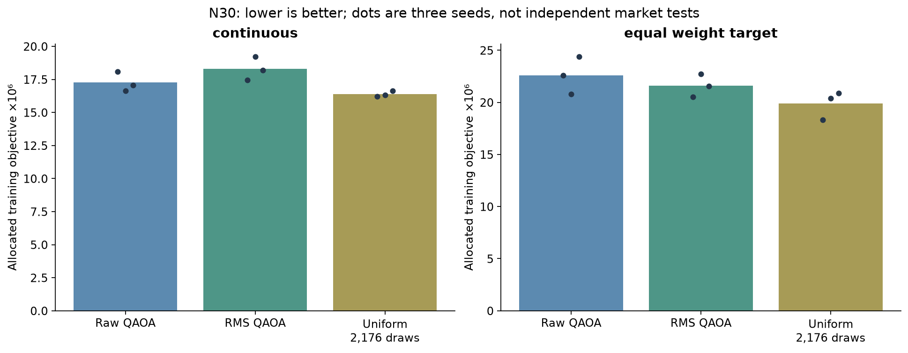
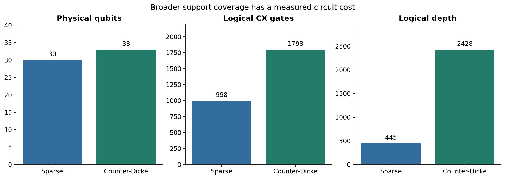
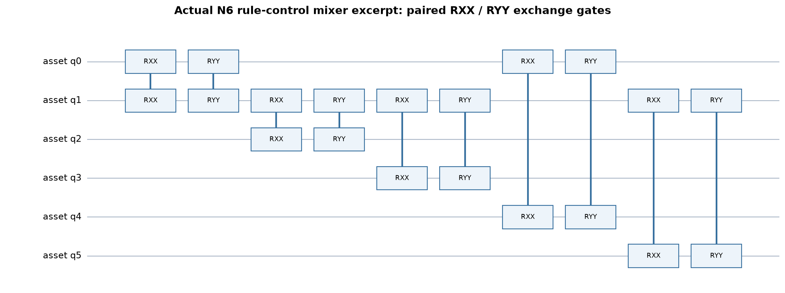

# Evidence gallery

English visual guide to recorded evidence. No new model inference, optimization or strategy outcomes.

## Historical data: numerical hygiene versus investability

Source/coverage/numerical columns are diagnostics only. Action labels flagged for review are not necessarily bad prices. All share-class, complete lineage and dated-sector reviews remain unverified; UTX is missing. DIA is an ETF proxy, not the official index.

## Provider adjustment factors need economic interpretation

The vendor may encode a spin-off or other noncash adjustment as a split. For example, a 1.046 price factor is not 0.2 Kyndryl shares per IBM share. Primary event candidates remain a partial ledger; dividends and all other actions also need source reconciliation.

## Model selection has separate gates

Artifact inspection and CPU chat rendering do not load model weights or test gate generation. QUASAR's completed interface probe accepted 1/3 tasks; older coder pilots are exploratory. The shortlist is provisional and no GPU sweep was added.

## Why a small successful pilot is insufficient

A planning illustration, not observed model performance. The locked 72-case confirmation needs 72 first-pass successes for this criterion. Independence must be justified; task seeds are not independent market or semantic cases. Do not extend the set until it passes.

## Formulation mismatch survives a better circuit

Exhaustive opened-development support audit. The continuous objective has 3.32% / 7.13% regret at the proxy optimum. Equal-weight targets pass B=F identity but define a different financial mandate. These are training-objective diagnostics, not realized returns.

## The classical control remains stronger

Opened conditional US corpus, ideal simulation. RMS coordinates improve energy geometry but worsen the continuous allocated objective here. Uniform uses the maximum optimizer-plus-final draw allowance; quantum postprocessing used final samples only. This pooling difference is explicit and no runtime or significance win is claimed.

## Coverage alone does not establish utility

Counter-Dicke reaches all 593,775 N30/K6 supports, using 33 physical qubits, 1,798 CX and depth 2,428. Workspace and cost compilation are counted. Counts assume all-to-all logical connectivity. No physical-device execution or full N33 Qiskit statevector validation is claimed.

## What circuit design changes

Drawn from the saved verified rule-control GateIR, not an LLM-generated success. Only the first asset-register mixer is shown; preparation, immutable compiler-owned COST, slack and measurement are omitted. Each RXX/RYY pair shares its angle; a lone RXX does not preserve cardinality.
