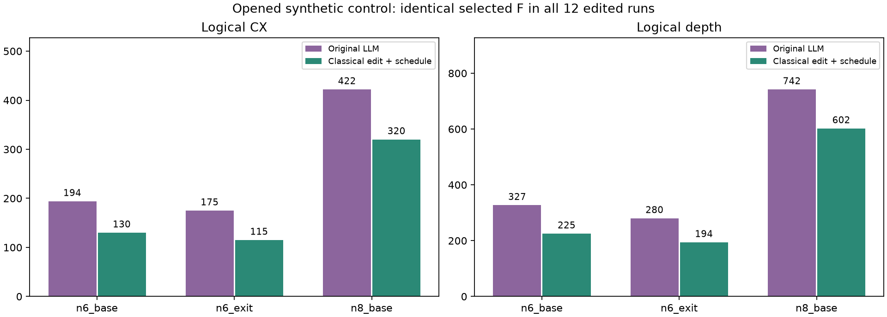
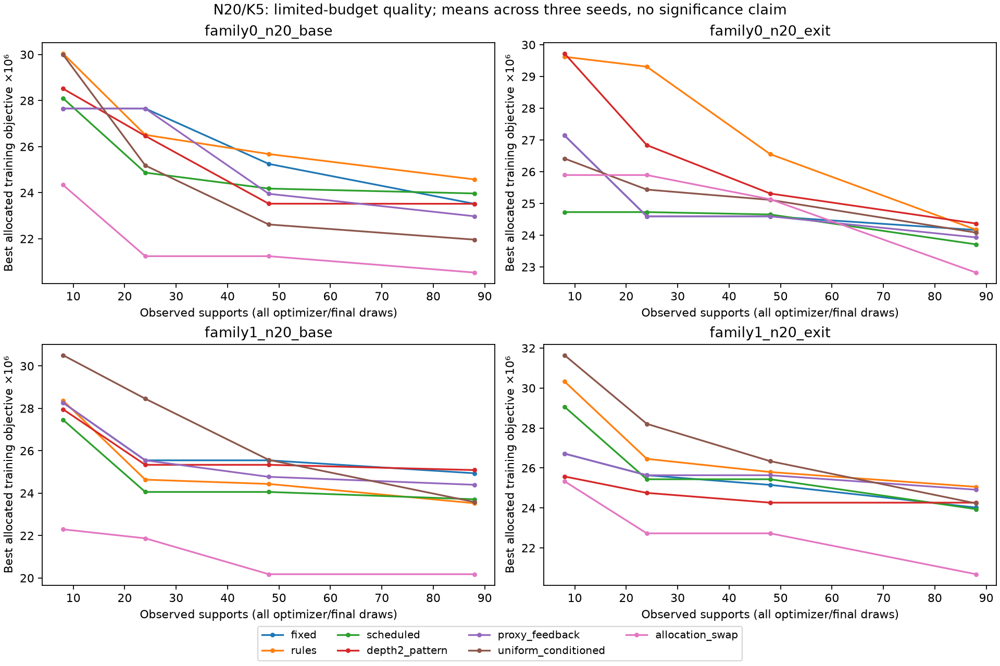
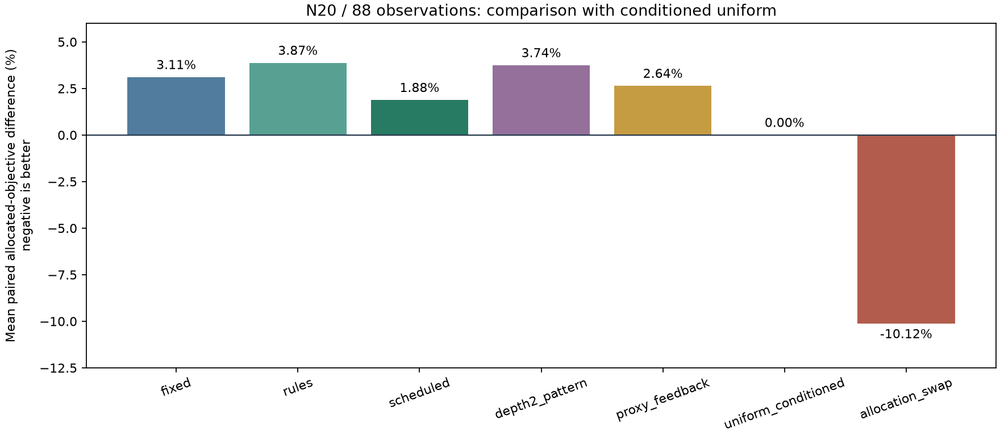

# Improvement results and technical decisions

Date: 2026-11-04. Development controls; no new LLM inference or investment-performance claim.

## Concrete circuit improvement

| Opened case | CX before → after | CX reduction | Depth before → after | Depth reduction | Same selected F? |
|---|---:|---:|---:|---:|---|
| n6_base | 194 → 130 | 33.0% | 327 → 225 | 31.2% | True |
| n6_exit | 175 → 115 | 34.3% | 280 → 194 | 30.7% | True |
| n8_base | 422 → 320 | 24.2% | 742 → 602 | 18.9% | True |

Removing the extra layer reduces both gates and parameters. Greedy edge coloring groups disjoint exchanges, reducing the scheduled critical path. This changes the unitary, so every edit was independently verified and refitted. Attribution is deterministic classical postprocessing of saved LLM proposals, not improved LLM reasoning. These are opened synthetic cases, not an independent non-inferiority study.

**Figure 1. Verified resource reductions.** Source: ablation.json. Full compiler-owned cost and counter-Dicke preparation are counted. All12 edited runs retained the original selected F within tolerance; hardware noise/routing are not measured.

## Benchmark now distinguishes methods

Two disjoint20-stock families from pinned US returns, N12/K3 and N20/K5, base/exclusion mandates, three seeds and seven methods produce168 runs and672 prefix rows. N20 base has15,504 supports; exclusion has11,628. Only first126 estimation rows were used. Full-year membership conditioning and artificial policy buckets prevent an unbiased historical financial claim.

**Figure 2. Allocated quality versus budget.** Source: metrics.csv. Lower is better. All optimizer/final observations count. Families, nested sizes, mandates and seeds are related; these are descriptive training curves, not independent market confidence intervals.

| N20 method,88 observations | Mean vs conditioned uniform | Median vs uniform | Mean vs local swap | Wins/ties/losses vs uniform |
|---|---:|---:|---:|---|
| allocation_swap | -10.12% | -11.20% | +0.00% | [12, 0, 0] |
| depth2_pattern | +3.74% | +2.68% | +15.74% | [4, 0, 8] |
| fixed | +3.11% | +2.50% | +15.03% | [3, 0, 9] |
| proxy_feedback | +2.64% | +1.66% | +14.53% | [2, 0, 10] |
| rules | +3.87% | +2.75% | +15.84% | [4, 0, 8] |
| scheduled | +1.88% | +3.87% | +13.47% | [3, 0, 9] |
| uniform_conditioned | +0.00% | +0.00% | +11.62% | [0, 12, 0] |

Positive differences mean a worse allocated training objective, not a loss in realized investment returns. Each N20 method has12 case/seed pairs, with dependencies. Uniform now respects includes/excludes and cardinality; there is no artificial forbidden-stock feasibility advantage.

**Figure 3. Stronger comparator reveals the remaining gap.** Source: paired metrics at88 observations. Negative means better than conditioned uniform. No significance or out-of-sample financial effect is asserted.

## What to keep and what to change

1. Keep one-layer resource eligibility and disjoint scheduling as explicit tested controls. The new cost-aware request API requires one layer and measured qubit/CX/depth budgets; verifier-backed admission, not prompt text, enforces resource eligibility. No new model generated a proposal under that contract in this study.
2. Keep conditioned uniform and allocation-aware local search as strong references. The original integration's tied optimum score was a ceiling effect; these budget curves are more discriminating.
3. Circuit scheduling can change the quality/resource frontier, but the current circuit family does not establish a better overall solution than strong classical search. More depth is not an earned default.
4. Mean allocated-F feedback and proxy feedback must be compared empirically. Direct F feedback aligns the scoring units but does not guarantee a better sampled portfolio; noisy low-budget fitting and circuit expressiveness remain unresolved.
5. Do not scale the LLM from this evidence. The next formulation/optimizer study must explain why the quantum sampler should improve useful-tail probability under matched total cost. Historical source reconstruction remains required before any investment test.

## Accounting and verification

- All564 downloaded files hash-checked;13048 feasible allocations independently rescored from sufficient statistics; max objective residual1.63e-19.
- Conservative CPU reservation USD0.221379; not an invoice. No GPU/model inference used.
- Quantum simulation uses the conserved subspace, crosschecked against the full executor on small instances. Large physical registers use the existing analytic certificate; no full N23 Qiskit statevector validation is claimed.
- SCIP references have their actual status, incumbent and bound in references.json. N20 time-limited incumbents are not global optima.
- Wall times include sampling/simulation/allocation; compile/verifier overhead is recorded separately once per method. Classical simulation timing does not establish a hardware speed advantage.

## Reproduction

See [frozen protocol](../../../docs/research/IMPROVEMENT_PROTOCOL.md), source_snapshot, protocol.json, ablation.json, records.json, metrics.csv, references.json and orchestration receipts. Raw/case return matrices are not published; case hashes and source-column identities permit reconstruction from the pinned local corpus.

Read [INSIGHTS.md](INSIGHTS.md) for the budget crossover, attribution and next technical decision.
