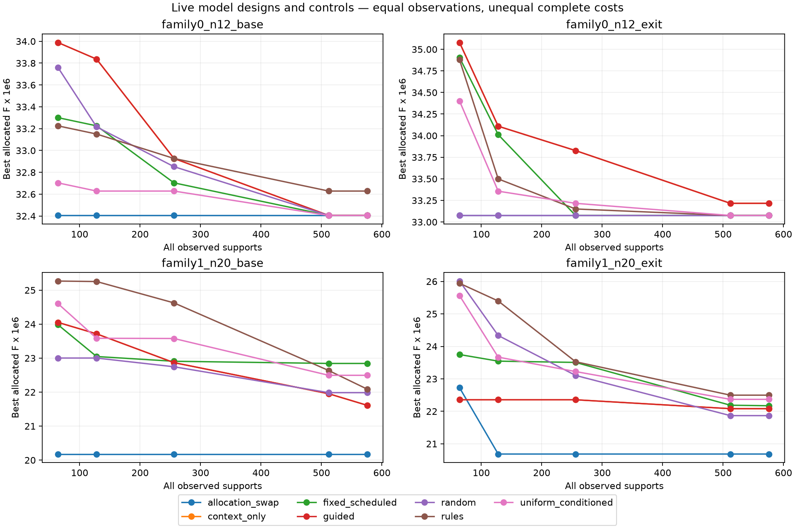
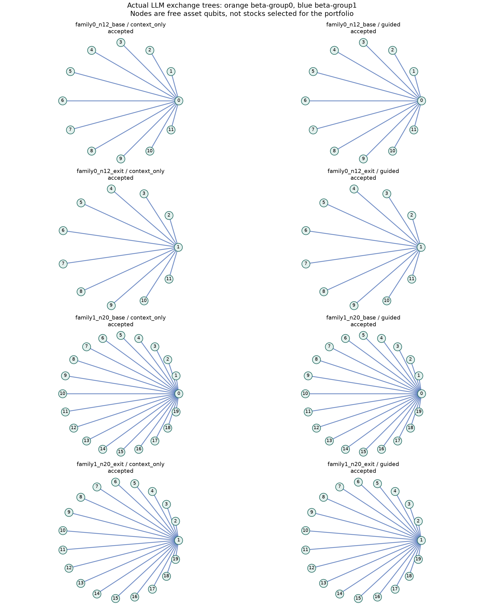

# Live LLM/QAOA guidance results

V2 is a new interface-development study: model selects edge IDs/groups once; compiler derives traceability and disjoint scheduling. Caps use the saved unscheduled fixed baseline for every method. These changes prevent attributing v1-v2 gains solely to prompting/model quality. Original v1 remains0/8 admitted. The within-v2 context/guided comparison shares schema, inputs, caps and compiler.

Real pinned Qwen Coder30 inference on Modal, followed by independent circuit/resource admission and CPU portfolio evaluation. Four opened conditional US development cases; no independent investment test or quantum hardware execution.

**Model proposals admitted: 8/8.** Completed 84 runs; 0 execution errors. Rejected proposals remain in the eight-request denominator. Acceptance means quantum/evidence/resource admission, not financial superiority.

## Exact prompts and responses

[Exact system prompts](SYSTEM_PROMPTS.md) · [All full requests](orchestration/prepared_requests.json) · [Raw answers and usage](orchestration/answers.json) · [All admissions](evaluation/admissions.json). Both arms share numerical context/schema/seed; the guided arm adds an explicit procedure. Compiler owns preparation and COST, numerical optimizer owns angles.

## Admission and resources

| Case | Arm/control | Admission | CX | Depth |
|---|---|---|---:|---:|
| family0_n12_base | context_only | accepted | 308 | 501 |
| family0_n12_base | guided | accepted | 308 | 501 |
| family0_n12_base | fixed_scheduled | accepted | 308 | 429 |
| family0_n12_base | rules | accepted | 308 | 445 |
| family0_n12_base | random | accepted | 308 | 436 |
| family0_n12_exit | context_only | accepted | 293 | 462 |
| family0_n12_exit | guided | accepted | 293 | 462 |
| family0_n12_exit | fixed_scheduled | accepted | 293 | 398 |
| family0_n12_exit | rules | accepted | 293 | 413 |
| family0_n12_exit | random | accepted | 293 | 408 |
| family1_n20_base | context_only | accepted | 998 | 1618 |
| family1_n20_base | guided | accepted | 998 | 1618 |
| family1_n20_base | fixed_scheduled | accepted | 998 | 1482 |
| family1_n20_base | rules | accepted | 998 | 1498 |
| family1_n20_base | random | accepted | 998 | 1492 |
| family1_n20_exit | context_only | accepted | 967 | 1540 |
| family1_n20_exit | guided | accepted | 967 | 1540 |
| family1_n20_exit | fixed_scheduled | accepted | 967 | 1412 |
| family1_n20_exit | rules | accepted | 967 | 1428 |
| family1_n20_exit | random | accepted | 967 | 1425 |

## Financial comparison

Positive means guided is worse. Means of paired allocated-training-objective percentage differences; comparison includes only pairs with both feasible decisions, while admission failures remain visible above. These are related cases/seeds, not returns or significance.

| Guided versus | Pairs | Mean difference | Median | Wins/ties/losses |
|---|---:|---:|---:|---|
| context_only | 12 | +0.00% | +0.00% | 0/12/0 |
| fixed_scheduled | 12 | -1.29% | +0.00% | 5/5/2 |
| uniform_conditioned | 12 | -1.20% | -0.37% | 6/5/1 |
| allocation_swap | 12 | +3.57% | +0.64% | 0/6/6 |

All methods receive576 observations/run where admitted. Actual allocator queries, cached observations, simulation calls and time differ. Full data is in metrics.csv/prefix_metrics.csv. Infeasible/unknown outcomes and final empirical gate statuses remain explicit. COST is B and allocated feedback is F, so this does not fix their formulation mismatch.

## What the model changed

| Case | Changed parent choices | Changed schedule | Changed beta groups |
|---|---:|---|---|
| family0_n12_base | 0 | False | False |
| family0_n12_exit | 0 | False | False |
| family1_n20_base | 0 | False | False |
| family1_n20_exit | 0 | False | False |

Different structures/citations alone are not evidence of useful adaptation. No automatic repair, bigger-model escalation or tuning to this result.

## Audit and cost

Verified 393 downloaded hashes and rescored 30,659 feasible cached allocations; maximum objective residual 1.63e-19. All batch/final feasibility and sample/cache/solver accounting checked independently.

Input tokens 76,782; output tokens 4,870. Total reservation USD2.083798, not an invoice. Account billing snapshots and GPU/prefetch/CPU call IDs are retained in orchestration. Build/input preparation overhead is not isolated by these function reservations or recorded evaluation timings.

## Limits and next decision

The corpus has full-year membership conditioning/artificial policy buckets; first126 observations only. This is a state-matched portfolio-repair algorithm study, not continuous investable account performance. No population-feasibility certification from empirical95% batch gates. Large circuits use analytic/conserved verification, not a claimed full N23 Qiskit statevector run.

A win against another circuit arm is a narrow result; direct allocation-aware search is the stronger financial reference. If guided proposals do not improve a useful quality/resource frontier, retain the negative result and revisit formulation/design before any model sweep.
