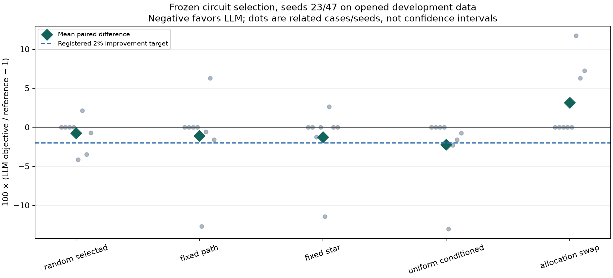
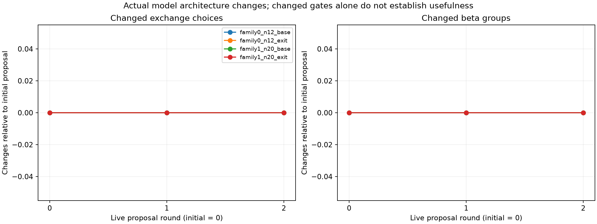
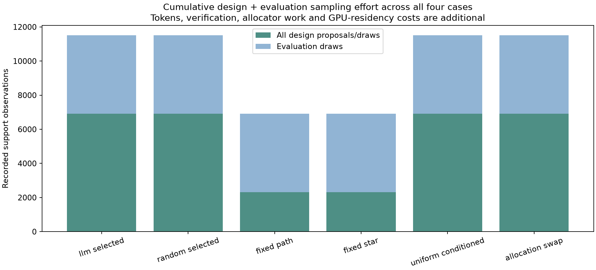

# Live GPU LLM/QAOA optimization results

**Registered usefulness target: UNSUPPORTED.** One real pinned Coder30 model generated 12 proposals in three resident-GPU rounds, with measured feedback between rounds. 12/12 proposals passed admission. 88/88 intended numerical runs completed; 0 failed/rejected runs remain in the denominator.

This is a conditional algorithm experiment on opened US development cases, not an independent financial test, investment-return result or physical quantum execution. Evaluation seeds 23/47 were previously opened; a winner lock prevents within-run seed-based architecture selection but does not create a pristine holdout.

## What actually ran

Model `Qwen/Qwen3-Coder-30B-A3B-Instruct`, revision `b2cff646eb4bb1d68355c01b18ae02e7cf42d120`, BF16/vLLM0.15, one Modal A10080GB. Real input/output tokens: 127,641/7,257. The model remained resident across three inference batches. CUDA complex128 executed state preparation, cost phases and exchange gates; CPU executed compilation, independent verification, optimizer control, sampling RNG and CLARABEL allocation in the same GPU worker. This is a hybrid workflow; allocating a GPU does not make every operation GPU work.

All 359 downloaded checksums passed. Independently rescored 36,494 feasible cached allocations, maximum residual 1.63e-19. Verified all four CUDA/NumPy amplitude checks (threshold1e-10), every completed circuit's CUDA metadata, and the winner lock/ranking. 59,904 total observations and 36,621 allocator queries were retained.

[Exact raw outputs](ACTUAL_RESPONSES.md) · [Exact system prompts](SYSTEM_PROMPTS.md) · [Prompt/schema index](prompt_index.json) · [Audit](analysis.json) · [Frozen winner lock](evaluation/selection_lock.json) · [GPU selfchecks](evaluation/cuda_selfcheck.json)

## Frozen evaluation comparison

Each entry is the mean of paired percentage differences in best allocated **training** objective F; negative favors the LLM. All intended pairs are in comparisons.csv, including failed/unavailable results. Pooled values use available valid pairs but the registered target requires all expected pairs and LLM final empirical feasibility. Related cases/seeds are descriptive observations, not independent replication or significance tests.

| Reference | Valid/expected pairs | Mean difference | Worst case mean | Wins/ties/losses |
|---|---:|---:|---:|---|
| random_selected | 8/8 | -0.766% | +0.000% | 3/4/1 |
| fixed_path | 8/8 | -1.075% | +2.344% | 3/4/1 |
| fixed_star | 8/8 | -1.259% | +0.000% | 2/5/1 |
| uniform_conditioned | 8/8 | -2.209% | +0.000% | 4/4/0 |
| allocation_swap | 8/8 | +3.160% | +6.773% | 0/5/3 |



The preregistered target requires at least2% pooled improvement against **both** matched random architecture search and fixed star, with no case-level mean regression over5%. Failure to meet either comparator, missing pairs or unqualified final LLM batches makes that target unsupported. A circuit comparison alone never establishes financial or quantum advantage.

## Architecture adaptation and attribution

Across parseable actual responses, 42/174 chosen edges equal the first presented schema enum (24.1%). First-enum choices do not comprise a majority, but enum-order bias is not ruled out; no controlled counterfactual isolates causal data/feedback adaptation.

[Per-proposal choice diagnostics](model_attempts.csv) retain ordered edge lists, edge/group hashes, equality to the previous proposal and selected-program star/path indicators. Hash equality is a structural diagnostic, not proof of financial equivalence.



LLM owns exchange-edge choices and beta sharing. Compiler owns gate scheduling, counter-Dicke preparation and immutable cost synthesis; numerical optimization owns angles. Each revision sees all preceding measured proposals. Edge enums are deterministically permuted; removing the prior first-enum star bias is an interface intervention, not evidence that the model became more intelligent. Different edges and fluent rationales are insufficient without measured usefulness. Explanations are unverified model prose.

## Complete costs and unequal fixed-reference design budgets



Per case, LLM and random search each receive three576-observation design runs (1,728 total); conditioned uniform/swap receive1,728 design observations. Fixed path/star receive one576-observation design run each. Every selected/control method then receives two576-observation evaluation runs. The fixed-versus-searched comparison is therefore **not equal in complete design budget**. Duplicate proposals, rejected/failed candidates and every fitting/final sample count; failed execution costs may be unknown rather than zero.

Recorded worker duration 1101.62s; model generation 339.57s; one model-load record 132.73s. The model stayed resident during finance work, so whole-worker GPU reservation includes that idle/host-work time. Total reservation USD3.640000, **not an invoice**. [Cost ledger](orchestration/cost_report.json) and before/after account snapshots remain in orchestration. Image builds, local input preparation and account billing changes do not constitute an isolated job bill.

## Limits and scientific decision

The source corpus is real US equity data with full-year membership conditioning. Four dependent cases use first126 estimation rows and artificial policy buckets. Historical DJIA/DIA identity/action/sector admission remains closed; no independent financial partition was opened. Empirical95% final-batch feasibility is not a population certificate. B is still the equal-weight Hamiltonian proxy while measured F comes from continuous allocation; feedback does not resolve their mathematical mismatch. Generalization, investment benefit, market deployability and quantum advantage remain unqualified.

The narrow registered usefulness hypothesis is **unsupported** on this development experiment. The result does not justify a model-size sweep. Preserve all attempts and use the strong direct finance comparison, formulation mismatch and data-admission gate to determine the next intervention.

## Explicit failures

Failure/rejection stages: {}. Admission/schema/resource rejections are distinguished from numerical design/evaluation execution failures and no-eligible-selection outcomes. No failed or rejected run was removed from the expected grid. Details follow (empty means all intended runs completed).

```json
[]
```

