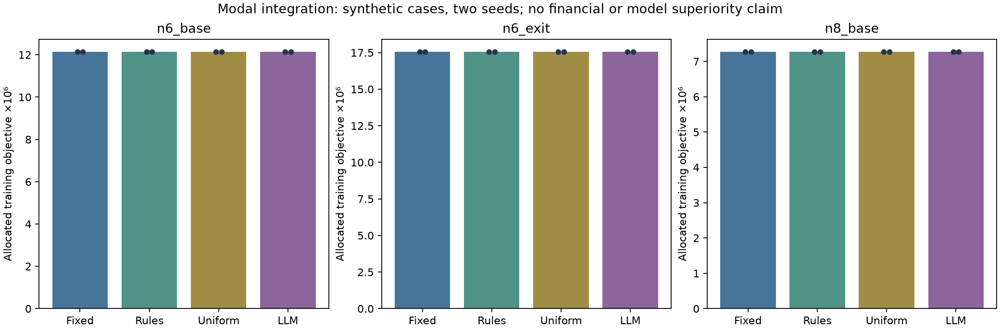
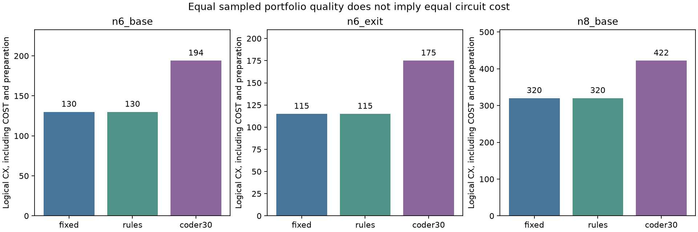

# Live Modal pipeline results

Date: 2026-11-04. **Connected integration succeeded; historical financial evaluation remains blocked.**

## What actually ran

- Model: `Qwen/Qwen3-Coder-30B-A3B-Instruct` at pinned revision `b2cff646eb4bb1d68355c01b18ae02e7cf42d120`.
- Live generation: `NVIDIA A100-SXM4-80GB`, vLLM0.15.0, batch size3, worker elapsed128.92s including model setup.
- Three proposals accepted, all with six active parameters and independently verified gate evolution. No repair or fallback.
- Cloud CPU evaluated24 decisions: three synthetic cases × four methods × two seeds;256 observations per decision,6,144 total.
- Download verified388 files. Independently rechecked24 financial objectives/trade balances and9 exported QPY/QASM circuits. See postrun_validation.json.
- Separate cloud software stage executed five two-period synthetic accounts with zero account resets, plus baseline and explicit blocked market branches.

## Measured outcomes

| Case | Selected allocated objective, all four methods | Rows feasible | Gap to exhaustive allocated reference |
|---|---:|---:|---:|
| n6_base | 1.21296206e-05 | 8/8 | 0 |
| n6_exit | 1.75391099e-05 | 8/8 | 0 |
| n8_base | 7.26579013e-06 | 8/8 | 0 |

Every method reached the same best enumerated allocated objective, within recorded numerical tolerances. This is an integration success, not an LLM performance win. The small spaces and256 observations make them easy; broader scaling needs a new development protocol.

**Figure 1. Allocated training objectives.** Source: evaluation/metrics.csv. Lower is better; dots show two seeds on each synthetic case. No out-of-sample market or statistical superiority claim.

**Figure 2. Complete logical circuit resources.** Source: recorded verification resources. Counts include compiler-owned COST and counter-Dicke workspace/preparation. All-to-all logical connectivity is assumed; these are not hardware execution costs.

The LLM chose path-shaped exchange trees and depth2 in all three cases. Valid programs therefore do not establish adaptation to the data profile. Resource and permutation/profile studies remain necessary.

## Cost and execution evidence

- Conservative total reservation: **USD2.33255**, across prepare CPU, weight-prefetch CPU, one GPU batch and finish CPU; all jobs completed.
- Tokens: **21,524 input + 855 output**.
- Account monthly metered snapshot: USD1.29907095 → USD1.53908568; this delta is not an isolated final job invoice and may lag.
- GPU is used for LLM inference. Quantum circuits are simulated on cloud CPU. Image-build spending is not separately allocated; during-build snapshot retained beside the run.

## Scope and remaining blockers

The simulator uses immutable proxy Hamiltonian B, but optimizer feedback scores actual allocated F. All optimizer/final observations join the candidate pool, and allocation/cache work is recorded. F is not a coherent quantum oracle.

These are state-matched allocation cases; continuous-account integration is in software_pipeline/synthetic_trajectory. There is no live-LLM historical walk-forward result here. Historical admission,95% independent correctness qualification, financial value and quantum advantage remain open.

The cloud market audit uses the manifest without raw provider files, so it reports unavailable remote raw files in addition to the established source-review blockers. See historical_audit_v3 for actual local coverage. Raw inputs were not silently replaced or admitted.

## Read and reproduce

- [Raw cloud report](evaluation/RESULTS.md), [metrics](evaluation/metrics.csv), [decisions](evaluation/decisions.jsonl), [references](evaluation/references.json).
- [Independent export/finance audit](postrun_validation.json), [final orchestration cost](orchestration/cost_report.json), [completed call checkpoint](orchestration/completed.json).
- [Frozen execution protocol](../../../docs/research/MODAL_E2E_PROTOCOL.md) and [runbook](../../../docs/MODAL_RUNBOOK.md).
- Running `python scripts/run_modal_pipeline.py --run-id modal_e2e_v1` reads the completed local checkpoint and schedules no new compute.

## Comparator limitation identified during review

The uniform integration control samples all K-of-N supports, including mandated
exclusions. The circuit compiler fixes excluded qubits. Therefore, the exit-case
feasibility percentages do not establish a quantum benefit over a classical sampler
conditioned on those same fixed bits. A next frozen comparison must include that
stronger conditioned sampler. All methods already tied allocated quality here;
this caveat does not reverse the reported conclusion. This is a post-run
interpretation note, with no additional experiment or changed raw score.
