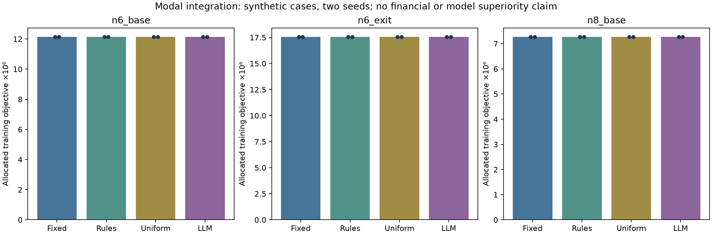

# AGQO evaluation results

Status: **completed_with_data_blockers**.

Live model designs evaluated: 3/3. Synthetic cloud integration only; historical market admission remains blocked. COST is B; sampled optimizer feedback is allocated F. No model/financial/quantum advantage qualified.

## Hypotheses

- Financial contribution: **inconclusive** until admitted market evidence and paired comparisons are available.
- LLM contribution: **inconclusive** unless the frozen design comparison establishes it.
- Quantum advantage: **unsupported** by CPU simulation.

## Measurements

| Method | Status | Net return | Tracking RMSE | Turnover |
|---|---|---:|---:|---:|
| fixed | feasible | None | None | None |
| fixed | feasible | None | None | None |
| rules | feasible | None | None | None |
| rules | feasible | None | None | None |
| uniform | feasible | None | None | None |
| uniform | feasible | None | None | None |
| coder30 | feasible | None | None | None |
| coder30 | feasible | None | None | None |
| fixed | feasible | None | None | None |
| fixed | feasible | None | None | None |
| rules | feasible | None | None | None |
| rules | feasible | None | None | None |
| uniform | feasible | None | None | None |
| uniform | feasible | None | None | None |
| coder30 | feasible | None | None | None |
| coder30 | feasible | None | None | None |
| fixed | feasible | None | None | None |
| fixed | feasible | None | None | None |
| rules | feasible | None | None | None |
| rules | feasible | None | None | None |
| uniform | feasible | None | None | None |
| uniform | feasible | None | None | None |
| coder30 | feasible | None | None | None |
| coder30 | feasible | None | None | None |

## Connected cloud stages

Cloud CPU prepared the financial/data profiles, live Modal GPU responses designed exchange gates, and cloud CPU verified, optimized sampled F, allocated supports and accounted trades.

The software_pipeline directory separately contains continuous synthetic accounts and explicit blocked market artifacts. The allocation-aware decisions here are state-matched cases, not a continuous market backtest.

**Figure 1. Allocated training objective.** Source: this run's metrics.csv. Lower is better. Dots are two seeds per synthetic case, not independent market observations. Rejected designs remain in records and do not receive fabricated scores.

All optimizer and final samples enter the financial candidate pool. COST remains the equal-weight proxy B; F is evaluated classically. Full accounting is in the local orchestration/cost_report.json after download; reservations are not invoices.
