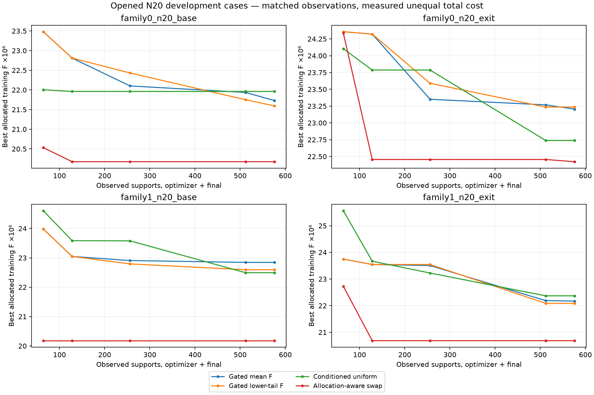
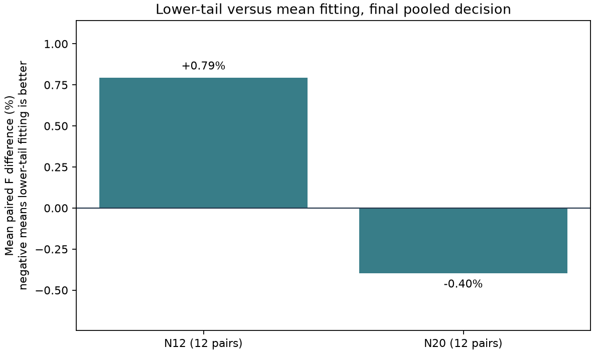
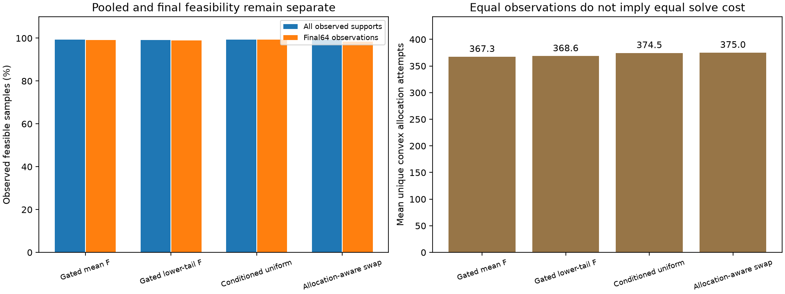

# Feasibility-gated tail-fitting results

Opened US-return development pilot, local CPU simulation/classical controls. No new LLM, GPU or quantum hardware execution; no independent financial qualification.

Study status: **completed_development_pilot**. Audited 96/96 completed runs; 0 recorded failures and 0 uncompleted slots. Failures and uncompleted work are not successful runs.

## What changed

The same compact, verified circuit is fitted using either mean allocated F or its lower-tail mean, with a separate all-shot empirical feasibility gate. COST still represents equal-weight B. This experiment tests aggregation, not a coherent F oracle or the new LLM guidance contract.

Each completed run receives576 observations (8×64 fitting plus64 final). Uniform and swap have the same observation budget. Actual allocator attempts, simulation evaluations and runtime differ; this is not matched complete cost. All observed supports enter the decision pool.

**Figure 1.** Best allocated training F versus all observed supports for N20 cases. Lower is better. Curves average available seeds; related families/mandates/seeds are not independent market samples. No significance or return interpretation.

## Paired final portfolio quality

Positive differences mean a worse allocated training objective. Values below are means of paired percentage differences, not ratios of aggregate means. Only pairs with both feasible decisions and a positive reference objective enter this descriptive table; failure counts remain above.

| Size | Method | Reference | Pairs | Mean F difference | Median | Wins/ties/losses |
|---|---|---|---:|---:|---:|---|
| N12 | Allocation-aware swap | Gated mean F | 12 | +0.00% | +0.00% | [0, 12, 0] |
| N12 | Gated lower-tail F | Gated mean F | 12 | +0.79% | +0.00% | [0, 11, 1] |
| N12 | Conditioned uniform | Gated mean F | 12 | +0.00% | +0.00% | [0, 12, 0] |
| N20 | Allocation-aware swap | Gated mean F | 12 | -7.14% | -7.42% | [11, 1, 0] |
| N20 | Gated lower-tail F | Gated mean F | 12 | -0.40% | -1.39% | [7, 1, 4] |
| N20 | Conditioned uniform | Gated mean F | 12 | -0.33% | -0.71% | [7, 0, 5] |
| N12 | Allocation-aware swap | Conditioned uniform | 12 | +0.00% | +0.00% | [0, 12, 0] |
| N12 | Gated lower-tail F | Conditioned uniform | 12 | +0.79% | +0.00% | [0, 11, 1] |
| N12 | Gated mean F | Conditioned uniform | 12 | +0.00% | +0.00% | [0, 12, 0] |
| N20 | Allocation-aware swap | Conditioned uniform | 12 | -6.77% | -7.44% | [11, 1, 0] |
| N20 | Gated lower-tail F | Conditioned uniform | 12 | -0.01% | +0.64% | [5, 0, 7] |
| N20 | Gated mean F | Conditioned uniform | 12 | +0.47% | +0.72% | [5, 0, 7] |
| N12 | Gated lower-tail F | Allocation-aware swap | 12 | +0.79% | +0.00% | [0, 11, 1] |
| N12 | Gated mean F | Allocation-aware swap | 12 | +0.00% | +0.00% | [0, 12, 0] |
| N12 | Conditioned uniform | Allocation-aware swap | 12 | +0.00% | +0.00% | [0, 12, 0] |
| N20 | Gated lower-tail F | Allocation-aware swap | 12 | +7.35% | +7.60% | [0, 0, 12] |
| N20 | Gated mean F | Allocation-aware swap | 12 | +7.90% | +8.03% | [0, 1, 11] |
| N20 | Conditioned uniform | Allocation-aware swap | 12 | +7.47% | +8.04% | [0, 1, 11] |

**Figure 2.** Lower-tail minus mean fitting at the pooled final decision. Any benefit is an aggregation result on opened data, not LLM benefit or quantum advantage.

## Feasibility and complete accounting

A run can retain a feasible observed portfolio even if its fitted sampling distribution fails the empirical95% gate. Training best-batch eligibility and final64-shot eligibility are recorded separately; neither is a population-feasibility certificate.

| Method | Completed | Mean pooled feasibility | Mean final64 feasibility | Best-fit gate passed | Final gate passed | Allocation attempts | Search seconds |
|---|---:|---:|---:|---:|---:|---:|---:|
| Gated mean F | 24 | 99.25% | 99.22% | 24/24 | 24/24 | 8,816 | 28.99 |
| Gated lower-tail F | 24 | 99.18% | 98.96% | 24/24 | 24/24 | 8,846 | 28.56 |
| Conditioned uniform | 24 | 99.26% | 99.35% | not applicable | not applicable | 8,988 | 29.59 |
| Allocation-aware swap | 24 | 99.27% | 98.44% | not applicable | not applicable | 9,001 | 30.06 |

**Figure 3.** Pooled/final sample feasibility and actual convex allocation attempts. Classical final64 means its last64 observations, not a held-out circuit distribution. Allocator caching is local to each run. Simulation and setup costs are additional.

The hit target is1.05 times a previously saved feasible5s SCIP incumbent. This is an opened-data algorithmic target, not global optimality or an economic margin. Pooled/final observed hit fractions and unknown/infeasible counts are in run_metrics.csv and analysis.json; adaptive observations are not independent Bernoulli trials.

## Target hits and compiled resources

| Method | Mean pooled observed hit fraction | Mean final64 observed hit fraction | Simulation state evaluations |
|---|---:|---:|---:|
| Gated mean F | 0.68% | 0.78% | 216 |
| Gated lower-tail F | 0.73% | 0.98% | 216 |
| Conditioned uniform | 0.65% | 0.85% | 0 |
| Allocation-aware swap | 1.35% | 0.98% | 0 |

The common circuit resources below include compiler-owned COST and counted counter-Dicke preparation. Both fitting arms use the same structure; changing the aggregation does not reduce its gates. Values are compiler resources, not noisy hardware measurements.

| Case | Physical/workspace-counted qubits | CX | Depth | Setup/verification seconds |
|---|---:|---:|---:|---:|
| family0_n12_base | 14 | 308 | 429 | 0.66 |
| family0_n12_exit | 14 | 293 | 398 | 0.08 |
| family0_n20_base | 23 | 998 | 1482 | 0.05 |
| family0_n20_exit | 23 | 967 | 1412 | 0.04 |
| family1_n12_base | 14 | 308 | 429 | 0.09 |
| family1_n12_exit | 14 | 293 | 398 | 0.08 |
| family1_n20_base | 23 | 998 | 1482 | 0.04 |
| family1_n20_exit | 23 | 967 | 1412 | 0.04 |

Total recorded setup/verification time: 1.07s. All attempted run time: 117.32413979427656s. Completed-run allocation totals exclude unknown partial work on failed/interrupted runs; no zero-cost assumption is made for that work. Local CPU only, with no new paid reservation or isolated cloud invoice.

## Independent audit

- Rescored 35,503 feasible cached allocations from sufficient statistics; maximum absolute objective residual 2.71e-20.
- Captured hashes for 325 input/run/setup/source files before derived reporting; raw files remain unchanged.
- Checked sample/cache/solver counters, support constraints, portfolio bounds, pooled best decisions and every recorded fitting/final aggregation and gate.
- Setup verification/resource records are retained. Conserved CPU simulation is exponential classical simulation, not hardware evidence.

## Interpretation and stop rule

Tail fitting is useful only if downstream quality and actual cost support it against strong controls. A win over mean fitting alone does not justify an LLM sweep. If allocation-aware swap still leads the useful frontier, preserve that result and investigate formulation/sampler limits before model escalation.

The corpus has full-year membership conditioning and artificial policy buckets. Only first126 estimation observations were used. No untouched financial test was opened; security/action/sector reconciliation remains required for investment evidence.
