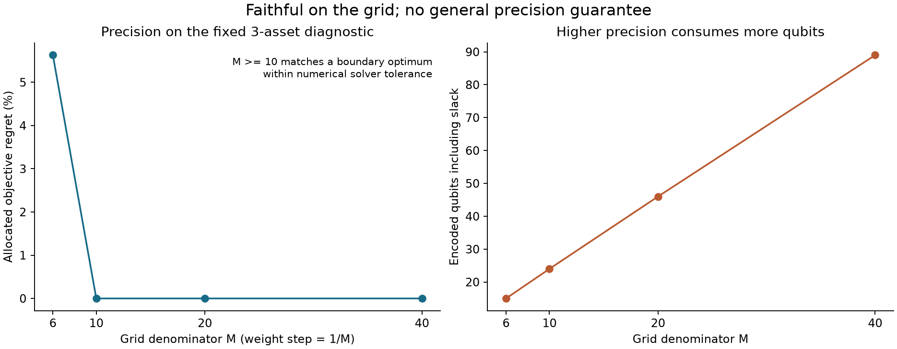
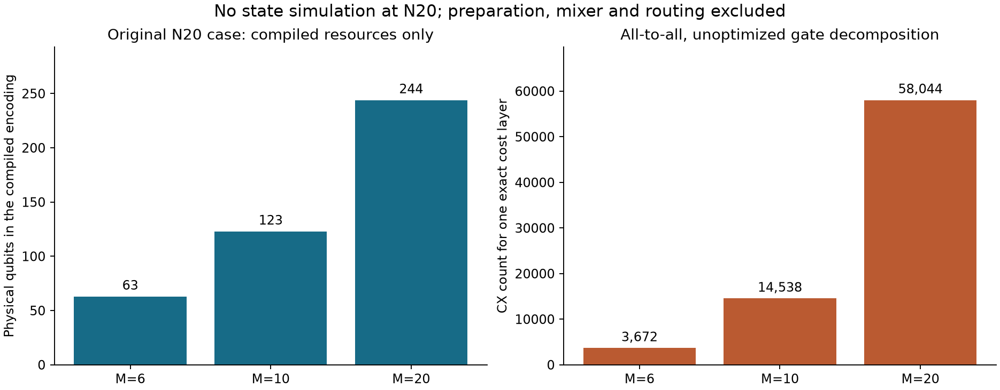

# Weight-grid formulation: correct cost, expensive encoding

Completed 2026-11-06. This is a formulation diagnostic, not an LLM/QAOA performance
experiment. No new model inference or Modal dispatch. Earlier real Coder30/H200
results remain unchanged; this study does not qualify a production model.

## What changed

The opt-in compiler represents selection **and** NAV amounts. Its financial QUBO
matches tracking plus proportional trading cost on valid amount registers; the
compiler owns those coefficients and emits explicit RZ/RZZ cost gates. Constraints
include money, cardinality, position bounds, required/excluded assets, sector counts
and weights, replacement limits and supported cash-aware turnover. Arbitrary prior
weights are allowed in costs. Capped turnover requires grid-compatible prior
holdings; unsupported drift raises an error rather than rounding. Ordinary XY
preserves bit count, not these money and per-asset amount constraints. No new mixer,
QAOA optimizer, GateIR/LLM grammar or production default is introduced here.

## Measured precision and cost

The fixed slice uses the first three assets/126 returns of the opened family1 N20
US development case, K=2 and declared policy/bounds. It is a new tiny diagnostic,
not a subset selected for performance, the original N20 problem, or an independent
financial test. Full-year universe selection and artificial policy groups remain
limitations. The data gate for historical investment claims remains closed.

| M | Qubits | Feasible grid portfolios | Regret vs continuous F | Cost CX | Full-state check |
|---|---:|---:|---:|---:|---|
| 6 | 15 | 9 | 5.6284% | 162 | passed |
| 10 | 24 | 15 | 0.0000% | 468 | skipped |
| 20 | 46 | 27 | 0.0000% | 1,846 | skipped |
| 40 | 89 | 51 | 0.0000% | 7,272 | skipped |

The M=10 optimum is weights (0.3,0,0.7), matching the numerical continuous boundary
optimum. Its raw relative residual is approximately -2.22e-12, within solver
tolerance, displayed as zero rather than a claimed improvement. Finer grids happen
to include the same optimum; this is **not** a general discretization guarantee.
M=6 has a real 5.63% approximation loss. NAV weights are not executable share lots.

| Original N20 / M | Qubits | One-cost-layer CX | One-cost-layer depth |
|---|---:|---:|---:|
| 6 | 63 | 3,672 | 361 |
| 10 | 123 | 14,538 | 712 |
| 20 | 244 | 58,044 | 1432 |

N20 resources are compiled only; no 63/123/244-qubit statevector is simulated.
These are all-to-all, optimization-level-zero costs. Initialization, mixing,
connectivity routing, noise, shots, inference and optimization are excluded.
The conservative penalty provides a mathematical ground-state validity bound,
not an optimized physical energy scale. Faithful encoding alone is insufficient
for a practical circuit. Do not describe this one-hot encoding as optimal or novel.

## Independent checks and limits

- 137 raw hashes verified; 105 feasible financial
  weights rescored directly from return residuals and absolute trade changes;
  maximum objective residual 3.253e-19. All grid-portfolio coverage checked.
- All 32,768 encoded states of the M=6 market diagnostic checked; nine zero-penalty
  states. Financial residual 2.41e-16, Ising/penalty residual 3.55e-15; Qiskit
  phase-evolution residual 1.49e-17. Two additional synthetic controls cover 64
  and 8,192 states, including cash/turnover and required/excluded holdings.
- Four QPY/QASM pairs parsed and gate schedules checked; one full-state
  crosscheck passes up to global phase. Three larger checks explicitly skipped.
- Continuous reference exhausts all three supports with optimal-status convex
  allocations. This is a numerical reference, not an exact-arithmetic certificate.
- All runtime/source/input artifacts are preserved. Successful-run wall time including input
  preparation is 2.301s on the local
  host, excluding failed preflights, tests and independent reporting; this is a
  diagnostic observation, not a complete compute-cost or CPU/GPU speed comparison.

## Execution corrections

The first local attempt saved source/inputs but failed on an incorrect provenance
key. A second preflight failed before creating v2 artifacts because the circuit-
request wrapper drops provenance. The successful controller uses the inspected
direct preparation interface. Partial v1 source and failure records are preserved;
no outcome-guided case or parameter change, paid retry, model or GPU dispatch
occurred. The executed source bytes are frozen; maintained files were subsequently
formatted without changing the recorded experiment.

## Decision

Encoding correctness on the declared grid is supported. Affordable full-scale
LLM/QAOA utility and independent financial benefit remain unproven. Keep the
continuous financial task and prior baselines. Next compare compact amount
encodings or an objective-preserving decomposition, with complete cost/error
bounds and strong classical references, before any further LLM-size experiment.
The current model is not promoted and no paid follow-up is scheduled.

[Registered rationale and papers](../../../docs/research/WEIGHT_GRID_PROTOCOL.md) ·
[Independent audit](independent_audit.json) · [Raw summary](summary.json) ·
[Financial spec](financial_spec.json) · [Prior decision audit](../decision_audit_v1/FINDINGS.md).
